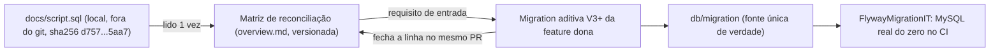

# Adotar as migrations Flyway como fonte única de verdade do schema

Histórico de status: 2026-11-12, aceito. Esta decisão substitui o trecho de
"fonte de estrutura" do rascunho do ADR-012 de 2026-11-11, que nunca teve
commit. O ADR-012 ficou só com a remoção do template, ver
[[ADR-012-remover-template-generico-do-backend]].

## Contexto e problema

Existem duas afirmações conflitantes, ambas atribuídas ao CARTOGRAFO:

* O commit `a1d2ddb` (2026-11-11) põe `docs/script.sql` no `.gitignore`. O
  motivo registrado é que o arquivo é um rascunho manual, com `DROP DATABASE`
  e nomes em PascalCase, que diverge do Flyway e "não deve virar fonte de
  verdade paralela nem ser executado".
* O rascunho do ADR-012, sem commit, declara o mesmo `docs/script.sql` como
  "única fonte de estrutura" e o chama de "cópia versionada".

As duas não valem ao mesmo tempo. Hoje o arquivo **não está versionado**:
`git log --all -- docs/script.sql` não retorna nada e
`git check-ignore -v docs/script.sql` aponta `.gitignore:41`. Ele existe só na
máquina local. O briefing (premissa 3 da F38) diz que "o schema de referência
permanece `BD/script.sql`; qualquer migration precisa casar com ele", mas esse
caminho não existe no repositório.

Além disso, a `V2__criar_schema_oficina.sql` foi escrita sem acesso ao script,
como diz o comentário dela. Ela casa com o script **em tabelas** e diverge em
**colunas**: falta `servicos.nome`, `pecas.nome`,
`movimentacoes_estoque.quantidade`, `financeiro.valor` e outras. Faltam também
as regras de `ON DELETE` e 4 índices.

Pergunta: qual artefato define o schema do sistema, o que acontece com o
script e quais são as 11 tabelas do domínio?

## Fatores de decisão

* **F1, verificação automática**: a fonte de verdade é checada por teste no CI
  (`FlywayMigrationIT` sobe MySQL real e aplica tudo do zero, conforme
  [[ADR-010-testes-de-integracao-com-testcontainers]]). Resposta sim ou não.
* **F2, fontes de schema em sincronia**: quantos artefatos versionados definem
  o schema. Alvo: 1.
* **F3, nenhum DDL destrutivo versionado**: zero `DROP DATABASE` em arquivo
  versionado que alguém possa executar por engano.
* **F4, intenção de negócio preservada**: 100% das colunas, FKs, regras de
  delete e índices do script que a V2 não tem ficam listados num arquivo
  versionado.
* **F5, escopo da F38**: zero arquivos alterados em `apps/api` por causa desta
  decisão. O guarda G-02 do PRD da F38 é "nenhuma migration além de V1 e V2".
* **F6, clone limpo**: um dev novo ou o CI consegue consultar a referência sem
  depender de um arquivo local.

## Opções consideradas

* **Opção A**: `docs/script.sql` como fonte de verdade. É o rascunho do
  ADR-012: reverter `a1d2ddb`, versionar o script e exigir que toda migration
  case com ele.
* **Opção B**: manter como está. Flyway é a fonte e o script é descartado sem
  registro do conteúdo, que é o efeito de `a1d2ddb` sozinho.
* **Opção C**: Flyway como fonte única, mais uma matriz de reconciliação
  versionada que congela o conteúdo do script como requisito de entrada. O
  arquivo bruto continua fora do git.
* **Opção D**: Flyway como fonte única, reescrevendo a V2 agora para casar 100%
  com o script antes de ela entrar na `main`.

## Resultado da decisão

Opção escolhida: **"Opção C"**. É a única que atende F1, F2, F3, F4, F5 e F6
ao mesmo tempo:

* A fonte de verdade é a que o CI executa (F1) e é uma só (F2).
* O script com `DROP DATABASE` continua fora do git (F3), o que confirma o
  `a1d2ddb`.
* O que o script sabe e a V2 ainda não tem fica versionado e revisável (F4, F6).
* Nada muda em `apps/api` na F38 (F5).

Regras que passam a valer:

1. **Fonte de verdade.** O schema do sistema é exatamente o que as migrations
   em `apps/api/src/main/resources/db/migration/` criam, aplicadas em ordem do
   zero. Nenhum outro arquivo define tabela, coluna, FK ou índice.
2. **Papel do script.** `docs/script.sql` deixa de ser fonte e vira **insumo
   histórico de requisito**. Continua no `.gitignore`, por `a1d2ddb`, e não é
   executado. A versão lida para esta decisão tem
   `sha256 d75746d0e63bebc2e4f95c3bd8aac6f5b49c1968a8038bfc0cfeb69afd235aa7`,
   com 12 `CREATE TABLE` e 12 `CREATE INDEX`. Quem tiver uma cópia diferente
   não está olhando a mesma referência.
3. **Matriz de reconciliação.** O conteúdo do script que ainda importa fica na
   seção "Reconciliação do schema com o script de referência" de
   `docs/architecture/overview.md`. A matriz é documento vivo: cada feature que
   cria a coluna fecha a linha dela no mesmo PR. A matriz traduz os nomes
   conforme [[ADR-007-nao-expor-entidade-na-api-dto-e-convencao-de-nomes]]
   (snake_case, PK `id`) e não manda copiar o script às cegas. Regra de delete
   (`CASCADE`/`SET NULL`) e nulidade são decididas pela feature dona, com
   justificativa no PR.
4. **Leitura da premissa 3 do briefing.** "Casar com o script" passa a
   significar: toda migration nova casa com a linha correspondente da matriz,
   ou registra na matriz por que diverge. Não significa reproduzir o arquivo.
5. **Sem V1 única.** Isto responde à dúvida em aberto nº 1 do PRD da F38. A
   `V1__criar_tabela_usuarios.sql` já está na `main` (F00), então absorver a V2
   nela reescreveria uma migration publicada, o que
   [[ADR-003-versionar-schema-com-flyway-migrations-aditivas]] proíbe. A V2 é
   incremento legítimo e fica como está.

### As 11 tabelas do domínio da oficina (criadas pela V2)

| # | Tabela (Flyway, fonte de verdade) | Nome no script de referência | Entidade JPA |
|---|---|---|---|
| 1 | `clientes` | `Clientes` | `Cliente` |
| 2 | `veiculos` | `Veiculos` | `Veiculo` |
| 3 | `servicos` | `Servicos` | `Servico` |
| 4 | `pecas` | `Pecas` | `Peca` |
| 5 | `ordens_servico` | `OrdensServico` | `OrdemServico` |
| 6 | `ordens_servico_servicos` | `OrdensServicoServicos` | `OrdemServicoServico` |
| 7 | `ordens_servico_pecas` | `OrdensServicoPecas` | `OrdemServicoPeca` |
| 8 | `movimentacoes_estoque` | `MovimentacoesEstoque` | `MovimentacaoEstoque` |
| 9 | `parcelas` | `Parcelas` | `Parcela` |
| 10 | `pagamentos` | `Pagamentos` | `Pagamento` |
| 11 | `financeiro` | `Financeiro` | `Financeiro` |

Fora das 11 ficam:

* **`usuarios`** (V1, F00; `Usuarios` no script; entidade `Usuario`). É a
  tabela de acesso, e por isso o script tem 12 `CREATE TABLE`.
* **`flyway_schema_history`**, a tabela de controle do Flyway.

Depois de aplicar tudo do zero, o banco tem **exatamente** essas 11, mais
`usuarios` e `flyway_schema_history`, e nenhuma tabela de template
(`Categories`, `users`, `products`). É assim que US-FUND-02-02 deve ser lido: o
"11" do critério são as tabelas do domínio da oficina e não exclui `usuarios`.

### Consequências

* Bom, porque existe uma resposta só, testável, para "qual é o schema": o que
  o `FlywayMigrationIT` sobe.
* Bom, porque o script destrutivo não volta ao git, e a contradição com
  `a1d2ddb` some sem reverter commit.
* Bom, porque o conhecimento do script fica versionado em formato revisável no
  PR (matriz) e verificável por hash, em vez de existir só numa máquina.
* Bom, porque nada muda em `apps/api` na F38, então o ESPRESSO revalida o que
  existe em vez de redesenhar schema.
* Ruim, porque a matriz é documentação e pode desatualizar. Se uma feature
  criar a coluna e não fechar a linha, ou esquecer a coluna, só a revisão de
  PR pega. Não há teste que compare a matriz com o banco.
* Ruim, porque cada feature de negócio (Catálogo, OS, Financeiro) começa com
  uma migration aditiva obrigatória antes de gravar dado. `servicos.nome`,
  `pecas.nome`, `movimentacoes_estoque.quantidade` e `financeiro.valor` são
  `NOT NULL` no script e não existem na V2.
* Ruim, porque a referência fica congelada no hash acima. Se o `BD/script.sql`
  do repo irmão mudar, ninguém aqui fica sabendo sem nova leitura.
* Neutro, porque os ADR-003 e ADR-007 (aceitos, imutáveis) ainda dizem que o
  script é "cópia versionada em `docs/script.sql`". Desde `a1d2ddb` isso é
  erro de fato, não de decisão. Este ADR corrige o fato sem reabrir aquelas
  decisões.

### Confirmação

* **CI, automático**: `FlywayMigrationIT.shouldCreateAllDomainTablesWhenAllMigrationsRunFromScratch`
  faz `containsExactlyInAnyOrder` com as 11 tabelas, mais `usuarios` e
  `flyway_schema_history`. Tabela a mais ou a menos quebra o teste. Entidade
  sem coluna correspondente quebra `ddl-auto: validate` no mesmo IT.
* **Revisão de PR, CARTOGRAFO e CORRENTE**: todo PR que adiciona migration
  precisa (a) citar a linha da matriz que fecha, ou registrar a divergência
  nela, e (b) atualizar a matriz no mesmo commit.
* **Higiene, checável por comando**:
  `git check-ignore -v docs/script.sql` deve continuar apontando o
  `.gitignore`, e `git ls-files | grep -i script.sql` deve voltar vazio.
* **Integridade da referência**: `shasum -a 256 docs/script.sql` deve dar o
  hash da regra 2. Se der outro, abrir ADR novo antes de usar a nova versão.

## Prós e contras das opções

### Opção A: `docs/script.sql` como fonte de verdade

* Bom, porque segue o texto literal da premissa 3 do briefing.
* Bom, porque o script fica disponível em todo clone (F6).
* Ruim, porque o script não roda no CI e "casar" seria comparação manual entre
  PascalCase/`cliente_id` e snake_case/`id`. Não atende F1.
* Ruim, porque cria duas fontes versionadas para manter em sincronia (F2 = 2)
  e a que de fato roda no banco é a outra.
* Ruim, porque versiona `DROP DATABASE IF EXISTS mecanicaSaoJorge`, que apaga
  o banco se rodado no ambiente errado. Não atende F3.
* Ruim, porque exige reverter `a1d2ddb`, uma decisão commitada há um dia, sem
  fato novo.
* Custo de adotar: editar o `.gitignore`, versionar o script, criar e manter
  uma revisão manual de equivalência a cada migration.

### Opção B: manter como está (Flyway sem registro do script)

* Bom, porque atende F1, F2, F3 e F5 sem trabalho nenhum.
* Ruim, porque perde F4 e F6. O que a V2 não tem (`servicos.nome`,
  `pecas.unidade`, regras de delete, índices) fica só num arquivo local
  ignorado, e quem implementar Catálogo num clone limpo não tem como saber.
* Ruim, porque a matriz atual do `overview.md` já tem erros (atribui `cpf` e
  `endereco` ao script, mas eles não estão lá) e omite itens (ver a seção de
  reconciliação). Manter como está mantém o erro.
* Custo de adotar: zero agora. O custo vem depois, como retrabalho de schema
  descoberto tarde em cada feature.

### Opção C: Flyway como fonte única, mais matriz versionada (escolhida)

* Bom, porque atende F1 a F6 (ver Resultado).
* Neutro, porque exige corrigir e completar a matriz do `overview.md` uma vez,
  e é documento, não código.
* Ruim, porque a matriz pode desatualizar sem que nenhum teste perceba. Só a
  revisão de PR protege.
* Ruim, porque empurra para cada feature uma migration aditiva antes de ela
  poder gravar dado.

### Opção D: reescrever a V2 agora para casar 100% com o script

* Bom, porque zera a dívida de colunas de uma vez: Catálogo, OS e Financeiro
  nascem com schema completo e a matriz fica só com divergências de nome.
* Bom, porque ainda é tecnicamente barato: a V2 não está na `main`
  (`git ls-tree main` só mostra a V1) e só foi aplicada em containers
  efêmeros.
* Ruim, porque fere F5. Altera `apps/api` dentro de uma correção cujo PRD
  proíbe mudança de backend além de revalidar.
* Ruim, porque obriga a decidir agora, sem o contexto da feature, regras de
  negócio que o script traz prontas e que são discutíveis. Exemplo:
  `ON DELETE CASCADE` de `veiculos` para `clientes` apaga veículo e histórico
  ao excluir cliente.
* Ruim, porque reescreve uma migration já commitada. Quebra o checksum em
  qualquer banco local de dev onde a V2 já rodou (exige `flyway repair` ou
  recriar o banco) e vai contra o espírito de
  [[ADR-003-versionar-schema-com-flyway-migrations-aditivas]].
* Custo de adotar: reescrever a V2, revisar as 12 entidades, rodar de novo o
  `FlywayMigrationIT`, e REGENTE/BUSSOLA reabrirem o escopo da F38.

## Dados pessoais (LGPD)

O script e esta decisão só tratam de DDL. Nenhum dos dois contém dado pessoal,
então tirar o script do git não tem efeito de LGPD.

Colunas com dado pessoal no schema:

* `usuarios.nome`, `usuarios.email`, `usuarios.senha_hash`: base legal e
  retenção registradas na V1.
* `clientes.nome`, `clientes.telefone`, `clientes.email`.
* `veiculos.placa`: dado pessoal indireto, porque identifica o dono.

**`cpf` e `endereco` não estão no script de referência.** Se a F09 (Clientes
criar) adicionar esses campos, é coleta nova e precisa de finalidade, base
legal e retenção registradas e revisadas pelo VIGIA antes da migration. A
matriz não justifica essa coleta.

## Mais informações

* Complementa [[ADR-003-versionar-schema-com-flyway-migrations-aditivas]]
  (migrations aditivas), [[ADR-007-nao-expor-entidade-na-api-dto-e-convencao-de-nomes]]
  (nomenclatura) e [[ADR-010-testes-de-integracao-com-testcontainers]] (IT do
  zero). Corrige o fato "cópia versionada" citado nos dois primeiros.
* Confirma o commit `a1d2ddb` e o separa do rascunho do
  [[ADR-012-remover-template-generico-do-backend]].
* Origem: PRD `docs/product/F38-correcao-template-build-ui-popups-senha.md`
  (premissa 3, US-FUND-02-02, dúvida nº 1) e
  `docs/product/F37-auditoria-sprint-01.md`.
* Features afetadas pela matriz: F03/F08/F09/F10 (clientes), F04 (veiculos),
  F05/F11/F12 (servicos), F17/F14/F15/F16 (pecas e estoque), F18/F19/F20/F21
  (OS), F07/F22 (parcelas e pagamentos), F23/F31/F32 (financeiro).
* Nenhum colega foi consultado nesta sessão (por isso `consulted` está vazio).
  REGENTE pode rejeitar antes de o ESPRESSO começar. Se rejeitar, o status
  muda para `rejeitado` com data.
* **Revisitar** se: (a) o `BD/script.sql` do repo irmão mudar (hash diferente);
  (b) a matriz ficar desatualizada em algum PR, caso em que vale avaliar um
  teste que compare `information_schema` com a matriz; ou (c) REGENTE preferir
  a Opção D enquanto a V2 ainda não está na `main`.
