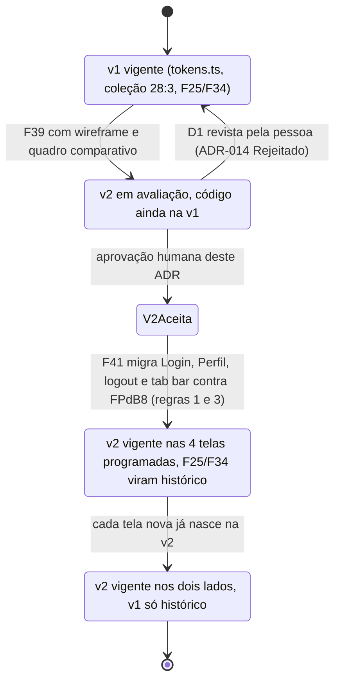

# Adotar o visual do Figma de referência como nova identidade visual do app

## Contexto e problema

A identidade visual vigente (aqui chamada **v1**) está em três lugares que já
divergem entre si: `docs/design/identidade-visual.md` (direção, 2026-11-07), a
coleção de variáveis `OP-002 Tokens de cor` do Figma
(`VariableCollectionId:28:3`, criada na F25 e reaproveitada na F34) e
`apps/mobile/src/theme/tokens.ts` (única fonte de cor do app). Em 2026-11-12,
a pessoa dona do produto decidiu (D1 da [[F39]]) que **a paleta e a
tipografia do Figma de referência** (`FPdB8RymAnN81pbKfizdzE`) passam a ser a
identidade do produto (**v2**). Login, Perfil, o diálogo de logout e a tab bar
já estão programados na v1, e a regra de paridade do briefing não admite Figma
e código divergentes ao fim de uma entrega.

Como registrar a troca de identidade sem quebrar a paridade das telas já
programadas, sem adotar ativo de licença não confirmada e sem antecipar, na
F39, trabalho de código que pertence a uma feature posterior?

### O que a leitura da referência mostrou (2026-11-13)

A primeira versão deste ADR (2026-11-12) foi escrita sem acesso à referência e
supunha que petro e primary seriam trocados. O ESQUADRO abriu a referência em
2026-11-13 e registrou os valores com saída real em
`docs/design/F39-redesenho-wireframes-navegacao.md` §2 a §5 (commit `c815235`).
Fatos que mudam o tamanho desta decisão:

1. **A cor de marca não muda.** Petro `#1E3A3F` e primary `#B5453D` são
   idênticos na referência, em `tokens.ts` e em `identidade-visual.md`.
2. **A referência coincide com `identidade-visual.md`** nos 14 hexadecimais de
   cor que o documento define. A divergência real é entre a referência (e o
   documento) de um lado e `tokens.ts` (e a coleção `28:3`) do outro: neutros
   slate, ausência de família tipográfica, escala 24/16/14/12, raio de card 12.
3. **Sete pares da referência falham em AA** (placeholder, borda de campo, três
   badges de status, item ativo da tab bar sem pill). Os pares citados neste
   ADR estão versionados em `docs/design/f39-frames/pares-contraste.csv` e são
   conferidos por `node docs/design/f39-frames/contraste.mjs` (fórmula de
   luminância do WCAG 2.2, sem dependência externa). Todos batem com a tabela
   do ESQUADRO, e o script achou dois pares que falham e que a v2 precisa vedar
   (achados 7 e 8).

Os valores da v2 citados abaixo vêm dessa leitura do ESQUADRO. **CARTOGRAFO
não abriu o Figma nesta revisão**: a origem dos valores é a spec, e os
contrastes foram recalculados por mim.

### Decisão de 2026-11-16 (F41)

Em 2026-11-16, a pessoa decidiu (D-01 a D-09 do PRD da [[F41]],
`docs/product/F41-prd-paridade-figma-fpdb8.md`, commit `00f1f17`) que
`FPdB8RymAnN81pbKfizdzE` é a **referência definitiva de alta fidelidade** de
Login, Perfil, diálogo de logout e tab bar, que **o Figma manda em tudo** e que
só barra de status, fonte do sistema e tamanho de aparelho são diferença de
plataforma. Três decisões mudam comportamento: rótulo "Usuário" com o campo
enviando e-mail (N-01), versão do app lida da configuração do Expo (N-10) e
Perfil fora da tab bar, aberto por um botão de usuário no cabeçalho (N-12). O
endpoint `POST /api/v1/auth/login` e o contrato de login não mudam.

Isso antecipa para a F41 a migração dessas quatro telas, que este ADR deixava
para depois dela. Também transforma o arquivo de referência, antes só de
leitura, na fonte do lado Figma da paridade. As regras 1, 2, 3, 6, 7, 12 e 14
foram revisadas, a regra 15 é nova, e duas seções novas fixam o pedido do
comandante: "Referência aprovada de alta fidelidade" (arquivo e nós) e "O que
conta como diferença de plataforma".

O arquivo de referência **não é "a v2 editada pela F39"**: a F39 não editou
nenhum nó dele. Ele é a inspiração externa da F39 e a origem dos valores da v2
deste ADR, e vira referência de paridade por decisão da pessoa. A v2 continua
sendo essa referência ajustada para AA (regra 5).

## Fatores de decisão

* **F1 — Decisão de produto**: a D1 já foi tomada pela pessoa em 2026-11-12. Paleta e tipografia da referência viram a identidade.
* **F2 — Paridade Figma × código**: nenhuma divergência nova nas 4 telas já programadas (Login, Perfil, diálogo de logout, tab bar) enquanto o código não migra.
* **F3 — Contraste WCAG 2.2 AA**: 100% dos pares de uso com 4,5:1 para texto normal e 3:1 para texto grande, componente de interface e anel de foco.
* **F4 — Direito de uso**: 100% dos ativos adotados (fonte, ícone, imagem) com titularidade ou licença registrada, e a fonte carregável no Expo.
* **F5 — Custo de retrabalho**: número de artefatos já aprovados a revisar (F25, F34, tokens.ts, identidade-visual.md) e de artefatos ainda não iniciados que nasceriam na v1 e teriam de ser refeitos (F26 a F29).
* **F6 — Escopo da F39 (US-WFR-04)**: nenhum arquivo de `apps/` nem `docs/design/identidade-visual.md` alterado na F39.
* **F7 — Referência única de paridade** (2026-11-16): cada tela programada tem 1 arquivo e 1 lista de nós aprovados, e a lista do que é diferença de plataforma é fechada (0 casos decididos na hora da conferência).

## Opções consideradas

* **A** — Manter a v1 de `tokens.ts` e usar a referência só como estrutura de navegação (status quo, PRD F39 v1).
* **B** — Adotar a referência, ajustada para AA, como v2, em transição controlada. A F39 entrega só o wireframe e o quadro comparativo. A aplicação em `tokens.ts`, `identidade-visual.md` e nos protótipos fica para feature posterior. No Figma, a v2 vive numa coleção de variáveis separada até a migração.
* **C** — Adotar e aplicar tudo de uma vez na F39 (big bang): F24, F25, F34, `tokens.ts` e `identidade-visual.md`.
* **D** — Híbrido: manter os neutros slate de `tokens.ts` e adotar só a tipografia, o espaçamento e o raio da referência.

## Resultado da decisão

Opção escolhida: **"B — adotar a referência ajustada para AA como v2, em
transição controlada"**. A justificativa, fator a fator:

* **F1**: B e C são as únicas opções que cumprem a D1 por inteiro. A contraria a D1, e D cumpre só a parte de tipografia e forma.
* **F2**: B não toca nada do que está programado. C só manteria a paridade se mudasse o código no mesmo PR, o que a F39 proíbe (F6).
* **F3 e F4**: B mede o contraste antes de qualquer valor virar token e adia ícone e imagem até a D2.
* **F5**: B impede que F26 a F29 nasçam na v1. O custo é revisar F25 e F34 uma vez, inevitável em qualquer opção que cumpra a D1.
* **F7** (2026-11-16): B, com as regras revisadas, aponta um arquivo e uma lista de nós por tela e fecha a lista de plataforma. A e D manteriam a F25 e a F34 como referência, contra a D-01 da F41. C já previa a troca de uma vez, mas continua violando a F6.

### Regras de transição (parte da decisão)

1. **Login, Perfil, diálogo de logout e tab bar migram na F41** (revisada em 2026-11-16, D-01 da F41). Para essas quatro telas, a F41 é a feature de migração da regra 3, e a referência aprovada é a da seção "Referência aprovada de alta fidelidade". Os frames da F25 (página `28:2`) e da F34 (página `39:2`) do arquivo `DLqbSzzKRxiN2eyvXG73Lr` deixam de ser referência de paridade, não são apagados nem editados e ficam como histórico da v1. Nenhuma outra tela está programada hoje; cada tela nova nasce direto na v2. Texto anterior (2026-11-13): "A v1 continua valendo para o código e para os frames aprovados da F25 e da F34 até a feature de migração".
2. **As variáveis semânticas da v2 vivem no arquivo de referência** `FPdB8RymAnN81pbKfizdzE`, numa coleção `OP-002 Identidade v2` com o contrato da seção "Coleção v2 e componentes estruturais no Figma" (revisada em 2026-11-16). Motivo: a paridade compara o código com o frame aprovado, e o frame aprovado agora está nesse arquivo. Uma coleção em outro arquivo não governaria os frames conferidos. Hoje o arquivo só tem primitivos importados, sem semânticos (leitura do ESQUADRO, 2026-11-14). A coleção `28:3` do arquivo da operação continua sem edição. Se a F39 tiver criado uma coleção v2 no arquivo da operação, ela vira cópia de consulta e não recebe valor novo: valor muda primeiro no arquivo de referência e em `tokens.ts`, na mesma entrega. Texto anterior (2026-11-13): a v2 entrava numa coleção nova do arquivo da operação.
3. **A troca v1 → v2 é atômica por feature de migração.** O mesmo PR altera `tokens.ts`, vincula os frames das telas programadas à v2, atualiza `identidade-visual.md`, ajusta os testes de componente e anexa a captura lado a lado no protocolo da F41. O fatiamento e a ordem são a D3, decidida por quem prioriza o backlog com a REGENTE, e não por este ADR.
   Para Login, Perfil, diálogo de logout e tab bar, esse PR é o da F41 (revisão de 2026-11-16), contra os frames da seção "Referência aprovada de alta fidelidade". A atualização de `identidade-visual.md` descrita em "O que muda, artefato por artefato" entra inteira nesse PR, porque o documento é um só e uma troca pela metade o deixaria descrevendo duas identidades. Valor sem consumidor no código fica marcado no documento como "entra com o primeiro consumidor" (regra 10).
4. **Token da v1 sem equivalente na referência mantém o valor da v1.** Hoje: anel de foco (petro + halo branco), borda de skeleton (`slate200`) e `radius.lg` (16). Esse token aparece no quadro como "sem equivalente na referência" e só muda por decisão registrada. Nenhum valor é inventado para preencher a lacuna.
5. **A v2 é a "referência ajustada para AA", não uma cópia literal.** Um par que falha entra na v2 com o valor ajustado, e o quadro registra antes e depois (US-WFR-10). Os ajustes já propostos estão na seção "O que muda, artefato por artefato". O anel de foco duplo de `use-focus-ring.ts` continua válido na v2, porque petro, branco e primary não mudam (petro/branco 12,12:1); ele só é reconferido sobre o fundo novo Pampas (petro/Pampas 11,14:1, passa).
6. **Fonte, ícone e imagem**: Barlow Condensed e Inter **não dependem da D2**, porque já estavam em `identidade-visual.md` §3 desde 2026-11-07 e são OFL-1.1, com pacote `@expo-google-fonts/*` (versões e licença verificadas pelo ESQUADRO com `npm view`, spec §3; não reverificado por mim). A fonte é embutida no bundle por `expo-font`, nunca carregada de CDN em tempo de execução. **Ícones e imagens da referência** (175 símbolos na página `1:66`) só entram com a D2 respondida. Até lá, a v2 reproduz só estilo.
   Na F41 (revisão de 2026-11-16), Barlow Condensed e Inter entram por `@expo-google-fonts/barlow-condensed` e `@expo-google-fonts/inter`, embutidas por `expo-font` (já em `package.json`), com o README principal atualizado na mesma entrega. O ORLA reconfere versão e licença com `npm view` antes do commit (P-05 do PRD da F41). O **escudo** da referência (84 × 96) é imagem e segue a parte de ícones e imagens desta regra. Formato recomendado, se a D2 liberar: PNG em `apps/mobile/assets/images/`, nas densidades 1x, 2x e 3x, carregado por `require` com o `Image` do React Native, sem dependência nova. SVG exigiria `react-native-svg`, que não está no `package.json` (conferido em 2026-11-16). Ícone desenhado no próprio código que só reproduz a forma da referência (o círculo com `!` da R-02, os ícones da tab bar) é estilo, não ativo exportado, e não depende da D2.
7. **Portão** (revisada em 2026-11-16). (a) Nenhum commit de código da F41 que dependa deste ADR entra com o ADR em `Proposto` (regra da casa: o ADR é revisado antes da implementação). (b) O escudo e qualquer vetor ou imagem exportado do arquivo de referência só entram com a D2 respondida (regra 6). Até lá, a correção correspondente fica bloqueada e registrada, sem substituto improvisado (P-05 do PRD da F41). (c) Protótipos novos de F26 a F29 continuam exigindo a aprovação da F39 registrada por BUSSOLA (US-WFR-07). Essa aprovação deixa de ser condição para as quatro telas da F41, que saem do alta fidelidade da F39 (PRD da F41, §6 item 4, a confirmar pela pessoa). O portão "protótipo aprovado antes do front" é regra do briefing, e não do ADR-007 (ver "ADRs existentes afetados"). Texto anterior (2026-11-13): o portão exigia F39 aprovada, D2 respondida e ADR `Aceito` antes de qualquer revisão de F25 ou F34.
8. **Nenhuma chave semântica exportada de `tokens.ts` é renomeada ou removida na migração.** As chaves de `color.*`, `spacing`, `radius`, `typography` e as demais exportadas são o contrato que os componentes consomem; a migração troca valor e acrescenta chave. Os primitivos (`primitiveColor`, não exportado) podem ser renomeados, porque nenhum arquivo fora de `tokens.ts` os importa (conferido por `grep` em `apps/mobile` em 2026-11-13). Motivo: a troca de identidade não pode exigir edição em cada componente, senão deixa de ser atômica (regra 3).
9. **Cor de erro com primitivo próprio e dois papéis de texto** (achado 1): `color.text.error` aponta hoje para `primitiveColor.primary600`, o mesmo primitivo da ação primária. Na migração, erro ganha primitivo próprio (`error600`, hoje com o mesmo valor `#B5453D`), para que uma mudança futura de marca não altere o erro e vice-versa. O texto de erro tem dois papéis: `color.text.error` (mensagem sob o campo, Crail, lida em `10:1861` e `10:1872`) e `color.text.errorOnBanner` (texto do banner, El Salva, lido em `10:976`). `color.text.error` nunca vai sobre `color.surface.errorBanner` (Crail sobre Pot Pourri dá 4,50:1, sem folga). Revisado em 2026-11-13 a partir da leitura do ESQUADRO (spec F39 §4.2.1): a versão anterior deste ADR propunha El Salva para os dois papéis.
10. **Token só entra em `tokens.ts` quando um componente o consome.** Cores de status de OS e de parcela, aviso e sucesso entram na feature que programa o primeiro componente que as usa, sempre com o valor da coleção v2 nos dois lados. Motivo: o briefing proíbe código morto; um token sem consumidor não tem teste de componente que o confira.
11. **Texto nunca sobre skeleton** (achado 8): `color.text.secondary` sobre `color.surface.skeleton` dá 4,44:1 (par P01 do verificador). No estado Carregando, a mensagem de carregamento fica sobre `color.surface.background` ou `color.surface.default`, e o bloco de skeleton não leva texto.
12. **Item selecionado da navegação inferior** (revisada em 2026-11-16, D-05 e D-07 da F41). Vale a estrutura da referência: sem pill, com ícone e rótulo do item selecionado em outra cor (símbolos `20:1102` e `20:1340` da leitura de 2026-11-14). O pill da F34 sai. A cor Crail direto sobre petro (2,24:1, par P02) não entra como está: o ESQUADRO propõe uma cor, e a pessoa aprova antes de ela mudar no Figma e em `tokens.ts`, na mesma entrega. A cor proposta precisa de 4,5:1 no rótulo e 3:1 no ícone, medidos sobre petro. O item selecionado também se distingue do inativo por um sinal que não é cor (SemiBold contra Medium, como na referência) e expõe `accessibilityState.selected`, para não depender só de cor (WCAG 1.4.1). Se a P-01 do PRD da F41 fechar sem item habilitado, o estado selecionado não aparece no app em execução e é provado por render do componente isolado, declarado como tal. Texto anterior (2026-11-13): o pill do F34 continuava, com três sinais.
13. **Forma da coleção v2 no Figma e dos componentes de cabeçalho e navegação inferior**: contrato na seção "Coleção v2 e componentes estruturais no Figma".
14. **Chaves que a F40 e a F41 acrescentaram a `tokens.ts` entram no contrato da regra 8** (achado 9). A branch `feat/f41-paridade-correcoes`, que contém a F40, acrescenta ao `tokens.ts` do `main` chaves que já têm consumidor: `color.surface.errorTint` (`inline-alert.tsx`), `color.text.placeholder` (`text-field.tsx`), `color.border.divider` (`profile-summary.tsx`), `color.focus.ringOnBrand` (`tab-bar-item.tsx`), oito papéis novos de `typography` e os grupos `borderWidth`, `opacity`, `iconSize` e `layout`. A migração parte do `tokens.ts` que estiver no `main` quando ela abrir: troca valor e não renomeia nem remove essas chaves. Onde este ADR chamava um papel por nome novo, vale a chave que já existe: o papel `color.surface.errorBanner` (regra 9 e rastreabilidade) é a chave `color.surface.errorTint`, e o papel `color.border.subtle` é a chave `color.border.divider`. Duas restrições medidas em 2026-11-13: (a) `color.surface.errorTint` hoje é Crail a 8% de opacidade; o texto Crail dá 4,83:1 sobre ele composto em branco (par V27) e 4,46:1 composto sobre o fundo Pampas da v2 (par P03, falha). Na v2 a faixa fica opaca, Pot Pourri `#F6E7E5`, com texto `color.text.errorOnBanner` (El Salva, 6,26:1, par V09; 6,20:1 mesmo se a faixa continuar translúcida, par V28). (b) Placeholder só sobre `color.surface.default`: o slate500 atual direto sobre Pampas dá 4,37:1 (par P04, falha), e na v2 ele vira Flint (5,36:1 sobre branco, par V04).
    **Revisão de 2026-11-16:** a F40 entrou na `main` pela PR #10 sem essas chaves, e a `feat/f41-paridade-correcoes` não é ancestral da `main`. O `tokens.ts` da `main` (`348a43e`) tem só `color.surface` (`default`, `skeleton`, `brand`, `overlay`), `color.text` (`primary`, `onBrand`, `secondary`, `onPrimaryAction`, `error`), `color.border` (`default`, `skeleton`), `color.action.primaryBackground`, `color.focus` (`ring`, `ringOffset`), os cinco papéis de `typography`, `borderWidth.hairline`, `opacity`, `iconSize` (`tab`, `alert`, `empty`), `layout` (`dialogMaxWidth`, `tabBarMaxWidth`) e `glyph.alert`. Para a F41, as chaves desta regra são novas. Quando um componente precisar de uma delas, ela entra com o nome já fixado aqui (`surface.errorTint`, `text.placeholder`, `border.divider`, `focus.ringOnBrand`) e nunca com um terceiro nome (regras 8 e 10). As chaves de medida que a branch antiga criou (`inlineAlertMinHeight`, `tabItemHeight`, `pageButtonHeight`, `avatarSize`) seguem a mesma regra, com o valor do frame novo (regra 15).
15. **Medida visível da referência, área de toque da casa** (nova em 2026-11-16, P-04 do PRD da F41). A medida visível segue o frame: campo de 46, botão de página de 50, barra de navegação de 62 e botão de ícone do cabeçalho com fundo de 36. A área de toque continua com no mínimo `minTouchTarget` (48), por `hitSlop` ou por área transparente em volta do controle. Essa área não aparece na captura e por isso não é divergência visual. Onde o componente não aceitar área estendida sem mudar o desenho, o ORLA registra o caso e ele volta à pessoa pela P-04. Nenhum alvo fica abaixo de 24 × 24 (WCAG 2.2, critério 2.5.8). Para as quatro telas, esta regra substitui a recomendação do achado 5, que continua valendo como risco.

## Referência aprovada de alta fidelidade: Login, Perfil, diálogo de logout e tab bar

Decisão da pessoa em 2026-11-16 (D-01 e D-02 do PRD da F41, commit `00f1f17`).
Os nós vêm da leitura do ESQUADRO em 2026-11-14
(`docs/design/F41-rodada-figma-fpdb8.md`, branch `docs/f41-rodada-figma-fpdb8`,
commit `f2833aa`). **CARTOGRAFO não os reabriu**: o Figma foi negado nesta sessão
(ver "Mais informações"). A confirmação por nó é a primeira tarefa do ESQUADRO
(ver "Confirmação").

* **Arquivo**: `FPdB8RymAnN81pbKfizdzE`.
* **Página**: `20:2132` "02 — Alta fidelidade", seção `10:3936`.
* **Frame de tela**: 360 × 740 (frame externo 362 × 772).

| Tela e estado | Frame | Nó | O que vale como referência |
|---|---|---|---|
| Login, estado inicial (vazio) | 1a — Login | `10:895` | Estrutura, textos, tokens e ícones do Login; estado vazio |
| Login, erro de credencial | 1b — Login — erro de credencial | `10:936` | Caixa de erro, bordas dos dois campos em erro, mensagem genérica sem indicar o campo |
| Perfil, preenchido | 1av — Perfil | `10:3842` | Cabeçalho com seta de voltar, avatar, nome, selo, cartão, botão "Sair da conta"; tela sem tab bar |
| Diálogo de logout | 1aw — Sair — confirmação | `10:3886` | Título, mensagem, ordem Cancelar e Sair, scrim |
| Tab bar, Ordens selecionado | símbolo | `20:1102` | Barra de 4 itens, ordem, rótulos, medidas, item selecionado e inativo |
| Tab bar, Clientes selecionado | símbolo | `20:1340` | Item selecionado fora da primeira posição |
| Cabeçalho com botão de usuário | dentro do frame 1c (tela Ordens de Serviço, sem conexão) | `10:981` | **Só** o cabeçalho e o botão de usuário 36 × 36 no canto direito. O corpo da tela (Ordens, sem conexão) não é referência da F41 |

**Não são referência de paridade:**

* `20:2131`: é a página "01 — Wireframes" (baixa fidelidade), citada no briefing como frame de alta. Continua sendo a página de inspiração do baixa da F39.
* `20:968`: é um rótulo de texto ("Navegação inferior / OS · Clientes · Catálogo · Financeiro / 3"), citado no briefing como frame de baixa.
* Arquivo `DLqbSzzKRxiN2eyvXG73Lr`: frames da F25 (página `28:2`: `29:2`, `29:20`, `29:35`, `29:56`, `29:79`, `33:2`, `33:14`, `33:33`, `33:49`) e da F34 (página `39:2`: `39:3`, `39:31`, `39:58`). Viram histórico da v1 e não são editados nem apagados. As capturas deles de 2026-11-13 estão em `docs/design/f41-capturas/figma-*.png`, na branch `docs/f41-rodada-figma-fpdb8`, e são o "antes" desta troca.
* Os demais frames da seção `10:3936` (Clientes, Catálogo, Ordens, Financeiro): são inspiração da F39 e de F26 a F29, não referência de paridade, porque nenhuma dessas telas está programada.

### Estados que o código tem e a referência não tem

Pela D-06 da F41, cada um é **divergência real aberta** até ter frame aprovado ou "não se aplica" registrado pela pessoa com o frame visto.

| Tela | Estados sem frame em 2026-11-16 |
|---|---|
| Login | carregando ("Entrando..."), preenchido sem erro, erro de conexão, sessão expirada, foco de campo, botão "Mostrar senha" (N-05, P-06 do PRD) |
| Perfil | carregando, erro |
| Tab bar | foco, desabilitado |

Como um estado entra na referência:

1. O ESQUADRO desenha o frame no arquivo `FPdB8RymAnN81pbKfizdzE`, página `20:2132`, numa seção própria "F41 — estados propostos". O nome do frame termina em " — proposto", segue o estilo dos frames da tabela acima e se liga à coleção v2 (regra 2).
2. A pessoa aprova vendo o frame. A aprovação é registrada com data no PRD da F41, e o frame perde o sufixo " — proposto". Só então ele entra na lista viva de `docs/design/figma.md`.
3. Se a pessoa decidir que o estado não se aplica, a justificativa fica no PRD. O código remove o estado na mesma entrega ou o mantém por decisão registrada. "Não se aplica" sem frame visto não vale.

### Edição do arquivo de referência

1. **Lista viva**: `docs/design/figma.md` (ESQUADRO) guarda a lista viva de nós aprovados. Este ADR fixa a regra e a lista de 2026-11-16. Nó novo aprovado entra só na lista viva e não reabre o ADR.
2. **Antes de editar** qualquer frame da tabela (decisão a favor do código, token, ligação a variável), o ESQUADRO captura o frame como está e versiona a captura junto da conferência, como foi feito com a F24.
3. **Alcance**: só a página `20:2132`, os frames da tabela, a seção "F41 — estados propostos" e a coleção `OP-002 Identidade v2`. Nenhum outro nó do arquivo é alterado na F41.
4. **Pré-condição**: o ESQUADRO registra a saída real de `whoami` e de uma leitura do arquivo antes de editar. Se o MCP estiver bloqueado ou a conta não puder editar o arquivo, vale a US-PAR-11: a feature fica aguardando, e nenhum frame é copiado para outro arquivo sem decisão da pessoa.

## O que conta como diferença de plataforma

Lista fechada pela pessoa em 2026-11-16 (D-02 da F41): **só três categorias são
"só de plataforma"**. Todo o resto é divergência real, inclusive dois casos que a
conferência de 2026-11-13 tratava como plataforma: a fonte Inter no frame contra a
fonte do sistema no app, e a sombra.

| Categoria | Conta como plataforma | Não conta: é divergência real |
|---|---|---|
| Barra de status e áreas do sistema | Conteúdo da barra de status (hora, sinal, bateria), notch e ilha dinâmica, indicador de início do iOS, barra de navegação do Android, altura da área segura | Estilo da barra de status definido pelo app (`StatusBar` clara ou escura) e a cor de fundo atrás dela, quando o frame os mostra |
| Renderização de fonte do sistema | Suavização, hinting e arredondamento de métrica de uma **mesma** família, peso e tamanho, e a quebra de linha que vem só disso | Família diferente (Barlow Condensed ou Inter no frame e fonte do sistema no app), peso, tamanho, entrelinha, espaçamento entre letras, caixa alta e alinhamento |
| Tamanho de aparelho | Largura e altura lógicas diferentes de 360 × 740: espaço vertical que sobra ou falta, rolagem, elemento fluido que estica na largura | Qualquer medida fixa (margem, espaçamento, altura de campo, botão e barra, raio, tamanho de ícone e de fonte), ordem, alinhamento e posição relativa |

Dois casos ficam fora das três categorias e são **real até a pessoa decidir**
(P-08, nova, para a pessoa):

* **Sombra**: no Android, `elevation` não reproduz a sombra dupla colorida da referência. Recomendação: valores do token iguais nos dois lados, e a diferença residual de desenho da sombra tratada como plataforma, se a pessoa aceitar.
* **Elementos que o sistema desenha e o app não estiliza**: teclado, cursor, seleção de texto, forma do indicador de carregamento nativo (`ActivityIndicator`), animação de transição. Recomendação: o protocolo captura sem teclado aberto e sem animação em curso. A forma do glifo nativo seria plataforma; cor, tamanho e posição são do app e continuam reais.

**Diferença de dado de exemplo** não é desenho nem plataforma: é quando campo,
formato, tipografia e posição são iguais e só o valor fictício difere (nome,
usuário, versão). O protocolo de captura a elimina: o usuário de teste usa os
mesmos valores fictícios do frame (por exemplo, o nome "João da Silva" de
`10:3842`). O que não der para igualar fica numa linha própria da planilha, do
tipo "dado", com decisão da pessoa. Caso conhecido: a versão do app, `0.1.0` em
`apps/mobile/app.config.ts` contra "1.0.0" no frame (P-07 do PRD da F41).

**Como comparar**: imagem composta, com o Figma à esquerda e o app à direita, na
mesma escala lógica (captura do aparelho reduzida à largura lógica e frame
exportado em 1x), com legenda do nó e do commit. A escala de fonte do sistema fica
em 100% no protocolo, e captura com outra escala não vale como evidência. Toda
linha "só de plataforma" da planilha cita uma das três categorias desta tabela.

## Coleção v2 e componentes estruturais no Figma

A regra 2 manda a v2 para uma coleção separada. Esta seção fixa a forma dessa
coleção e dos dois componentes que a pessoa pediu para seguir a referência de
perto (cabeçalho e navegação inferior). O ESQUADRO pinta 110 frames sobre ela,
e a migração depois copia a mesma estrutura para `tokens.ts`. Nada aqui é
executado antes do gate G1 do PRD da F39 (versão nomeada da F24). Para as quatro
telas da F41, vale a regra 7, e não o gate G1 (revisão de 2026-11-16).

### Estrutura da coleção

| Opção | Custo estimado | Resultado |
|---|---|---|
| (a) Só semânticos, com hex direto | cerca de 35 variáveis | Descartada: o mesmo hex se repete em vários papéis (Crail em 6), e trocar um valor exige editar todos, o contrário do que a US-WFR-09 busca |
| **(b) Primitivo → semântico** | cerca de 30 primitivos e 35 semânticos | **Escolhida**: é a forma de `tokens.ts` (`primitiveColor` → `color.*`) e da coleção `28:3`, e a migração vira cópia 1:1 de nomes |
| (c) Primitivo → semântico → componente (`header/background` etc.) | (b) mais cerca de 40 variáveis | Descartada: `tokens.ts` não tem camada de componente, então o Figma teria nomes sem par no código e a migração quebraria a regra 8 |

Contrato:

1. Coleção `OP-002 Identidade v2`, com um modo `v2`, no arquivo `FPdB8RymAnN81pbKfizdzE` (regra 2, revisada em 2026-11-16). A coleção `28:3` do arquivo da operação não é tocada.
2. Primitivos em `primitive/<nome>` (ex.: `primitive/petro-900`, `primitive/crail-600`, `primitive/error-600`, `primitive/pampas-50`), com a lista de escopos (`scopes`) vazia, para não aparecerem no seletor e para nenhum nó se ligar a eles direto.
3. Semânticos com o caminho da chave de `tokens.ts`, trocando ponto por barra (`color/text/error` ↔ `color.text.error`), sempre como alias de um primitivo. A descrição da variável diz `tokens.ts: color.text.error` quando a chave já existe, ou `tokens.ts: entra com o primeiro consumidor (regra 10)` quando ainda não existe.
4. Medidas em variáveis numéricas: `spacing/*`, `radius/*`, `size/minTouchTarget` (48), `size/header` (56) e `size/tabBar` (62).
5. Tipografia em estilos de texto `typography/<papel>`. Os papéis são os de `tokens.ts` (`title`, `body`, `label`, `button`, `caption`) mais os da escala proposta pelo ESQUADRO que ainda não têm chave (`input`, `detail`, `cardTitle`, `brand`; spec F39 §4.2.1). Sombra no estilo de efeito `shadow/card`.
6. Todo fill, stroke, raio e texto dos 110 frames se liga a um semântico ou estilo da v2. Ficam em zero as ligações a `primitive/*` e à coleção `28:3`.
7. Na F41 (2026-11-16), os frames da seção "Referência aprovada de alta fidelidade" e os estados propostos se ligam à coleção em todo fill, stroke, raio e texto que usa um token tocado pela F41. Variável criada só para a F41 segue a regra 10: entra junto com o primeiro consumidor no código.

Estar na coleção v2 não obriga o token a entrar em `tokens.ts`: a regra 10 continua
valendo para o código. A diferença entre os dois lados fica visível na descrição
de cada variável, e quem a resolve é a feature de migração. A regra de paridade
do briefing ("token novo entra nos dois lados ao mesmo tempo") vale para telas
programadas, e nenhuma tela programada se liga à v2 antes da migração (regra 1).

### Rastreabilidade à referência

Cada decisão de cabeçalho, de navegação inferior e de token aponta para o nó do
arquivo de referência `FPdB8RymAnN81pbKfizdzE` de onde saiu. Os node-ids vêm da
leitura do ESQUADRO (spec F39 §4, §6.3 e §6.4). CARTOGRAFO não os reabriu, porque
o Figma foi negado nesta sessão (ver "Mais informações").

| Decisão | Valor adotado | Nó de origem | Desvio da referência e motivo |
|---|---|---|---|
| Paleta, tipografia e medidas da v2 | Tabelas da seção "O que muda" | `20:1065` (`get_variable_defs`), `20:1066` (`get_design_context`), 49 frames `Tela / …` da página `20:2132` (escala tipográfica) | Sete pares ajustados para AA (regra 5) |
| Mensagem de erro de campo | `color/text/error` (Crail), Inter Regular 13, borda `color/border/error` de 2 px | `10:1861`, `10:1872` | Nenhum |
| Banner de erro | `color/text/errorOnBanner` (El Salva) sobre `color/surface/errorBanner` (Pot Pourri), borda Rose Fog, Inter 14 | `10:976` | Nenhum |
| Cabeçalho: fundo, altura e título | `color/surface/brand`, `size/header` 56, `typography/title` (Barlow Condensed SemiBold 21) em `color/text/onBrand` | `10:1052`, `10:1373` | Nenhum |
| Cabeçalho, variante lista (tela raiz) | Sem voltar; ação Perfil (ícone de pessoa), nome acessível "Perfil" | `20:1174`, `20:1080`; na F41, `10:981` | Decidido em 2026-11-16 (D-05 da F41): o Perfil sai da tab bar e é aberto por este botão |
| Cabeçalho, variante detalhe | Voltar, título e ação editar | `20:1435` | Nenhum |
| Cabeçalho, variante formulário | Voltar e título, sem ação | `20:1455`, `20:2084` | Nenhum |
| Cabeçalho, variante detalhe de OS ou de parcela | Voltar, título e badge de status | `20:1726`, `20:1922` | Badge com as cores de status ajustadas (regra 5) |
| Cabeçalho, botão de ícone | Fundo visível de 36, área de toque de 48 | `10:992` | Área de 36 → 48 (`minTouchTarget`, achado 5) |
| Cabeçalho como componente único | Propriedades `titulo` (texto), `voltar` (booleano) e `acao` (variante: nenhuma, perfil, editar, badge) | — | A referência tem uma instância por título, resultado da importação de HTML; o wireframe usa um componente só (US-WFR-16) |
| Cabeçalho no Login (D8 do PRD) | Mesmo componente, com `voltar` falso e `acao` nenhuma | `1:885` (Login da referência) | O ESQUADRO confirma se a referência tem cabeçalho no Login e registra o desvio, se houver |
| Navegação inferior: barra | `color/surface/brand`, `size/tabBar` 62, 4 itens de 90 × 62, ícone de 22 acima do rótulo | `20:1103`; símbolo `20:1102` na leitura de 2026-11-14 | Decidido em 2026-11-16 (D-05 da F41): 4 itens, sem Perfil, na ordem Ordens, Clientes, Catálogo, Financeiro. Id a confirmar (achado 11) |
| Navegação inferior: item inativo | `color/text/onBrandMuted` (Tide), Inter Medium 11 | `20:1103` | Nenhum |
| Navegação inferior: item ativo | Sem pill; ícone e rótulo na cor aprovada pela pessoa, Inter SemiBold 11 | Variantes por aba: `20:1103` (Ordens; `20:1102` em 2026-11-14), `20:1341` (Clientes; `20:1340` em 2026-11-14), `20:1545` (Catálogo), `20:1851` (Financeiro) | Crail direto sobre petro (2,24:1) não entra; cor AA proposta pelo ESQUADRO e aprovada pela pessoa (regra 12, revisada em 2026-11-16) |
| Onde a navegação inferior aparece | Só nas 6 telas raiz | `10:1052`, `10:1889`, `10:2092`, `10:2480`, `10:3277`, `10:3647` | Nenhum |

Com cabeçalho e navegação inferior aplicados por instância nos 110 frames, a
decisão da REGENTE sobre os débitos 1 e 2 vira a edição de um componente, e não
de 110 frames. Por isso "nenhuma cópia desanexada" (US-WFR-16) é também requisito
de arquitetura, e não só de aceite.

## Quadro comparativo de tokens e contrastes medidos

Pedido do comandante na etapa 3 da F39 (2026-11-13): consolidar neste ADR o quadro comparativo que sai do wireframe, com os contrastes medidos. **O wireframe ainda não foi pintado**: o gate G1 do PRD v3 está fechado e nenhum frame foi editado. Por isso nenhum valor abaixo saiu de frame da F39. Origem de cada coluna:

* **`main`**: `apps/mobile/src/theme/tokens.ts` no `main`, lido por `git show main:` em 2026-11-13.
* **F40/F41**: o mesmo arquivo na `feat/f41-paridade-correcoes`, que contém a F40 e ainda não está no `main`. As versões do `main`, da F40 e da F41 têm hashes diferentes; a coluna mostra o valor da F41 e diz "igual" quando não difere do `main`.
* **Referência**: leitura do ESQUADRO em `FPdB8RymAnN81pbKfizdzE` (spec F39 §4, commit `c815235`). CARTOGRAFO não a reabriu, porque o Figma foi negado nesta sessão (ver "Mais informações").
* **v2**: valor proposto por este ADR (referência ajustada para AA, regra 5).
* **Par**: id em `docs/design/f39-frames/pares-contraste.csv`, com a razão calculada por `contraste.mjs` em 2026-11-13.

Quando o ESQUADRO pintar os frames, a confirmação é `get_variable_defs` nos frames editados devolver a coluna v2. Divergência volta para este quadro antes da aprovação da F39 (US-WFR-07).

### Cor

| Papel (chave) | `main` | F40/F41 | Referência | v2 | Par e razão na v2 |
|---|---|---|---|---|---|
| Marca escura `color.surface.brand`, `color.text.primary` | `#1E3A3F` | igual | `#1E3A3F` | sem mudança | V01 11,14:1 sobre Pampas; V12 branco sobre petro 12,12:1 |
| Ação primária `color.action.primaryBackground` | `#B5453D` | igual | `#B5453D` | sem mudança | V11 branco sobre Crail 5,41:1 |
| Fundo de tela `color.surface.background` (nova) | — (`surface.default` branco) | — | Pampas `#F7F5F2` | Pampas | V01, V03, V06, V08, V25 |
| Card e campo `color.surface.default` | `#FFFFFF` | igual | `#FFFFFF` | sem mudança | — |
| Texto secundário `color.text.secondary` | slate700 `#334155` | igual | Flint `#6E6A66` | Flint | V02 5,36:1; V03 4,93:1 |
| Placeholder `color.text.placeholder` | não existe | slate500 `#64748B` | Dawn `#A8A39D` (2,50:1, falha) | Flint | V04 5,36:1; P04 slate500 sobre Pampas 4,37:1 (proibido) |
| Borda de controle `color.border.default` | slate500 `#64748B` | igual | Westar `#E2DEDA` (1,34:1, falha) | Natural Gray `#8C8780` | V05 3,56:1; V06 3,28:1 |
| Divisor `color.border.divider` | não existe | petro `#1E3A3F` (a confirmar no nó `33:42`) | Westar | Westar, se decorativo | decorativo, isento do WCAG 1.4.11 |
| Skeleton `color.surface.skeleton` | slate100 `#F1F5F9` | igual | `#EDE9E4` | `#EDE9E4` | P01 texto sobre skeleton 4,44:1 (proibido, regra 11) |
| Borda de skeleton `color.border.skeleton` | slate200 `#E2E8F0` | igual | sem equivalente | sem mudança (regra 4) | — |
| Scrim `color.surface.overlay` | `rgba(0,0,0,0.5)` | igual | petro a 55% | petro a 55% | — |
| Erro de campo `color.text.error` | `primary600` | igual | Crail (`10:1861`) | Crail em primitivo próprio (regra 9) | V07 5,41:1; V08 4,97:1 |
| Borda de erro `color.border.error` (nova) | — | — (campo em erro usa `text.error` com `borderWidth.emphasis` 1,5) | Crail, 2 px | Crail, 2 px | V10 5,41:1 |
| Faixa de erro `color.surface.errorTint` | não existe | Crail a 8% | Pot Pourri `#F6E7E5` | Pot Pourri opaco (regra 14) | V27 4,83:1 (valor da F41 sobre branco); P03 4,46:1 (translúcido sobre Pampas, proibido) |
| Texto da faixa `color.text.errorOnBanner` (nova) | — | — (a faixa usa `text.error`) | El Salva `#923631` | El Salva | V09 6,26:1; V28 6,20:1 |
| Aba inativa `color.text.onBrandMuted` (nova) | — (branco) | — (branco; abas reservadas com `opacity.unavailable` 0,6 em `tab-bar-item.tsx`) | Tide `#B7B2AC` | Tide, sujeito ao achado 4 | V13 5,76:1 |
| Aba ativa | pill Crail com rótulo branco | pill Crail com rótulo branco SemiBold | Crail direto sobre petro, sem pill | sem pill; cor AA a aprovar pela pessoa (regra 12, revisada em 2026-11-16) | P02 Crail sobre petro 2,24:1 (proibido) |
| Anel de foco `color.focus.ring` / `ringOffset` | petro / branco | igual | não definido | sem mudança | V24 12,12:1; V25 11,14:1; V26 5,41:1 |
| Anel sobre a barra `color.focus.ringOnBrand` | não existe | branco | não definido | sem mudança | branco sobre petro 12,12:1 (mesmo par de V12) |
| Status de OS e de parcela, aviso, sucesso | não existem | não existem | tabela "Cores de status" | ajustados | V15 a V23 |

### Tipografia, medidas e forma

| Papel | `main` | F40/F41 | Referência | v2 |
|---|---|---|---|---|
| Família | sistema | sistema | Barlow Condensed (títulos) e Inter (corpo) | Barlow Condensed e Inter (regra 6) |
| Título da faixa e do cabeçalho | `title` 24/700 | `header` 20/700 (também nas iniciais de `avatar.tsx`) | Barlow Condensed SemiBold 21 | `header` e `title`: Barlow SemiBold 21; iniciais do avatar decididas na migração |
| Título de diálogo e nome no Perfil | — | `heading` 17/600 | Barlow Condensed SemiBold 17 (título de cartão) | `heading`: Barlow SemiBold 17 |
| Valor digitado no campo | `body` 16 | `field` 15/400 | Inter Regular 15 | `field`: mesmo tamanho, ganha família |
| Rótulo de campo | `label` 14/600 | `labelSmall` 13/500 | Inter Medium 13 | `label` e `labelSmall`: Inter Medium 13 |
| Subtítulo e mensagem de diálogo | — | `subtitle` 13/400 | Inter Regular 13 | `subtitle`: mesmo tamanho |
| Botão | `button` 16/600 | igual | Inter SemiBold 15 | Inter SemiBold 15 |
| Corpo | `body` 16/400 | igual | Inter Regular 14 | Inter Regular 14 (achado 6) |
| Selo e legenda | `caption` 12/400 | `micro` 11/600 | Inter Medium e SemiBold 11 | `micro`: mesmo tamanho |
| Rótulo da tab bar | — | `tab` 10/400 e `tabSelected` 10/600 | Inter Medium 11 e SemiBold 11 | 11, Medium no inativo e SemiBold no ativo |
| Espaçamento | 4, 8, 16, 24, 32 | mais `field` 6, `card` 20, `formTop` 30 | 3, 4, 6, 8, 9, 12, 14, 16 | nenhuma chave removida (regra 8) |
| Raio de card | `radius.md` 12 | igual | 10 | 10 |
| Borda de campo | 1 | `borderWidth.field` 1,25 e `emphasis` 1,5 | 1 px; erro e foco de campo 2 px | decisão da migração com o ESQUADRO |
| Altura do botão de página | `minTouchTarget` 48 | `layout.pageButtonHeight` 52 | 50 | 50 visível, área de toque de pelo menos 48 (regra 15) |
| Célula da tab bar | — | `layout.tabItemHeight` 64, pill 56 × 32 | barra 62, item 90 × 62 | barra 62 visível, sem pill, área de toque de pelo menos 48 (regras 12 e 15) |
| Ícone da aba | — | `iconSize.tab` 22 | 22 | sem mudança |
| Anel de foco | largura 2, respiro 2 | largura 2, respiro 4 | não definido | sem mudança (regra 5) |

Leitura do quadro: a F41 já aproximou a escala tipográfica da referência (13, 15, 17 e 11 existem como chave), então a migração troca a família e poucos tamanhos (cabeçalho 20 → 21, botão 16 → 15, corpo 16 → 14, aba 10 → 11). Em cor, a mudança é a que este ADR já previa, com duas chaves da F41 reaproveitadas (regra 14).

Revisão de 2026-11-16, para a F41:

* A coluna F40/F41 é da `feat/f41-paridade-correcoes`, que não entrou na `main`. O ponto de partida da F41 é a coluna `main` (regra 14).
* Os valores v2 de placeholder (Flint) e da aba ativa são propostas deste ADR. Pela D-07 da F41, entra nos dois lados a cor que o ESQUADRO propuser e a pessoa aprovar. O mesmo vale para a borda de campo em repouso e para o texto da caixa de erro, se a leitura por nó confirmar que reprovam AA.
* Na `main`, `focusRingRadius` deriva de `radius.md` (`apps/mobile/src/theme/tokens.ts:85`). Trocar `radius.md` de 12 para 10 muda também o raio do anel de foco, e a F41 confere o anel nos controles tocados (achado 12).

## O que muda, artefato por artefato

Nada desta seção é executado na F39 (F6). É o contrato da feature de migração
e das features de protótipo. Valor "proposto" ainda depende da aprovação da F39
e pode ser ajustado por ela; valor "da referência" foi lido pelo ESQUADRO.

### `apps/mobile/src/theme/tokens.ts`

Cor (chave semântica → valor hoje → valor v2):

| Chave | Hoje (v1) | v2 | Origem e observação |
|---|---|---|---|
| `color.surface.brand`, `color.text.primary`, `color.action.primaryBackground`, `color.text.onBrand`, `color.text.onPrimaryAction` | petro `#1E3A3F`, primary `#B5453D`, branco | **sem mudança** | Referência idêntica |
| `color.surface.default` | `#FFFFFF` (tela, card, campo, diálogo) | `#FFFFFF` (card, campo, diálogo) | Sem mudança de valor; deixa de ser fundo de tela |
| `color.surface.background` (**nova**) | — | Pampas `#F7F5F2` | Fundo de tela; consumidores: `app/(menu)/_layout.tsx` (existe nesta branch) e `src/components/ui/screen-container.tsx` (só na branch da F40), que hoje usam `surface.default` |
| `color.text.secondary` | slate700 `#334155` (10,35:1) | Flint `#6E6A66` (5,36:1 branco; 4,93:1 Pampas) | Da referência; continua AA, com menos folga |
| `color.text.placeholder` (existe na F40/F41; consumidor `text-field.tsx`) | não existe no `main`; slate500 `#64748B` (4,76:1 sobre branco) na F40/F41 | Flint `#6E6A66` (5,36:1 sobre branco) | Ajuste AA: Dawn `#A8A39D` da referência dá 2,50:1. Só sobre `color.surface.default` (regra 14, par P04) |
| `color.border.default` | slate500 `#64748B` (4,76:1) | Natural Gray `#8C8780` (3,56:1) | Ajuste AA para borda de controle: Westar `#E2DEDA` da referência dá 1,34:1 |
| `color.border.divider` (existe na F40/F41; consumidor `profile-summary.tsx`) | não existe no `main`; petro `#1E3A3F` na F40/F41, lido de captura e marcado "confirmar" no próprio `tokens.ts` | Westar `#E2DEDA`, se a conferência do nó `33:42` confirmar que o divisor é decorativo; senão, o valor confirmado | Só divisor decorativo, nunca contorno de controle (Westar sobre branco dá 1,34:1). Ocupa o lugar da chave nova `border.subtle`, que não é criada (regra 14) |
| `color.border.skeleton` | slate200 `#E2E8F0` | **sem mudança** | Regra 4: sem equivalente lido |
| `color.surface.skeleton` | slate100 `#F1F5F9` | `#EDE9E4` | Da referência |
| `color.surface.overlay` | `rgba(0,0,0,0.5)` | `rgba(30,58,63,0.55)` (petro a 55%) | Da referência |
| `color.text.error` | primary600 `#B5453D` | Crail `#B5453D` em primitivo próprio `error600` (5,41:1 branco; 4,97:1 Pampas) | Regra 9; mensagem sob o campo lida em `10:1861` e `10:1872` (Inter Regular 13). Corrige a versão anterior, que propunha El Salva a partir do banner |
| `color.text.errorOnBanner` (**nova**) | — | El Salva `#923631` (6,26:1 Pot Pourri) | Regra 9; texto do banner `10:976`; mesmo consumidor previsto da linha anterior (F40) |
| `color.border.error` (**nova**) | — (campo usa primary600) | Crail `#B5453D`, 2 px | Da referência; mesmo valor da marca, primitivo próprio (regra 9) |
| `color.surface.errorTint` (existe na F40/F41) / `color.border.errorBanner` (**nova**) | não existe no `main`; Crail a 8% (`rgba(181,69,61,0.08)`) na F40/F41 / — | Pot Pourri `#F6E7E5` opaco / Rose Fog `#E2B5B0` | Da referência (`10:976`). Ocupa o lugar da chave nova `surface.errorBanner`, que não é criada (regra 14). Consumidor: `src/components/ui/inline-alert.tsx` (F40/F41). O valor translúcido sobre Pampas reprova (par P03) |
| `color.action.primaryPressed` (**nova**, opcional) | — (F40 usa `opacity.pressed` 0,85) | El Salva `#923631` | Da referência; trocar opacidade por cor é decisão da migração |
| `color.text.onBrandMuted` (**nova**) | — (aba inativa usa `onBrand` branco) | Tide `#B7B2AC` (5,76:1 sobre petro) | Da referência; ver achado 4 antes de adotar |
| `color.focus.ring`, `color.focus.ringOffset` | petro + branco | **sem mudança** | Regras 4 e 5 |
| `color.status.os.*`, `color.status.parcela.*`, `color.feedback.success`, `color.feedback.warning` (**novas**) | — | Tabela "Cores de status" abaixo | Regra 10: entram com o primeiro consumidor |

Cores de status (texto branco sobre o fundo; valores de `identidade-visual.md`
§2.3/§2.4, iguais aos da referência):

| Status | Referência | Contraste | v2 proposta | Contraste |
|---|---|---|---|---|
| `ABERTA`, `PENDENTE` | `#8C8780` | 3,56:1 falha | `#6E6A66` (ou `#7A7670`, 4,51:1 sem folga) | 5,36:1 |
| `EM_ANALISE` | `#33575D` | 7,89:1 | sem mudança | — |
| `AGUARDANDO_PECA`, `PARCIAL` | `#BF8B3D` | 3,01:1 falha | `#7A5620` | 6,60:1 |
| `EM_ANDAMENTO` | `#2C5258` | 8,55:1 | sem mudança | — |
| `FINALIZADA`, `PAGO` | `#5C8C68` | 3,88:1 falha | `#477654` | 5,27:1 |
| `ENTREGUE` | `#3E6E4A` | 5,94:1 | sem mudança | — |
| `CANCELADA`, `ATRASADO` | `#B5453D` | 5,41:1 | sem mudança | — |

Aviso: Kumera `#7A5620` sobre Albescent `#F7EEDD` (5,73:1). Sucesso:
Killarney `#3E6E4A` sobre Gin `#E4EEE6` (5,00:1, par V23 do verificador).

Tipografia, forma e medidas:

| Chave | Hoje (v1) | v2 | Observação |
|---|---|---|---|
| `typography.*.fontFamily` (**novo campo**) | nenhum (fonte do sistema) | títulos Barlow Condensed (SemiBold/Bold); corpo Inter (Regular/Medium/SemiBold) | Dependências `@expo-google-fonts/barlow-condensed` e `@expo-google-fonts/inter`; README atualizado na mesma entrega |
| `typography.title` | 24/700 | Barlow Condensed SemiBold 21 | Da referência (título do header) |
| `typography.body` | 16/400 | Inter Regular 14, entrelinha 21 | Da referência; ver achado 6 |
| `typography.label` | 14/600 | Inter Medium 13 | Da referência |
| `typography.button` | 16/600 | Inter SemiBold 15 | Da referência |
| `typography.caption` | 12/400 | Inter Medium 11 | Da referência |
| Escala | 5 papéis | a referência usa 17 tamanhos | A migração fecha um conjunto pequeno com o ESQUADRO; não é decidido aqui |
| `spacing` | 4/8/16/24/32 | referência usa 3, 4, 6, 8, 9, 12, 14, 16 | Nenhuma chave removida (regra 8); 6 e 12 entram só se consumidos |
| `radius.sm` / `radius.pill` | 8 / 999 | sem mudança | Referência idêntica |
| `radius.md` | 12 | 10 | Da referência. `focusRingRadius` da F40/F41 deriva de `radius.sm` (8) mais `focusRingInset`, e não de `radius.md` (conferido no `tokens.ts` das duas branches em 2026-11-13). Card com raio 10 não muda o anel |
| `radius.lg` | 16 | sem mudança | Regra 4 |
| `shadow.card` (**nova**) | — | `0 1 3 rgba(30,58,63,.12)` + `0 8 24 rgba(30,58,63,.08)` | Da referência; no React Native vira `shadow*` (iOS) e `elevation` (Android), diferença de plataforma aceita pela regra de paridade |
| `minTouchTarget` | 48 | **sem mudança** | Achado 5: campo de 46 e botão de ícone de 36 da referência ficam com área de toque 48 |
| Comentário de cabeçalho do arquivo | aponta para a coleção `28:3` / F25 | aponta para a coleção v2 | — |

A coluna "Hoje (v1)" destas tabelas é o `main`. O ponto de partida real da migração é o `tokens.ts` da F41 depois do merge, cujas chaves novas (papéis de tipografia `header`, `subtitle`, `labelSmall`, `field`, `heading`, `micro`, `tab` e `tabSelected`; espaçamentos `field`, `card` e `formTop`; `borderWidth`, `layout` e `iconSize`) estão na coluna F40/F41 do quadro comparativo e seguem as regras 8 e 14.

### `apps/mobile/src/theme/use-focus-ring.ts`

Sem mudança de código (regra 5). A migração só confirma, no teste de
componente, que o anel aparece sobre o fundo `surface.background`.

### `docs/design/identidade-visual.md`

Vira a descrição canônica da v2 (referência ajustada para AA) na feature de
migração, não na F39:

| Seção | Mudança |
|---|---|
| Nota de versão (topo) | Hoje diz que, em divergência, valem os tokens slate. Passa a dizer que a v2 é este documento ajustado para AA, com a data do ADR-014 em `Aceito` |
| §1 Conceito | Sem mudança: o vermelho e o branco do nome São Jorge sobrevivem, porque a marca não muda |
| §2.1 Marca | Sem mudança de valor; `primary-dark` passa a ser também a cor de texto de erro (regra 9) |
| §2.2 Neutros | `text-disabled #A8A39D` sai como cor de texto (2,50:1); `border` vira dois papéis: controle `#8C8780` e divisor `#E2DEDA`; entram skeleton `#EDE9E4` e scrim petro 55% |
| §2.3 / §2.4 Status | Três fundos trocados pelos valores da tabela de status acima |
| §2.5 Acessibilidade | Hoje afirma AA em todos os pares, o que é falso em 7 pares. Passa a trazer a tabela de pares medidos, com razão e resultado |
| Nova seção de feedback | Erro (Crail na mensagem de campo; El Salva sobre Pot Pourri, borda Rose Fog, no banner), aviso e sucesso, com as razões do verificador de contraste |
| §3 Tipografia | Escala 28/20/15/13/12 trocada pela escala fechada na migração |
| §4 Componentes | Tab bar: hoje diz "ativo em primary sobre petro tem bom contraste", o que é falso (2,24:1); passa a descrever o pill do F34. Card: raio 8 → 10 e sombra. Campo: altura e borda de controle. Header: título Barlow SemiBold 21 e botão de ícone com área 48 |
| §5 Logo | Sem mudança; a referência não foi lida como fonte de logo |

### Protótipos F25 a F29

| Protótipo | Situação | O que muda |
|---|---|---|
| F25 Login e Perfil (página `28:2`) | Substituído como referência em 2026-11-16 (regra 1) | Os frames de 2026-11-13 viram histórico da v1. A referência passa a ser a seção "Referência aprovada de alta fidelidade", e a F41 é a migração dessas telas. Não há nova aprovação da página `28:2` |
| F26 Clientes e Veículos | Não iniciado | Nasce na coleção v2, depois do portão (regra 7). Cita "gate do ADR-007", citação errada (ver ADRs afetados) |
| F27 Catálogo e Estoque | Não iniciado | Nasce na v2. Alerta de estoque mínimo usa o par de aviso (Kumera/Albescent) e nunca só cor |
| F28 Ordens de Serviço | Não iniciado | Nasce na v2, com badges de status de OS nos valores ajustados. Cita "gate do ADR-007" |
| F29 Financeiro | Não iniciado | Nasce na v2, com badges de parcela nos valores ajustados. O texto "petro #1E3A3F e primary #B5453D" continua correto; falta citar neutros e tipografia da v2 |

F26 a F29 são refinadas à mão pela pessoa: este ADR não as edita, só registra
o impacto. A estrutura de navegação (controle segmentado, bottom sheet etc.)
vem do wireframe da F39, não deste ADR.

### Outros artefatos afetados

* **F33/F34 (tab bar)** (revisado em 2026-11-16): a tab bar passa a ter 4 itens, sem Perfil, na ordem da referência (Ordens, Clientes, Catálogo, Financeiro), sem pill (regra 12). Os frames `39:3`, `39:31` e `39:58` viram histórico. US-MENU-01 a 03 da F33 deixam de valer como escritos; o efeito está registrado no PRD da F41, §6, sem reescrever a F33.
* **`docs/design/F33-especificacao-menu-tabbar.md`**: o valor "≈5,46:1 nos desabilitados a 60%" foi medido com branco; com Tide vira 3,08:1.
* **F40**: refatoração sem mudança visual, fica na v1 sem conflito. Os tokens que ela acrescenta (`borderWidth`, `opacity`, `iconSize`, `layout`, `glyph`, `focusRingRadius`) seguem a regra 8.
* **F41** (revisado em 2026-11-16): é a feature de migração de Login, Perfil, diálogo de logout e tab bar (regras 1 e 3), contra a seção "Referência aprovada de alta fidelidade". Parte do `tokens.ts` da `main` (`348a43e`), e não da `feat/f41-paridade-correcoes`, que fica como insumo (regra 14). As capturas finais da F41 viram a linha de base de F35, F36, F42 e F43. A exceção temporária do briefing ("redesenho aguardando código") perde o objeto para essas quatro telas; o texto do briefing é da pessoa e não é editado por este ADR.

### Achados da revisão

1. **Erro e marca compartilham valor** em `tokens.ts` (`text.error` = `primary600`). Tratado pela regra 9.
2. **A D1 é menor do que parecia**: a marca não muda; muda neutro, status, erro, tipografia e forma. A D1 continua de pé; se a pessoa quiser revê-la com esse dado, é decisão dela com a REGENTE.
3. **`identidade-visual.md` afirma contraste que não existe** (§2.5 e §4, tab bar). Corrigido na migração (tabela acima), não na F39.
4. **Tide com a opacidade de indisponível da F40** (`opacity.unavailable` 0,6) dá `#7A8280` sobre petro, 3,08:1. O WCAG isenta componente inativo do critério 1.4.3, mas a F33 hoje promete 4,5:1 nos desabilitados. A migração escolhe entre manter o rótulo inativo branco ou aceitar a isenção, e registra.
5. **Alvo de toque menor que 48 na referência**: campo de 46 e botão de ícone do header de 36×36. O projeto mantém `minTouchTarget` 48.
6. **Corpo de texto cai de 16 para 14**. O conceito de `identidade-visual.md` §1 prioriza leitura rápida no meio do serviço. Mitigação: manter `allowFontScaling` (padrão do React Native) e incluir texto em 200% no teste de acessibilidade da migração.
7. **Pill do item ativo contra a barra: 2,24:1** (par P02, medido em 2026-11-13). O F34 aprovado e o código atual usam o pill como indicador de forma, mas a fronteira Crail/petro fica abaixo do 3:1 do WCAG 1.4.11. Com rótulo branco SemiBold e nome acessível "selecionada", o estado não depende só desse contraste (regra 12), mas o risco residual existe. Recomendação ao ESQUADRO: avaliar no wireframe um sinal de 3:1 contra a barra (contorno branco de 1 px no pill ou barra indicadora branca). Se for adotado, chega ao código pela feature de migração, com revisão da F34, e nunca pela F39.
8. **Texto secundário sobre skeleton: 4,44:1** (par P01, medido em 2026-11-13). Tratado pela regra 11.
9. **O `tokens.ts` mudou depois da leitura de 2026-11-13** (medido na etapa 3). A F40 e a F41 acrescentaram uma chave que este ADR tratava como nova (`text.placeholder`) e duas que ocupam papéis previstos com outro nome (`surface.errorTint` no lugar de `surface.errorBanner`, `border.divider` no lugar de `border.subtle`). Tratado pela regra 14. Dois pares reprovam se a migração trocar só o fundo de tela: P03 (faixa de erro translúcida sobre Pampas, 4,46:1) e P04 (placeholder slate500 sobre Pampas, 4,37:1). Por isso a troca atômica da regra 3 é obrigatória: trocar `surface.background` sem trocar `errorTint` e `placeholder` no mesmo PR cria regressão AA.
10. **Os ids do briefing não são frames** (leitura do ESQUADRO, 2026-11-14): `20:2131` é a página "01 — Wireframes" e `20:968` é um rótulo de texto. Tratado na seção "Referência aprovada de alta fidelidade", que lista os nós que valem.
11. **Id da tab bar com Ordens selecionado diverge entre leituras**: `20:1103` na spec da F39 (2026-11-13) e `20:1102` (símbolo) na rodada da F41 (2026-11-14). Um pode ser a instância e o outro o símbolo. O ESQUADRO confirma por `get_metadata` e corrige este ADR enquanto ele estiver `Proposto`.
12. **Raio do anel de foco acompanha `radius.md` na `main`** (`tokens.ts:85`): a troca de 12 para 10 do card muda o anel. A F41 confere o anel nos controles tocados.
13. **A `main` não tem as chaves da regra 14**: medido em 2026-11-16 no `tokens.ts` da base `348a43e`. Tratado na revisão da regra 14.

### Condição para passar a `Aceito`

Este ADR fica `Proposto` até as condições abaixo estarem registradas, com data,
no PRD da F41 (revisadas em 2026-11-16; até então eram registradas no PRD da F39):

1. A pessoa dona do produto aprovou este ADR, incluindo as regras revisadas em 2026-11-16, a seção "Referência aprovada de alta fidelidade" e a lista fechada de "O que conta como diferença de plataforma".
2. O ESQUADRO confirmou por nó, com saída real, os ids da seção "Referência aprovada de alta fidelidade", ou este ADR foi corrigido antes da aprovação (achado 11). **Aberta em 2026-11-16.**
3. O ESQUADRO abriu a referência e extraiu os tokens com a saída real registrada. **Cumprida em 2026-11-13** na spec F39 §2 e §4 (commit `c815235`) e em 2026-11-14 na rodada da F41 (commit `f2833aa`), não reverificada no Figma por CARTOGRAFO.
4. O quadro comparativo token a token está anexado (US-WFR-11). **Cumprida em 2026-11-13 por referência** (seção "Quadro comparativo de tokens e contrastes medidos").

A D2 deixa de ser condição para `Aceito` (até 2026-11-13 era a condição 1) e passa
a ser portão só do escudo e dos ativos exportados da referência (regra 7, item b).
Motivo: a F41 não pode começar com este ADR em `Proposto`, e prender o ADR inteiro
a uma dúvida de licença de imagem travaria correções que não usam ativo da
referência. Cor, escala e espaçamento já estão em `identidade-visual.md`, que é do
projeto, e a fonte é OFL-1.1.

Se a D2 voltar como "terceiros sem licença", o ADR não é rejeitado só por
isso: cor, escala e espaçamento coincidem com `identidade-visual.md`, que é do
projeto, a regra 6 já impede ícone e imagem, e a fonte não vem da referência.
Ele passa a `Rejeitado` se a pessoa rever a D1. Depois de aceito, não é
editado: mudança vira ADR novo que o substitui.

### Consequências

* Bom, porque cumpre a D1 sem tocar o que já está programado: código e protótipos de Login, Perfil e tab bar continuam idênticos entre si até a migração.
* Bom, porque a marca não muda e o anel de foco continua válido, o que reduz a migração a neutros, erro, tipografia e forma.
* Bom, porque F26 a F29 nascem direto na v2 e não são refeitos depois.
* Bom, porque o contraste da v2 é medido par a par antes de virar token, e os 7 pares que falham já têm valor ajustado proposto.
* Bom, porque a regra 8 mantém a migração restrita a `tokens.ts` e aos testes, sem editar cada componente.
* Ruim, porque o Figma passa um período com duas identidades (v1 em F25/F34, v2 no wireframe da F39). Mitigação: nome explícito das coleções e nota em `docs/design/figma.md`.
* Ruim, porque F25 e F34, já aprovados, voltam a ser revisados, e a F41 confere a paridade na v1 e vai precisar de nova rodada depois da migração.
* Ruim, porque F26 a F29 e, por consequência, F35, F36, F42 e F43 ficam bloqueadas por mais tempo (portão da regra 7).
* Ruim, porque os ajustes AA afastam três cores de status do visual da referência (o âmbar vira marrom; os dois verdes ficam mais próximos entre si). O texto do badge evita dependência só de cor, mas a leitura "de longe" de §2.3 perde força.
* Ruim, porque o corpo de texto menor (achado 6) e a margem mais curta do texto secundário (10,35:1 → 5,36:1) pioram a legibilidade em relação à v1, ainda dentro do AA.
* Neutro, porque não há impacto no backend. A dependência de fonte chega com a feature de migração, com atualização do README.
* Bom (2026-11-16), porque Login, Perfil, diálogo e tab bar passam a ter um arquivo e uma lista de nós como referência, e a lista do que é plataforma é fechada: a conferência deixa de decidir caso a caso.
* Bom (2026-11-16), porque a F41 vira a migração dessas quatro telas, e a exceção temporária "redesenho aguardando código" deixa de ser necessária.
* Ruim (2026-11-16), porque a lista fechada torna real a diferença de família de fonte: a F41 precisa embutir duas fontes (dependência nova, README atualizado) e pode ter divergência residual de sombra até a P-08.
* Ruim (2026-11-16), porque o arquivo de referência, antes só de leitura, passa a ser editado. A separação entre inspiração externa e artefato do projeto some, e a D2 (titularidade) pesa mais.
* Ruim (2026-11-16), porque dez estados sem frame precisam ser desenhados e aprovados antes do fechamento, o que alonga a F41.
* Ruim (2026-11-16), porque, enquanto a F39 tiver uma coleção v2 no arquivo da operação, existem duas coleções com os mesmos nomes. Mitigação: regra 2 (a do arquivo da operação não recebe valor novo).

### Confirmação

* **US-WFR-04 na F39**: `git diff --stat main...HEAD` na branch da F39 não lista nada em `apps/` nem `docs/design/identidade-visual.md`.
* **Código na v1 até a migração**: `grep -nE "petro900: '#1E3A3F'|slate700: '#334155'" apps/mobile/src/theme/tokens.ts` retorna as duas linhas até o PR da feature de migração; depois dele, `slate700` some e `petro900` continua.
* **Regra 8**: no PR de migração, o `git diff` de `tokens.ts` não remove nenhuma chave exportada, e nenhum arquivo de `apps/mobile/src/components` muda só para acompanhar renome de token.
* **Regras 5 e 9**: a feature de migração inclui um teste unitário de tokens que calcula a razão WCAG dos pares semânticos (texto sobre fundo, borda de controle sobre fundo, branco sobre cada status) e falha abaixo de 4,5:1 ou 3:1, e que garante que `color.text.error` não usa o mesmo primitivo de `color.action.primaryBackground`.
* **Contraste (US-WFR-10)**: `node docs/design/f39-frames/contraste.mjs` termina com `RESULTADO: confere` e código 0, e `node --test docs/design/f39-frames/contraste.test.mjs` passa (o Node 24 não aceita diretório nesse comando). Todo par novo usado num frame entra no CSV antes de ser pintado.
* **Figma, regra 2**: `get_variable_defs` em `29:79` (Login Preenchido, F25) e `39:3` (tab bar, F34) devolve variáveis da coleção `28:3` até a migração. Nos frames da F39, devolve só variáveis da coleção v2, sem valor solto (US-WFR-09).
* **Figma, regra 13**: uma listagem somente leitura (`use_figma`) dos filhos da página `3:2` conta 0 nós ligados a `primitive/*`, 0 ligados à coleção `28:3`, 0 textos sem estilo `typography/*` e 0 cabeçalhos ou navegações inferiores que não sejam instância dos componentes únicos.
* **Revisão de PR**: todo PR que toque `tokens.ts`, `identidade-visual.md` ou a coleção `28:3` passa por CARTOGRAFO e ESQUADRO e só é aprovado com os dois lados alterados no mesmo PR e a captura lado a lado anexada.
* **Referência aprovada (F41)**: `get_metadata` na página `20:2132` de `FPdB8RymAnN81pbKfizdzE` devolve os nós da seção "Referência aprovada de alta fidelidade" com os nomes registrados, e a saída fica anexada à conferência da F41. Id divergente é corrigido aqui enquanto o ADR estiver `Proposto`, ou só em `docs/design/figma.md` depois disso.
* **Lista de plataforma (F41)**: toda linha "só de plataforma" da planilha da F41 cita uma das três categorias. O CRIVO devolve como real qualquer linha de plataforma fora delas.
* **Variáveis (F41)**: `get_variable_defs` nos frames da referência aprovada devolve variáveis da coleção `OP-002 Identidade v2`, com nomes iguais às chaves de `tokens.ts` dos tokens tocados pela F41 e os mesmos valores.
* **Código fora da v1 (F41)**: depois do PR da F41, o comentário de cabeçalho de `apps/mobile/src/theme/tokens.ts` não cita mais a página da F25 nem a coleção `28:3` (`grep -nE "28:3|F25" apps/mobile/src/theme/tokens.ts` sem saída).
* **Área de toque (regra 15)**: o teste de componente dos controles com medida visível abaixo de 48 confere o `hitSlop` (ou a área transparente) que leva o alvo a pelo menos 48.

## Prós e contras das opções

### A — Manter a v1 de `tokens.ts`, referência só como estrutura
* Bom, porque o retrabalho é zero em F25, F34 e `tokens.ts`, e F26 a F29 podem começar logo depois da aprovação da F39.
* Bom, porque mantém os pares com mais folga (texto secundário 10,35:1).
* Neutro, porque a marca é a mesma nas duas, então a diferença visível é de neutro, tipografia e forma.
* Ruim, porque **contraria a D1** (F1), uma decisão de produto já tomada pela pessoa.
* Ruim, porque mantém `identidade-visual.md` e `tokens.ts` divergentes, uma inconsistência que já existe e que A não resolve.

### B — Adotar como v2 ajustada para AA, em transição controlada (escolhida)
* Bom, porque cumpre a D1 (F1), preserva a paridade (F2), mede o contraste antes (F3), separa fonte (OFL) de ícone e imagem (D2) (F4) e respeita o escopo da F39 (F6).
* Bom, porque encerra a divergência entre `identidade-visual.md` e `tokens.ts`.
* Bom, porque cada troca de lado é um PR atômico e reversível por `git revert`, com captura anexada.
* Neutro, porque exige criar e manter uma segunda coleção de variáveis no Figma durante a transição.
* Ruim, porque o período com duas identidades no Figma pode gerar confusão, o retrabalho de F25 e F34 continua existindo e as features de front ficam bloqueadas por mais tempo.

### C — Aplicar tudo de uma vez na F39
* Bom, porque há uma só migração, sem período com duas identidades, e a F41 confere a paridade uma vez só.
* Neutro, porque o retrabalho total de F25 e F34 é o mesmo de B, só que antecipado.
* Ruim, porque **viola a US-WFR-04** e o fora do escopo da F39 (F6).
* Ruim, porque altera protótipos aprovados sem nova aprovação e muda `tokens.ts` sem os testes de componente revisados, o que quebra a Definição de pronto. O PR seria grande e difícil de revisar e de reverter.

### D — Híbrido: neutros slate da v1 com tipografia, espaçamento e raio da referência
* Bom, porque o retrabalho é menor: sem trocar neutro nem status, e o texto secundário mantém 10,35:1.
* Neutro, porque continua dependendo das dependências de fonte no Expo.
* Ruim, porque **contraria a D1 na parte de paleta** (F1), decidida de forma explícita.
* Ruim, porque mistura dois sistemas (neutros frios slate com a tipografia e a forma de um sistema de neutros quentes), e a harmonia que motivou a escolha está na combinação. O resultado não é a referência nem a v1.

## Segurança, LGPD e direito de uso

* **Dado pessoal**: a decisão trata só de tokens visuais e não coleta, armazena nem expõe dado pessoal. Um ponto pode receber dado pessoal: as capturas da tela rodando no app, exigidas pelo protocolo de paridade na feature de migração. Elas devem ser feitas com dados fictícios (seed de desenvolvimento), nunca contra uma base com cliente real. Os textos do wireframe seguem fictícios (premissa 4 do PRD F39). Base legal e retenção: não se aplicam (não há dado pessoal).
* **Arquivo de referência** (revisado em 2026-11-16): `FPdB8RymAnN81pbKfizdzE` deixa de ser só de leitura. A edição fica restrita ao alcance da seção "Edição do arquivo de referência", sempre com captura do antes. Os frames usam só dados fictícios (o nome "João da Silva" do `10:3842`, por exemplo), e nenhum frame novo pode trazer dado real de cliente ou funcionário. A squad não altera o compartilhamento do arquivo; abrir link público é decisão da pessoa. O arquivo da operação (`DLqbSzzKRxiN2eyvXG73Lr`) segue sem edição nos frames da F25 e da F34.
* **Dado pessoal nas telas da F41**: o Perfil continua exibindo nome, e-mail e perfil de acesso do usuário logado, que já chegam pela resposta de login (sem coleta nova). A versão do app não é dado pessoal. O rótulo "Usuário" não muda o dado enviado: o corpo de `POST /api/v1/auth/login` continua com o e-mail. Nas capturas, nome e e-mail são fictícios e a senha fica mascarada (premissa 7 do PRD da F41). Finalidade: provar paridade visual. Base legal: não aplicável, sem dado real. Retenção: até o fechamento da F41, depois só a linha de base.
* **Direito autoral**: ícone e imagem de terceiros sem licença são risco jurídico, contido pela regra 6. Cor, escala e espaçamento são reproduzidos como estilo e já constavam de `identidade-visual.md`.
* **Cadeia de suprimento**: as dependências de fonte entram na migração com a verificação normal (origem oficial do pacote, licença, `npm audit`). A fonte é embutida no bundle, sem CDN de terceiro em tempo de execução.

## ADRs existentes afetados

| ADR | Afetado? | Como |
|---|---|---|
| ADR-001 a ADR-006, ADR-009 a ADR-013 | Não | Tratam de backend, schema, segurança da API, configuração e testes. Nenhum decide identidade visual nem front. |
| ADR-007 (DTO + MapStruct e convenção de nomes) | **Conteúdo não afetado, citação quebrada** | O "gate do ADR-007" citado em `docs/product/F25-prototipo-login-perfil.md` (§1 e US-PROTO-LGN-05) e nas features F26 e F28 **não corresponde a este ADR**: o ADR-007 trata de DTO desde `74246ac`, e nenhum ADR formaliza o portão "protótipo aprovado antes do front". O portão é regra do briefing e da Definição de pronto; este ADR o cita pela fonte real. A correção das citações fica fora da F39, porque F26 e F28 são refinadas à mão pela pessoa. |
| ADR-008 (monorepo) | Não alterado | A migração toca só `apps/mobile` (`tokens.ts`, carga de fonte) e `docs/design`, dentro das fronteiras do ADR-008. |

## Mais informações

* PRD: `docs/product/F39-redesenho-wireframes-navegacao-figma.md`, v3 de 2026-11-13 (commit `3956ba1`), no ramo `docs/f39-wireframe-redesenho`.
* Spec de design: `docs/design/F39-redesenho-wireframes-navegacao.md` (2026-11-13, commit `c815235`), fonte dos valores da v2 (§4), dos contrastes (§5) e da lista de impacto (§11). A spec cita "regra 8" e "achado 1" deste ADR, que passam a existir nesta revisão.
* Contraste: versionado em `docs/design/f39-frames/contraste.mjs`, com os pares em `pares-contraste.csv` (conjuntos `referencia`, `v2` e `proibido`) e o teste em `contraste.test.mjs`. Saída real na etapa 3 (2026-11-13), depois de acrescentar V27, V28, P03 e P04: `pares: 57; v2 que passam: 28 de 28; divergentes: 0` e `RESULTADO: confere`, com código de saída 0; `node --test docs/design/f39-frames/contraste.test.mjs` com 7 testes e 0 falhas. Pares sem folga: Crail/Pot Pourri 4,5013:1 e branco/`#7A7670` 4,5134:1.
* Acesso ao Figma: na versão de 2026-11-12, `whoami` na sessão do CARTOGRAFO devolveu `Claude requested permissions to use mcp__figma-remote__whoami, but you haven't granted it yet.`. Na revisão de 2026-11-13, CARTOGRAFO não abriu o Figma; os valores vêm da leitura do ESQUADRO. Na etapa 2 (2026-11-13), `whoami` devolveu de novo `Claude requested permissions to use mcp__figma-remote__whoami, but you haven't granted it yet.`, e a chamada não foi repetida; os node-ids da seção de rastreabilidade não foram reabertos por CARTOGRAFO.
* Acesso ao Figma na etapa 3 (2026-11-13): o conector `claude_ai_Figma` apareceu nesta sessão, e `whoami` devolveu `Claude requested permissions to use mcp__claude_ai_Figma__whoami, but you haven't granted it yet.`. A chamada não foi repetida. O `figma-remote` segue sem autenticação (sessão não interativa). Nenhum valor deste ADR foi lido no Figma por CARTOGRAFO.
* **Pendência para a REGENTE**: o portão de protótipo é citado como "ADR-007" sem existir como ADR. Saídas: (a) ADR próprio do portão, com o próximo número livre, e correção das citações; ou (b) corrigir as citações para apontar para o briefing. Recomendação: (b), mais barata, porque a regra já é do briefing e não tem alternativa técnica a comparar.
* Acesso ao Figma em 2026-11-16 (revisão para a F41): `mcp__figma-remote__whoami` devolveu `Claude requested permissions to use mcp__figma-remote__whoami, but you haven't granted it yet.`. A chamada não foi repetida. Nenhum nó da seção "Referência aprovada de alta fidelidade" foi aberto por CARTOGRAFO; a origem é a leitura do ESQUADRO de 2026-11-14.
* Arquivos citados que não estão nesta branch: a spec da F39, `docs/design/f39-frames/contraste.mjs`, `pares-contraste.csv` e `contraste.test.mjs` estão em `docs/f39-wireframe-redesenho` (`18efb4e`); a leitura do ESQUADRO de 2026-11-14 e as capturas da v1 estão em `docs/f41-rodada-figma-fpdb8` (`f2833aa`). O PRD da F41 está nesta branch, em `docs/product/F41-prd-paridade-figma-fpdb8.md` (`00f1f17`).
* Histórico: 2026-11-12, `Proposto` (primeira versão, sem acesso à referência). 2026-11-13, `Proposto`, revisado com a leitura do ESQUADRO (marca sem mudança, regras 8 a 10, seção "O que muda, artefato por artefato", achados). 2026-11-13, `Proposto`, etapa 2 da rota da F39: erro em dois papéis (regra 9), regras 11 a 13, contrato da coleção v2, rastreabilidade por node-id do cabeçalho, da navegação inferior e dos tokens, contraste versionado e achados 7 e 8. 2026-11-13, `Proposto`, etapa 3 da rota da F39 (PRD v3): quadro comparativo consolidado com as colunas `main`, F40/F41, referência e v2; regra 14 e achado 9 (chaves acrescentadas pela F40 e pela F41); pares V27, V28, P03 e P04; correção da origem do `focusRingRadius`. Continua `Proposto` até a aprovação humana (instrução do comandante).
  2026-11-16, `Proposto`, revisão para a F41 (decisões D-01 a D-09 da pessoa): regras 1, 2, 3, 6, 7, 12 e 14 revisadas, regra 15 nova, seções "Referência aprovada de alta fidelidade" e "O que conta como diferença de plataforma", condição de aceite sem a D2, achados 10 a 13. Arquivo trazido para a base da F41 (branch `docs/f41-adr014-referencia-aprovada`). Continua `Proposto` até a aprovação humana.
* Revisitar quando: a D2 for respondida; a pessoa aprovar ou rever a D1; um ajuste de contraste descaracterizar a referência; a primeira feature de migração abrir (este ADR já deve estar `Aceito`).
* Revisitar também (2026-11-16): quando a P-08 (sombra e elementos desenhados pelo sistema) for respondida; quando o ESQUADRO confirmar os ids da referência aprovada; quando a pessoa confirmar que a F39 não edita o alta das quatro telas (PRD da F41, §6 item 4).
* Complementa: nenhum ADR. Substitui: nenhum ADR (substitui direção visual não registrada em ADR).
