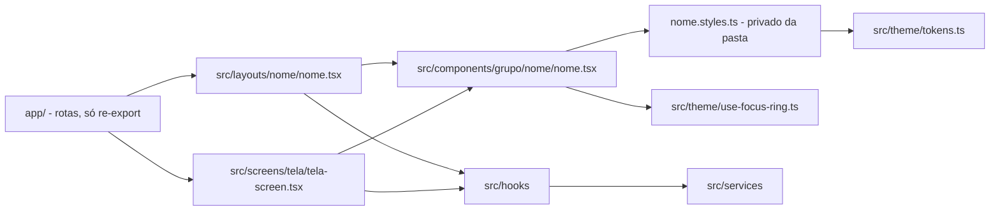

# Separar rota, tela e estilo no app mobile: `app/` só roteia, telas em `src/screens`, estilo em `*.styles.ts` na pasta do componente

Histórico de status: 2026-11-13, proposto.

Vínculos: PRD `docs/product/F40-componentizacao-front-mobile.md` (US-COMP-01, decisão R1);
spec `docs/design/F40-componentes-base-especificacao.md` §4 e `apps/mobile/README.md`
("Estrutura de pastas" e "Divergência registrada"), que já citavam um "ADR-015 proposto e não
gravado" para as camadas do mobile. Este arquivo fecha essa referência. Complementa
[[ADR-008-monorepo-com-backend-spring-e-mobile-expo]] e o ADR-014 (identidade visual v2, proposto
no ramo `docs/f39-wireframe-redesenho`): `src/theme/tokens.ts` continua a única fonte de valor visual.

Escopo: uma decisão, a organização do código de UI do mobile. Os pedidos (a) e (b) da revisão
humana ficam no mesmo ADR porque são executados pela mesma mudança, impostos pela mesma
configuração de lint e confirmados pelo mesmo teste de roteamento.

## Contexto e problema

Estado verificado em 2026-11-13 na branch `feat/f41-paridade-correcoes` (HEAD `1490234`), por
leitura de arquivo e busca no código:

* 17 dos 18 `.tsx` de `src/components/{ui,menu,perfil}` declaram `StyleSheet.create` no fim do
  arquivo do JSX, inclusive `menu/menu-tab-bar.tsx`. O 18º (`ui/alert-icon.tsx`) não tem StyleSheet,
  mas lê `color` de tokens direto no JSX; `button.tsx` e `state-view.tsx` fazem o mesmo para a cor
  de `ActivityIndicator` e de ícone.
* 3 componentes montam objeto de estilo inline com valor de runtime: `menu-tab-bar.tsx`
  (`paddingBottom: insets.bottom`), `screen-header.tsx` (`paddingTop: insets?.top`) e
  `screen-container.tsx` (`paddingTop: topSpacing`).
* `app/` tem 5 rotas com lógica: `_layout.tsx` (providers + `Stack`), `index.tsx` (reidratação de
  sessão), `login.tsx`, `(menu)/_layout.tsx` (guard de sessão + `MenuShell` + `Slot`) e
  `(menu)/perfil.tsx`. `app/login.tsx` importa `spacing` de tokens para `ScreenContainer.topSpacing`.
* 4 testes moram em `app/`. O expo-router instalado (6.0.24) trata como rota todo `.ts/.tsx` de
  `app/` exceto `+api`, `+html` e `+native-intent` (`node_modules/expo-router/_ctx-shared.js`);
  os testes só ficam fora do bundle por causa do `resolver.blockList` de `metro.config.js`.
* `src/integration/menu-routing.test.tsx` usa `renderRouter` com mapa explícito que importa os
  módulos de `app/` por caminho relativo.
* `.eslintrc.js` impõe fronteiras só com regras core do ESLint 8 (`no-restricted-syntax`,
  `no-restricted-imports`, `no-restricted-globals`) por override de pasta.
* O README do mobile registra a divergência "telas ficam em `app/`, não em `src/screens/`". Este
  ADR reverte essa divergência, por pedido da revisão humana.

Pergunta: que estrutura de pastas e que regras mecânicas garantem que (a) nenhum componente
declara estilo no arquivo do JSX e o estilo lê só de `src/theme/tokens.ts`, e (b) `app/` só roteia,
sem quebrar o Expo Router, o grupo `(menu)` nem o teste com `renderRouter`?

## Fatores de decisão

* F1. Zero `StyleSheet.create` e zero objeto de estilo literal em `.tsx` de `app/`, `src/components`,
  `src/screens` e `src/layouts`, verificado por `npm run lint`.
* F2. Todo arquivo de `app/` contém só re-export (nenhum import, função ou JSX), verificado por
  `npm run lint`.
* F3. Nenhuma dependência nova em `package.json` e nenhum plugin ESLint novo (README: "só regras
  core do ESLint 8").
* F4. Caminho de import dos consumidores de componente inalterado (`@/components/ui/button`
  continua válido), para o diff ficar concentrado em movimentação de arquivo.
* F5. Suíte inteira verde depois da mudança, com o mesmo número de testes ou mais, incluindo
  `menu-routing.test.tsx` (US-MENU-01 e US-MENU-08).
* F6. Custo de manutenção proporcional a um app de uma pessoa (CLAUDE.md: evitar overengineering),
  medido em arquivos novos por componente.

## Opções consideradas

* A. Pasta por componente com `*.styles.ts` e `index.ts`; telas em `src/screens/<tela>/`; layouts em
  `src/layouts/<layout>/`; `app/` só com re-export.
* B. Manter como está (variante B2: extrair só o estilo e manter telas em `app/`).
* C. Arquivo de estilo irmão, sem pasta por componente (`ui/button.tsx` + `ui/button.styles.ts`).
* D. Biblioteca de estilização (NativeWind, Restyle, styled-components ou Tamagui).
* E. Estilos centralizados em `src/theme/styles/<componente>.ts`.

## Resultado da decisão

Opção escolhida: "A", porque é a única que atende F1 e F2 só com regras core (F3), mantém os
imports dos consumidores pelo `index.ts` (F4) e segue o texto do pedido ("arquivo de estilos
próprio, na pasta do componente"). Paga por isso o maior custo de F6 entre as opções sem
dependência nova: 2 arquivos a mais por componente.



### D1. Estrutura de pastas

```text
apps/mobile/
├── app/                         # só rotas do Expo Router; cada arquivo é 1 re-export
│   ├── _layout.tsx              # export { default } from "@/layouts/root-layout/root-layout";
│   ├── index.tsx                # export { default } from "@/screens/session-restore/session-restore-screen";
│   ├── login.tsx                # export { default } from "@/screens/login/login-screen";
│   └── (menu)/
│       ├── _layout.tsx          # export { default } from "@/layouts/menu-layout/menu-layout";
│       └── perfil.tsx           # export { default } from "@/screens/profile/profile-screen";
└── src/
    ├── layouts/
    │   ├── root-layout/         root-layout.tsx
    │   └── menu-layout/         menu-layout.tsx, menu-layout.test.tsx
    ├── screens/
    │   ├── session-restore/     session-restore-screen.tsx, session-restore-screen.test.tsx
    │   ├── login/               login-screen.tsx, login-screen.test.tsx
    │   └── profile/             profile-screen.tsx, profile-screen.test.tsx
    ├── components/
    │   ├── ui/<nome>/           <nome>.tsx, <nome>.styles.ts, <nome>.test.tsx, index.ts
    │   ├── menu/<nome>/         idem (menu-tab-bar, menu-shell)
    │   └── perfil/<nome>/       idem (avatar, access-profile-badge, profile-summary)
    ├── integration/             menu-routing.test.tsx (fica), ui-structure.test.ts (novo)
    └── hooks/ services/ theme/ i18n/ config/ test-utils/   # sem mudança
```

Ajustes à proposta recebida (`src/screens/<tela>/<tela>-screen.tsx` + pasta por componente):

* Layout não é tela: `_layout` vai para `src/layouts/<nome>/<nome>.tsx`. Sem isso o guard de sessão
  ficaria em `app/(menu)/_layout.tsx` e `app/` continuaria com lógica. `src/layouts` pode importar
  `expo-router` (`Stack`, `Slot`, `useRouter`).
* Nome da tela em inglês e kebab-case, como os componentes já fazem: `index` vira
  `session-restore-screen.tsx` (`SessionRestoreScreen`), `perfil` vira `profile-screen.tsx`
  (`ProfileScreen`), `login` vira `login-screen.tsx` (`LoginScreen`). A URL (`/perfil`, `/login`)
  não muda, porque vem do nome do arquivo em `app/`.
* Tela e layout não têm `index.ts` (só `app/` os importa, por caminho completo). Componente tem
  `index.ts`, que reexporta só o componente e seus tipos públicos; nunca o estilo.
* Tela e layout não têm `*.styles.ts`: só compõem componentes (US-COMP-01). Estilo que uma tela
  precisar vira componente.
* O grupo `perfil/` não é renomeado aqui (fora do pedido).
* `ScreenContainer.topSpacing` deixa de receber número de token vindo da tela e vira variante
  semântica (`topSpacing?: "default" | "form"`, `default` = `spacing.lg`, `form` = `spacing.formTop`),
  resolvida em `screen-container.styles.ts`. É o único ponto em que uma tela importa token hoje.

### D2. Contrato de `<nome>.styles.ts`

* Fica na pasta do componente e só é importado pelo `<nome>.tsx` da mesma pasta, como
  `./<nome>.styles`.
* Imports permitidos, e só estes: `StyleSheet` de `react-native`; tipos `ViewStyle`, `TextStyle`,
  `ImageStyle` de `react-native` com `import type`; `@/theme/tokens`. Nada de React, hook, i18n,
  `expo-*`, outro componente ou outro `*.styles.ts`.
* Exports nomeados, sem `export default`:
  * `styles`: `export const styles = StyleSheet.create({ ... });`
  * `visual` (opcional): objeto `as const` com token usado em prop que não é `style` (ex.: `color` e
    `size` de `Ionicons` e `ActivityIndicator`). É o que tira `@/theme/tokens` do `.tsx`; em
    `alert-icon` é o único export.
  * funções puras para valor de runtime (opcional): recebem número ou variante e devolvem estilo,
    ex.: `export function bottomInset(bottom: number): ViewStyle { return { paddingBottom: bottom }; }`.
    Sem hook e sem efeito colateral. Cobre os 3 casos inline listados no contexto.
* Continuam valendo as regras atuais: sem hex, sem número visual literal (`0` e porcentagem seguem
  permitidos como hoje).
* O `.tsx` do componente não importa `@/theme/tokens`. Exceção mantida: o hook `useFocusRing`
  (`src/theme/use-focus-ring.ts`), que já devolve estilo derivado de token.

### D3. Testes

* Teste fica na pasta do código: `<nome>.test.tsx`, `<tela>-screen.test.tsx`, `<layout>.test.tsx`.
  Os 4 testes de `app/` vão para `src/screens/*/` e `src/layouts/menu-layout/`, importando `./<arquivo>`
  e mantendo os mesmos `jest.mock("expo-router", ...)`.
* `app/` fica sem teste: deixa de depender do `blockList` do Metro para o teste não virar rota. O
  `blockList` fica como defesa.
* Não há teste isolado de `*.styles.ts`: o valor visual continua verificado no teste do componente,
  com `StyleSheet.flatten` contra token, como já é feito.
* `inline-alert.test.tsx` passa a importar `AlertIcon` de `@/components/ui/alert-icon`.
* `error-retry-modal.tsx` hoje não tem teste; a mudança não cria nem tira cobertura dele.
* Novo `src/integration/ui-structure.test.ts` (só `fs` do Node, sem dependência), porque lint não
  impõe posição de arquivo: (1) nenhum `.tsx` diretamente em `src/components/<grupo>/`; (2) toda
  pasta `src/components/<grupo>/<nome>/` tem `<nome>.tsx` e `index.ts`; (3) toda pasta
  `src/screens/<nome>/` tem `<nome>-screen.tsx`; (4) nenhum `*.test.*` dentro de `app/`.

### D4. Regras de lint (`apps/mobile/.eslintrc.js`, só core do ESLint 8)

Seletores (esquery) usados abaixo, por número:

```text
S1  Program > :not(ExportNamedDeclaration[source], ExportAllDeclaration)
S2  MemberExpression[object.name="StyleSheet"][property.name="create"]
S3  JSXAttribute[name.name=/[sS]tyle/] ObjectExpression
S4  ImportDeclaration:not([source.value="react-native"], [source.value="@/theme/tokens"])
S5  ImportDeclaration[source.value="react-native"][importKind="value"] ImportSpecifier[importKind="value"]:not([imported.name="StyleSheet"])
S6  ExportDefaultDeclaration
```

1. `app/**/*.{ts,tsx}`: `no-restricted-syntax` com S1, mensagem "app/ só roteia: reexporte a tela
   de @/screens ou o layout de @/layouts". Bloqueia import, função, JSX e lógica. O override atual
   de `app/` (sem `@/services/*` e `expo-secure-store`) passa para `src/screens` e `src/layouts`.
2. `src/components/**/*.tsx`, `src/screens/**/*.tsx` e `src/layouts/**/*.tsx` (sem testes):
   `no-restricted-syntax` soma S2 ("StyleSheet.create só em <nome>.styles.ts") e S3 ("objeto de
   estilo inline: use styles ou uma função de <nome>.styles.ts") aos seletores atuais (`HEX_COLOR`,
   `FIXED_VISUAL_NUMBER`, `LITERAL_UI_TEXT`); `no-restricted-imports` soma `@/theme/tokens`
   ("valor visual entra pelo <nome>.styles.ts").
3. `src/screens/**/*.tsx` e `src/layouts/**/*.tsx`: também proíbem `@/services/*`,
   `expo-secure-store` e `**/*.styles` (tela e layout não têm estilo).
4. `src/**/*.styles.ts`: `no-restricted-syntax` com `HEX_COLOR`, `FIXED_VISUAL_NUMBER`, S4 e S5
   ("arquivo de estilo importa só StyleSheet, tipos de estilo e tokens"; `import type` passa) e S6
   ("use export nomeado styles ou visual").
5. `app/**` e `src/**` (sem testes): `no-restricted-imports` com os padrões `@/**/*.styles` e
   `../**/*.styles` ("*.styles é privado da pasta do componente"). Só `./<nome>.styles` passa.
6. Cuidados de implementação:
   * No ESLint 8, quando dois overrides casam o mesmo arquivo e configuram a mesma regra, o último
     substitui as opções inteiras, não soma. Cada regra é montada uma vez por combinação de pasta,
     juntando seletores e padrões em constantes (como `HEX_COLOR` hoje). Ex.: o override de
     `src/components/ui/**` precisa repetir `@/theme/tokens` e `**/*.styles` junto com `@/i18n/*`,
     `@/hooks/*` etc., senão a regra nova some para `ui/`.
   * S4 compara string exata, sem regex, porque o regex de seletor do esquery não aceita barra
     dentro do literal.
   * S3 casa qualquer atributo com "style" ou "Style" no nome (`style`, `contentContainerStyle`) que
     receba objeto literal, inclusive dentro de array ou de função.
   * S5 depende do campo `importKind`, que vem do parser TypeScript aplicado pelo `eslint-config-expo`
     a `.ts`. Se o campo não existir, S5 não casa e a regra passa em silêncio (ver Confirmação).

### D5. Expo Router e `renderRouter`

* A rota continua definida pelo nome do arquivo em `app/`. O Expo Router carrega o módulo via
  `require.context` e usa o `default`; o `babel-preset-expo` transforma
  `export { default } from "..."` em getter de `module.exports`, então a rota recebe o mesmo
  componente.
* Grupo `(menu)`: a pasta `app/(menu)/` e seus `_layout.tsx` e `perfil.tsx` continuam onde estão;
  só o conteúdo vira re-export. O guard de sessão vai junto para `src/layouts/menu-layout/`.
* Exports especiais de rota (`unstable_settings`, `ErrorBoundary`, `generateStaticParams`), se
  surgirem, entram no mesmo re-export nomeado: `export { default, ErrorBoundary } from "...";`.
  S1 aceita.
* `menu-routing.test.tsx` mantém o mapa `CONTEXTO_APP` com as mesmas chaves (`_layout`, `index`,
  `login`, `(menu)/_layout`, `(menu)/perfil`) e continua importando de `../../app/...`, não de
  `src/screens`. Assim cobre a cadeia rota → re-export → tela ou layout, que é o que a mudança pode
  quebrar.
* `router.replace("/perfil")` e `router.replace("/login")` não mudam.
* `@/components/ui/button` passa a resolver para `button/index.ts`: o `expo/tsconfig.base` usa
  `moduleResolution: "bundler"` (conferido no `node_modules`), que resolve índice de pasta; Metro e
  Jest também resolvem índice pela regra de Node. Nada disso foi executado nesta etapa; F5 confirma.

### D6. Execução

* Mover com `git mv` em commit só de movimentação, sem mudar conteúdo, e extrair estilo no commit
  seguinte, para `git log --follow` e a revisão enxergarem o que mudou. Sequência sugerida:
  `refactor(mobile): mover componentes para pasta própria`,
  `refactor(mobile): extrair estilos para arquivos styles`,
  `refactor(mobile): mover telas e layouts para src/screens e src/layouts`,
  `build(mobile): impor estrutura de UI por lint`,
  `test(mobile): verificar estrutura de pastas de UI`,
  `docs(mobile): atualizar README e índice de ADR`.
* No mesmo PR: atualizar `apps/mobile/README.md` (estrutura, tabela de fronteiras, remover a
  "Divergência registrada") e a tabela Decisões de `docs/architecture/overview.md`.

### Consequências

* Bom, porque revisão de visual olha um arquivo que só lê token, e revisão de comportamento olha o
  `.tsx` sem ruído de estilo.
* Bom, porque os pedidos (a) e (b) viram falha de `npm run lint`, não convenção oral; a F35 e as
  seguintes nascem no padrão.
* Bom, porque `app/` fica trivial: renomear rota ou mudar tela de grupo não toca lógica, e teste
  deixa de morar onde o Expo Router procura rota.
* Ruim, porque o diff é grande: 18 pastas de componente, cerca de 18 `*.styles.ts` e 18 `index.ts`
  novos, 3 telas, 2 layouts e 4 testes movidos, 5 arquivos de `app/` reescritos.
* Ruim, porque achar a tela a partir da URL passa a ter um salto (`app/login.tsx` →
  `src/screens/login/login-screen.tsx`).
* Ruim, porque conflita com qualquer branch aberta que mexa nos mesmos componentes. A
  `feat/f41-paridade-correcoes` contém a F40 inteira (63 arquivos de `apps/mobile` diferentes do
  `main`, conferido com `git diff --stat main...HEAD`).
* Ruim, porque regra por seletor AST é mais frágil que plugin dedicado: seletor errado passa calado.

### Confirmação

* `npm run lint` verde no ramo da mudança e vermelho, com a mensagem certa, quando o CRIVO introduz
  de propósito (arquivo temporário, não commitado) cada violação: `StyleSheet.create` em `.tsx` de
  componente; `style={{ padding: x }}` em componente; import de `@/theme/tokens` em `.tsx`; import
  de `react` e de `View` em `*.styles.ts`; `export default` em `*.styles.ts`; qualquer import em
  `app/login.tsx`; import de `button.styles` a partir de outro componente. Saída real de cada uma
  registrada na entrega.
* `npm test` verde, com contagem de testes igual ou maior que a contada antes da mudança no mesmo
  ramo, incluindo `menu-routing.test.tsx` e o novo `ui-structure.test.ts`.
* `npm run typecheck` verde.
* Busca: `StyleSheet.create` em `apps/mobile/app` e `apps/mobile/src` só em `*.styles.ts`;
  `@/theme/tokens` em `.tsx` só em `*.test.tsx`.
* App real com `npx expo start` e Expo Go: reidratação, Login e Perfil dentro da tab bar abrem como
  antes. O `renderRouter` não passa pelo bundle do Metro, então só ele não basta.
* Revisão de PR: diff de `app/` só com re-exports; `package.json` e `package-lock.json` sem mudança.

## Prós e contras das opções

### A. Pasta por componente, styles e index; telas e layouts em src; app/ só re-export

* Bom, porque atende F1 e F2 só com regras core (F3) e mantém os imports dos consumidores (F4).
* Bom, porque componente, estilo e teste ficam juntos: mover ou apagar um componente é mover ou
  apagar uma pasta.
* Neutro, porque `src/screens` já era a proposta original da F40, citada no README.
* Ruim, porque são 4 arquivos por componente e um salto a mais da URL até a tela (F6).
* Ruim, porque o `index.ts` permitiria reexportar o estilo por engano; mitigado pela regra D4.5.

### B. Manter como está (e variante B2)

* Bom, porque o custo agora é zero e não há risco de quebrar roteamento.
* Ruim, porque descumpre os pedidos (a) e (b) da revisão humana e a F40 continua devolvida.
* Ruim, porque F1 e F2 seguem sem verificação mecânica, e `app/` continua com guard de sessão e com
  testes que o Expo Router enxerga como rota.
* B2 (extrair estilo, manter telas em `app/`): atende (a) e não atende (b); custa quase o mesmo
  que A na parte de componente.
* Custo de descartar B: nenhum técnico; o custo de escolhê-la é a F40 não fechar.

### C. Estilo irmão, sem pasta por componente

* Bom, porque atende F1, F3 e F4 sem `index.ts`, com 1 arquivo novo por componente (F6 melhor).
* Ruim, porque não atende "na pasta do componente" ao pé da letra, e `ui/` passa de 25 para cerca
  de 38 arquivos planos, com 3 papéis distinguidos só pelo sufixo.
* Ruim, porque sem pasta não há unidade clara para o teste de estrutura verificar.
* Custo de descartar C: 18 `index.ts` e um nível de diretório a mais na opção A.

### D. Biblioteca de estilização

* Bom, porque traz tema tipado e variantes prontas; Restyle impede, pelo tipo, valor fora do tema.
* Ruim, porque é dependência estrutural nova (fere F3), exige ADR próprio e configuração de Babel
  e Metro; NativeWind traria uma segunda fonte de token, em conflito com `tokens.ts` e o ADR-014.
* Ruim, porque reescreve os 18 componentes e os testes que usam `StyleSheet.flatten`.
* Custo de descartar D: abrir mão da checagem de tema por tipo; o lint por AST cobre o mesmo
  objetivo com menos garantia.

### E. Estilos centralizados em src/theme/styles

* Bom, porque concentra todo valor visual numa pasta e a regra de lint fica mais simples.
* Ruim, porque não atende "na pasta do componente"; todo PR de componente toca duas árvores
  distantes e `theme/` vira depósito com conhecimento de cada componente.
* Custo de descartar E: nenhum relevante.

## Dados pessoais e ameaças

* Nenhum fluxo de dado pessoal novo. E-mail e senha continuam entrando pela tela de Login e saindo
  só por `useLogin` → `auth-service`; a sessão (token e usuário com nome, e-mail e perfil) continua
  só no `expo-secure-store`, via `session-storage`. A mudança move código de UI e estende a
  proibição de `@/services/*` e `expo-secure-store` a `src/screens` e `src/layouts`.
* Ameaça própria da mudança: perder ou desligar o guard de sessão do grupo `(menu)` ao mover
  `app/(menu)/_layout.tsx`, deixando um deep link para `/perfil` montar a área logada sem sessão.
  Controle: o caso US-MENU-08 de `menu-routing.test.tsx` (deep link sem sessão vai para `/login`,
  nenhuma aba e nenhum nome de usuário renderizados) tem de continuar verde importando de `app/`.
* `*.styles.ts` não pode importar nada além de tokens, então não vira caminho de log ou de dado.
* Testes continuam com dado fictício (`exemplo-ficticio.com.br`).

## Mais informações

* Risco residual:
  * Os seletores S1 a S6 não foram executados nesta etapa. Seletor que não casa passa calado; por
    isso a Confirmação exige violação proposital.
  * A resolução de índice de pasta por Metro, Jest e tsc foi deduzida da configuração, não rodada.
  * Branches abertas que criarem componente no formato antigo vão falhar no lint até migrarem.
  * Fazer a mudança antes da F40 e da F41 integrarem gera conflito em quase todo arquivo de UI.
    Recomendação: aplicar em PR próprio sobre a ponta da cadeia F40/F41, sem misturar com
    correção visual.
* Pendências fora deste arquivo, não alteradas nesta etapa: linha do ADR-015 na tabela Decisões de
  `docs/architecture/overview.md`; README do mobile.
* Condição para Aceito: revisão da pessoa revisora da F40. Nenhum arquivo do app é movido com este
  ADR em `proposto`.
* Revisitar quando: adotar biblioteca de estilização; tema escuro (estilo passaria a depender do
  tema em runtime, ex. `makeStyles(theme)`); ou `src/components/ui` passar de uns 30 componentes.
