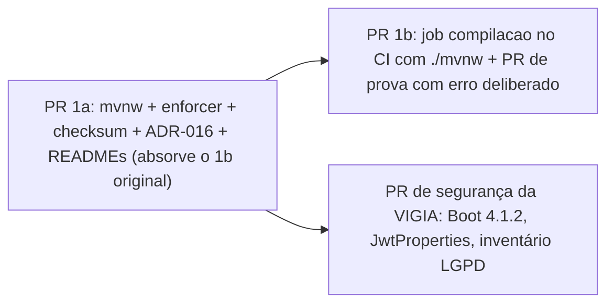

# Fixar o JDK 21 no build da API com maven-enforcer-plugin e Maven Wrapper

Relacionado: F44 (retrabalho da F38); complementa ADR-008 (monorepo), ADR-010 (verify com Testcontainers), ADR-012 e ADR-013 (conteúdo da F38), todos em `docs/architecture/adr/`. PRD: `docs/product/F44-main-compilando-de-verdade.md`.

## Contexto e problema

O relato "a `main` não compila" tem duas causas, uma histórica e uma atual. Reproduzido em 2026-11-14:

| # | Árvore | Ambiente | Comando | Resultado real |
|---|---|---|---|---|
| R1 | `origin/main` 11f35b3 | host, Maven 3.10.0, JDK padrão 27.0.1 (Homebrew) | `mvn -B -ntp clean compile` | `BUILD FAILURE`: `Fatal error compiling: java.lang.ExceptionInInitializerError: com.sun.tools.javac.tree.EndPosTable` (Lombok no javac 27) |
| R2 | `origin/main` 11f35b3 | contêiner `maven@sha256:3a4ab327…` (JDK 21.0.7), mesma imagem do estágio de build do `Dockerfile` | `mvn -B -ntp clean compile` | `BUILD SUCCESS`, 34 arquivos com `release 21` |
| R3 | `origin/main` 11f35b3 | mesmo contêiner, com socket do Docker | `mvn -B -ntp clean verify` | `BUILD SUCCESS`; 16 unitários e 3 `FlywayMigrationIT` verdes; `Successfully applied 2 migrations … now at version v2` |
| R4 | `d9f2fe5` (main antes do merge das PRs #4 e #5) | mesmo contêiner JDK 21 | `mvn -B -ntp clean compile` | `BUILD FAILURE`: `AuthService.java:(4,39) package br.com.mecanicasaojorge.api.dto does not exist`, mais erros iguais para `entity`, `mapper`, `repository` e `oauth2.jose.jws` |

Causa histórica (R4): até 2026-11-12 a `main` tinha o `AuthService` da PR #1 sem as classes de `dto`, `entity`, `mapper` e `repository`, que só existiam na branch da F30/F38. A F38 foi aprovada contra a branch, não contra a `main`, e não havia check obrigatório no merge. As PRs #4 e #5, mergeadas em 2026-11-12, resolveram o código; a proteção da `main` exigindo `ci-api-ok` chegou depois (PR #8, 2026-11-13).

Causa atual (R1 x R2): o código compila no JDK 21 e quebra no JDK 27, que é o padrão do Maven do Homebrew. O pom declara `java.version` 21, mas isso só define o `--release` do javac; não impede rodar o Maven num JDK mais novo. O erro aparece dentro do Lombok, sem pista de que a causa é a versão do JDK.

Como garantir que qualquer pessoa ou máquina que rode o build da API use o JDK 21 e, se não usar, receba uma mensagem que diga isso?

## Fatores de decisão

* F1. Build com JDK fora de 21 falha antes do javac, em menos de 10 s, com mensagem que cita "JDK 21" e a versão encontrada.
* F2. Build reproduzível a partir de um clone limpo, sem depender da versão do Maven instalada no host (pendência conhecida do `CLAUDE.md`).
* F3. Zero linha de código de produção alterada; no máximo um plugin de build novo.
* F4. Nenhuma configuração por máquina (arquivo fora do repositório) para o caminho feliz funcionar.
* F5. CI e máquina local usando a mesma versão do Maven.

## Opções consideradas

* A. Manter como está: só documentar o JDK 21 no README (PR #7).
* B. `maven-enforcer-plugin` com `requireJavaVersion` na faixa 21 inclusive a 22 exclusive (fase `validate`) mais Maven Wrapper (`mvnw`, `distributionType=only-script`, Maven 3.9.9).
* C. `maven-toolchains-plugin` com `toolchains.xml` apontando para o JDK 21, mais Maven Wrapper.
* D. Atualizar o Lombok para uma versão compatível com o javac 27 e deixar o JDK livre.

## Resultado da decisão

Opção escolhida: "B. enforcer + Maven Wrapper", porque é a única que atende F1, F2, F3 e F4 ao mesmo tempo: o enforcer falha na fase `validate` com mensagem em português (F1), o wrapper fixa a versão do Maven no repositório (F2, F5), o custo é um plugin e três arquivos de script e propriedades (F3), e nada precisa ser configurado fora do repositório (F4).

A implementação já existe no commit `1672f72` da branch `fix/f44-main-compilando`. A faixa de versão vale até a decisão de subir para outro LTS, que exige ADR novo substituindo este.

### Consequências

* Bom, porque o erro R1 vira `JDK 21 e obrigatorio (encontrado: 27.0.1.0.3)` em vez de `ExceptionInInitializerError` (conferido em 2026-11-14, ver Confirmação).
* Bom, porque `./mvnw` baixa e usa o Maven 3.9.9 do repositório, independente do Maven 3.10.0 do host ou do Maven do runner.
* Bom, porque a mesma regra protege CI, Dockerfile e máquina local, sem código de produção.
* Ruim, porque o wrapper não troca o JDK: quem tem o JDK 27 como padrão continua precisando exportar `JAVA_HOME` para o Temurin 21; o ganho é a mensagem clara, não a troca automática.
* Ruim, porque a faixa também barra JDK 22 a 25; subir para o Java 25 LTS exige ADR novo e mudança no pom.
* Ruim, porque o `Dockerfile` ainda chama o `mvn` da imagem (linhas 11 e 16), não o `./mvnw`, e a versão do Maven do estágio de build pode divergir da do wrapper. A trava de JDK vale ali também, porque a imagem é JDK 21.
* Neutro, porque compilação feita só pela IDE (compilador interno do IntelliJ, por exemplo) não passa pelo enforcer.

### Confirmação

* Revisão do pom: `apps/api/pom.xml` contém `maven-enforcer-plugin` com execução `exigir-jdk-21`, fase `validate` e regra `requireJavaVersion` limitada ao 21.
* Teste negativo: `mvn -B -ntp -q validate` com JDK 27 termina com código diferente de 0 e a mensagem `JDK 21 e obrigatorio (encontrado: …)`. Saída real em 2026-11-14 (branch `fix/f44-main-compilando`, host com JDK 27.0.1):

  ```
  ERROR Rule 0: org.apache.maven.enforcer.rules.version.RequireJavaVersion failed with message:
  ERROR JDK 21 e obrigatorio (encontrado: 27.0.1.0.3). Exporte JAVA_HOME apontando para o Temurin 21 ou use ./mvnw com JAVA_HOME do JDK 21.
  ```

* Teste positivo: `./mvnw -B -ntp clean compile` com JDK 21. Saída real em 2026-11-14 (contêiner `maven@sha256:3a4ab327…`; o wrapper baixou o próprio Maven em `~/.m2/wrapper`):

  ```
  Apache Maven 3.9.9 (8e8579a9e76f7d015ee5ec7bfcdc97d260186937)
  INFO Rule 0: org.apache.maven.enforcer.rules.version.RequireJavaVersion passed
  INFO Compiling 34 source files with javac (debug parameters release 21) to target/classes
  INFO BUILD SUCCESS
  ```

  Os colchetes de nível de log (`INFO`, `ERROR`) foram omitidos na transcrição acima.
* Repositório: `git ls-files apps/api` lista `mvnw`, `mvnw.cmd` e `.mvn/wrapper/maven-wrapper.properties`, e nenhum `maven-wrapper.jar`.
* CI: o job `compilacao` do `ci-api.yml` roda `./mvnw -B -ntp clean compile` e entra no `ci-api-ok`, que é check obrigatório da `main` (branch `ci/f44-job-compilacao`, PR posterior a este).

## Prós e contras das opções

### A. Manter como está (só README)

* Bom, porque o custo é zero e não muda o pom.
* Neutro, porque o README já tem o aviso desde a PR #7.
* Ruim, porque não atende F1: o erro continua sendo `ExceptionInInitializerError` dentro do Lombok, e foi esse erro que gerou o relato desta feature.
* Ruim, porque não atende F2 nem F5: sem wrapper, a versão do Maven é a de cada máquina.
* Custo de descartar: nenhum de implementação. O custo de manter é retrabalho recorrente de diagnóstico, que já consumiu parte da F37 e esta etapa da F44.

### B. enforcer + Maven Wrapper (escolhida)

* Bom, porque atende F1 a F4 e F5 no CI.
* Bom, porque `distributionType=only-script` evita versionar binário (`maven-wrapper.jar`).
* Neutro, porque o `mvnw` é gerado pelo `maven-wrapper-plugin`, mas é versionado por desenho; o que não entra é o `.jar` nem o Maven baixado em `~/.m2/wrapper`.
* Ruim, porque o wrapper baixa o Maven da internet na primeira execução: sem checksum, uma distribuição adulterada rodaria no build (ver Ameaças).
* Ruim, porque não resolve sozinha o JDK errado do host; só explica.

### C. toolchains + Maven Wrapper

* Bom, porque o Maven pode rodar no JDK 27 e compilar com o JDK 21 de verdade, sem a pessoa trocar `JAVA_HOME`.
* Ruim, porque exige `~/.m2/toolchains.xml` em cada máquina e um passo a mais no CI, o que fere F4.
* Ruim, porque, se o arquivo faltar, o erro é de toolchain não encontrada, outro erro pouco claro para quem chega no projeto.
* Custo de descartar: perder a troca automática de JDK. Custo de adotar: um arquivo por máquina, documentação e passo extra no `setup-java` do CI.

### D. Atualizar o Lombok e liberar o JDK

* Bom, porque removeria o sintoma de R1 sem mexer em `JAVA_HOME`.
* Ruim, porque contradiz a restrição "Java 21 como base" do briefing: CI, `Dockerfile` e produção ficam em 21 e a máquina local em outra versão.
* Ruim, porque cada JDK novo pode quebrar Lombok, MapStruct ou Mockito de novo, e o erro volta a ser opaco.
* Custo de descartar: nenhum; o Lombok continua na versão gerida pelo Spring Boot.

## Ameaças e dados pessoais

Fluxo afetado: cadeia de build (máquina local, CI e imagem Docker). Não há dado pessoal neste fluxo: a mensagem do enforcer imprime só a versão do JDK, e nenhum log de build traz segredo, token ou e-mail. Base legal e retenção não se aplicam.

| Ameaça (STRIDE) | Onde | Mitigação | Estado |
|---|---|---|---|
| Tampering: distribuição do Maven adulterada no download do `mvnw` | `.mvn/wrapper/maven-wrapper.properties` | `distributionSha256Sum` do Maven 3.9.9 | Feito por VIGIA no commit `4c9607f` da branch `fix/f44-seguranca-dependencias`; ainda fora da `fix/f44-main-compilando` |
| Tampering: script `mvnw` alterado num PR | `apps/api/mvnw`, `apps/api/mvnw.cmd` | revisão de PR; o script vem do `maven-wrapper-plugin` 3.3.4 sem edição manual | Aberto: sem verificação automática do conteúdo do script |
| Denial of service no build: Maven Central fora do ar | primeira execução do `mvnw` | cache do Maven no CI (`setup-java` com `cache: maven`) | Parcial |

## Ordem dos PRs da etapa 1



## Mais informações

* Riscos residuais: (1) até o `4c9607f` entrar no PR 1a, o wrapper baixa sem checksum; (2) o `Dockerfile` não usa o `./mvnw`; (3) a IDE pode compilar fora da trava; (4) a proteção da `main` aceita `skipped` como sucesso no `ci-api-ok`, então PR que não toca `apps/api` não compila a API, por desenho.
* Pendência para ESPRESSO e ANCORA: avaliar trocar `mvn` por `./mvnw` no `Dockerfile` em PR próprio.
* Revisitar quando: o projeto decidir subir de LTS (Java 25), o Lombok deixar de ser dependência, ou o Maven Wrapper mudar de `only-script` para outro modo.
