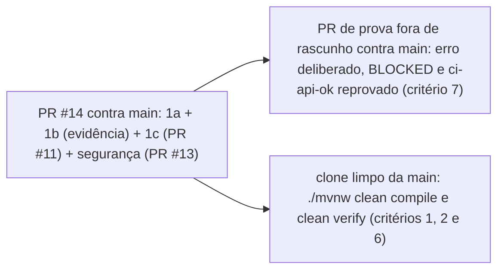

# Fixar o JDK 21 no build da API com maven-enforcer-plugin e Maven Wrapper

Relacionado: F44 (retrabalho da F38); complementa ADR-008 (monorepo), ADR-010 (verify com Testcontainers), ADR-012 e ADR-013 (conteúdo da F38), todos em `docs/architecture/adr/`. PRD: `docs/product/F44-main-compilando-de-verdade.md`.

## Contexto e problema

O relato "a `main` não compila" tem duas causas, uma histórica e uma atual. Reproduzido em 2026-11-14:

| # | Árvore | Ambiente | Comando | Resultado real |
|---|---|---|---|---|
| R1 | `origin/main` 11f35b3 | host, Maven 3.10.0, JDK padrão 27.0.1 (Homebrew) | `mvn -B -ntp clean compile` | `BUILD FAILURE`: `Fatal error compiling: java.lang.ExceptionInInitializerError: com.sun.tools.javac.tree.EndPosTable` (Lombok no javac 27) |
| R2 | `origin/main` 11f35b3 | contêiner `maven@sha256:3a4ab327…` (JDK 21.0.7), mesma imagem do estágio de build do `Dockerfile` | `mvn -B -ntp clean compile` | `BUILD SUCCESS`, 34 arquivos com `release 21` |
| R3 | `origin/main` 11f35b3 | mesmo contêiner, com socket do Docker | `mvn -B -ntp clean verify` | `BUILD SUCCESS`; 16 unitários e 3 `FlywayMigrationIT` verdes; `Successfully applied 2 migrations … now at version v2` |
| R4 | `d9f2fe5` (main antes do merge das PRs #4 e #5) | mesmo contêiner JDK 21 | `mvn -B -ntp clean compile` | `BUILD FAILURE`: `AuthService.java:(4,39) package br.com.mecanicasaojorge.api.dto does not exist`, mais erros iguais para `entity`, `mapper`, `repository` e `oauth2.jose.jws` |
| R5 | `main` 348a43e | host, Maven 3.10.0, JDK 27.0.1.0.3 (Homebrew) | `mvn -B -ntp clean compile` | `BUILD FAILURE`: `Fatal error compiling: java.lang.ExceptionInInitializerError: com.sun.tools.javac.tree.EndPosTable` (2026-11-16, igual a R1) |
| R6 | `main` 348a43e | contêiner `maven:3.9.9-eclipse-temurin-21` | `mvn -B -ntp clean compile` | `BUILD SUCCESS`, 34 arquivos com `release 21` (2026-11-16, igual a R2) |
| R7 | PR #14 `d50a49b` | host, Maven 3.10.0, JDK 27.0.1.0.3 | `mvn -B -ntp -q validate` | código 1: `JDK 21 e obrigatorio (encontrado: 27.0.1.0.3)` (2026-11-16) |
| R8 | PR #14 `d50a49b` | contêiner `maven:3.9.9-eclipse-temurin-21` sem `unzip` | `./mvnw -v` e `./mvnw -B -ntp clean verify` | o wrapper para antes de rodar o Maven: `Failed to validate Maven distribution SHA-256, your Maven distribution might be compromised.` (2026-11-16) |
| R9 | PR #14 `d50a49b` | mesmo contêiner, com `unzip` instalado por `apt-get` e socket do Docker | `./mvnw -B -ntp clean verify` | `Apache Maven 3.9.9`; `RequireJavaVersion passed`; 18 unitários verdes (`JwtPropertiesTest` 2, `AuthControllerTest` 7, `AuthServiceTest` 7, `GlobalExceptionHandlerTest` 2) e 3 `FlywayMigrationIT` verdes; `Successfully applied 2 migrations … now at version v2`; `BUILD SUCCESS` (2026-11-16) |

Causa histórica (R4): até 2026-11-12 a `main` tinha o `AuthService` da PR #1 sem as classes de `dto`, `entity`, `mapper` e `repository`, que só existiam na branch da F30/F38. A F38 foi aprovada contra a branch, não contra a `main`, e não havia check obrigatório no merge. As PRs #4 e #5, mergeadas em 2026-11-12, resolveram o código; a proteção da `main` exigindo `ci-api-ok` chegou depois (PR #8, 2026-11-13).

Causa atual (R1 x R2): o código compila no JDK 21 e quebra no JDK 27, que é o padrão do Maven do Homebrew. O pom declara `java.version` 21, mas isso só define o `--release` do javac; não impede rodar o Maven num JDK mais novo. O erro aparece dentro do Lombok, sem pista de que a causa é a versão do JDK.

Revalidação em 2026-11-16 (R5 a R9): o diagnóstico de 2026-11-14 continua valendo na `main` atual. A `main` 348a43e compila em JDK 21 e quebra em JDK 27 com o mesmo erro. O PR #14 troca o erro opaco pela mensagem do enforcer e passa no `verify` completo com o wrapper. R8 expõe um requisito do wrapper que o ADR não registrava. Sem `unzip`, o `mvnw` em modo `only-script` troca a URL do `.zip` pela do `.tar.gz` (linhas 179 e 180 do `apps/api/mvnw`). O hash baixado deixa de conferir com o `distributionSha256Sum`, que é o do `.zip`, e o build para dizendo que a distribuição pode estar comprometida. A falha é segura, porque nada roda, mas a mensagem engana.

Relação com o ADR-012: a causa raiz da F44 tem duas camadas. Elas ficam registradas neste ADR, e não no ADR-012. O ADR-012 (aceito em 2026-11-12, na `main`) decidiu remover o template genérico. A camada histórica (R4) é o motivo de essa remoção não ter chegado à `main` a tempo. Como ADR aceito é imutável, ela não pode ser acrescentada ao ADR-012. O número 016 também não pode virar 012, porque numeração de ADR nunca é reutilizada. A descrição do PR 1a cita os dois: o ADR-012 para a camada histórica e o ADR-016 para a decisão que precisa de aceite.

Como garantir que qualquer pessoa ou máquina que rode o build da API use o JDK 21 e, se não usar, receba uma mensagem que diga isso?

## Fatores de decisão

* F1. Build com JDK fora de 21 falha antes do javac, em menos de 10 s, com mensagem que cita "JDK 21" e a versão encontrada.
* F2. Build reproduzível a partir de um clone limpo, sem depender da versão do Maven instalada no host (pendência conhecida do `CLAUDE.md`).
* F3. Zero linha de código de produção alterada; no máximo um plugin de build novo.
* F4. Nenhuma configuração por máquina (arquivo fora do repositório) para o caminho feliz funcionar.
* F5. CI e máquina local usando a mesma versão do Maven.

## Opções consideradas

* A. Manter como está: só documentar o JDK 21 no README (PR #7).
* B. `maven-enforcer-plugin` com `requireJavaVersion` na faixa 21 inclusive a 22 exclusive (fase `validate`) mais Maven Wrapper (`mvnw`, `distributionType=only-script`, Maven 3.9.9).
* C. `maven-toolchains-plugin` com `toolchains.xml` apontando para o JDK 21, mais Maven Wrapper.
* D. Atualizar o Lombok para uma versão compatível com o javac 27 e deixar o JDK livre.

## Resultado da decisão

Opção escolhida: "B. enforcer + Maven Wrapper", porque é a única que atende F1, F2, F3 e F4 ao mesmo tempo: o enforcer falha na fase `validate` com mensagem em português (F1), o wrapper fixa a versão do Maven no repositório (F2, F5), o custo é um plugin e três arquivos de script e propriedades (F3), e nada precisa ser configurado fora do repositório (F4).

A implementação está no PR #14 (`fix/f44-main-compilando`, ponta `d50a49b`): wrapper e enforcer em `1672f72`, checksum do Maven em `e3d9f44` e job `compilacao` do CI em `874e90f` (PR #11, mergeado na branch do #14). A faixa de versão vale até a decisão de subir para outro LTS, que exige ADR novo substituindo este.

### Consequências

* Bom, porque o erro R1 vira `JDK 21 e obrigatorio (encontrado: 27.0.1.0.3)` em vez de `ExceptionInInitializerError` (conferido em 2026-11-14, ver Confirmação).
* Bom, porque `./mvnw` baixa e usa o Maven 3.9.9 do repositório, independente do Maven 3.10.0 do host ou do Maven do runner.
* Bom, porque a mesma regra protege CI, Dockerfile e máquina local, sem código de produção.
* Ruim, porque o wrapper não troca o JDK: quem tem o JDK 27 como padrão continua precisando exportar `JAVA_HOME` para o Temurin 21; o ganho é a mensagem clara, não a troca automática.
* Ruim, porque a faixa também barra JDK 22 a 25; subir para o Java 25 LTS exige ADR novo e mudança no pom.
* Ruim, porque o `Dockerfile` ainda chama o `mvn` da imagem (linhas 11 e 16), não o `./mvnw`, e a versão do Maven do estágio de build pode divergir da do wrapper. A trava de JDK vale ali também, porque a imagem é JDK 21. Hoje o `Dockerfile` não precisa de `unzip`. Passa a precisar se trocar `mvn` por `./mvnw`, porque a imagem `maven:3.9.9-eclipse-temurin-21` não traz `unzip` (R8).
* Ruim, porque o wrapper exige `unzip` em toda máquina e runner que o use. Sem ele, o build para com uma mensagem de checksum que aponta para adulteração, não para a ferramenta ausente (R8). O `apps/api/README.md` do PR #14 já lista o requisito.
* Neutro, porque compilação feita só pela IDE (compilador interno do IntelliJ, por exemplo) não passa pelo enforcer.

### Confirmação

* Revisão do pom: `apps/api/pom.xml` contém `maven-enforcer-plugin` com execução `exigir-jdk-21`, fase `validate` e regra `requireJavaVersion` limitada ao 21.
* Teste negativo: `mvn -B -ntp -q validate` com JDK 27 termina com código diferente de 0 e a mensagem `JDK 21 e obrigatorio (encontrado: …)`. Saída real em 2026-11-14 (branch `fix/f44-main-compilando`, host com JDK 27.0.1):

  ```
  ERROR Rule 0: org.apache.maven.enforcer.rules.version.RequireJavaVersion failed with message:
  ERROR JDK 21 e obrigatorio (encontrado: 27.0.1.0.3). Exporte JAVA_HOME apontando para o Temurin 21 ou use ./mvnw com JAVA_HOME do JDK 21.
  ```

* Teste positivo: `./mvnw -B -ntp clean compile` com JDK 21. Saída real em 2026-11-14 (contêiner `maven@sha256:3a4ab327…`; o wrapper baixou o próprio Maven em `~/.m2/wrapper`):

  ```
  Apache Maven 3.9.9 (8e8579a9e76f7d015ee5ec7bfcdc97d260186937)
  INFO Rule 0: org.apache.maven.enforcer.rules.version.RequireJavaVersion passed
  INFO Compiling 34 source files with javac (debug parameters release 21) to target/classes
  INFO BUILD SUCCESS
  ```

  Os colchetes de nível de log (`INFO`, `ERROR`) foram omitidos na transcrição acima.
* Repositório: `git ls-files apps/api` lista `mvnw`, `mvnw.cmd` e `.mvn/wrapper/maven-wrapper.properties`, e nenhum `maven-wrapper.jar`.
* Ambiente sem `mvn` no host (critério 6 da F44): duas condições, ambas no contêiner `maven:3.9.9-eclipse-temurin-21` em 2026-11-16. Com `unzip`, o wrapper baixa o Maven 3.9.9 e o build conclui (R9). Sem `unzip`, o build para na checagem de SHA-256 (R8). As duas condições entram na descrição do PR 1a, junto com o requisito de `unzip` no runner do CI e, se um dia o `Dockerfile` usar `./mvnw`, na imagem de build.
* CI: o job `compilacao` do `ci-api.yml` roda `./mvnw -B -ntp clean compile` e entra no `ci-api-ok`, que é check obrigatório da `main`. O job chegou ao PR #14 pelo commit `874e90f` (PR #11). A prova de bloqueio do critério 7 da F44 ainda não vale: o PR #12 era rascunho e rodou o job a partir do ramo de prova. Ela é refeita depois do merge do #14, com um PR fora de rascunho contra a `main`, mostrando `mergeStateStatus` `BLOCKED` e o `ci-api-ok` reprovado.

## Prós e contras das opções

### A. Manter como está (só README)

* Bom, porque o custo é zero e não muda o pom.
* Neutro, porque o README já tem o aviso desde a PR #7.
* Ruim, porque não atende F1: o erro continua sendo `ExceptionInInitializerError` dentro do Lombok, e foi esse erro que gerou o relato desta feature.
* Ruim, porque não atende F2 nem F5: sem wrapper, a versão do Maven é a de cada máquina.
* Custo de descartar: nenhum de implementação. O custo de manter é retrabalho recorrente de diagnóstico, que já consumiu parte da F37 e esta etapa da F44.

### B. enforcer + Maven Wrapper (escolhida)

* Bom, porque atende F1 a F4 e F5 no CI.
* Bom, porque `distributionType=only-script` evita versionar binário (`maven-wrapper.jar`).
* Neutro, porque o `mvnw` é gerado pelo `maven-wrapper-plugin`, mas é versionado por desenho; o que não entra é o `.jar` nem o Maven baixado em `~/.m2/wrapper`.
* Ruim, porque o wrapper baixa o Maven da internet na primeira execução: sem checksum, uma distribuição adulterada rodaria no build (ver Ameaças).
* Ruim, porque não resolve sozinha o JDK errado do host; só explica.

### C. toolchains + Maven Wrapper

* Bom, porque o Maven pode rodar no JDK 27 e compilar com o JDK 21 de verdade, sem a pessoa trocar `JAVA_HOME`.
* Ruim, porque exige `~/.m2/toolchains.xml` em cada máquina e um passo a mais no CI, o que fere F4.
* Ruim, porque, se o arquivo faltar, o erro é de toolchain não encontrada, outro erro pouco claro para quem chega no projeto.
* Custo de descartar: perder a troca automática de JDK. Custo de adotar: um arquivo por máquina, documentação e passo extra no `setup-java` do CI.

### D. Atualizar o Lombok e liberar o JDK

* Bom, porque removeria o sintoma de R1 sem mexer em `JAVA_HOME`.
* Ruim, porque contradiz a restrição "Java 21 como base" do briefing: CI, `Dockerfile` e produção ficam em 21 e a máquina local em outra versão.
* Ruim, porque cada JDK novo pode quebrar Lombok, MapStruct ou Mockito de novo, e o erro volta a ser opaco.
* Custo de descartar: nenhum; o Lombok continua na versão gerida pelo Spring Boot.

## Ameaças e dados pessoais

Fluxo afetado: cadeia de build (máquina local, CI e imagem Docker). Não há dado pessoal neste fluxo: a mensagem do enforcer imprime só a versão do JDK, e nenhum log de build traz segredo, token ou e-mail. Base legal e retenção não se aplicam.

| Ameaça (STRIDE) | Onde | Mitigação | Estado |
|---|---|---|---|
| Tampering: distribuição do Maven adulterada no download do `mvnw` | `.mvn/wrapper/maven-wrapper.properties` | `distributionSha256Sum` do Maven 3.9.9 | Feito: commit `e3d9f44`, já no PR #14 |
| Denial of service no build: `unzip` ausente faz o `mvnw` baixar o `.tar.gz`, e o hash do `.zip` não confere | `apps/api/mvnw`, linhas 179 e 180 | `unzip` como pré-requisito documentado no `apps/api/README.md`; runner `ubuntu-latest` do CI | Parcial: falha segura, mas a mensagem fala de adulteração; não existe checagem de `unzip` antes do download |
| Tampering: script `mvnw` alterado num PR | `apps/api/mvnw`, `apps/api/mvnw.cmd` | revisão de PR; o script vem do `maven-wrapper-plugin` 3.3.4 sem edição manual | Aberto: sem verificação automática do conteúdo do script |
| Denial of service no build: Maven Central fora do ar | primeira execução do `mvnw` | cache do Maven no CI (`setup-java` com `cache: maven`) | Parcial |

## Cortes finais dos PRs da etapa 1 (2026-11-16)

O diagnóstico (R4 a R9) mostra que a remoção do template (ADR-012) e as migrations V1 e V2 (ADR-013) já estão na `main` desde as PRs #4 e #5. Dos cortes originais da F44, sobra código só para o wrapper, a trava de JDK e o job de CI. A tabela abaixo é o estado real, não o plano original.

| Corte da F44 | Conteúdo original | O que restou depois do diagnóstico | Onde está hoje |
|---|---|---|---|
| 1a | causa raiz, limpeza do template, pom, Maven Wrapper, `mvn clean compile` | wrapper, enforcer, checksum, ADR-016, READMEs e PRD; a limpeza do template não tem código restante | PR #14, commits `1672f72` a `6d5b200` |
| 1b | migrations na `main`, `ddl-auto: validate`, `mvn clean verify` | nenhum código; só a evidência do `verify` (R3, R9) e do `FlywayMigrationIT` | absorvido pelo PR #14 como evidência |
| 1c | job de compilação no CI que bloqueia o merge | job `compilacao` no `ci-api-ok` | PR #11, mergeado na branch do PR #14 em 2026-11-14 (`874e90f`) |
| fora da F44 | — | Boot 4.1.2 por CVE, máscara do segredo JWT, inventário LGPD (VIGIA) | PR #13, mergeado na branch do PR #14 (`9788d35` a `d8b0153`) |



A decisão de manter o PR #14 único ou separar o #11 e o #13 de volta é da pessoa. Ela está registrada como D-A em "Mais informações". Este ADR não depende dela, porque a trava de JDK é a mesma nas duas rotas.

## Mais informações

* Riscos residuais: (1) o `Dockerfile` não usa o `./mvnw`; (2) a IDE pode compilar fora da trava; (3) a proteção da `main` aceita `skipped` como sucesso no `ci-api-ok`, então um PR que não toca `apps/api` não compila a API, por desenho; (4) sem `unzip`, o wrapper falha com mensagem de adulteração (R8); (5) o PR #14 mistura a F44 com a correção de segurança do #13, o que aumenta a revisão (14 arquivos, +999 −38, dos quais 484 linhas são os scripts gerados `mvnw` e `mvnw.cmd`).
* Pendência para ESPRESSO e ANCORA: avaliar trocar `mvn` por `./mvnw` no `Dockerfile` em PR próprio, já com `unzip` na imagem de build.
* Decisões pendentes da pessoa:
  * D-A, forma do PR da etapa 1. Opção recomendada: manter o PR #14 único (1a, 1b e 1c, mais a segurança do #13). A F44 permite juntar cortes quando o diagnóstico mostra que cabem em menos, e o critério 10 passa a valer para um PR só. O custo é um PR maior, e o pedido da revisão de 16/11 de rebasear o #11 deixa de se aplicar, porque o #11 já foi mergeado na branch do #14 em 2026-11-14. Alternativa: separar, com force-push na branch do #14 para tirar `874e90f` e os commits do #13 e reabrir os dois como PRs contra a `main` depois do merge do 1a. O custo é reescrever uma branch com PR aberto, mais dois ciclos de revisão e de CI (a auditoria leva cerca de 46 min por rodada). O ganho é seguir o critério 10 ao pé da letra.
  * D-B, aceite deste ADR. O PR 1a só pode ser tratado como pronto depois do aceite.
* Revisitar quando: o projeto decidir subir de LTS (Java 25), o Lombok deixar de ser dependência, ou o Maven Wrapper mudar de `only-script` para outro modo.
* Histórico de status: proposto em 2026-11-14; revalidado em 2026-11-16 (R5 a R9, cortes finais e requisito de `unzip`), ainda proposto.
