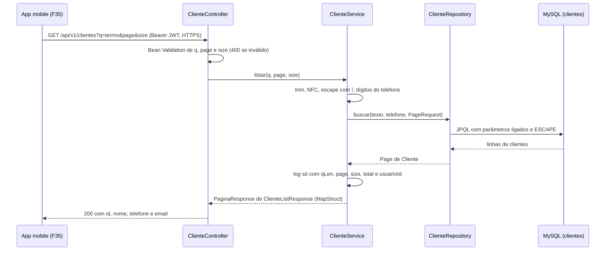

# Padronizar a listagem com busca: termo literal, collation ai_ci fixada por migration e página própria

Histórico de status: 2026-11-14, proposto (F03a, etapa do CARTOGRAFO). Pela regra da casa, o código da F03a só começa depois do aceite da pessoa.

Vínculos: F03a (US-CLI-01 a US-CLI-08), consumida pela F35. O mesmo contrato vale para as próximas listagens com busca: F05 (serviços), F17 (peças), F06 (OS) e F31 (financeiro). Complementa o ADR-003 (migrations aditivas), o ADR-007 (DTO e nomes), o ADR-011 (handler global) e o ADR-013 (Flyway como fonte do schema). Atende os achados A1, A2, A7 e A8 de `docs/security/politica-dados-pessoais-cliente.md`.

## Contexto e problema

A F03a abre o primeiro endpoint de listagem com busca, e mais quatro listagens vão seguir o mesmo modelo. Quatro pontos ainda não estão decididos no código:

1. Busca sem acento e sem caixa: hoje depende da collation padrão do servidor, porque a V2 não fixa `CHARACTER SET` nem `COLLATE` (A7).
2. Termo como texto literal: `%`, `_` e `\` viram curinga ou escape do `LIKE` se não forem tratados (A2).
3. Limites de página: o `Pageable` do Spring corrige `size` grande em silêncio, e o handler global transforma erro de parâmetro em 500 (A1). O critério US-CLI-03a pede 400.
4. Formato JSON da página, que é o contrato da F35.

Como fixar esse contrato para que a busca dê o mesmo resultado em teste, local e produção, e para que as próximas listagens não precisem reinventá-lo?

## Evidência levantada em 2026-11-14

Executado pelo CARTOGRAFO nesta etapa, com a saída real registrada no handoff:

* Base compila: ramo `feat/f03a-clientes-listar` (`origin/main` 11f35b3 mais o commit de documentação 2488c75), compilado no contêiner `maven` fixado no `apps/api/Dockerfile` (Temurin 21.0.7). `mvn -B clean test-compile` compilou 34 fontes e 4 de teste, com BUILD SUCCESS em 51,6 s. Os testes não foram rodados nesta etapa.
* `mysql:8.4` vazio (8.4.13): `@@collation_server` e `@@collation_database` são `utf8mb4_0900_ai_ci`. A tabela `clientes`, criada com o DDL da V2, herda `utf8mb4_0900_ai_ci` na tabela e nas colunas `nome`, `telefone` e `email`.
* Com conexão `utf8mb4`: `jose antonio` casa `José Antônio`, `ana` casa `ANA PAULA` e `pecas` casa `100% Peças`.
* Sem escape, os termos `%` e `_` casam 4 de 4 linhas, ou seja, viram curinga. Com `ESCAPE` usando `!`: `!%` casa só `100% Peças`, `!_` casa só o email que tem `_`, e `uau!!` casa `Oficina Uau!`.
* Barra invertida com parâmetro ligado (`PREPARE`/`EXECUTE`), valor `Barra\Invertida` e padrão `%a\I%`: com `ESCAPE` usando `!` o resultado é 1 linha; sem a cláusula `ESCAPE` é 0, porque a barra vira escape.
* Armadilha observada: o cliente `mysql` do contêiner abriu a conexão em `latin1` e gravou o acento com dupla codificação, e a busca acentuada falhou até a conexão ser forçada para `utf8mb4`. O Connector/J usa `utf8mb4` por padrão, mas isso **não foi verificado** contra a aplicação nesta etapa. O teste de integração da F03a cobre esse ponto.

## Fatores de decisão

* F1. A busca dá o mesmo resultado em Testcontainers, docker-compose e produção, sem depender do padrão implícito do servidor.
* F2. Termo hostil não amplia o resultado: `%`, `_`, `\` e `!` são literais, e o termo nunca é concatenado em SQL ou JPQL.
* F3. Entrada inválida (`size` 0, `size` acima de 100, `page` negativa, `page` não numérica, `q` com mais de 100 caracteres) responde 400 no formato do ADR-011. Nunca há correção silenciosa nem 500.
* F4. O JSON da página é explícito e estável para a F35, sem acoplar ao formato interno do Spring Data.
* F5. Custo: nenhuma dependência nova, nenhum índice dedicado (premissa P2) e no máximo uma migration pequena.
* F6. O contrato é reaproveitável sem mudança por F05, F17, F06 e F31.

## Opções consideradas

São três eixos independentes. Cada um tem a opção de manter como está.

Eixo 1, insensibilidade a acento e caixa:

* C1. Manter como está: confiar no padrão do servidor e só documentar.
* C2. Fixar a collation das colunas buscadas por migration aditiva (V3) e afirmá-la no teste de integração.
* C3. Coluna sombra normalizada em Java (`nome_busca` e afins), mantida pela aplicação a cada escrita.
* C4. `COLLATE` explícito dentro da consulta.

Eixo 2, termo como texto literal:

* E1. Manter o escape padrão do MySQL (`\`), escapando `\`, `%` e `_` no service.
* E2. Usar `!` como caractere de escape, com cláusula `ESCAPE` explícita em toda consulta e `!`, `%` e `_` escapados no service.
* E3. Trocar `LIKE` por `LOCATE`/`INSTR`, que não têm curinga.

Eixo 3, paginação e formato:

* P1. Manter o padrão do Spring: `Pageable` como argumento do controller e `Page` serializado direto.
* P2. Parâmetros `page` e `size` explícitos, validados por Bean Validation, e um DTO próprio `PaginaResponse<T>`.

## Resultado da decisão

Opções escolhidas: **C2 + E2 + P2**.

* C2, porque atende F1 em qualquer servidor com o menor custo entre as opções que atendem (F5). C1 falha em F1 sem que nenhum teste perceba; C3 e C4 custam mais e se reaproveitam pior (F5, F6).
* E2, porque `!` não tem significado especial em literal Java, em JPQL nem no MySQL, enquanto `\` é escape em literal Java e no MySQL, e no MySQL o efeito muda com o `sql_mode` `NO_BACKSLASH_ESCAPES`. O comportamento foi provado contra `mysql:8.4` com parâmetro ligado (F2).
* P2, porque é a única que devolve 400 para `size` acima de 100 (F3) e mantém o JSON sob controle (F4).

### Contrato normativo (F03a, modelo para as próximas listagens)

Endpoint: `GET /api/v1/clientes`, autenticado por JWT (fora de `PUBLIC_PATHS`).

| Parâmetro | Tipo | Padrão | Regra | Inválido |
|---|---|---|---|---|
| `q` | texto | ausente | `@Size(max = 100)` sobre o valor recebido; ausente, vazio ou só espaços lista sem filtro | 400 |
| `page` | inteiro | 0 | `@Min(0)` | 400, inclusive `page=abc` |
| `size` | inteiro | 20 | `@Min(1) @Max(100)` | 400, nunca corrigido em silêncio |

O controller não recebe `Pageable`. Ele recebe os três parâmetros com as anotações acima e repassa ao service, que monta o `PageRequest`. Não há parâmetro `sort` nesta fatia, e parâmetro desconhecido é ignorado.

Normalização do termo, no service, numa função pura com teste unitário:

1. `trim`. Se ficar vazio, a consulta é sem filtro.
2. `java.text.Normalizer` em NFC, para que acento composto por dois code points (alguns teclados) compare igual ao acento de um code point, sem depender de comportamento da collation que não foi verificado.
3. Padrão de texto: `"%" + escapar(termo) + "%"`, onde `escapar` troca, nesta ordem, `!` por `!!`, `%` por `!%` e `_` por `!_`. A ordem importa: `!` vem primeiro para não escapar duas vezes. A barra invertida não é tocada, porque com `ESCAPE` usando `!` ela é literal.
4. Padrão de telefone: remover tudo que não é dígito. Se sobrar pelo menos um dígito, `"%" + digitos + "%"`; senão, `null` e o telefone não é consultado (premissa P4 e US-CLI-01a).

Consulta no `ClienteRepository`, em JPQL com parâmetros nomeados e nunca concatenados:

```sql
select c from Cliente c
where c.nome like :texto escape '!'
   or c.email like :texto escape '!'
   or (:telefone is not null and c.telefone like :telefone escape '!')
```

Sem termo, a consulta é o `findAll(Pageable)` herdado. Nenhuma consulta usa `lower()` ou `upper()`: a insensibilidade vem só da collation. Assim, uma regressão de collation quebra o teste de integração em vez de ficar escondida.

Ordenação: `PageRequest.of(page, size, Sort.by(Sort.Order.asc("nome"), Sort.Order.asc("id")))`. A ordem segue a collation, então `Álvaro` fica ao lado de `Alvaro`.

Resposta 200, corpo `PaginaResponse<ClienteListResponse>` (record genérico no pacote `dto`, reaproveitado pelas próximas listagens):

```json
{
  "itens": [
    { "id": 1, "nome": "José Antônio", "telefone": "11987654321", "email": "jose@example.com" }
  ],
  "pagina": 0,
  "tamanho": 20,
  "totalItens": 1,
  "totalPaginas": 1
}
```

* `telefone` e `email` podem ser `null`, porque são opcionais na V2, e vão no JSON como `null` em vez de serem omitidos.
* Página além do fim: `itens` vazio, com `totalItens` e `totalPaginas` reais (US-CLI-03b).
* Base vazia ou busca sem resultado: `itens` vazio, `totalItens` 0 e `totalPaginas` 0 (US-CLI-02).
* Os nomes dos campos seguem o português do `ErrorResponse` e do `LoginResponse` já publicados.

Erros, todos no corpo `{timestamp, status, erro, mensagem, path}` do ADR-011:

* 400: o `GlobalExceptionHandler` ganha handlers para `HandlerMethodValidationException`, `ConstraintViolationException` e `MethodArgumentTypeMismatchException`. A mensagem cita só o nome do parâmetro (por exemplo `Parametro invalido: size`) e nunca o valor rejeitado. Isso completa o mapeamento "400 = validação de entrada" que o ADR-011 já define; o ADR-011 não muda.
* 401: sem mudança, pelo `RestAuthenticationEntryPoint`.
* 500: mensagem fixa. O log segue a seção 7 da política de dados (classe da exceção, caminho sem query string e identificador da requisição).

### Migration da F03a

`V3__fixar_collation_clientes.sql`, aditiva, escrita pelo ESPRESSO na F03a:

```sql
ALTER TABLE clientes CONVERT TO CHARACTER SET utf8mb4 COLLATE utf8mb4_0900_ai_ci;
```

* No `mysql:8.4` o resultado lógico não muda, porque o padrão já é esse, mas a tabela passa a não depender do servidor. Tipos e tamanhos das colunas não mudam, então o `ddl-auto: validate` continua passando.
* Regra para as próximas listagens: a feature dona de cada busca textual fixa a collation das colunas buscadas na própria migration (`servicos` na F05, `pecas` na F17, e assim por diante).
* `CHECK` de telefone só com dígitos (A8): fica para a migration da F03c, junto com a validação de escrita de 10 ou 11 dígitos, porque a regra e o seu teste nascem com o caminho de escrita. Na F03a ainda não existe escrita, então o risco até lá é só de carga manual.

### Fluxo do dado pessoal na busca



O termo entra pela query string, circula só em memória e como parâmetro ligado, e nunca sai em log nem em mensagem de erro. Nome, telefone e email saem só no corpo da resposta 200. CPF e endereço não existem na V2 e, depois da F09, não entram neste DTO.

### Consequências

* Bom, porque a busca dá o mesmo resultado em todo servidor onde a V3 rodar, e o teste de integração quebra se a collation mudar.
* Bom, porque nenhum termo amplia o resultado: o curinga vira literal, e o parâmetro ligado impede injeção.
* Bom, porque entrada inválida vira 400 com o nome do parâmetro, sem eco do valor, o que fecha o A1 também para as próximas listagens.
* Bom, porque a F35 recebe um JSON explícito e estável, e as próximas listagens reaproveitam `PaginaResponse<T>` e a função de escape.
* Ruim, porque cada listagem nova precisa lembrar de `ESCAPE` em cada `like` e de fixar a collation na sua migration. A seção Confirmação torna isso verificável por `grep` e por teste.
* Ruim, porque `LIKE` com `%` no início faz varredura completa da tabela. Isso é aceito pelo volume da premissa P2.
* Ruim, porque um termo misto como `rua 7` também procura `7` no telefone e traz resultados a mais. Isso segue a premissa P4 como está escrita; mudar a regra é decisão da BUSSOLA (ver Mais informações).
* Neutro, porque o `ALTER TABLE ... CONVERT` reconstrói a tabela, mas com o volume atual o bloqueio é desprezível.

### Risco residual

* O charset da conexão do Connector/J não foi verificado contra a aplicação. O teste de integração com dado acentuado prova o caminho completo.
* A query string carrega o termo (A4). A mitigação está na seção 7 da política de dados: access log sem query, HTTPS fora do local e app sem log de URL.
* Qualquer token válido percorre a base em páginas de 100 (A3, risco aceito pela pessoa).
* Tabelas criadas no futuro sem collation explícita herdam o padrão do servidor. A regra deste ADR cobre só as colunas buscadas.

### Confirmação

* Teste de integração com Testcontainers (`mysql:8.4`, todas as migrations do zero) lê `information_schema.COLUMNS` e afirma `utf8mb4_0900_ai_ci` em `clientes.nome`, `telefone` e `email`. O mesmo teste afirma, com dados: acento e caixa ignorados; `%`, `_`, `\` e `!` literais; telefone com e sem máscara; termo só de letras sem casar telefone; página além do fim; ordem por nome e id.
* Teste MockMvc: 400 para `size=0`, `size=101`, `page=-1`, `page=abc` e `q` com 101 caracteres, com o corpo sem o valor rejeitado.
* Teste unitário da função de normalização e escape, incluindo `!` seguido de `%`.
* Revisão de PR: `git grep -niE "like :" -- apps/api/src/main/java` não pode ter linha sem `escape`; `git grep -n "Pageable " -- apps/api/src/main/java/br/com/mecanicasaojorge/api/controller` deve vir vazio.
* Revisão do CARTOGRAFO nos PRs de F05, F17, F06 e F31 contra este contrato.

## Prós e contras das opções

### C1. Manter a collation padrão do servidor
* Bom, porque não exige mudança nenhuma e hoje funciona no `mysql:8.4`.
* Ruim, porque falha em F1: um servidor gerenciado ou atualizado com outro padrão muda o resultado da busca em silêncio, e nenhum teste percebe.
* Custo de descartar: nenhum.

### C2. Fixar a collation por migration aditiva (escolhida)
* Bom, porque atende F1 em todo ambiente que roda as migrations, com um único `ALTER` e sem dependência nova (F5).
* Neutro, porque no `mysql:8.4` é um no-op lógico.
* Ruim, porque vale só para as tabelas que a fixarem, e cada feature de busca precisa repetir a regra.

### C3. Coluna sombra normalizada em Java
* Bom, porque independe do banco.
* Ruim, porque exige uma coluna a mais por campo buscado, sincronização em toda escrita (F03c e F03d), migration de backfill e mais código para manter. Falha em F5 e F6.
* Custo de descartar: perdemos a independência de banco, que o projeto não precisa, porque o MySQL é fixo no briefing.

### C4. COLLATE explícito na consulta
* Bom, porque não precisa de migration.
* Ruim, porque `COLLATE` não é JPQL padrão, o que obriga SQL nativo ou função específica do Hibernate. Também impede uso de índice e se repete em cada consulta. Falha em F6.
* Custo de descartar: uma migration a mais por tabela buscada.

### E1. Escape padrão com barra invertida
* Bom, porque é o padrão do MySQL e dispensa a cláusula `ESCAPE`.
* Ruim, porque a barra é escape em literal Java e no MySQL, e no MySQL o efeito muda com o `sql_mode` `NO_BACKSLASH_ESCAPES`. São camadas de escape sobrepostas, e é fácil errar.
* Custo de descartar: escrever `ESCAPE` em cada consulta.

### E2. Escape com ! e ESCAPE explícito (escolhida)
* Bom, porque `!` não tem significado em nenhuma camada, e o comportamento foi provado contra `mysql:8.4` com parâmetro ligado.
* Ruim, porque o próprio `!` também precisa ser escapado, e a cláusula não pode ser esquecida (coberto por `grep` e teste).

### E3. LOCATE/INSTR em vez de LIKE
* Bom, porque não há curinga e, portanto, nada a escapar.
* Ruim, porque não foi verificado se respeita a insensibilidade a acento da collation, o custo de varredura é o mesmo do `LIKE`, e o padrão é menos conhecido pelo time.
* Custo de descartar: manter a função de escape, que é pequena e tem teste.

### P1. Pageable e Page do Spring
* Bom, porque exige menos código.
* Ruim, porque o `max-page-size` corrige `size=101` para 100 e responde 200 em vez de 400, e `page` negativa vira 0, o que fere F3 e US-CLI-03a. A serialização direta de `PageImpl` é desaconselhada pelo próprio Spring Data e expõe campos internos (`pageable`, `sort`), o que fere F4.
* Custo de descartar: um record genérico e três handlers novos.

### P2. Parâmetros explícitos e PaginaResponse (escolhida)
* Bom, porque a validação declarativa vira 400 pelo handler global, e o JSON fica sob controle do time.
* Ruim, porque cria um DTO genérico novo e exige handlers que hoje não existem (A1).

## Mais informações

* Revisitar quando a base passar de alguns milhares de clientes (premissa P2): avaliar índice `FULLTEXT` com parser `ngram` ou busca por prefixo.
* Revisitar se a F35 pedir ordenação: o parâmetro `sort` entra com uma lista fechada de campos, nunca com um nome de coluna livre.
* Ponto para a BUSSOLA: consultar o telefone só quando o termo tiver apenas dígitos e caracteres de máscara (espaço, parênteses, hífen, ponto e `+`) reduziria o ruído de termos como `rua 7`. Hoje a premissa P4 diz "pelo menos um dígito", e este ADR segue o texto aprovado.
* Melhoria possível: `ALTER DATABASE` com a collation padrão numa migration faria tabelas futuras herdarem a regra. Fica de fora porque exige privilégio que não foi verificado no usuário da aplicação.
* Dependência de merge: a F03a só entra na `main` depois do PR #13 (Spring Boot 4.1.2, achado A0) ou rebaseada sobre ele.
* Os ADR-014, 015 e 016 existem em ramos ainda fora da `main`. A numeração está reservada, por isso este é o ADR-017.
