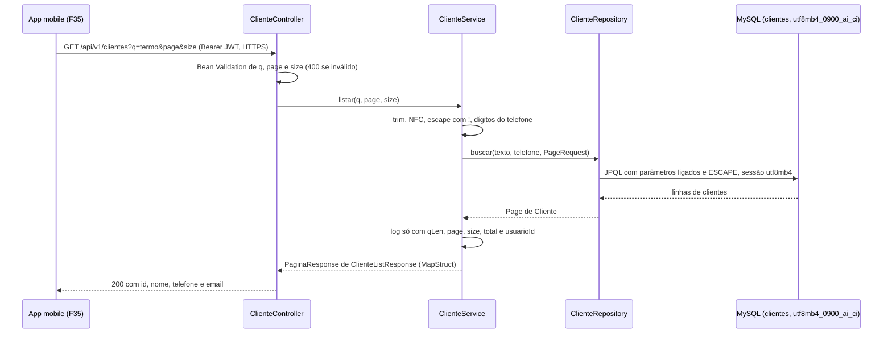

# Padronizar a listagem com busca: termo literal, collation ai_ci fixada por migration e página própria

Histórico de status:

* 2026-11-14: proposto (F03a, etapa do CARTOGRAFO), commit 9213152. Entrou na `main` pela PR #15.
* 2026-11-17: revisão 1, ainda proposto. Decide o charset da sessão (eixo 4) com evidência contra o Connector/J real e contra servidor em `latin1`, fecha os casos de borda do contrato (`q` só de espaços acima de 100, `qLen`, `tamanho`), alinha o escape ao achado A2 da política e corrige a dependência de merge do PR #13 para o PR #14. Pronto para o aceite da pessoa. Pela regra da casa, o código da F03a só começa depois do aceite.

Vínculos: F03a (US-CLI-01 a US-CLI-08), consumida pela F35. O mesmo contrato vale para as próximas listagens com busca: F05 (serviços), F17 (peças), F06 (OS) e F31 (financeiro). Complementa o ADR-003 (migrations aditivas), o ADR-007 (DTO e nomes), o ADR-009 (configuração por variável de ambiente), o ADR-011 (handler global) e o ADR-013 (Flyway como fonte do schema). Atende os achados A1, A2, A7 e A8 e as seções 6.3 e 7 de `docs/security/politica-dados-pessoais-cliente.md` (revisão 1 na PR #17).

## Contexto e problema

A F03a abre o primeiro endpoint de listagem com busca, e mais quatro listagens vão seguir o mesmo modelo. Cinco pontos ainda não estão decididos no código:

1. Busca sem acento e sem caixa: hoje depende da collation padrão do servidor, porque a V2 não fixa `CHARACTER SET` nem `COLLATE` (A7).
2. Termo como texto literal: `%`, `_` e `\` viram curinga ou escape do `LIKE` se não forem tratados (A2).
3. Limites de página: o `Pageable` do Spring corrige `size` grande em silêncio, e o handler global transforma erro de parâmetro em 500 (A1). O critério US-CLI-03a pede 400.
4. Formato JSON da página, que é o contrato da F35.
5. Charset da sessão: em 2026-11-14 o cliente `mysql` do contêiner abriu a sessão em `latin1` e gravou acento com dupla codificação. Faltava saber se a aplicação corre o mesmo risco e se um servidor com padrão `latin1` muda o resultado da busca.

Como fixar esse contrato para que a busca dê o mesmo resultado em teste, local e produção, e para que as próximas listagens não precisem reinventá-lo?

## Evidência

### 2026-11-14 (proposta original)

* Base compila: ramo `feat/f03a-clientes-listar` (`origin/main` 11f35b3 mais o commit 2488c75), compilado no contêiner `maven` fixado no `apps/api/Dockerfile` (Temurin 21.0.7). `mvn -B clean test-compile` terminou com BUILD SUCCESS. Os testes não foram rodados nessa etapa.
* `mysql:8.4` vazio (8.4.13): `@@collation_server` e `@@collation_database` são `utf8mb4_0900_ai_ci`, e a tabela `clientes` criada com o DDL da V2 herda essa collation nas colunas `nome`, `telefone` e `email`.
* Sem escape, `%` e `_` casaram 4 de 4 linhas. Com `ESCAPE` usando `!`, cada um casou só a linha que o contém. Barra invertida com parâmetro ligado (`PREPARE`/`EXECUTE`): com `ESCAPE` usando `!` o padrão `%a\I%` achou `Barra\Invertida`; sem a cláusula `ESCAPE`, não achou.

### 2026-11-17 (revisão 1)

Executado pelo CARTOGRAFO com contêineres `mysql:8.4` descartáveis e o driver real: `mysql-connector-j` 9.7.0, a versão gerenciada pelo Spring Boot 4.1.2 (alvo do PR #14), em Temurin 21.0.7 na imagem `maven` fixada no `apps/api/Dockerfile`. O programa de prova inseriu e buscou por `PreparedStatement`, o mesmo caminho de bind usado pelo Hibernate, com URL sem nenhum parâmetro de charset (`jdbc:mysql://host:3306/msj`). A pilha Hikari + Hibernate não foi exercitada; quem prova esse trecho é o teste de integração da F03a.

| Cenário | Sessão aberta pelo driver | Colunas de `clientes` | Resultado |
|---|---|---|---|
| Servidor padrão, DDL da V2 | `utf8mb4` / `utf8mb4_0900_ai_ci` | `utf8mb4_0900_ai_ci` | 12 de 12 buscas como esperado; `José` gravado com bytes `C3A9` no `é` (UTF-8 correto) |
| Servidor padrão, V2 + V3 | igual | igual | igual: a V3 é no-op lógico |
| Servidor com `--character-set-server=latin1`, DDL da V2 | `utf8mb4` / `utf8mb4_0900_ai_ci` | `latin1_swedish_ci` | as 12 buscas passaram, mas nome com emoji falhou com `Incorrect string value`; em comparação direta, `Müller` difere de `muller` e `Ö` difere de `o` na collation sueca |
| Servidor `latin1`, V2 + V3 | igual | `utf8mb4_0900_ai_ci` | 12 de 12 buscas; nome com emoji gravado |

Buscas do roteiro: `jose antonio`, `ana`, `pecas`, `PEÇAS`, `%`, `_`, `\`, `uau!`, `alvaro`, `(11) 98765`, `4444` e `José` escrito com acento combinante (U+0301) e normalizado em NFC. `%` casou só `100% Peças`; `_` casou só o email que tem `_`; `\` casou só `Barra\Invertida`; `ana` não consultou telefone; `alvaro` trouxe `Álvaro` e `Alvaro`, empatados na collation e desempatados por `id`. Em `utf8mb4_0900_ai_ci`, `Müller` casa `muller` e `Ö` é igual a `o`.

Conversão com dado já gravado: no servidor `latin1`, `José Antônio` e `Müller` foram inseridos por uma sessão `utf8mb4` na tabela ainda em `latin1_swedish_ci` (bytes `E9`, `F4` e `FC`), e só depois a V3 rodou. As colunas passaram para `utf8mb4_0900_ai_ci`, os bytes viraram `C3A9`, `C3B4` e `C3BC` (UTF-8 correto, sem perda), e `muller` passou de 0 para 1 resultado.

Origem do `latin1`: o cliente `mysql` dentro do contêiner, com `LANG` vazio, abre a sessão em `latin1` (`character_set_client`, `connection` e `results`), mesmo com o servidor em `utf8mb4`. Com `--default-character-set=utf8mb4`, ou com `LANG=C.UTF-8` no `docker exec` ou no ambiente do contêiner, abre em `utf8mb4`. Com `LANG=C.UTF-8` no ambiente do contêiner, o servidor continua em `utf8mb4_0900_ai_ci`.

Dano provado: `Joséfa` inserido pela sessão `latin1` ficou gravado com bytes `C383C2A9` no lugar do `é` (dupla codificação). Ele aparece certo para a própria sessão `latin1`, mas uma sessão `utf8mb4` buscando `josefa` não encontra nada.

Conclusão: o `latin1` vem do cliente de linha de comando, não do servidor nem do driver da aplicação. O risco real é um script manual (seed, correção de cadastro ou a anonimização da seção 4 da política) gravar dado que a busca depois não acha, e a V3 não corrige dado que já entrou com dupla codificação.

## Fatores de decisão

* F1. A busca dá o mesmo resultado em Testcontainers, docker-compose e produção, sem depender do padrão implícito do servidor.
* F2. Termo hostil não amplia o resultado: `%`, `_`, `\` e `!` são literais, e o termo nunca é concatenado em SQL ou JPQL.
* F3. Entrada inválida (`size` 0, `size` acima de 100, `page` negativa, `page` não numérica, `q` com mais de 100 caracteres) responde 400 no formato do ADR-011. Nunca há correção silenciosa nem 500.
* F4. O JSON da página é explícito e estável para a F35, sem acoplar ao formato interno do Spring Data.
* F5. Custo: nenhuma dependência nova, nenhum cache, nenhum índice dedicado (premissa P2) e no máximo uma migration pequena e uma linha de configuração.
* F6. O contrato é reaproveitável sem mudança por F05, F17, F06 e F31.
* F7. Dado gravado por qualquer caminho de escrita previsto (aplicação, Flyway, script manual de ADMIN) fica em UTF-8 correto e é encontrado pela busca.

## Opções consideradas

São quatro eixos independentes. Cada um tem a opção de manter como está.

Eixo 1, insensibilidade a acento e caixa:

* C1. Manter como está: confiar no padrão do servidor e só documentar.
* C2. Fixar a collation das colunas buscadas por migration aditiva (V3) e afirmá-la no teste de integração.
* C3. Coluna sombra normalizada em Java (`nome_busca` e afins), mantida pela aplicação a cada escrita.
* C4. `COLLATE` explícito dentro da consulta.

Eixo 2, termo como texto literal:

* E1. Manter o escape padrão do MySQL (`\`), escapando `\`, `%` e `_` no service.
* E2. Usar `!` como caractere de escape, com cláusula `ESCAPE` explícita em toda consulta e `!`, `%` e `_` escapados no service.
* E3. Trocar `LIKE` por `LOCATE`/`INSTR`, que não têm curinga.

Eixo 3, paginação e formato:

* P1. Manter o padrão do Spring: `Pageable` como argumento do controller e `Page` serializado direto.
* P2. Parâmetros `page` e `size` explícitos, validados por Bean Validation, e um DTO próprio `PaginaResponse<T>`.

Eixo 4, charset da sessão com o banco:

* K1. Manter como está: confiar no padrão do driver, sem afirmação em teste e sem regra para o cliente de linha de comando.
* K2. Confiar no padrão do Connector/J, afirmar a sessão `utf8mb4` no teste de integração e fechar o caminho do cliente `mysql` (`LANG=C.UTF-8` no serviço do docker-compose e `--default-character-set=utf8mb4` obrigatório em script manual).
* K3. Fixar `characterEncoding=UTF-8` e `connectionCollation` na URL ou em `spring.datasource.hikari.data-source-properties`.
* K4. Fixar o charset do servidor (`--character-set-server=utf8mb4`) no docker-compose e exigir o mesmo do banco de produção.

## Resultado da decisão

Opções escolhidas: **C2 + E2 + P2 + K2**.

* C2, porque atende F1 em qualquer servidor com o menor custo entre as opções que atendem (F5). A evidência de 2026-11-17 mostra que, num servidor `latin1`, a V3 leva as colunas para `utf8mb4_0900_ai_ci` e a busca passa a ignorar acento nos casos em que a collation sueca não ignora. C1 falha em F1 sem que nenhum teste perceba; C3 e C4 custam mais e se reaproveitam pior (F5, F6).
* E2, porque `!` não tem significado especial em literal Java, em JPQL nem no MySQL, enquanto `\` é escape em literal Java e no MySQL, e no MySQL o efeito muda com o `sql_mode` `NO_BACKSLASH_ESCAPES`. Provado com parâmetro ligado em 2026-11-14 e de novo pelo Connector/J em 2026-11-17 (F2).
* P2, porque é a única que devolve 400 para `size` acima de 100 (F3) e mantém o JSON sob controle (F4).
* K2, porque o driver já abre a sessão em `utf8mb4`, inclusive com servidor `latin1` (evidência de 2026-11-17). A única origem de dupla codificação observada é o cliente de linha de comando, e ela se fecha com uma linha no docker-compose e uma regra de operação (F7, F5). A afirmação no teste de integração pega troca de driver ou de padrão.

### Contrato normativo (F03a, modelo para as próximas listagens)

Endpoint: `GET /api/v1/clientes`, autenticado por JWT (fora de `PUBLIC_PATHS`).

| Parâmetro | Tipo | Padrão | Regra | Inválido |
|---|---|---|---|---|
| `q` | texto | ausente | `@Size(max = 100)` sobre o valor bruto recebido; ausente, vazio ou só espaços lista sem filtro | 400 |
| `page` | inteiro, base 0 | 0 | `@Min(0)` | 400, inclusive `page=abc` |
| `size` | inteiro | 20 | `@Min(1) @Max(100)` | 400, inclusive `size=abc`; nunca corrigido em silêncio |

Casos de borda fechados na revisão 1:

* O limite de `q` conta `String.length()` (unidades UTF-16, como faz o `@Size` do Hibernate Validator) do valor bruto, antes do `trim`. A validação vem antes da normalização: `q` com 101 espaços responde 400, e `q` com até 100 espaços lista sem filtro. Um emoji conta 2.
* O controller não recebe `Pageable`. Ele recebe os três parâmetros com as anotações acima, sem `@Validated` na classe, e repassa ao service, que monta o `PageRequest`. Não há parâmetro `sort` nesta fatia, e parâmetro desconhecido é ignorado.

Normalização do termo, no service, numa função pura com teste unitário:

1. `trim`. Se ficar vazio, a consulta é sem filtro.
2. `java.text.Normalizer` em NFC, para que acento composto por dois code points (alguns teclados) compare igual ao acento de um code point. Provado com `Jose` + U+0301 em 2026-11-17.
3. Padrão de texto: `"%" + escapar(termo) + "%"`, onde `escapar` troca, nesta ordem, `!` por `!!`, `%` por `!%` e `_` por `!_`. A ordem importa: `!` vem primeiro para não escapar duas vezes.
4. A barra invertida **não** é escapada. Com `ESCAPE` usando `!`, ela já é literal (provado em 2026-11-14 e 2026-11-17). Escapá-la seria um erro: em 2026-11-17, com `ESCAPE` usando `!`, o padrão `%\%` achou `Barra\Invertida` e o padrão `%\\%` não achou nada. O achado A2 da política fala em escapar `\`, `%` e `_` porque partia do escape padrão do MySQL; com a opção E2, vale este ADR.
5. Padrão de telefone: remover tudo que não é dígito ASCII de 0 a 9. Se sobrar pelo menos um dígito, `"%" + digitos + "%"`; senão, `null`, e o telefone não é consultado (premissa P4 e US-CLI-01a).
6. `qLen` da linha de log (seção 6.3 da política) é o `length()` do termo depois dos passos 1 e 2, antes do escape. Sem termo, é 0. O termo em si nunca vai para o log.

Consulta no `ClienteRepository`, em JPQL com parâmetros nomeados e nunca concatenados:

```sql
select c from Cliente c
where c.nome like :texto escape '!'
   or c.email like :texto escape '!'
   or (:telefone is not null and c.telefone like :telefone escape '!')
```

Sem termo, a consulta é o `findAll(Pageable)` herdado. Nenhuma consulta usa `lower()` ou `upper()`: a insensibilidade vem só da collation. Assim, uma regressão de collation quebra o teste de integração em vez de ficar escondida.

Ordenação: `PageRequest.of(page, size, Sort.by(Sort.Order.asc("nome"), Sort.Order.asc("id")))`. A ordem segue a collation, então `Álvaro` e `Alvaro` empatam no nome e são desempatados pelo `id`.

Resposta 200, corpo `PaginaResponse<ClienteListResponse>` (record genérico no pacote `dto`, reaproveitado pelas próximas listagens):

```json
{
  "itens": [
    { "id": 1, "nome": "José Antônio", "telefone": "11987654321", "email": "jose@example.com" }
  ],
  "pagina": 0,
  "tamanho": 20,
  "totalItens": 1,
  "totalPaginas": 1
}
```

* `pagina` é o `page` pedido (base 0). `tamanho` é o `size` pedido, não a quantidade de itens devolvidos. `totalItens` é `long`, e `totalPaginas` é `int`.
* `telefone` e `email` podem ser `null`, porque são opcionais na V2, e vão no JSON como `null` em vez de serem omitidos. `telefone` sai só com dígitos, como está gravado; a formatação para exibição é da F35.
* Página além do fim: `itens` vazio, com `totalItens` e `totalPaginas` reais (US-CLI-03b).
* Base vazia ou busca sem resultado: `itens` vazio, `totalItens` 0 e `totalPaginas` 0 (US-CLI-02).
* Os nomes dos campos seguem o português do `ErrorResponse` e do `LoginResponse` já publicados. O nome do schema que o springdoc gera para o tipo genérico não faz parte do contrato; a F35 se guia pelos nomes dos campos.

Erros, todos no corpo `{timestamp, status, erro, mensagem, path}` do ADR-011:

* 400: o `GlobalExceptionHandler` ganha handlers para `HandlerMethodValidationException`, `ConstraintViolationException` e `MethodArgumentTypeMismatchException`. A mensagem cita só o nome do parâmetro (por exemplo `Parametro invalido: size`) e nunca o valor rejeitado, e a mensagem de constraint não usa `${validatedValue}`. Isso completa o mapeamento "400 = validação de entrada" que o ADR-011 já define; o ADR-011 não muda.
* 401: sem mudança, pelo `RestAuthenticationEntryPoint`.
* 500: mensagem fixa. O log segue a seção 7 da política de dados: classe da exceção, caminho sem query string e identificador da requisição, sem `getMessage()` de causa de persistência (A5).

### Migration da F03a

`V3__fixar_collation_clientes.sql`, aditiva, escrita pelo ESPRESSO na F03a:

```sql
ALTER TABLE clientes CONVERT TO CHARACTER SET utf8mb4 COLLATE utf8mb4_0900_ai_ci;
```

* No `mysql:8.4` padrão o resultado lógico não muda, mas a tabela deixa de depender do servidor. Num servidor `latin1`, a V3 converteu as três colunas para `utf8mb4_0900_ai_ci` sem perder o dado gravado (evidência de 2026-11-17). Tipos e tamanhos das colunas não mudam, então o `ddl-auto: validate` continua passando.
* O número V3 está livre: a `main` (dfab787) e a cabeça do PR #14 (927bfaa) só têm V1 e V2, conferido em 2026-11-17. Se outra feature entrar antes com V3, a F03a usa o próximo número livre (ADR-003).
* A V3 não conserta dado já gravado com dupla codificação: ela converte bytes que já estão errados. Por isso a regra do cliente de linha de comando abaixo vale antes do primeiro dado real.
* Regra para as próximas listagens: a feature dona de cada busca textual fixa a collation das colunas buscadas na própria migration (`servicos` na F05, `pecas` na F17, e assim por diante).
* `CHECK` de telefone só com dígitos (A8): fica para a migration da F03c, junto com a validação de escrita de 10 ou 11 dígitos, porque a regra e o seu teste nascem com o caminho de escrita.

### Charset da sessão

* Aplicação: nenhum parâmetro de charset em `DB_URL`, no `.env.example` nem no `application.yml`. Vale o padrão do Connector/J (`utf8mb4`), afirmado no teste de integração. `DB_URL` com `characterEncoding` diferente de `UTF-8` é proibido, e o comentário do `.env.example` passa a dizer isso (ADR-009).
* docker-compose: o serviço `mysql` de `apps/api/docker-compose.yml` ganha `LANG: C.UTF-8` em `environment`, para que `docker compose exec mysql mysql ...` abra a sessão em `utf8mb4`. O servidor não muda.
* Script manual (seed, correção de cadastro, anonimização da seção 4 da política): sempre executado com `mysql --default-character-set=utf8mb4`, inclusive fora do docker-compose. O script revisado pelo VIGIA para a pendência P2 traz esse comando no cabeçalho.

### Fluxo do dado pessoal na busca



O termo entra pela query string, circula só em memória e como parâmetro ligado, e nunca sai em log nem em mensagem de erro. Nome, telefone e email saem só no corpo da resposta 200. CPF e endereço não existem na V2 e, depois da F09, não entram neste DTO.

### Consequências

* Bom, porque a busca dá o mesmo resultado em todo servidor onde a V3 rodar, inclusive num servidor `latin1`, e o teste de integração quebra se a collation ou o charset da sessão mudarem.
* Bom, porque nenhum termo amplia o resultado: o curinga vira literal, e o parâmetro ligado impede injeção.
* Bom, porque entrada inválida vira 400 com o nome do parâmetro, sem eco do valor, o que fecha o A1 também para as próximas listagens.
* Bom, porque a F35 recebe um JSON explícito e estável, e as próximas listagens reaproveitam `PaginaResponse<T>` e a função de escape.
* Bom, porque o caminho que de fato corrompeu dado (cliente `mysql` em `latin1`) fica fechado no ambiente local e tem regra escrita para produção.
* Ruim, porque cada listagem nova precisa lembrar de `ESCAPE` em cada `like` e de fixar a collation na sua migration. A seção Confirmação torna isso verificável por `grep` e por teste.
* Ruim, porque `LIKE` com `%` no início faz varredura completa da tabela. Isso é aceito pelo volume da premissa P2.
* Ruim, porque um termo misto como `rua 7` também procura `7` no telefone e traz resultados a mais. Isso segue a premissa P4 como está escrita; mudar a regra é decisão da BUSSOLA (ver Mais informações).
* Ruim, porque um segundo teste de integração com servidor `latin1` acrescenta um contêiner ao job de integração do CI.
* Neutro, porque o `ALTER TABLE ... CONVERT` reconstrói a tabela, mas com o volume atual o bloqueio é desprezível.

### Risco residual

* Script manual em produção rodado sem `--default-character-set=utf8mb4` ainda grava dupla codificação. Nenhum teste pega isso; a mitigação é a regra acima e a revisão do VIGIA no script da P2.
* A afirmação de sessão `utf8mb4` no teste de integração vale para a URL do Testcontainers, não para a `DB_URL` de produção. Uma `DB_URL` com `characterEncoding` errado só é pega por revisão.
* A query string carrega o termo (A4). A mitigação está na seção 7 da política de dados: access log sem query, HTTPS fora do local e app sem log de URL.
* Qualquer token válido percorre a base em páginas de 100 (A3, risco aceito pela pessoa).
* Tabelas criadas no futuro sem collation explícita herdam o padrão do servidor. A regra deste ADR cobre só as colunas buscadas.

### Confirmação

* Teste de integração com Testcontainers (`mysql:8.4`, todas as migrations do zero):
  * lê `information_schema.COLUMNS` e afirma `utf8mb4_0900_ai_ci` em `clientes.nome`, `telefone` e `email`;
  * afirma `SELECT @@character_set_connection` igual a `utf8mb4` pelo `DataSource` da aplicação;
  * afirma com dados, pela API: acento e caixa ignorados; `%`, `_`, `\` e `!` literais; telefone com e sem máscara; termo só de letras sem casar telefone; termo acentuado em forma decomposta (NFD); página além do fim; ordem por nome e id.
* Segundo teste de integração com o servidor em `latin1` (`withCommand("--character-set-server=latin1", "--collation-server=latin1_swedish_ci")`), todas as migrations do zero: afirma a collation das três colunas depois da V3 e que `muller` encontra `Müller`. É a prova do fator F1.
* Teste MockMvc: 400 para `size=0`, `size=101`, `size=abc`, `page=-1`, `page=abc`, `q` com 101 caracteres e `q` com 101 espaços, com o corpo sem o valor rejeitado.
* Teste unitário da função de normalização e escape, incluindo `!` seguido de `%`, a barra invertida intacta e o termo NFD.
* Revisão de PR:
  * `git grep -niE "like :" -- apps/api/src/main/java` não pode ter linha sem `escape`;
  * `git grep -n "Pageable " -- apps/api/src/main/java/br/com/mecanicasaojorge/api/controller` deve vir vazio;
  * `git grep -n "characterEncoding" -- apps/api` vazio ou só com `UTF-8`;
  * `docker compose -f apps/api/docker-compose.yml config` mostra `LANG: C.UTF-8` no serviço `mysql`.
* Revisão do CARTOGRAFO nos PRs de F05, F17, F06 e F31 contra este contrato.

## Prós e contras das opções

### C1. Manter a collation padrão do servidor
* Bom, porque não exige mudança nenhuma e hoje funciona no `mysql:8.4`.
* Ruim, porque falha em F1: num servidor `latin1` as colunas viram `latin1_swedish_ci`, em que `Müller` difere de `muller` e emoji é recusado (provado em 2026-11-17), e nenhum teste percebe.
* Custo de descartar: nenhum.

### C2. Fixar a collation por migration aditiva (escolhida)
* Bom, porque atende F1 em todo ambiente que roda as migrations, com um único `ALTER` e sem dependência nova (F5). Provado em servidor `utf8mb4` e em servidor `latin1`.
* Neutro, porque no `mysql:8.4` padrão é um no-op lógico.
* Ruim, porque vale só para as tabelas que a fixarem, cada feature de busca precisa repetir a regra, e a conversão não conserta dado já corrompido.

### C3. Coluna sombra normalizada em Java
* Bom, porque independe do banco.
* Ruim, porque exige uma coluna a mais por campo buscado, sincronização em toda escrita (F03c e F03d), migration de backfill e mais código para manter. Falha em F5 e F6.
* Custo de descartar: perdemos a independência de banco, que o projeto não precisa, porque o MySQL é fixo no briefing.

### C4. COLLATE explícito na consulta
* Bom, porque não precisa de migration.
* Ruim, porque `COLLATE` não é JPQL padrão, o que obriga SQL nativo ou função específica do Hibernate. Também impede uso de índice e se repete em cada consulta. Num servidor `latin1`, não resolve o emoji recusado na escrita. Falha em F6.
* Custo de descartar: uma migration a mais por tabela buscada.

### E1. Escape padrão com barra invertida
* Bom, porque é o padrão do MySQL e dispensa a cláusula `ESCAPE`.
* Ruim, porque a barra é escape em literal Java e no MySQL, e no MySQL o efeito muda com o `sql_mode` `NO_BACKSLASH_ESCAPES`. São camadas de escape sobrepostas, e é fácil errar.
* Custo de descartar: escrever `ESCAPE` em cada consulta.

### E2. Escape com ! e ESCAPE explícito (escolhida)
* Bom, porque `!` não tem significado em nenhuma camada, e o comportamento foi provado contra `mysql:8.4` com parâmetro ligado e com o Connector/J.
* Ruim, porque o próprio `!` também precisa ser escapado, a cláusula não pode ser esquecida (coberto por `grep` e teste) e o texto do A2 da política precisa ser lido junto com este ADR.

### E3. LOCATE/INSTR em vez de LIKE
* Bom, porque não há curinga e, portanto, nada a escapar.
* Ruim, porque não foi verificado se respeita a insensibilidade a acento da collation, o custo de varredura é o mesmo do `LIKE`, e o padrão é menos conhecido pelo time.
* Custo de descartar: manter a função de escape, que é pequena e tem teste.

### P1. Pageable e Page do Spring
* Bom, porque exige menos código.
* Ruim, porque o `max-page-size` corrige `size=101` para 100 e responde 200 em vez de 400, e `page` negativa vira 0, o que fere F3 e US-CLI-03a. A serialização direta de `PageImpl` é desaconselhada pelo próprio Spring Data e expõe campos internos (`pageable`, `sort`), o que fere F4.
* Custo de descartar: um record genérico e três handlers novos.

### P2. Parâmetros explícitos e PaginaResponse (escolhida)
* Bom, porque a validação declarativa vira 400 pelo handler global, e o JSON fica sob controle do time.
* Ruim, porque cria um DTO genérico novo e exige handlers que hoje não existem (A1).

### K1. Manter o padrão do driver sem afirmação
* Bom, porque não exige mudança, e o driver já abre em `utf8mb4` (provado em 2026-11-17).
* Ruim, porque uma troca de driver ou de padrão passa sem teste, e o cliente `mysql` continua corrompendo dado em script manual, que foi o único dano observado. Falha em F7.
* Custo de descartar: nenhum.

### K2. Padrão do driver afirmado em teste e cliente de linha de comando fechado (escolhida)
* Bom, porque fecha a única origem de dupla codificação observada com uma linha no docker-compose, uma asserção e uma regra de operação, sem dependência nova (F5, F7).
* Ruim, porque depende de disciplina em script manual fora do docker-compose, e a asserção do teste não cobre a `DB_URL` de produção.

### K3. characterEncoding fixado na configuração
* Bom, porque deixa a escolha explícita na configuração da aplicação.
* Ruim, porque repete o padrão já verificado do driver, não resolve o cliente de linha de comando e, como a `DB_URL` é texto livre por ambiente (ADR-009), quem escreve a URL ainda pode sobrescrever. A precedência entre propriedade do Hikari e parâmetro da URL **não foi verificada**.
* Custo de descartar: perdemos a declaração explícita, compensada pela asserção no teste de integração.

### K4. Charset do servidor fixado no docker-compose
* Bom, porque tabelas futuras do ambiente local herdariam `utf8mb4` mesmo sem `COLLATE`.
* Ruim, porque no `mysql:8.4` já é o padrão, não vale para o banco de produção, que depende do provedor, e não resolve o cliente `mysql`: o cliente segue o locale, não o servidor (provado com servidor `utf8mb4` e cliente `latin1`).
* Custo de descartar: tabela futura sem collation herda o padrão do servidor, o que já está no risco residual.

## Mais informações

* Revisitar quando a base passar de alguns milhares de clientes (premissa P2): avaliar índice `FULLTEXT` com parser `ngram` ou busca por prefixo.
* Revisitar se a F35 pedir ordenação: o parâmetro `sort` entra com uma lista fechada de campos, nunca com um nome de coluna livre.
* Ponto para a BUSSOLA: consultar o telefone só quando o termo tiver apenas dígitos e caracteres de máscara (espaço, parênteses, hífen, ponto e `+`) reduziria o ruído de termos como `rua 7`. Hoje a premissa P4 diz "pelo menos um dígito", e este ADR segue o texto aprovado.
* Melhoria possível: `ALTER DATABASE` com a collation padrão numa migration faria tabelas futuras herdarem a regra. Fica de fora porque exige privilégio de `ALTER` no banco que não foi verificado no usuário de produção, e uma migration que falha impede a aplicação de subir.
* Dependência de merge: o código da F03a só entra na `main` depois do PR #14 (Spring Boot 4.1.2, achado A0) ou rebaseado sobre ele. O PR #13 foi mergeado no ramo do #14, não na `main`.
* ADR-014 já está na `main`. ADR-015 e ADR-016 continuam em ramos fora dela (ADR-016 no PR #14). A numeração deles está reservada, por isso este é o ADR-017.
* A evidência de 2026-11-17 veio de um programa descartável fora do repositório. A prova versionada é o teste de integração da F03a.
