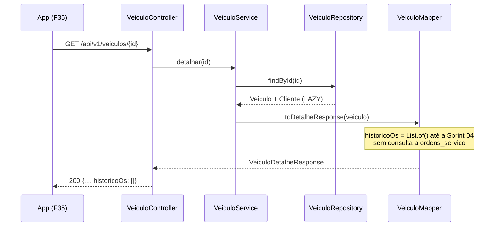

# Devolver `historicoOs` sempre presente no detalhe do veículo, com item `{id, status, valorTotal}` e lista vazia até a Sprint 04

## Contexto e problema

O detalhe do veículo (`GET /api/v1/veiculos/{id}`) deve mostrar o histórico de ordens de serviço (critério 19 do card), mas a OS só é entregue na Sprint 04 (F06 e F18). O REGENTE pediu para confirmar no schema da V1 se a tabela de OS existe. Conferido em 2026-11-19 lendo as migrations:

* `apps/api/src/main/resources/db/migration/V1__criar_tabela_usuarios.sql` (commit `e88e482`): cria **só** `usuarios`. **Não existe tabela de OS na V1.**
* `apps/api/src/main/resources/db/migration/V2__criar_schema_oficina.sql` (commit `afb9eac`): cria `ordens_servico` com `id`, `cliente_id` (`fk_os_cliente`), `veiculo_id` (`fk_os_veiculo`), `status VARCHAR(20)` sem `CHECK` e os totais `DECIMAL(10,2)` (`subtotal_servicos`, `subtotal_pecas`, `desconto`, `valor_total`), **sem coluna de data** (pendência A6/P5 do `overview.md`).
* Nenhuma migration de V3 a V8 altera `ordens_servico`. Existe a entidade `OrdemServico` (com `StatusOS` só `ABERTA` e `EM_ANALISE`), mas **não existe** `OrdemServicoRepository` nem endpoint que grave OS. Em ambiente criado pelo Flyway a tabela fica sempre vazia.

O código do commit `4becbb2` já devolve `historicoOs: []` pelo mapper e cita este ADR, mas o arquivo não existia. Pergunta: o que o detalhe devolve como histórico antes da Sprint 04, e qual contrato a Sprint 04 herda?

## Fatores de decisão

* F1. Contrato estável para a F35: o app desenha a seção de histórico desde já e não muda quando a OS chegar.
* F2. Nenhuma consulta a dado que ninguém grava: sem código morto nem teste de algo inexistente.
* F3. A Sprint 04 só acrescenta, nunca renomeia nem remove (sem quebra no app).
* F4. Mínimo de dado no item: nada de dado pessoal nem descrição livre de serviço.
* F5. Custo do detalhe proporcional: uma consulta para veículo e dono.

## Opções consideradas

* A. Campo `historicoOs` sempre presente, item `{id, status, valorTotal}`, preenchido com `[]` fixo no mapper até a Sprint 04, sem consultar `ordens_servico`.
* B. Consultar `ordens_servico` por `veiculo_id` já agora.
* C. Omitir o campo até a Sprint 04.
* D. Endpoint próprio `GET /api/v1/veiculos/{id}/ordens-servico`, sem campo no detalhe.

## Resultado da decisão

Opção escolhida: "A", porque fixa o contrato para a F35 (F1) sem consultar uma tabela que nenhum código grava (F2). **Decisão sobre o histórico vazio: até a Sprint 04, `historicoOs` é sempre `[]` em todo veículo, mesmo que exista linha em `ordens_servico` inserida fora da API; a Sprint 04 troca o `[]` pela consulta sem mudar o formato.**

### Especificação normativa

1. `VeiculoDetalheResponse.historicoOs` é `List<HistoricoOsItem>`, nunca `null` (`List.copyOf`), sempre presente no JSON.
2. `HistoricoOsItem` = `{id: Long, status: String, valorTotal: BigDecimal}`. `status` é o `name()` do `StatusOS` (ex.: `ABERTA`); `valorTotal` em reais com 2 casas, vindo de `ordens_servico.valor_total`.
3. Até a Sprint 04: `VeiculoMapper.toDetalheResponse` usa `@Mapping(target = "historicoOs", expression = "java(java.util.List.of())")`. O `VeiculoService.detalhar` não consulta OS.
4. Regras para a Sprint 04 (F06/F18), que o ADR da OS deve citar:
   1. Ordem: `data_abertura` decrescente e depois `id` decrescente; enquanto a coluna de data não existir (A6/P5), só `id` decrescente.
   2. Campo novo no item (ex.: `dataAbertura`) é compatível; renomear ou remover campo é quebra e volta ao PO e ao dono da F35 com ADR novo.
   3. O item nunca traz dado pessoal, descrição livre nem observação da OS; detalhe da OS fica no recurso da OS.
   4. Consulta em uma ida ao banco (projeção por `veiculo_id`), sem N+1.
   5. Se o histórico passar de 50 itens por veículo na operação real, revisitar para paginação ou para a opção D.

### Consequências

* Bom, porque o app (F35) implementa o estado vazio do histórico agora e não muda na Sprint 04.
* Bom, porque nenhum código consulta tabela sem gravação nem testa dado inexistente.
* Ruim, porque o `[]` é uma afirmação falsa se alguém inserir OS direto no banco antes da Sprint 04; aceito porque não existe caminho de gravação de OS na API, e registrado no `docs/api/veiculos.md`.
* Ruim, porque sem paginação o detalhe cresce com o histórico; o limite de revisão está na regra 4.5.

### Confirmação

* `VeiculoIT` C19 (`shouldReturnDetailWithOwnerAndEmptyHistoryWhenVehicleHasNoOrders`: `historicoOs` presente e `[]`) e C19a (o detalhe devolve `[]` antes da Sprint 04; opcionalmente insere uma linha em `ordens_servico` pelo `JdbcTemplate` e confere que o `[]` não muda).
* Revisão: o `VeiculoService` não injeta repositório de OS até a Sprint 04; quando injetar, o PR cita este ADR e troca o `expression` do mapper.
* Teste de serialização: `historicoOs` nunca `null` nem ausente.

## Prós e contras das opções

### A. Campo presente, `[]` fixo

* Bom, porque atende F1, F2, F4 e F5.
* Neutro, porque a troca na Sprint 04 é uma linha no mapper mais uma consulta no service.
* Ruim, porque o `[]` não reflete linha inserida fora da API.

### B. Consultar já agora

* Bom, porque refletiria qualquer linha existente.
* Ruim, porque cria repositório e consulta para dado que ninguém grava (falha F2), e fixa a ordenação antes de a coluna de data existir.
* Ruim, porque o teste exigiria inserir OS por SQL, acoplando a F04 ao schema da Sprint 04.

### C. Omitir o campo

* Bom, porque nada é prometido antes da hora.
* Ruim, porque o app muda na Sprint 04 e o campo novo aparece sem contrato prévio (falha F1).

### D. Endpoint próprio de OS do veículo

* Bom, porque permite paginação e mantém o detalhe pequeno.
* Ruim, porque são duas chamadas para a tela de detalhe e um endpoint novo sem dado agora; custo maior que A para o porte atual. Fica como evolução se a regra 4.5 disparar.

## Mais informações

* Complementa ADR-024 (vínculo com cliente) e ADR-013 (migrations como fonte do schema). Pendência A6/P5 (datas da OS) no `overview.md`.
* PRD `docs/product/F04-veiculos.md` (C19, C19a, C19b); contrato em `docs/api/veiculos.md`.
* Revisitar na Sprint 04, quando a F06/F18 gravar OS.
