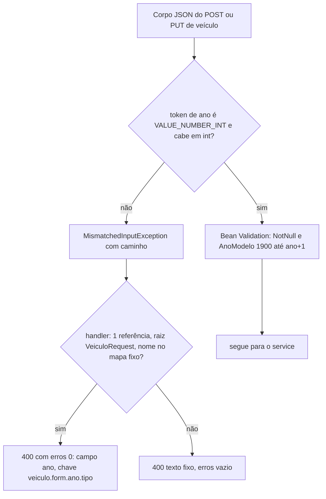

# Rejeitar `ano` não inteiro com desserializador próprio no campo e reportar o campo `ano` com a chave `veiculo.form.ano.tipo` por lista fixa no handler

## Contexto e problema

A revisão humana de 18/11 (critério 8) constatou que `"ano": 2015.9` e `"ano": "2015"` respondem 201 hoje: o Jackson 3 (`tools.jackson.databind` 3.1.7, lido no `apps/api/target/api.jar`) converte decimal e texto numérico para `Integer` por padrão. A revisão pediu 400 com erro no campo `ano` nos dois casos, **restringindo a coerção só ao `ano` do veículo, sem mudar o `ObjectMapper` global**, e manteve o teste da virada do ano. O PRD rev 2 (D2) estende a recusa para `2015.0`. Hoje o 400 de corpo ilegível (`HttpMessageNotReadableException`) sai com texto fixo e `erros: []`, então o app não sabe qual campo errou. Pergunta (D3): como recusar e como dizer que foi o `ano`, sem refletir texto do atacante?

## Fatores de decisão

* F1. Escopo: só `VeiculoRequest.ano`; login, cliente e F30 inalterados (ex.: `"marca": 123` continua com o comportamento de hoje).
* F2. Mesmo 400, com `erros[0].campo = "ano"` e `erros[0].chave = "veiculo.form.ano.tipo"`, para `2015.9`, `2015.0`, `"2015"`, booleano, objeto, array e inteiro de 20 dígitos; nunca 500. `null` ou ausente segue `veiculo.form.ano.obrigatorio`.
* F3. Nada refletido: o handler não lê `getMessage`, `getOriginalMessage`, valor nem `location`, e não loga (condições 1 a 6 da seção 2.6 da política rev 7, W1).
* F4. Simples de manter: uma classe pequena e uma regra no handler, testáveis por IT.

## Opções consideradas

* A. Desserializador próprio `ValueDeserializer<Integer>` ligado só ao componente `ano` por `@JsonDeserialize`, e handler que identifica o campo por lista fixa.
* A'. `@JsonFormat(lenient = OptBoolean.FALSE)` no componente `ano`, com o mesmo handler.
* B. Desligar coerção no `ObjectMapper` global (`ACCEPT_FLOAT_AS_INT` e `CoercionConfig` de texto para inteiro).
* C. Receber `ano` como `String` ou `JsonNode` e validar no Bean Validation.
* D. Manter como está.

## Resultado da decisão

Opção escolhida: "A", porque fica restrita ao campo (F1), cobre todos os tipos de F2 numa regra só (aceita apenas `VALUE_NUMBER_INT` que cabe em `int`) e não depende de comportamento não documentado do Jackson 3. A' pode substituir A **somente** se passar no mesmo conjunto de IT da Confirmação; a prova não foi executada (ver Mais informações).

### Especificação normativa

1. **Desserializador** `dto/AnoInteiroDeserializer extends tools.jackson.databind.ValueDeserializer<Integer>`:
   1. aceita só quando o token atual é `JsonToken.VALUE_NUMBER_INT` **e** `p.getNumberType() == NumberType.INT`, devolvendo `p.getIntValue()`;
   2. qualquer outro token ou inteiro que não cabe em `int` chama `ctxt.handleUnexpectedToken(Integer.class, p)` (ou equivalente que gere `MismatchedInputException` com o caminho preenchido); nunca põe `getText()` em mensagem;
   3. `null` não chega ao método (o Jackson usa `getNullValue`, que devolve `null`), então `@NotNull` responde `ano.obrigatorio`.
2. **Ligação**: `@JsonDeserialize(using = AnoInteiroDeserializer.class)` no componente `ano` do `VeiculoRequest`. Nenhuma mudança em `JsonMapper`, builder de `ObjectMapper` ou `spring.jackson.*`.
3. **Chave**: constante `VeiculoChaves.ANO_TIPO = "veiculo.form.ano.tipo"`, incluída em `VeiculoChaves.TODAS`.
4. **Handler** (`handleUnreadableBody`), condições do VIGIA (W1):
   1. percorre as causas até achar `tools.jackson.databind.DatabindException`;
   2. preenche `erros[]` só se o caminho tem exatamente uma referência, a classe raiz é `VeiculoRequest` (pelo `getFrom()` da referência, seja instância ou `Class`) e o nome da propriedade está no mapa fixo em código `Map.of(VeiculoRequest.class, Map.of("ano", VeiculoChaves.ANO_TIPO))`;
   3. o `campo` devolvido é a chave do mapa, nunca o nome lido do caminho; a `chave` é a constante, nunca concatenação;
   4. lê só o caminho: nunca `getMessage`, `getOriginalMessage`, valor ou `location`;
   5. resposta: 400, `mensagem` = `veiculo.form.ano.tipo`, `erros` com um item só (`campo` = `ano`, `chave` = `veiculo.form.ano.tipo`);
   6. fora das condições: texto fixo `Corpo da requisicao invalido` e `erros: []`, como hoje; nenhuma linha de log nos dois caminhos.
5. **Parada obrigatória**: se no Jackson 3.1.7 o `getFrom()` não permitir identificar `VeiculoRequest` (por exemplo, devolver só um builder interno), o ESPRESSO para e volta ao CARTOGRAFO; não troca a regra por comparação de texto.

### Consequências

* Bom, porque `2015.9`, `2015.0` e `"2015"` passam a 400 com o campo certo, e o app traduz pela chave.
* Bom, porque login, cliente e F30 não mudam.
* Ruim, porque o Jackson para no primeiro erro de desserialização: com `ano` inválido, erros de outros campos (ex.: placa vazia) não aparecem na mesma resposta. Aceito; o app valida o formulário antes de enviar.
* Ruim, porque o pacote `exception` passa a importar `dto` (`VeiculoRequest`, `VeiculoChaves`) para o mapa fixo; divergência registrada no `overview.md`. Campo novo com regra de tipo exige editar o mapa e este ADR.
* Neutro, porque a regra de tipo fica fora do Bean Validation; a faixa (`@AnoModelo`, 1900 até ano corrente + 1) continua lá.

### Confirmação

* `VeiculoIT` (POST e PUT, C8c, C8d, C8e, C16a): `2015.9`, `2015.0`, `"2015"`, `true`, objeto, array e `12345678901234567890` respondem 400 com um item em `erros` (`campo` = `ano`, `chave` = `veiculo.form.ano.tipo`) e nada gravado (contagem pelo `JdbcTemplate`); `null` e ausente respondem `veiculo.form.ano.obrigatorio`; C8b (virada do ano) inalterado.
* Não regressão: `"marca": 123` no veículo e corpo de cliente com tipo errado continuam com a resposta de hoje; testes de cliente e login passando sem mudança.
* Log: nenhum evento de log no 400 de tipo (appender de teste).
* Revisão: `grep -rn "ACCEPT_FLOAT_AS_INT" apps/api/src`, `grep -rn "CoercionConfig" apps/api/src` e `grep -rn "spring.jackson" apps/api/src` sem resultado; o handler não chama `getMessage` nem `getOriginalMessage` em `DatabindException`.

## Prós e contras das opções

### A. Desserializador no campo

* Bom, porque atende F1 a F4 e trata todos os tokens numa regra explícita.
* Neutro, porque é uma classe nova de cerca de 20 linhas com teste próprio.
* Ruim, porque o handler precisa ler o caminho da exceção do Jackson e importa `dto`.

### A'. `@JsonFormat(lenient = FALSE)`

* Bom, porque é anotação só, sem classe nova.
* Ruim, porque não verifiquei no Jackson 3.1.7 se recusa `2015.0`, booleano e texto em `Integer` de record; depende de comportamento não documentado (falha F4 até haver prova).

### B. `ObjectMapper` global

* Bom, porque uma configuração cobre toda a API.
* Ruim, porque muda login, cliente e F30 (falha F1) e foi descartada pela revisão humana.

### C. `ano` como `String` ou `JsonNode`

* Bom, porque o erro vira violação comum de Bean Validation, junto dos outros campos.
* Ruim, porque o DTO perde o tipo, exige conversão manual, muda o OpenAPI do campo para `string` e aceita `"2015"` como válido por construção, contra o critério 8.

### D. Manter como está

* Bom, porque custo zero.
* Ruim, porque `2015.9` vira 2015 gravado sem aviso, contra o critério 8.

## Mais informações

* Complementa ADR-011 (formato do erro) e ADR-023 (`erros[]` com campo e chave). PRD `docs/product/F04-veiculos.md` (N2, D2, D3, C8c a C8e, C16a); política rev 7, seção 2.6 (W1).
* **Não verificado**: a prova isolada no Jackson 3.1.7 (desserializador, A' e `getFrom()` em record) não foi executada; a escrita do arquivo de prova foi bloqueada pela permissão do ambiente e não foi contornada. A confirmação passa a ser o IT do ESPRESSO, e a regra 5 da especificação cobre o caso de falha.
* Revisitar se outro campo numérico precisar de regra de tipo, ou se a API migrar para um formato de erro único (ADR-023).
