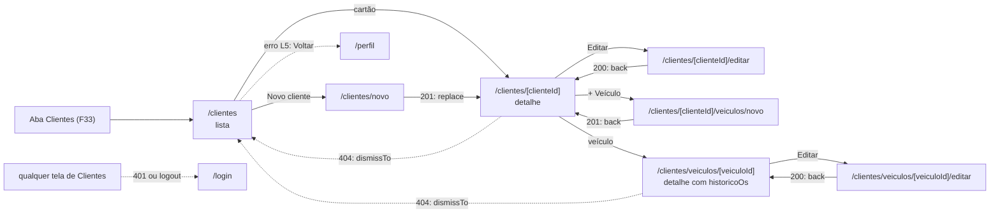

# Navegar Clientes e Veículos num Stack aninhado na aba Clientes, com rota que carrega só id

Histórico de status:

* 2026-11-19: proposto (F35, etapa do CARTOGRAFO). Pela regra da casa, a fatia (a) da F35 só começa depois do aceite.

Vínculos: F35 (critérios US-CLV-FRONT-06, 07, 09, 10, 11, 18, 20, 21, 23 e 26; tarefas 5, 7 a 10 e 16). Roteiro 8.1 e decisão D4 de `docs/product/F26-prototipo-clientes-veiculos.md`. Seção 7 de `docs/security/politica-dados-pessoais-cliente.md` (CPF fora de parâmetro de rota e de deep link). Complementa o ADR-008 (monorepo) e o ADR-015 (separar rota, tela e estilo; proposto, fora da `main`). Os contratos de dados estão no ADR-030 e a busca no ADR-031.

## Contexto e problema

Verificado na `main` (`055a6da`) por leitura de código:

* `app/_layout.tsx` monta um `Stack` raiz sem cabeçalho. `app/(menu)/_layout.tsx` guarda a sessão e renderiza `MenuShell` com `<Slot />`, ou seja, o grupo `(menu)` **não tem histórico próprio**: cada rota filha substitui a anterior.
* `src/components/menu/menu-tab-bar.tsx` desenha os 4 itens da F33 com `unavailable` e `selected={false}`, sem navegação. A tab bar é própria, não é o `Tabs` do expo-router.
* A única rota filha do grupo hoje é `app/(menu)/inicio.tsx`. `app/perfil.tsx` e `app/login.tsx` ficam fora do grupo.
* `expo-router` 6.0.24 instalado; expõe `Stack`, `useRouter` (com `back`, `replace`, `navigate`, `dismissTo`, `dismissAll`), `useNavigation`, `useFocusEffect`, `useLocalSearchParams` e `usePathname`. `@react-navigation/native` (7.5.1) existe só como dependência interna do `expo-router` (`node_modules/expo-router/node_modules`), não está no `package.json` do app.

A F35 acrescenta sete telas encadeadas (lista, detalhe e formulários de cliente; detalhe e formulários de veículo). O roteiro 8.1 da F26 exige que "Voltar" leve sempre à tela anterior do fluxo, e a D4 da F26 exige confirmar o descarte quando o formulário tem alteração. A política de dados proíbe CPF em parâmetro de rota e em deep link.

Como encaixar essas telas no grupo `(menu)` sem reescrever a F33, com voltar previsível e sem dado pessoal na rota?

## Fatores de decisão

* N1. Cada um dos 13 passos do roteiro 8.1 da F26 chega ao destino esperado, verificável por teste com `renderRouter`.
* N2. Nenhum dado pessoal (nome, CPF, telefone, email, endereço, placa) em parâmetro de rota, URL ou deep link. Só id numérico e, se preciso, sinalizador de valor fixo.
* N3. Nenhuma dependência nova no `package.json`.
* N4. `MenuShell`, a guarda de sessão de `(menu)/_layout.tsx` e os outros três itens da tab bar ficam como a F33 definiu; só o item Clientes muda.
* N5. No 401 e no logout, nenhuma tela de Clientes continua montada (critério 23).
* N6. Formulário com alteração não é descartado sem confirmação por nenhum caminho de saída que a F35 controla (seta Voltar, Cancelar, voltar do Android, toque na aba).
* N7. Custo de manutenção: uma pasta de rotas, um layout e nenhum estado global novo.

## Opções consideradas

* A. `Stack` do expo-router em `app/(menu)/clientes/_layout.tsx`, com rotas aninhadas por arquivo e parâmetro só de id.
* B. Manter como está: rotas planas no grupo `(menu)`, renderizadas pelo `Slot`, sem `Stack` próprio.
* C. Trocar a tab bar própria da F33 pelo `Tabs` do expo-router, com um `Stack` por aba.
* D. Formulários como modal (`presentation: 'modal'`) sobre a lista e o detalhe, e só lista e detalhes no `Stack`.

## Resultado da decisão

Opção escolhida: "A", porque é a única que atende N1 e N4 juntos sem dependência nova (N3). B falha em N1 (não há histórico dentro do `Slot`; voltar do detalhe sai do grupo). C atende N1, mas reescreve a F33 (falha em N4) e a tab bar própria já tem paridade conferida na F41. D muda o desenho aprovado na F26, que mostra os formulários como tela cheia com seta Voltar.

### D1. Rotas

Todas dentro de `app/(menu)/clientes/`. O `_layout.tsx` desta pasta declara `<Stack screenOptions={{ headerShown: false }} />`; o cabeçalho continua sendo o `ScreenHeader` da F40, desenhado pela própria tela.

| URL | Arquivo em `app/(menu)/clientes/` | Tela | Chamadas (ADR-030) |
|---|---|---|---|
| `/clientes` | `index.tsx` | Lista com busca | `GET /api/v1/clientes` |
| `/clientes/novo` | `novo.tsx` | Criar cliente | `POST /api/v1/clientes` |
| `/clientes/[clienteId]` | `[clienteId]/index.tsx` | Detalhe do cliente | `GET /api/v1/clientes/{id}` e `GET /api/v1/clientes/{id}/veiculos` |
| `/clientes/[clienteId]/editar` | `[clienteId]/editar.tsx` | Editar cliente | `GET` e `PUT /api/v1/clientes/{id}` |
| `/clientes/[clienteId]/veiculos/novo` | `[clienteId]/veiculos/novo.tsx` | Criar veículo do cliente | `POST /api/v1/clientes/{id}/veiculos` |
| `/clientes/veiculos/[veiculoId]` | `veiculos/[veiculoId]/index.tsx` | Detalhe do veículo com histórico | `GET /api/v1/veiculos/{id}` |
| `/clientes/veiculos/[veiculoId]/editar` | `veiculos/[veiculoId]/editar.tsx` | Editar veículo | `GET` e `PUT /api/v1/veiculos/{id}` |

Regras:

* A rota espelha a API. Só a criação de veículo leva o `clienteId`, porque o `POST` precisa dele. Detalhe e edição de veículo usam só o `veiculoId`, como `/api/v1/veiculos/{id}`: o dono vem de `clienteId` na resposta (ADR-024, dono imutável), e a URL nunca discorda da API sobre quem é o dono.
* Segmento estático tem precedência sobre dinâmico no expo-router: `novo` e `veiculos` nunca são lidos como `clienteId`. O teste de rota afirma isso.
* `clienteId` e `veiculoId` passam por uma função pura de leitura de id (inteiro positivo em texto, `^[1-9][0-9]{0,15}$`). Valor fora disso leva a tela ao estado "não encontrado" **sem chamar a API**, porque a API responderia 400 e o critério 21 pede a mensagem de registro não encontrado.
* Parâmetro de rota permitido: o id e, se o ESQUADRO pedir aviso de sucesso no destino (frames L6, D4, D5 e V5 da F26), um sinalizador de valor fixo (por exemplo `aviso=salvo`). Nada digitado pelo usuário nem recebido da API além do id.
* Com o ADR-015 na `main` (PR #44), cada arquivo da tabela é só um re-export; o corpo da tela fica em `src/screens/<tela>/<tela>-screen.tsx` (`client-list`, `client-create`, `client-detail`, `client-edit`, `vehicle-create`, `vehicle-detail`, `vehicle-edit`) e o layout em `src/layouts/clients-stack-layout/`. As pastas de tela ficam num nível só, sem `clients/` e `vehicles/`, porque o teste de estrutura do ADR-015 exige `src/screens/<pasta>/<pasta>-screen.tsx`. A tabela de URLs não muda.

### D2. Destino depois de cada ação

| Origem | Ação | Navegação | Motivo |
|---|---|---|---|
| Lista | toca no cartão | `push('/clientes/{id}')` | roteiro 8.1, passo 2 |
| Lista | "Novo cliente" (também no estado vazio) | `push('/clientes/novo')` | critério 3 |
| Criar cliente | salvou (201) | `replace('/clientes/{id}')` | critério 7; voltar do detalhe vai para a lista, não para o formulário já enviado |
| Detalhe do cliente | "Editar" | `push('/clientes/{id}/editar')` | passo 5 |
| Editar cliente | salvou (200) | `back()` | critério 9; o detalhe recarrega ao voltar ao foco (D4) |
| Detalhe do cliente | toca num veículo | `push('/clientes/veiculos/{veiculoId}')` | passos 7 e 10 |
| Detalhe do cliente | "+ Veículo" (também no estado sem veículos) | `push('/clientes/{id}/veiculos/novo')` | passo 3 e critério 20 |
| Criar veículo | salvou (201) | `back()` | critério 10; o detalhe do cliente recarrega a lista de veículos ao voltar ao foco |
| Detalhe do veículo | "Editar" | `push('/clientes/veiculos/{veiculoId}/editar')` | passo 8 |
| Editar veículo | salvou (200) | `back()` | critério 11 |
| Qualquer formulário | seta Voltar ou Cancelar | `back()`, passando pela guarda D3 | passos 4, 6 e 9 |
| Detalhe com 404 | "Voltar à lista" | `dismissTo('/clientes')` | critério 21 |
| Lista com erro (L5) | "Voltar" | `navigate('/perfil')` | decisão C3a da F26 |

Nenhuma navegação leva o corpo da resposta para a tela seguinte. A tela de destino busca pelo id (ADR-030). Isso custa um `GET` a mais depois de criar ou editar e evita estado compartilhado com CPF.

### D3. Guarda de descarte do formulário (D4 da F26)

* Um hook `useDiscardChangesGuard(temAlteracao)` em `src/hooks` usa `useNavigation()` do `expo-router` e o evento `beforeRemove`. Com alteração, chama `preventDefault()` e expõe `{ dialogoVisivel, continuarEditando, descartar }`. `descartar` reenvia a ação guardada (`navigation.dispatch(e.data.action)`).
* O hook não importa componente (regra de lint da F40). A tela renderiza o `ConfirmDialog` já existente com o estado do hook.
* As rotas de formulário (`novo`, `editar`, `veiculos/novo`, `veiculos/[veiculoId]/editar`) declaram `gestureEnabled: false` no `Stack`. Motivo: no iOS, o gesto de arrastar do `native-stack` não é bloqueado pelo `beforeRemove` sozinho; o `usePreventRemove`, que resolve isso, vive em `@react-navigation/native`, que não está no `package.json` (N3).
* Depois de salvar com sucesso, o formulário marca `temAlteracao = false` antes de navegar, para a guarda não perguntar.
* A seta Voltar e o Cancelar chamam `back()` e passam pela mesma guarda, sem lógica própria de confirmação.

### D4. Recarga ao voltar ao foco

Lista, detalhe do cliente e detalhe do veículo buscam de novo quando a tela volta ao foco (`useFocusEffect`), mantendo o conteúdo atual na tela até a resposta chegar. É assim que o dado editado aparece sem cache compartilhado (critérios 9, 10 e 11). A lista recarrega a primeira página com o termo atual (ADR-031).

### D5. Aba Clientes (critério 26)

* O item Clientes de `MenuTabBar` passa a ser habilitado. Fica `selected` quando `usePathname()` começa com `/clientes`, e o toque chama `router.navigate('/clientes')`. Os outros três itens continuam como a F33 definiu.
* A leitura de rota fica num hook (`useMenuTabs` em `src/hooks`), para a tab bar continuar só desenhando.
* Toque na aba Clientes já ativa, com uma tela funda aberta, volta à lista. Isso remove as telas de cima e, portanto, passa pela guarda D3.
* A premissa 5 da F35 pede confirmar com quem especificou a F33 que só a aba Clientes muda. Este ADR assume que sim.

### D6. Sessão expirada e logout (critério 23)

Nenhuma mudança na guarda existente. `app/(menu)/_layout.tsx` já devolve `null` quando o status não é `autenticado` e faz `replace('/login')`. Com isso o `Stack` de Clientes inteiro é desmontado, e o estado dos hooks (CPF incluído) deixa de ter referência. O 401 chega a esse ponto pelo `tratarSessaoExpirada` (ADR-030, D5).

### Consequências

* Bom, porque voltar segue o histórico real do `Stack`, e o roteiro 8.1 vira teste com `renderRouter`, no mesmo estilo de `src/integration/menu-routing.test.tsx`.
* Bom, porque a URL só tem id, então deep link, histórico do navegador (no `expo start --web`) e log de navegação não carregam dado pessoal.
* Bom, porque a F33 não muda além de um item, e o logout e o 401 desmontam tudo sem código novo.
* Ruim, porque cada criação e edição custa um `GET` a mais na tela de destino, e voltar ao foco sempre busca de novo. Com o volume da oficina é aceitável.
* Ruim, porque `gestureEnabled: false` tira o gesto de arrastar para voltar nos formulários do iOS, mesmo sem alteração. A seta Voltar continua lá.
* Ruim, porque o detalhe do cliente fica montado embaixo do formulário de edição, então o CPF completo do detalhe fica em memória enquanto a edição está aberta. A política diz "sai da memória ao sair da tela"; empilhar não é sair. Registrado para o VIGIA.
* Neutro, porque sair de Clientes para o Perfil (fora do grupo) desmonta o `Stack` e perde a posição na lista. A volta começa na lista.

### Risco residual

* Não verifiquei em execução que o `beforeRemove` é disparado quando a navegação sai do grupo `(menu)` (por exemplo, para `/perfil` pelo cabeçalho) com um formulário aberto. Se não for, esse caminho descarta sem perguntar. O teste da guarda cobre o caso. Se falhar, a alternativa é declarar `@react-navigation/native` no `package.json`, na mesma versão interna do `expo-router` (7.5.1), e usar `usePreventRemove`, com ADR novo para a dependência.
* Não verifiquei que `router.navigate('/clientes')` com o `Stack` fundo volta à lista em vez de empilhar outra lista. O teste da D5 afirma o tamanho da pilha depois do toque; se empilhar, a D5 passa a usar `dismissTo('/clientes')`.
* Qualquer usuário autenticado abre qualquer `/clientes/{id}` (não há permissão por perfil). É a regra atual do projeto, não uma falha desta decisão.

### Confirmação

* Teste de integração com `renderRouter` cobrindo os 13 passos do roteiro 8.1 da F26, mais: `replace` depois de criar cliente (voltar cai na lista), `dismissTo` no 404 e `clientes/novo` resolvido como rota estática.
* Teste do hook `useDiscardChangesGuard`: com alteração, `back()` não remove a tela e abre o diálogo; "Descartar" remove; sem alteração, sai direto; depois de salvar, não pergunta.
* Teste da tab bar: aba Clientes habilitada e selecionada em `/clientes/...`; as outras três como antes (os testes da F33 continuam passando, exceto a asserção do item Clientes, que muda).
* Teste de sessão: com 401 numa tela de Clientes, a árvore de Clientes não fica montada e `/login` é a rota ativa.
* Revisão de PR: `git grep -nE "setParams|[?&](cpf|telefone|nome|email|endereco|placa)=" -- apps/mobile/app apps/mobile/src` vem vazio, e todo `push`/`replace` de Clientes monta a URL só com id.
* Revisão de PR: `apps/mobile/package.json` sem dependência nova.

## Prós e contras das opções

### A. Stack aninhado na aba Clientes (escolhida)

* Bom, porque usa só o que o `expo-router` instalado já oferece e não toca na tab bar além de um item.
* Bom, porque a estrutura de pastas é o próprio mapa de navegação, legível para quem pegar o código depois.
* Neutro, porque o voltar do Android segue o `Stack` sem código.
* Ruim, porque precisa de `gestureEnabled: false` nos formulários para a guarda valer no iOS sem dependência nova.

### B. Manter como está (rotas planas no Slot)

* Bom, porque não precisa de layout novo.
* Ruim, porque o `Slot` não guarda histórico: voltar do detalhe sai do grupo `(menu)`, e o roteiro 8.1 falha (N1). Simular a pilha à mão em estado global seria mais código e guardaria telas com dado pessoal.
* Custo de descartar: um `_layout.tsx` a mais.

### C. Tabs do expo-router com Stack por aba

* Bom, porque é o padrão mais comum em apps com abas e preserva a pilha de cada aba ao trocar de aba.
* Ruim, porque troca a tab bar da F33 (paridade conferida na F41) pelo componente do `@react-navigation/bottom-tabs`, ou exige `tabBar` customizada para manter o desenho. Também mexe na guarda de sessão do grupo. Falha em N4 e N7.
* Ruim, porque manter a pilha de cada aba mantém o detalhe com CPF montado enquanto o usuário está em outra aba.
* Custo de descartar: quando as outras abas existirem (Sprints 03 a 05), cada uma terá o próprio `Stack` aninhado neste mesmo modelo, e trocar de aba perde a posição. Revisitar se isso incomodar no uso.

### D. Formulários como modal

* Bom, porque o modal deixa claro que é uma tarefa temporária, e o gesto de fechar é padrão.
* Ruim, porque diverge da F26 (formulário em tela cheia com seta Voltar), o que quebra a paridade obrigatória.
* Ruim, porque a guarda de descarte também precisa cobrir o gesto de fechar do modal, com o mesmo problema do iOS.
* Custo de descartar: nenhum além de não ter o visual de modal, que a F26 não pediu.

## Mais informações

* Pendente de revisão: ORLA (viabilidade da guarda e do `navigate` da D5), ESQUADRO (destinos da D2 contra os frames e o aviso de sucesso) e VIGIA (CPF em memória com o detalhe empilhado sob a edição).
* Depende do ADR-015 só na localização do corpo da tela (D1); a navegação é a mesma com ou sem ele.
* Histórico: em 2026-11-24 a F35 foi portada para a estrutura do ADR-015 no merge da `main` (PR #34); a D1 foi atualizada com as pastas reais.
* Revisitar quando as abas Ordens, Catálogo e Financeiro forem habilitadas: se a perda de posição ao trocar de aba incomodar, avaliar a opção C com um ADR novo.
* O mapa de navegação do wireframe (`docs/architecture/diagrams/navegacao-wireframe-f24.md`) não foi alterado nesta etapa; o diagrama acima vale para a F35.
