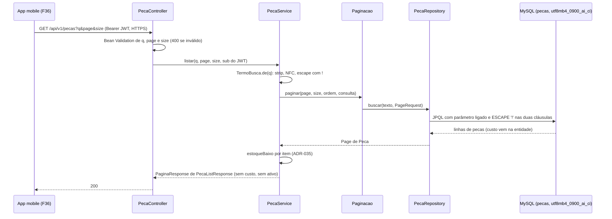

# Listar peças em `GET /api/v1/pecas` com busca em nome ou código, sem filtro de ativo e sem custo na resposta

Histórico de status:

* 2026-11-23: proposto (F17, etapa do CARTOGRAFO), ramo `docs/f17-adr-pecas-listar`, empilhado sobre `docs/f05a-adr-paginacao-e-nome-servico`.

Vínculos: F17 (F05d, US-CAT-14 a US-CAT-17e), consumida pela F36 e pré-requisito de F14 e F15. Aplica o [ADR-017](ADR-017-padronizar-listagem-com-busca-e-paginacao.md) (contrato de página, termo literal, erros) e o [ADR-032](ADR-032-reaproveitar-contrato-de-listagem-do-adr-017-com-paginacao-extraida-no-service.md) (`service.Paginacao`, regras para a F17), sem mudar nenhum dos dois. Complementa o ADR-007 (DTO) e o ADR-011 (handler global). A coluna `nome` e a collation vêm do [ADR-036](ADR-036-acrescentar-pecas-nome-por-v10-e-fixar-collation-ai-ci-em-toda-a-tabela.md); o campo `estoqueBaixo` é decidido no [ADR-035](ADR-035-calcular-estoque-baixo-no-service-a-cada-leitura-sem-persistir.md).

## Contexto e problema

O ADR-032 deixou para a F17 tudo o que é próprio de peças: em que colunas buscar, que filtros aceitar e que campos devolver. A tabela `pecas` da V2 tem `codigo` (único), `custo`, `preco_venda`, `quantidade_estoque`, `estoque_minimo` e `ativo` (conferido no arquivo V2 em 2026-11-23). A história pede busca "por nome ou código" e diz que peça não tem ativo/inativo nesta fase, mas a coluna `ativo` existe. O custo é dado de margem que a lista não precisa. Qual é o contrato de `GET /api/v1/pecas`?

## Fatores de decisão

* F1. Um campo de busca só no app (F36): o atendente digita trecho do nome ou do código no mesmo campo. Medido pelos critérios 1 e 7 da F17.
* F2. Mesmo contrato de página e de erro de clientes e serviços (ADR-017, ADR-032). Medido por um teste de 400 para `size=0`, `size=101`, `page=-1` e `q` com 101 caracteres.
* F3. Resposta mínima: nada que a tela não use, e nunca `custo` (critério 14).
* F4. Custo de manutenção: uma consulta só no repository, nenhuma dependência nova, nenhuma mudança em `ClienteService`, `ServicoService` ou `Paginacao`.

## Opções consideradas

* A. Um parâmetro `q` buscando por trecho em `nome` ou `codigo`, sem parâmetro `ativo`, item sem `custo` nem `ativo`.
* B. Dois parâmetros, `nome` e `codigo`, cada um filtrando só a sua coluna.
* C. Igual a A, mais o parâmetro `ativo` do ADR-032, como em serviços.
* D. Igual a A, devolvendo `custo` e `ativo` no item, e a F36 decide o que mostrar.

## Resultado da decisão

Opção escolhida: "A", porque atende F1 com um campo só, mantém F2 sem parâmetro novo, atende F3 e cabe numa consulta (F4). B falha em F1 (a tela teria de adivinhar se o texto é nome ou código). C cria um filtro sem caso de uso: nenhuma feature desta fase grava `ativo = false`, e a história diz que toda peça aparece. D falha em F3 e expõe a margem a qualquer usuário autenticado.

### Contrato normativo

`GET /api/v1/pecas`, autenticado por JWT, fora de `PUBLIC_PATHS`.

| Parâmetro | Tipo | Padrão | Regra | Inválido |
|---|---|---|---|---|
| `q` | texto | ausente | ADR-017: `@Size(max = 100)` sobre o valor bruto; ausente, vazio ou só espaços lista sem filtro; trecho em `nome` **ou** `codigo`, literal (`%`, `_` e `!` escapados) | 400 |
| `page` | inteiro, base 0 | 0 | ADR-017, `@Min(0)`; além do fim devolve 200 com `itens` vazio e total real | 400 |
| `size` | inteiro | 20 | ADR-017, `@Min(1) @Max(100)`, nunca corrigido em silêncio | 400 |

Parâmetro desconhecido (por exemplo `ativo` ou `sort`) é ignorado, como em clientes.

Consulta em `PecaRepository`, JPQL com parâmetro nomeado, um `ESCAPE '!'` por cláusula `like`:

```sql
select p from Peca p
where (:texto is null
       or p.nome like :texto escape '!'
       or p.codigo like :texto escape '!')
```

* `texto` vem de `TermoBusca.de(q).padraoTexto()` (já existe na `main`). `padraoTelefone()` não é usado.
* Sem `lower()`/`upper()`: caixa e acento são ignorados pela collation da tabela (ADR-036). Provado por cliente `mysql` em 2026-11-23: `q=pf-2` acha `PF-200` e `q=OLEO` acha `Filtro de Óleo` (ADR-036, Evidência).
* Ordem: `Sort.by(Sort.Order.asc("nome"), Sort.Order.asc("id"))` via `Paginacao.paginar` (ADR-032).
* Não filtra por `ativo`. A coluna continua mapeada em `Peca` e não aparece na resposta.

Corpo 200: `PaginaResponse<PecaListResponse>` (envelope do ADR-017). Item, record em `dto`, mapeado por MapStruct (`PecaMapper`):

| Campo | Tipo JSON | Origem |
|---|---|---|
| `id` | inteiro | `pecas.id` |
| `nome` | texto | `pecas.nome` (V10) |
| `codigo` | texto | `pecas.codigo` |
| `precoVenda` | decimal | `pecas.preco_venda` |
| `quantidadeEstoque` | inteiro | `pecas.quantidade_estoque` |
| `estoqueMinimo` | inteiro | `pecas.estoque_minimo` |
| `estoqueBaixo` | booleano | calculado no service (ADR-035), não é coluna |

```json
{
  "itens": [
    { "id": 1, "nome": "Filtro de óleo", "codigo": "FO-100", "precoVenda": 25.00,
      "quantidadeEstoque": 5, "estoqueMinimo": 5, "estoqueBaixo": true }
  ],
  "pagina": 0,
  "tamanho": 20,
  "totalItens": 1,
  "totalPaginas": 1
}
```

* Erros: 400, 401, 404, 405 e 500 exatamente como no ADR-011 e no ADR-017, sem handler novo. O 405 de `POST /api/v1/pecas` vale até a F14 entrar.
* Log: uma linha INFO no service, `pecas.listar qLen={} page={} size={} total={} usuarioId={}`. O termo nunca vai para o log.

### Fluxo de dados e ameaças



Dado pessoal: peça não tem dado pessoal. O único identificador que circula é o `usuarioId` (o `sub` do JWT) na linha de log, com a base legal e a retenção já registradas para a linha de log da F03a (`docs/security/politica-dados-pessoais-cliente.md`, seção 6). Nenhuma finalidade nova de LGPD.

| Ameaça (STRIDE) | Onde | Mitigação | Verificação |
|---|---|---|---|
| Spoofing | chamada sem token ou com token inválido | `anyRequest().authenticated()`, 401 antes do controller | IT do critério 13 |
| Tampering (injeção) | `q` | parâmetro ligado, nunca concatenado; `ESCAPE '!'` nas duas cláusulas | IT com `q=%`, `q=_` e `q=!` (critério 7) |
| Repudiation | quem listou | `usuarioId` na linha de log | teste do service |
| Information disclosure | `custo` e erro de banco | DTO sem `custo` (critério 14); 500 com mensagem fixa, sem stack trace nem SQL (ADR-011) | IT que procura a chave `custo` no JSON; IT do critério 12 |
| Denial of service | `size`, `q` e varredura | `size` até 100, `q` até 100; `LIKE '%x%'` varre a tabela, aceito pelo volume de uma oficina | IT do critério 6 |
| Elevation of privilege | perfis | sem distinção de perfil hoje (`CLAUDE.md`); catálogo sem custo não é sensível | n/a |

### Consequências

* Bom, porque o app usa um campo só para nome e código, e o contrato é o mesmo que a F35 já consome.
* Bom, porque a margem (`custo`) não sai da API nesta fatia.
* Ruim, porque a coluna `ativo` existe e é ignorada: uma peça marcada inativa por script manual aparece na lista. Hoje nenhuma feature grava `false`.
* Ruim, porque `LIKE '%x%'` em duas colunas não usa índice. Com o catálogo de uma oficina (centenas de linhas) o custo é desprezível.
* Neutro, porque o nome do DTO segue o repositório (`PecaListResponse`, como `ServicoListResponse`), não o `PecaResponse` do texto da F17. `PecaResponse` fica livre para o detalhe da F14.

### Risco residual

* Quando ativar/inativar peça sair do backlog, a lista terá de decidir se esconde inativas. Isso exige ADR novo e alinhamento com a F36.
* Alguém pode esquecer o `ESCAPE` na segunda cláusula. Mitigação: o `grep` da Confirmação e um caso de IT por coluna.
* Os critérios da F17 citam `content`, `totalElements` e `totalPages`. O envelope que vale é o do ADR-017 (`itens`, `pagina`, `tamanho`, `totalItens`, `totalPaginas`), porque a F03a entrou primeiro (premissa 1 da própria F17). O CRIVO lê os critérios com essa correspondência.

### Confirmação

* `grep -n " like " apps/api/src/main/java/br/com/mecanicasaojorge/api/repository/PecaRepository.java` e `grep -n "escape '!'"` no mesmo arquivo dão 2 linhas cada.
* IT com Testcontainers (`mysql:8.4`, migrations do zero) cobrindo os critérios 1 a 14, mais `q` com caixa e acento diferentes do gravado e `page=2147483647&size=100` (200 vazio com total real).
* IT afirma que cada item tem exatamente as 7 chaves da tabela acima (sem `custo`, sem `ativo`).
* O CRIVO confere a tabela de parâmetros deste ADR contra as anotações springdoc do `PecaController`.

## Prós e contras das opções

### A. `q` em nome ou código, sem `ativo`, sem custo (escolhida)

* Bom, porque atende F1 a F4.
* Bom, porque reaproveita `TermoBusca` e `Paginacao` sem mudar nada neles.
* Ruim, porque a coluna `ativo` fica sem uso visível.
* Ruim, porque um termo curto como `10` acha tanto `FO-100` quanto um nome com "10". Aceitável numa lista de oficina.

### B. Parâmetros `nome` e `codigo` separados

* Bom, porque o resultado é mais preciso quando se sabe o campo.
* Ruim, porque a tela precisa de dois campos ou de um seletor (falha F1), e o contrato diverge de clientes e serviços.
* Custo do descarte: nenhum hoje; se o caso aparecer, `codigo` exato vira parâmetro extra sem quebrar `q`.

### C. A mais `ativo`

* Bom, porque fica igual a serviços.
* Ruim, porque é um filtro sem dado que o diferencie nesta fase, com teste e documentação a manter.
* Custo do descarte: um parâmetro e uma cláusula, fáceis de somar depois sem quebrar o contrato.

### D. A devolvendo `custo` e `ativo`

* Bom, porque a F36 teria tudo sem nova versão do contrato.
* Ruim, porque expõe margem a qualquer autenticado (falha F3) e contraria o critério 14.
* Custo do descarte: nenhum.

## Mais informações

* Dúvida 1 da F17 (tamanho 20) continua com a BUSSOLA; o padrão segue o ADR-017 e muda sem quebrar o contrato.
* Revisitar quando ativar/inativar peça ou o filtro "somente estoque baixo" saírem do backlog.
* Pela regra da casa, o código da F17 só começa depois do aceite deste ADR, do ADR-035 e do ADR-036.
