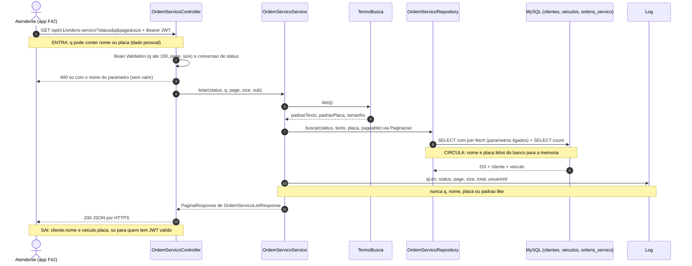

# Listar ordens de serviço com filtro de status e busca por nome do cliente ou placa, em uma consulta com `join fetch`

Histórico de status:

* 2026-11-24: proposto (F06a, etapa do CARTOGRAFO), ramo `docs/f06a-cartografo-adrs`, empilhado sobre `docs/f06a-bussola-prd-os-listar`.

Vínculos: F06a ([PRD](../../product/F06a-os-listar.md), US-OS-LST-01 a 14 e acréscimos com letra), card F06, consumida pela F42 (tela). Aplica o [ADR-017](ADR-017-padronizar-listagem-com-busca-e-paginacao.md) e o [ADR-032](ADR-032-reaproveitar-contrato-de-listagem-do-adr-017-com-paginacao-extraida-no-service.md) sem mudá-los e segue o padrão de nome do [ADR-034](ADR-034-listar-pecas-com-busca-em-nome-ou-codigo-sem-filtro-de-ativo-e-sem-custo.md). Depende do [ADR-038](ADR-038-criar-data-abertura-e-data-previsao-entrega-da-os-pela-migration-v11-da-f06a.md) (colunas de data) e do [ADR-039](ADR-039-representar-data-e-hora-na-api-como-instant-utc-com-fuso-da-conexao-fixado.md) (formato de `dataAbertura`). Complementa o ADR-006 (enum como STRING), o ADR-007 (DTO + MapStruct) e o ADR-011 (handler global). Depende da V7 da F04 (placa normalizada, ADRs 022 a 031 no ramo `feat/f04-veiculos`, fora da `main` em 2026-11-24).

## Contexto e problema

O comandante pediu para conferir se os ADRs de paginação e busca da F03 (ADR-017) e da F17 (ADR-032, ADR-034) cobrem a busca por nome do cliente ou placa **com junção** e a ordenação por data de abertura e id. Conferi nos arquivos e no código em 2026-11-24:

| Ponto | Coberto? | Onde |
|---|---|---|
| `page` base 0, `size` 1 a 100 (padrão 20), 400 só com o nome do parâmetro, 404 e 405 | sim | ADR-017; `GlobalExceptionHandler` |
| Envelope `PaginaResponse<T>` (`itens`, `pagina`, `tamanho`, `totalItens`, `totalPaginas`), decisão D5 do PRD | sim | ADR-017 |
| Guarda O3 (página além do fim, `page * size > Integer.MAX_VALUE`) | sim | `service.Paginacao` (ADR-032) |
| `q` até 100, literal, escape `!` com `ESCAPE` explícito, `strip` + NFC, `qLen` no log | sim | ADR-017; `service.TermoBusca` |
| Busca no nome do cliente sem caixa nem acento | sim | collation de `clientes` fixada pela V3 |
| Ordenação composta com desempate por `id` | sim, mecanicamente: `Paginacao.paginar` recebe um `Sort` | ADR-032 |
| **Busca em coluna de outra tabela (junção com cliente e veículo) sem N+1** | **não** | nenhum ADR trata junção nem consulta de contagem; as três listas atuais leem uma tabela só |
| **Normalização da placa (hífen, espaço, caixa)** | **não** | `TermoBusca` só tem `padraoTexto` e `padraoTelefone` |
| **Filtro por enum (`status`)** | **não** | o ADR-032 trata só filtro booleano (`ativo`) |
| **Coluna `data_abertura` para ordenar** | **não existe** (ADR-038) | a V2 não tem coluna de data em `ordens_servico` |
| **Formato de data e hora na resposta** | **não** (ADR-039) | nenhum DTO de recurso expõe data hoje |

Os itens em negrito são decisões novas. Este ADR fecha o contrato do endpoint, a junção, a placa e o filtro de status. As colunas e o formato de data ficam em ADRs próprios porque afetam outras features (F18, F20, F22 e toda resposta com data).

## Fatores de decisão

* F1: a página com 20 itens sai com no máximo **2 comandos SQL** (página + contagem) e **zero** carga extra de entidade (`Statistics.getEntityFetchCount() == 0`), porque cada item mostra cliente e veículo (US-OS-LST-12).
* F2: nenhum termo de busca, nome ou placa em log, mensagem de erro ou `toString()` que possa parar em log (H3 do PRD; política de dados, seção 6).
* F3: reaproveitar `Paginacao`, `TermoBusca`, `PaginaResponse` e o handler global sem mudar o comportamento deles nas listas já entregues (clientes, serviços, peças).
* F4: convenção da casa: DTO + MapStruct (ADR-007), regra no service, consulta parametrizada, nenhuma dependência nova.
* F5: simples de manter por uma pessoa: uma consulta que se lê inteira no repositório, sem `Specification` nem Criteria dinâmico.

## Opções consideradas

Para carregar cliente e veículo sem N+1 (o ponto que decide F1):

* A: `@Query` JPQL com `join fetch` de cliente e veículo e `countQuery` explícita, as duas com o mesmo `where` vindo de uma constante da interface.
* B: `@Query` com `join` simples mais `@EntityGraph(attributePaths = cliente, veiculo)`.
* C: projeção por construtor em JPQL (`select new ...`) e montagem manual do DTO.
* D: manter o padrão das outras listas (consulta sem `fetch`) e ligar `hibernate.default_batch_fetch_size`.

## Resultado da decisão

Opção escolhida: **A**, porque é a única que atende F1 com uma consulta legível no repositório (F5), sem configuração global, mantendo o mapeamento por MapStruct a partir da entidade (F4). O `countQuery` explícito é obrigatório: o Spring Data não deriva uma contagem válida de consulta com `join fetch` (o Hibernate rejeita `fetch` quando o dono da associação não está no `select`).

### Contrato do endpoint

`GET /api/v1/ordens-servico`, autenticado por JWT (ADR-004), qualquer perfil (não há distinção entre ADMIN e FUNCIONARIO no sistema hoje).

| Parâmetro | Tipo | Regra |
|---|---|---|
| `status` | `StatusOS`, opcional | ausente: todos os status. Valor fora do enum, inclusive caixa diferente (`aberta`): 400 `Parametro invalido: status`, pelo handler de `MethodArgumentTypeMismatchException` que já existe, sem eco do valor e sem handler novo. Vazio (`status=`) e parâmetro repetido: comportamento do conversor do Spring, a fixar por teste (ver Mais informações) |
| `q` | texto, opcional, `@Size(max = 100)` no valor bruto | trecho do nome do cliente OU da placa; em branco equivale a ausente |
| `page` | int, `@Min(0)`, padrão 0 | ADR-017 |
| `size` | int, `@Min(1) @Max(100)`, padrão 20 | ADR-017 |

Ordem fixa: `dataAbertura` desc, depois `id` desc. Constante `ORDEM_PADRAO` no service, `Sort.by(Sort.Order.desc(dataAbertura), Sort.Order.desc(id))`, passada a `Paginacao.paginar`. Os nomes são de atributo da entidade, nunca vindos da requisição.

Resposta 200: `PaginaResponse<OrdemServicoListResponse>`.

| Campo | Tipo JSON | Origem |
|---|---|---|
| `id` | número | `ordens_servico.id` |
| `status` | texto (nome do enum) | `ordens_servico.status` |
| `dataAbertura` | texto ISO-8601 em UTC com `Z`, por exemplo `2026-11-24T12:30:00Z` (ADR-039) | `ordens_servico.data_abertura` (ADR-038) |
| `previsaoEntrega` | texto `AAAA-MM-DD` ou `null` | `ordens_servico.data_previsao_entrega` (ADR-038) |
| `valorTotal` | número decimal | `ordens_servico.valor_total` |
| `cliente` | objeto `ClienteResumo` com `id` e `nome` | `clientes` |
| `veiculo` | objeto `VeiculoResumo` com `id`, `placa` e `modelo` | `veiculos` |

Nada além disso: sem telefone, CPF, endereço, marca, cor, quilometragem nem subtotais (minimização, LGPD art. 6º, III).

Erros: 400 (parâmetro inválido; mensagem só com o nome do parâmetro, decisão D10 do PRD: se o `erros[]` da F04 já estiver na `main` quando a F06a for codificada, ele é preenchido com o campo e sem valor; senão, só a mensagem), 401 (token ausente, inválido ou expirado), 405, 500. Página além do fim: 200 com `itens` vazio e o total real.

### Classes (pacotes do ADR-001)

| Pacote | Classe | Responsabilidade |
|---|---|---|
| `controller` | `OrdemServicoController` | recebe e valida os parâmetros, lê `jwt.getSubject()`, delega; anotações springdoc como em `PecaController` |
| `service` | `OrdemServicoService` (concreta, sem interface, como `PecaService`) | normaliza o termo, monta a página, registra o log, mapeia dentro de `@Transactional(readOnly = true)` |
| `service` | `TermoBusca` (alterada) | ganha o componente `padraoPlaca` e um `toString()` que mostra só o tamanho |
| `repository` | `OrdemServicoRepository.buscar` | consulta com `join fetch` e `countQuery` |
| `dto` | `OrdemServicoListResponse`, `ClienteResumo`, `VeiculoResumo` | records de saída; os dois resumos ficam no topo de `dto`, como `UsuarioResumo` |
| `mapper` | `OrdemServicoMapper` | MapStruct entidade para DTO, inclusive `OffsetDateTime` para `Instant` (ADR-039) |
| `entity` | `OrdemServico` (alterada) | ganha `dataAbertura` e `dataPrevisaoEntrega` (ADR-038) |

Nome do DTO: o card e o PRD dizem `OrdemServicoResumoResponse`; vale `OrdemServicoListResponse`, padrão da casa (`ClienteListResponse`, `ServicoListResponse`, `PecaListResponse`), como o ADR-034 fez na F17. Divergência registrada no `overview.md`.

`ClienteResumo`, `VeiculoResumo` e `OrdemServicoListResponse` sobrescrevem `toString()` para mostrar só o `id`, como os DTOs da F04, porque o `toString()` padrão de record imprime nome e placa.

### Consulta

O `where` fica numa constante da interface (campo de interface é `static final`; texto concatenado é constante de compilação e pode ir na anotação), para que a página e a contagem nunca divirjam:

```java
String FILTRO = """
     where (:status is null or o.status = :status)
       and (:texto is null
            or c.nome like :texto escape '!'
            or (:placa is not null and v.placa like :placa escape '!'))
    """;

@Query(
    value = "select o from OrdemServico o join fetch o.cliente c join fetch o.veiculo v" + FILTRO,
    countQuery = "select count(o) from OrdemServico o join o.cliente c join o.veiculo v" + FILTRO)
Page<OrdemServico> buscar(
    @Param("status") StatusOS status,
    @Param("texto") String texto,
    @Param("placa") String placa,
    Pageable pageable);
```

* Junção interna nas duas: `cliente_id` e `veiculo_id` são `NOT NULL` com FK na V2, então nenhuma OS some da lista por causa do `join`.
* Sem `lower()` e sem `CONVERT`: caixa e acento do nome vêm da collation de `clientes` (V3); a placa é comparada já em maiúsculas (abaixo).
* O `Sort` vira `order by o.dataAbertura desc, o.id desc` pelo Spring Data, que acrescenta a ordenação na consulta de página e não na de contagem.

### Normalização do termo (`TermoBusca`)

`TermoBusca.de(q)` continua igual para `padraoTexto` e `padraoTelefone` (clientes, serviços e peças não mudam, F3) e ganha `padraoPlaca`, calculado a partir do termo já com `strip` e NFC:

1. Remove hífen e espaço em branco.
2. Converte para maiúsculas com `Locale.ROOT`.
3. Se o resultado casar com `^[A-Z0-9]{1,10}$`, o padrão é `%` + resultado + `%`; senão, `padraoPlaca` é `null` e a placa não entra na consulta (US-OS-LST-07c, `q` só com hífen).

Diferença para o texto do PRD (seção 6, item 4, que pede escapar o padrão de placa): o filtro do item 3 só deixa passar letras ASCII e dígitos, que não precisam de escape. O resultado é o mesmo do PRD para toda placa que a V7 da F04 aceita (`ck_veiculos_placa_formato`: só `[A-Z0-9]` e o marcador `ANON<id>`), e o caminho de escape some do código. O `like` da placa mantém `escape '!'` para a regra do ADR-017 (todo `like` com `ESCAPE`) continuar verificável por busca no código.

O termo do nome mantém o hífen (`Ana-Maria`) e o escape do ADR-017.

`TermoBusca` ganha `toString()` que mostra só `tamanho`: hoje o record imprime `padraoTexto`, que contém o termo, e basta um `LOG.debug(termo)` para vazar (F2). Vale para as quatro listas.

### Log

Uma linha por chamada, no padrão das outras listas:

`ordens-servico.listar qLen=<n> status=<enum ou null> page=<n> size=<n> total=<n> usuarioId=<sub do JWT>`

Nunca `q`, nome, placa ou o padrão `like`. O `status` é valor do enum validado (não é entrada livre nem dado pessoal).

### Dado pessoal: onde entra, circula e sai



### Threat model (STRIDE)

| Ameaça | Cenário | Controle | Risco residual |
|---|---|---|---|
| S, falsificação | chamada sem token ou com token forjado lista OS de todos os clientes | resource server JWT (ADR-004); 401 sem corpo de dado | token roubado de aparelho vale até expirar (ADR-004) |
| T, adulteração | `q` com `%`, `_`, `!` ou trecho SQL para ampliar a busca ou injetar | parâmetro ligado em JPQL; escape `!` no nome; placa só `[A-Z0-9]` | nenhum conhecido |
| T, adulteração | `sort` ou nome de coluna vindo da requisição | ordem fixa no service; nenhum parâmetro de ordenação é lido | nenhum |
| R, repúdio | quem buscou o quê | `usuarioId` no log de cada chamada | o log não guarda o termo (de propósito), então não diz quem procurou qual cliente; aceito pela minimização |
| I, divulgação | termo, nome ou placa em log, erro ou `toString()` | linha de log fixa; 400 sem valor; `toString()` só com id nos DTOs e só com tamanho no `TermoBusca`; 500 loga só classe e URI (ADR-011) | log de SQL do Hibernate com parâmetros ligado por alguém em produção imprime o termo (configuração, fora do código) |
| I, divulgação | lista devolve mais do que precisa | DTO fechado com 7 campos; sem telefone, CPF, endereço | o nome completo sai em toda linha; necessário para identificar a OS no balcão |
| I, divulgação | `q=anon` ou `q=anonimizado` acha registros anonimizados | o nome anonimizado e o marcador `ANON<id>` não identificam a pessoa (política, seção 4) | revela quantas OS são de clientes anonimizados; aceitável |
| D, negação de serviço | `size=100` com `q` curto e `like` com `%` na frente varre as tabelas | `size` máximo 100; `q` até 100; junção por PK | sem índice útil para `like %x%`; com o volume de uma oficina (milhares de OS) é aceitável; revisitar com volume (Mais informações) |
| E, elevação | FUNCIONARIO vê o mesmo que ADMIN | decisão vigente do produto (CLAUDE.md, Segurança) | quando houver permissão por perfil, este endpoint entra na revisão |

Base legal e retenção (proposta, a confirmar pela VIGIA na decisão D9 do PRD): nome do cliente e placa na lista seguem a base da F03 e da F04 (execução de contrato, LGPD art. 7º, V) e a retenção R1 da política de dados (5 anos após o último evento). O endpoint não cria dado pessoal novo nem cópia persistente; o `usuarioId` no log é o mesmo das outras listas; a base legal e a retenção desse log ainda não estão registradas (pendência para a VIGIA, junto com a D9).

### Consequências

* Bom, porque a página sai com uma consulta e uma contagem, sem N+1, e o mapeamento continua no MapStruct.
* Bom, porque o `where` único na constante impede que página e contagem filtrem coisas diferentes.
* Bom, porque `status` como enum no controller reaproveita o 400 que já existe, sem handler novo; o card pedia handler próprio (tarefas 4 e 6), que fica dispensado e substituído por teste.
* Bom, porque o `toString()` novo de `TermoBusca` fecha um vazamento latente nas quatro listas.
* Ruim, porque a contagem também faz as duas junções; é o custo de filtrar por nome e placa (sem `q` as junções são por PK e baratas).
* Ruim, porque a busca por placa depende da V7 da F04 (placa gravada em maiúsculas, sem hífen). Sem ela, placa antiga com hífen ou minúscula não é achada (risco P7 do PRD). Por isso não há `CONVERT` em `veiculos` aqui: com a V7, a comparação é entre ASCII maiúsculo dos dois lados e independe da collation; sem a V7, nem o `CONVERT` resolveria o hífen.
* Ruim, porque `like %termo%` não usa índice; aceito para o porte (ver Mais informações).
* Neutro, porque o Spring Data pula a contagem quando a página vem incompleta na primeira página ou é a última; o total continua certo, mas o teste de comandos SQL precisa contar com isso.

### Confirmação

* Revisão de PR: a `@Query` de `buscar` tem `join fetch` e `countQuery` com a constante `FILTRO`; todo `like` tem `escape '!'` (busca por `like` sem `escape` no pacote `repository` retorna vazio).
* Teste de integração (Testcontainers, ADR-010) da contagem de comandos, com `hibernate.generate_statistics` ligado só no perfil de teste: 21 OS de clientes e veículos distintos; chamar `page=0&size=20` e `page=0&size=1` (as duas obrigam a contagem); esperar `getPrepareStatementCount() == 2` e `getEntityFetchCount() == 0` em cada chamada.
* Teste unitário de `TermoBusca`: `abc-1d23`, ` ABC 1D23 `, `-`, `José`, `%`, termo com 11 caracteres alfanuméricos, e `toString()` sem o termo.
* Teste de integração do controller: `status=aberta` e `status=XYZ` dão 400 com `Parametro invalido: status` e sem o valor no corpo; `status=` e `status` repetido têm o comportamento observado registrado no teste.
* Teste de log (capturar o appender, como nas outras listas): a linha `ordens-servico.listar` não contém o termo, o nome nem a placa da massa.
* Teste de ordenação: duas OS com a mesma `data_abertura` saem por `id` desc (US-OS-LST-01b do PRD).

## Prós e contras das opções

### A: `join fetch` + `countQuery` com `where` compartilhado (escolhida)

* Bom, porque atende F1 (2 comandos, zero carga extra), comportamento documentado do Hibernate para `ManyToOne`.
* Bom, porque a consulta inteira fica visível em um arquivo (F5) e segue o estilo de `PecaRepository` (F3).
* Neutro, porque exige escrever a contagem à mão; a constante `FILTRO` reduz isso a uma linha.
* Ruim, porque `join fetch` com paginação só é seguro para associação a um (`ManyToOne`). Quando a F18 quiser trazer serviços ou peças da OS (a muitos) na mesma consulta, o Hibernate pagina em memória; essa lista nunca deve fazer `fetch` de coleção.

### B: `join` + `@EntityGraph`

* Bom, porque a contagem derivada pelo Spring Data funciona sem `countQuery`.
* Neutro, porque o resultado em SQL deve ser parecido com A.
* Ruim, porque não verifiquei se o Hibernate 7.4 reaproveita o `join` com alias do `where` ou gera um segundo `join` para o grafo; se gerar, são 4 junções por consulta. Custo de adotar: um experimento antes do código e uma anotação a mais que esconde parte da consulta.

### C: projeção por construtor

* Bom, porque lê só as colunas usadas (7 em vez de todas as de três tabelas).
* Ruim, porque monta o DTO fora do MapStruct, contra o ADR-007 e o padrão das três listas (F4); a projeção carrega a contagem e o `Sort` por nome de atributo do mesmo jeito.
* Custo de adotar: uma classe de linha a mais e uma exceção à convenção para ganhar colunas que, no porte da oficina, não pesam.

### D: manter sem `fetch` e ligar batch fetch

* Bom, porque não muda a consulta.
* Ruim, porque são 3 comandos por página (página, clientes em lote, veículos em lote) mais a contagem, o que não atende F1 nem o critério 12 do PRD (mesma consulta).
* Ruim, porque `default_batch_fetch_size` é configuração global e muda o perfil de SQL de todas as features.
* Custo de adotar: descumprir o critério de aceite e mexer em todas as listas sem pedido.

## Mais informações

* Pendências que ESPRESSO resolve por teste e registra no PR, sem decisão nova: comportamento de `status=` (o conversor de enum do Spring tende a devolver `null` para texto vazio, o que lista todos) e de `status` repetido (tende a usar o primeiro valor). Se o observado for outro (por exemplo 400), o teste fixa o observado e o CARTOGRAFO revisa este ADR.
* Merge: a F06a só vai para a `main` depois da F04 (V7, entidade `Veiculo` com placa normalizada). Se a ordem se inverter, a busca por placa funciona só para placas já gravadas em maiúsculas sem hífen.
* Índice: não cria `idx_ordem_status` nem índice em `data_abertura` agora (decisão D8 do PRD, parte do índice). Revisitar quando `ordens_servico` passar de 50 mil linhas ou a lista passar de 300 ms no p95 medido; o candidato é `(status, data_abertura, id)`.
* Collation de `veiculos`: diverge da sugestão do PRD (D8, converter a tabela como a V10 fez em `pecas`). O custo de converter seria uma reconstrução da tabela com a `uk_veiculos_placa` da F04 dentro de uma migration de outra feature, sem efeito na busca, porque o padrão já chega em maiúsculas ASCII. Se um dia a busca incluir `modelo` ou `marca`, a feature que fizer isso fixa a collation de `veiculos`.
* Revisitar este ADR quando: entrar filtro por período ou ordenação escolhida pela pessoa (fora do escopo, PRD seção 3), houver permissão por perfil, ou a F18 precisar de coleção na lista.
