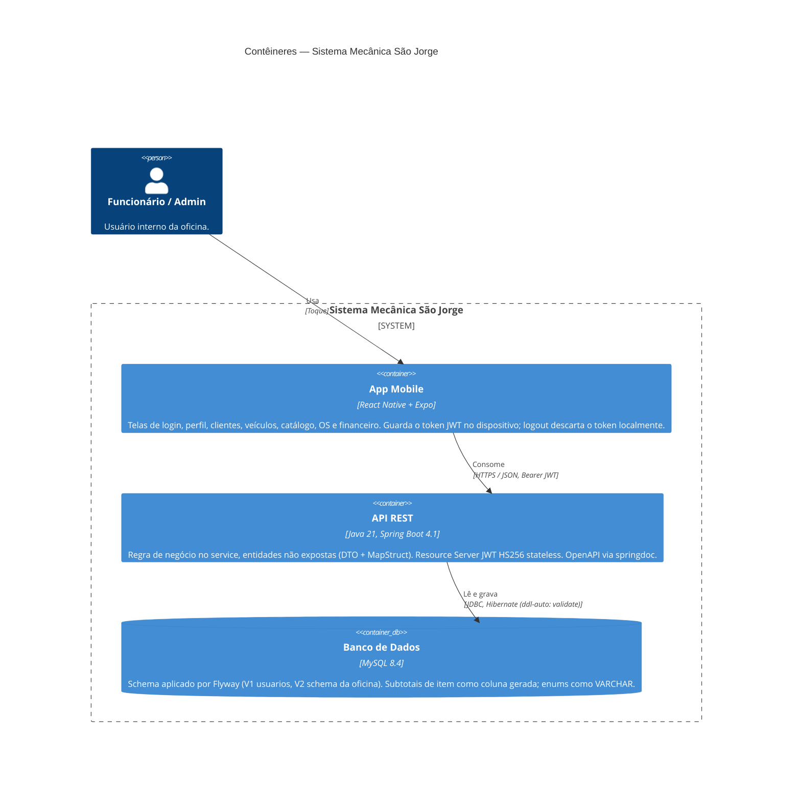
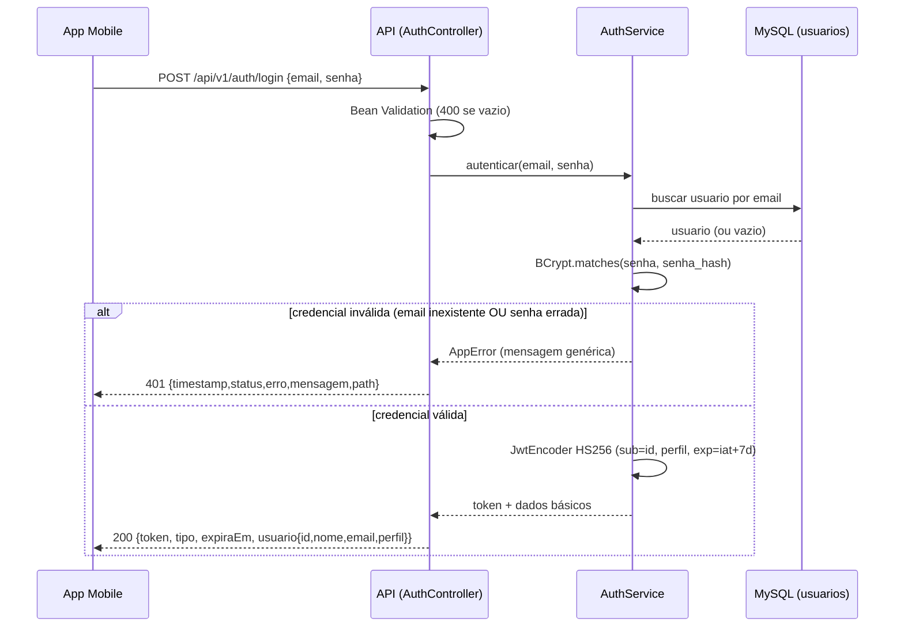

# C4 — Nível 2: Contêineres

Contêineres do sistema. Mermaid versionado; atualizar com o ADR da mudança.

Componentes relevantes da API (nível 3, resumido):
- `security` — SecurityConfig (resource server), JwtEncoder/JwtDecoder,
  AuthenticationEntryPoint ([[ADR-004-autenticacao-stateless-via-jwt-hs256]]).
- `controller` → `service` → `repository`/`mapper` → `entity`
  ([[ADR-001-organizar-pacotes-por-camada]], [[ADR-007-nao-expor-entidade-na-api-dto-e-convencao-de-nomes]]).
- `exception` — GlobalExceptionHandler + ErrorResponse
  ([[ADR-011-handler-global-de-erro-e-mapeamento-de-status]]).

Fluxo de autenticação (login):

