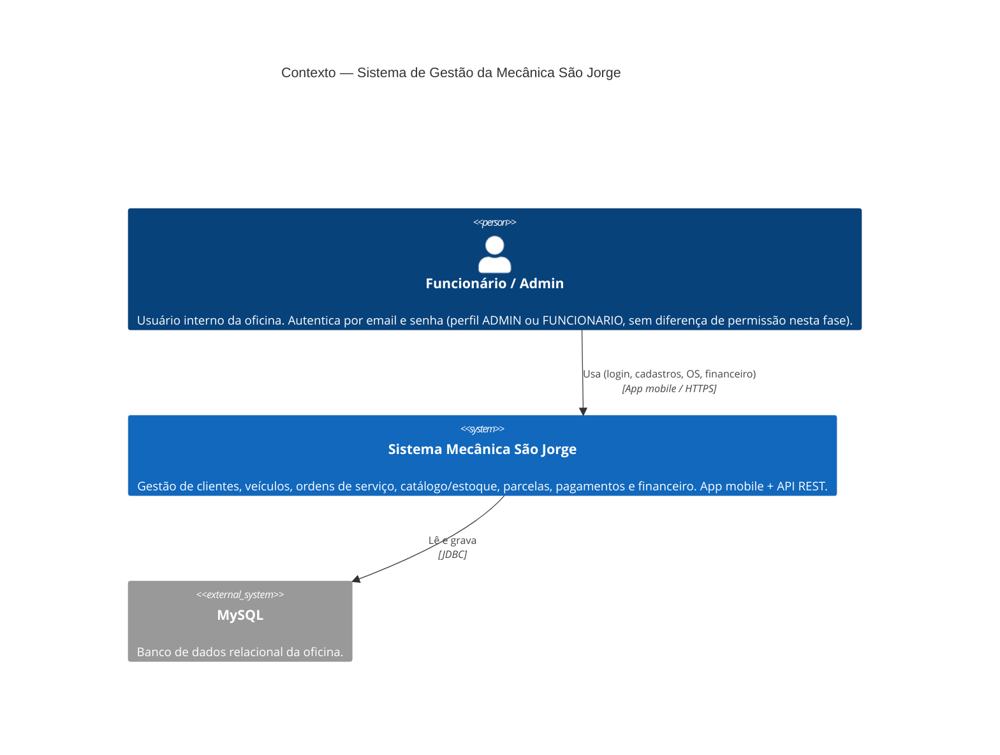

# C4 — Nível 1: Contexto

Sistema **Mecânica São Jorge** e seus atores. Diagrama versionado (Mermaid).
Atualizar junto de qualquer mudança estrutural, citando o ADR correspondente.

Notas:
- Sem integrações externas nesta fase (sem WhatsApp, PDF, e-mail, gateway de
  pagamento) — backlog de produto, fora de escopo (briefing).
- A própria API emite e valida o JWT (sem servidor de autorização externo) —
  ver [[ADR-004-autenticacao-stateless-via-jwt-hs256]].
