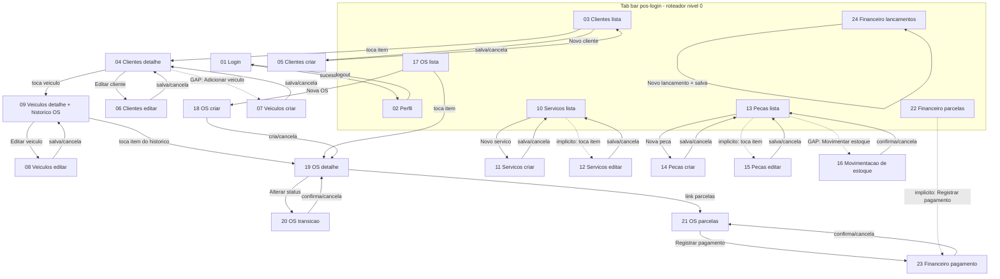

# Mapa de navegação entre telas — Wireframe F24 (24 telas)

- Autor: CARTOGRAFO (Arquiteto)
- Data: 2026-11-07
- Fonte de verdade das telas: `docs/product/F24-wireframe-baixa-fidelidade.md`
  (seção 4) e `docs/design/F24-wireframe-baixa-fidelidade.md` (seção 6).
- Instrução que originou este artefato: comandante — "confirmar o mapa de
  navegação entre telas para o wireframe não criar fluxo órfão".

## 1. Para que serve

A matriz de cobertura de estado (PRD seção 5.4) verifica **estado por tela**
(vazio, carregando, erro de rede, erro de validação, preenchido). Ela **não**
verifica se cada tela é alcançável e se cada ação leva a algum lugar. Este mapa
é a outra metade do critério técnico: fecha o grafo de navegação das 24 telas e
lista, tela a tela, de onde se entra e para onde se sai, para que o CRIVO
consiga reprovar um fluxo órfão com a mesma objetividade com que reprova um
estado faltante.

**Definição de órfão aqui**: tela sem nenhuma aresta de entrada a partir da raiz
(inalcançável) ou ação de tela sem destino declarado (botão que não leva a lugar
nenhum).

## 2. Raiz e casa pós-login

- **Raiz**: `01 Login`. Única tela sem navegação de entrada (ponto de partida).
- **Casa pós-login**: `02 Perfil`, conforme F30 (tela de pouso da Sprint 01) e
  F33 (tab bar inferior como casa). Na Sprint 01 a tab bar tem só a aba Perfil;
  as demais abas entram sprint a sprint (F33). Para o wireframe das 24 telas,
  trate a tab bar como o **roteador de nível 0** que expõe o topo de cada módulo:

| Aba (tab bar, estado-alvo) | Tela-topo do módulo |
|---|---|
| Perfil | `02 Perfil` |
| Clientes | `03 Clientes · lista` |
| Catálogo | `10 Serviços · lista` + `13 Peças · lista` (ver nota A) |
| Ordens de Serviço | `17 Ordens de Serviço · lista` |
| Financeiro | `22 Financeiro · parcelas` + `24 Financeiro · lançamentos` (ver nota A) |

> **Nota A**: Catálogo reúne duas listas (Serviços e Peças) e Financeiro reúne
> duas telas-topo (Parcelas e Lançamentos). Como ESQUADRO expõe as duas dentro
> de uma aba (sub-aba, segmented control ou cabeçalho) é decisão de design, mas
> **ambas precisam ter entrada visível a partir da raiz** — senão `13 Peças ·
> lista` e `24 Financeiro · lançamentos` ficam órfãs em relação à tab bar.

## 3. Grafo de navegação

Legenda: linha cheia = aresta declarada na spec de ESQUADRO; linha tracejada =
aresta **não declarada** (órfão ou implícita) que precisa ser fechada antes de
o wireframe ser aprovado.

## 4. Entrada e saída por tela (as 24)

| # | Tela | Entra a partir de | Sai para | Situação |
|---|---|---|---|---|
| 01 | Login | — (raiz) | 02 (sucesso) | OK |
| 02 | Perfil | tab bar; 01 (sucesso) | 01 (logout) | OK |
| 03 | Clientes · lista | tab bar | 04, 05 | OK |
| 04 | Clientes · detalhe | 03 (item) | 06, 09, **07** | **Gap 1** |
| 05 | Clientes · criar | 03 | 03/04 | OK |
| 06 | Clientes · editar | 04 | 04 | OK |
| 07 | Veículos · criar | **04 (sem botão hoje)** | 04/09 | **Gap 1 (órfão)** |
| 08 | Veículos · editar | 09 | 09 | OK |
| 09 | Veículos · detalhe + histórico | 04 (item veículo) | 08, 19 | **Gap 4** (item→19) |
| 10 | Serviços · lista | tab bar (Catálogo) | 11, 12 | **Gap 2** (nota A) |
| 11 | Serviços · criar | 10 | 10 | OK |
| 12 | Serviços · editar | **10 (item, implícito)** | 10 | **Gap 3** |
| 13 | Peças · lista | tab bar (Catálogo) | 14, 15, 16 | **Gap 2** (nota A) |
| 14 | Peças · criar | 13 | 13 | OK |
| 15 | Peças · editar | **13 (item, implícito)** | 13 | **Gap 3** |
| 16 | Movimentação de estoque | **sem entrada declarada** | 13 | **Gap 5 (órfão)** |
| 17 | Ordens de Serviço · lista | tab bar | 18, 19 | OK |
| 18 | Ordens de Serviço · criar | 17 | 19 | OK (consome 03/04/10/13 como seletor) |
| 19 | Ordens de Serviço · detalhe | 17 (item); 09 (histórico) | 20, 21 | OK |
| 20 | Ordens de Serviço · transição | 19 | 19 | OK |
| 21 | Ordens de Serviço · parcelas | 19 | 23 | OK |
| 22 | Financeiro · parcelas | tab bar | **23 (implícito)** | **Gap 6** |
| 23 | Financeiro · pagamento | 21; **22** | 21/22 | **Gap 6** |
| 24 | Financeiro · lançamentos | tab bar | 24 (form na mesma tela) | OK (nota A) |

## 5. Órfãos e lacunas de fluxo (decisão de design, não de schema)

Seis pontos a fechar antes da aprovação. Nenhum é decisão de arquitetura de
backend — são arestas de navegação que a spec de ESQUADRO precisa declarar
explicitamente. Dono da correção: **ESQUADRO** (spec) → **ORLA/F35/F36** (front).

1. **`07 Veículos · criar` é órfã.** A spec de `04 Clientes · detalhe` lista
   "Editar cliente" e a lista de veículos, mas **não** tem ação de adicionar
   veículo. Como "Veículos no fluxo do cliente" (Sprint 02), a única entrada
   coerente é um botão **"Adicionar veículo"** em `04`. Sem isso, não há como
   chegar à tela 07. → Adicionar a aresta `04 → 07`.
2. **Entrada das duas listas de Catálogo e das duas de Financeiro a partir da
   raiz** (nota A). Confirmar que `13 Peças · lista` e `24 Financeiro ·
   lançamentos` têm entrada visível na tab bar (sub-aba/segmented), senão ficam
   inalcançáveis a partir da casa pós-login.
3. **`12 Serviços · editar` e `15 Peças · editar` dependem de "tocar item".**
   Serviços e Peças **não têm tela de detalhe** — a edição é o destino do toque
   no item da lista. A spec de `10` e `13` descreve o item, mas não declara que
   ele navega para a edição. → Declarar explicitamente `10 → 12` e `13 → 15`.
4. **`09 → 19` (item do histórico de OS).** `09` lista o histórico de OS do
   veículo ("OS-0001 — …"), mas não diz se o item é tocável. → Confirmar se o
   item do histórico navega para `19 OS · detalhe` (recomendado) ou é só leitura.
5. **`16 Movimentação de estoque` é órfã.** A tela assume uma peça de contexto
   ("Peça: Filtro de óleo — FO-1023"), mas nenhuma tela declara como chegar
   nela. Como não há tela de detalhe de peça, a entrada natural é uma ação
   **"Movimentar estoque"** no item de `13 Peças · lista` (ou num detalhe de
   peça, se ESQUADRO decidir criar um). → Fechar a aresta de entrada de `16`.
6. **`22 Financeiro · parcelas → 23 Financeiro · pagamento`.** O pagamento só
   está cabeado a partir de `21 OS · parcelas`. Se `22` lista parcelas de todas
   as OS mas não permite pagar, há duas telas de parcela com affordance
   diferente. → Confirmar se `22` também leva a `23` (recomendado, consistência)
   ou se o pagamento é exclusivo do fluxo da OS.

Órfãos reais (telas inalcançáveis): **07 e 16**. Os demais são arestas
implícitas a tornar explícitas. Nenhuma tela fica sem caminho de volta — a
convenção 4.4 de ESQUADRO já prevê "cancelar"/voltar em todo formulário e
detalhe.

## 6. Revisão dos dois pontos do handoff da BUSSOLA

### 6.1 A matriz da seção 5.4 é suficiente como critério técnico?
**Suficiente para cobertura de estado, não para cobertura de fluxo.** A matriz
é objetiva e contável (93 frames) e serve ao CRIVO sem interpretação. Mas,
sozinha, deixaria passar um wireframe com as 24 telas e os 93 frames **e ainda
assim** com as telas 07 e 16 inalcançáveis. Recomendo que o critério de
aceitação do CRIVO passe a ser **matriz 5.4 (estado) + seção 4 deste mapa
(fluxo)**: toda tela marcada na seção 4 como "OK" tem entrada e saída; os seis
gaps fechados é pré-condição de US-DES-07 (aprovação).

### 6.2 As dúvidas de schema (dúvida 2 do PRD) têm impacto de arquitetura?
**Não para o wireframe; sim como pendência de migration já mapeada — com uma
lacuna nova.** O wireframe pode usar placeholder estrutural para campo sem
coluna (foi o que ESQUADRO fez, seção 3 da spec). A estratégia de migration
aditiva por feature já está registrada em `overview.md` ("Schema V2
incremental"), cobrindo `servicos.nome`, `pecas.nome`,
`movimentacoes_estoque.quantidade` etc. — **nada disso bloqueia a F24**.

Porém, revisando o mapa incremental de `overview.md`, **`clientes.cpf` e
`clientes.endereco` (pedidos por US-DES-04) não têm feature dona registrada** —
a tabela incremental não lista `clientes`. Corrigi isso em `overview.md` nesta
entrega, atribuindo a coluna à feature que primeiro grava o cliente (F09
Clientes criar / F03 módulo), por migration aditiva, conforme ADR-003. Não abre
ADR novo: é aplicação direta da decisão de schema aditivo já aceita.

## 7. Quando atualizar este mapa

- Se o comandante/BUSSOLA separar `24 Financeiro · lançamentos` em duas telas
  (dúvida 3 do PRD), a contagem vira 25 e as arestas de `24` mudam — republicar.
- Se ESQUADRO criar uma tela de **detalhe de peça** ou **detalhe de serviço**,
  as arestas dos gaps 3 e 5 mudam de destino.
- Toda nova tela de módulo (sprints seguintes) entra aqui com entrada e saída
  antes de o front da feature começar.
