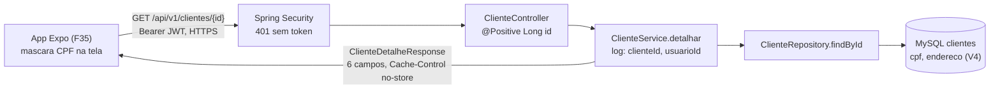

# Arquitetura — Mecânica São Jorge (op-002)

Visão de arquitetura da operação e índice de decisões (ADRs). Mantido pelo
CARTOGRAFO. Toda decisão difícil de reverter ou que afeta mais de um componente
vira um ADR em `adr/`, listado na tabela **Decisões** abaixo, atualizada no
mesmo commit.

## Estilo e fronteiras

- **Monorepo** ([[adr/ADR-008-monorepo-com-backend-spring-e-mobile-expo]]):
  `apps/api` (Spring Boot 4.1 / Java 21), `apps/mobile` (Expo), `docs/`.
- **Backend em camadas, pacotes por camada** ([[adr/ADR-001-organizar-pacotes-por-camada]]):
  `entity` → `repository`/`mapper` → `service` (regra de negócio) → `controller`;
  transversais em `config`, `security`, `exception`.
- **Nunca expor entidade na API**: entrada `*Request` (Bean Validation), saída
  `*Response`, mapeamento MapStruct ([[adr/ADR-007-nao-expor-entidade-na-api-dto-e-convencao-de-nomes]]).
- **Segurança**: Resource Server JWT HS256 stateless, a própria API emite/valida
  ([[adr/ADR-004-autenticacao-stateless-via-jwt-hs256]]); segredos fora de código
  e log ([[adr/ADR-009-configuracao-por-variavel-de-ambiente-e-segredos-fora-do-codigo]]).
- **Persistência**: MySQL via Flyway (migrations aditivas, sem DROP DATABASE),
  `ddl-auto: validate` ([[adr/ADR-003-versionar-schema-com-flyway-migrations-aditivas]]);
  enum como STRING ([[adr/ADR-006-persistir-enum-de-dominio-como-string]]);
  subtotais de item como coluna gerada ([[adr/ADR-005-subtotais-da-os-como-coluna-gerada-no-banco]]).

Diagramas C4 em `diagrams/` (contexto, contêineres, fluxo de login).
Mapa de navegação entre telas (wireframe F24, todas as telas do app, para
evitar fluxo órfão) em [`diagrams/navegacao-wireframe-f24.md`](diagrams/navegacao-wireframe-f24.md).

## Decisões

| ADR | Título | Status | Data |
|---|---|---|---|
| [ADR-001](adr/ADR-001-organizar-pacotes-por-camada.md) | Organizar o backend em pacotes por camada | Aceito | 2026-11-07 |
| [ADR-002](adr/ADR-002-documentar-api-com-springdoc-openapi.md) | Documentar a API com springdoc-openapi, não com Springfox | Aceito | 2026-11-07 |
| [ADR-003](adr/ADR-003-versionar-schema-com-flyway-migrations-aditivas.md) | Versionar o schema com Flyway e nunca reescrever migration aplicada | Aceito | 2026-11-07 |
| [ADR-004](adr/ADR-004-autenticacao-stateless-via-jwt-hs256.md) | Autenticação stateless via JWT HS256 com oauth2-resource-server | Aceito | 2026-11-07 |
| [ADR-005](adr/ADR-005-subtotais-da-os-como-coluna-gerada-no-banco.md) | Subtotais das junções da OS como coluna gerada no banco | Aceito | 2026-11-07 |
| [ADR-006](adr/ADR-006-persistir-enum-de-dominio-como-string.md) | Persistir enum de domínio como STRING | Aceito | 2026-11-07 |
| [ADR-007](adr/ADR-007-nao-expor-entidade-na-api-dto-e-convencao-de-nomes.md) | Não expor entidade na API: DTO + MapStruct e convenção de nomes | Aceito | 2026-11-07 |
| [ADR-008](adr/ADR-008-monorepo-com-backend-spring-e-mobile-expo.md) | Monorepo com backend Spring e mobile Expo | Aceito | 2026-11-07 |
| [ADR-009](adr/ADR-009-configuracao-por-variavel-de-ambiente-e-segredos-fora-do-codigo.md) | Configuração por variável de ambiente e segredos fora do código | Aceito | 2026-11-07 |
| [ADR-010](adr/ADR-010-testes-de-integracao-com-testcontainers.md) | Testes de integração com Testcontainers rodando as migrations do zero | Aceito | 2026-11-07 |
| [ADR-011](adr/ADR-011-handler-global-de-erro-e-mapeamento-de-status.md) | Handler global de erro: formato único e mapeamento de status HTTP | Aceito | 2026-11-07 |
| [ADR-012](adr/ADR-012-remover-template-generico-do-backend.md) | Remover o template genérico do backend em vez de adaptá-lo | Aceito | 2026-11-12 |
| [ADR-013](adr/ADR-013-adotar-migrations-flyway-como-fonte-unica-de-verdade-do-schema.md) | Adotar as migrations Flyway como fonte única de verdade do schema | Aceito | 2026-11-12 |
| [ADR-014](adr/ADR-014-adotar-referencia-figma-como-nova-identidade-visual.md) | Adotar o visual do Figma de referência como nova identidade visual do app (aceito na F41: referência FPdB8, cor ajustada para AA, classes de divergência e tabela token Figma × código) | Aceito | 2026-11-16 |
| [ADR-016](adr/ADR-016-fixar-jdk-21-no-build-com-enforcer-e-maven-wrapper.md) | Fixar o JDK 21 no build da API com maven-enforcer-plugin e Maven Wrapper | Proposto | 2026-11-14 |
| [ADR-017](adr/ADR-017-padronizar-listagem-com-busca-e-paginacao.md) | Padronizar a listagem com busca: termo literal, collation ai_ci fixada por migration e página própria | Proposto | 2026-11-14 |
| [ADR-018](adr/ADR-018-guardar-cpf-e-endereco-do-cliente-como-colunas-opcionais.md) | Guardar CPF e endereço do cliente como colunas opcionais, com endereço em campo único (V4 da F03b) | Proposto | 2026-11-17 |
| [ADR-019](adr/ADR-019-mapear-recurso-nao-encontrado-para-404-por-excecao-de-dominio.md) | Mapear recurso de domínio não encontrado para 404 com exceção dedicada no handler global | Proposto | 2026-11-17 |
| [ADR-020](adr/ADR-020-garantir-cpf-unico-por-indice-no-banco-com-409-no-service.md) | Garantir CPF único com índice no banco e traduzir a violação para 409 no service (F03c; momento de ligar depende de D2/P10) | Proposto | 2026-11-17 |
| [ADR-021](adr/ADR-021-compartilhar-dto-de-entrada-clienterequest-entre-criar-e-editar.md) | Compartilhar um único DTO de entrada `ClienteRequest` entre criar (F09) e editar (F10) | Proposto | 2026-11-17 |

ADR-014 foi trazido de `docs/f39-wireframe-redesenho` (`18efb4e`) pela branch `docs/f41-adr014-referencia-aprovada`, aceito em 2026-11-16 na F41 e levado à `main` pela #16. O ADR-016 chega com a #14 (a F44 usa o número 016; o ADR-012 é a remoção do template, da F38). O ADR-015 continua fora da `main` (`refactor/f40-estrutura-ui-sobre-f41`); a numeração dele está reservada e ele entra nesta tabela no próprio merge.

> Nota de materialização: a F00 referenciou ADR-004/006/010/011 em código mas
> não gravou os arquivos (ver `README.md`). Esta entrega da F02 materializa todo
> o conjunto, mantendo os números que o código já cita, e backfilla as decisões
> da F00 (008, 009, 010) para deixar a numeração íntegra e sem referência pendente.

## Modelo de dados (12 entidades)

Convenção ([[adr/ADR-007-nao-expor-entidade-na-api-dto-e-convencao-de-nomes]]):
tabela plural snake_case, PK `id` (`BIGINT UNSIGNED AUTO_INCREMENT`), FK
`<singular>_id`, entidade no singular em `entity`.

**Fonte de verdade**: o schema é o que as migrations Flyway criam
([[adr/ADR-013-adotar-migrations-flyway-como-fonte-unica-de-verdade-do-schema]]).
**Divergência registrada**: o script de referência (`docs/script.sql`, local e
fora do git desde `a1d2ddb`, originado do `BD/script.sql` do repo irmão) usa PascalCase e
PK `<tabela>_id` (ex.: `Clientes.cliente_id`). A casa segue o padrão já aplicado
pela F00 (`usuarios`, PK `id`, snake_case). O script é referência de **estrutura**
(colunas, FKs, geradas, enums), não de nomenclatura.

| Entidade | Tabela | Migration | Observações |
|---|---|---|---|
| Usuario | `usuarios` | V1 (F00) | PK `id`; `perfil` VARCHAR+CHECK (enum STRING); `created_at`/`updated_at` |
| Cliente | `clientes` | V2 (+ V3 na F03a; + V4 na F03b, aplicada no ramo `feat/f03b-clientes-detalhe`) | nome, telefone, email, created_at; `cpf` e `endereco` opcionais pela V4 ([ADR-018](adr/ADR-018-guardar-cpf-e-endereco-do-cliente-como-colunas-opcionais.md)); collation `utf8mb4_0900_ai_ci` fixada pela V3 ([ADR-017](adr/ADR-017-padronizar-listagem-com-busca-e-paginacao.md)) |
| Veiculo | `veiculos` | V2 | FK `cliente_id`; placa, modelo, marca, ano, cor, quilometragem |
| Servico | `servicos` | V2 | valor_padrao_mao_obra, tempo_estimado_horas, ativo |
| Peca | `pecas` | V2 | codigo UNIQUE, custo, preco_venda, quantidade_estoque, estoque_minimo, ativo |
| OrdemServico | `ordens_servico` | V2 | FK `cliente_id`, `veiculo_id`; `status` VARCHAR (enum); subtotais/desconto/valor_total **recalculados no service** (colunas comuns) |
| OrdemServicoServico | `ordens_servico_servicos` | V2 | FK `ordem_id`, `servico_id`; valor_cobrado, quantidade; **subtotal = coluna gerada** |
| OrdemServicoPeca | `ordens_servico_pecas` | V2 | FK `ordem_id`, `peca_id`; valor_unitario_cobrado, quantidade; **subtotal = coluna gerada** |
| MovimentacaoEstoque | `movimentacoes_estoque` | V2 | FK `peca_id`, `ordem_id?`; `tipo` VARCHAR (enum ENTRADA/SAIDA/AJUSTE), motivo |
| Parcela | `parcelas` | V2 | FK `ordem_id`; numero/total_parcelas, valor_previsto, data_vencimento. **Status calculado em runtime** (não é coluna) |
| Pagamento | `pagamentos` | V2 | FK `parcela_id`; valor, `forma_pagamento` VARCHAR (enum) |
| Financeiro | `financeiro` | V2 | `tipo` VARCHAR (enum ENTRADA/SAIDA); FK `ordem_id?`, `pagamento_id?` (origem do lançamento) |

Enums (todos `@Enumerated(EnumType.STRING)` + VARCHAR):
`Perfil` (ADMIN, FUNCIONARIO) · `StatusOS` (ABERTA, EM_ANALISE, ... — enum da
Sprint 04) · `FormaPagamento` (DINHEIRO, PIX, CARTAO, BOLETO) ·
`TipoMovimentacao` (ENTRADA, SAIDA, AJUSTE) · `TipoLancamento` (ENTRADA, SAIDA).

Colunas geradas ([[adr/ADR-005-subtotais-da-os-como-coluna-gerada-no-banco]]):
`ordens_servico_servicos.subtotal = GENERATED ALWAYS AS (valor_cobrado * quantidade) STORED`
e `ordens_servico_pecas.subtotal = GENERATED ALWAYS AS (valor_unitario_cobrado * quantidade) STORED`.
Mapear com `@Column(insertable=false, updatable=false)`.

## Reconciliação do schema com o script de referência

Regra ([[adr/ADR-013-adotar-migrations-flyway-como-fonte-unica-de-verdade-do-schema]]):
o schema do sistema é **o que as migrations criam**. `docs/script.sql` é
insumo histórico de requisito: fica local, fora do git desde `a1d2ddb`, e a
versão lida tem `sha256 d75746d0…afd235aa7`. Esta matriz congela o que o
script tem e a V1/V2 não têm. A V2 é **deliberadamente mínima**: cria as 11
tabelas só com o que a F02 precisa para `ddl-auto: validate`. Cada feature
dona fecha a sua linha **no mesmo PR** da migration aditiva (`V3+`,
[[adr/ADR-003-versionar-schema-com-flyway-migrations-aditivas]]). A entidade
JPA só mapeia a coluna depois que a migration que a cria entrar. Conferido
coluna a coluna por CARTOGRAFO em 2026-11-12, lendo os três arquivos SQL.

### Colunas do script ausentes nas migrations

| Tabela | Colunas no script que faltam em V1/V2 | Feature dona |
|---|---|---|
| `clientes` | nenhuma (só nomes divergem, ver abaixo) | n/a |
| `veiculos` | `data_cadastro` | F04 |
| `servicos` | `nome VARCHAR(150) NOT NULL`, `descricao VARCHAR(255)` | F05 / F11 / F12 |
| `pecas` | `nome VARCHAR(150) NOT NULL`, `categoria VARCHAR(80)`, `fabricante VARCHAR(100)`, `unidade VARCHAR(20) NOT NULL DEFAULT 'UN'` | F17 / F14 / F15 |
| `ordens_servico` | `descricao_problema TEXT`, `diagnostico TEXT`, `data_abertura`, `data_previsao_entrega DATE`, `data_fechamento` | F18 / F19 / F20 |
| `ordens_servico_servicos` | nenhuma | n/a |
| `ordens_servico_pecas` | nenhuma | n/a |
| `movimentacoes_estoque` | `quantidade INT NOT NULL`, `data_movimento` | F16 |
| `parcelas` | nenhuma (`numero` corresponde a `numero_parcela`) | n/a |
| `pagamentos` | `data_pagamento` | F22 |
| `financeiro` | `valor DECIMAL(10,2) NOT NULL`, `descricao VARCHAR(200)`, `forma_pagamento VARCHAR(30)`, `data_movimento` | F22 / F23 / F31 / F32 |
| `usuarios` | nenhuma | n/a |

### Regras de FK, nulidade, default e índice

Estas regras são decididas pela feature dona, com justificativa no PR. Não são
copiadas do script às cegas: `CASCADE` apaga histórico.

| Onde | Script | Migrations hoje | Feature dona |
|---|---|---|---|
| `veiculos.cliente_id` | `ON DELETE CASCADE` | sem ação (bloqueia o delete) | F04 |
| `veiculos.modelo`, `veiculos.marca` | `NULL` | `NOT NULL` (mais restrito) | F04 |
| `pecas.codigo` | `NULL`, `UNIQUE` | `NOT NULL`, `UNIQUE` | F14 |
| `ordens_servico.status` | `VARCHAR(30) DEFAULT 'ABERTA'` | `VARCHAR(20)`, sem default | F18 / F20 |
| `ordens_servico_servicos.ordem_id`, `ordens_servico_pecas.ordem_id` | `ON DELETE CASCADE` | sem ação | F19 |
| `movimentacoes_estoque.ordem_id` | `ON DELETE SET NULL` | sem ação | F16 |
| `parcelas.ordem_id` | `ON DELETE CASCADE` | sem ação | F21 |
| `parcelas.numero`, `parcelas.total_parcelas` | `DEFAULT 1` | sem default | F21 |
| `pagamentos.parcela_id` | `ON DELETE CASCADE` | sem ação | F22 |
| `financeiro.ordem_id`, `financeiro.pagamento_id` | `ON DELETE SET NULL` | sem ação | F22 / F23 |
| Índices fora de FK: `idx_ordem_status`, `idx_parcela_vencimento`, `idx_financeiro_tipo`, `idx_financeiro_data` | presentes | ausentes | F06 / F07 / F31 |
| `clientes.nome`, `telefone`, `email` (collation) | sem `COLLATE` | sem `COLLATE`; no `mysql:8.4` padrão herdam `utf8mb4_0900_ai_ci` (verificado em 2026-11-14); num servidor com `--character-set-server=latin1` herdam `latin1_swedish_ci` (verificado em 2026-11-17) | F03a: a V3 fixa `utf8mb4_0900_ai_ci` nos dois casos (ADR-017, achado A7) |
| `clientes.telefone` (formato) | `VARCHAR(20)` sem `CHECK` | `VARCHAR(20)` sem `CHECK` | F03c: `CHECK` de 10 ou 11 dígitos, junto com a validação de escrita (ADR-017, achado A8) |
| `clientes.cpf`, `clientes.endereco` | ausentes (não estão no script, ver "Fora do script") | ausentes; a V4 da F08 cria `cpf VARCHAR(11) NULL` com `CHECK` de 11 dígitos e `endereco VARCHAR(255) NULL` ([ADR-018](adr/ADR-018-guardar-cpf-e-endereco-do-cliente-como-colunas-opcionais.md)) | F08 (F03b) cria; `UNIQUE` em `cpf`, se houver, é da F09 (F03c) |
| `ordens_servico.data_abertura`, `pagamentos.data_pagamento` | `TIMESTAMP DEFAULT CURRENT_TIMESTAMP` | ausentes | F18 e F22: entram como `NOT NULL DEFAULT CURRENT_TIMESTAMP`, porque sustentam o prazo R1 da política de dados de cliente (achado A6). A `data_fechamento` da OS (F20) entra no cálculo quando existir |

Os 8 índices do script que ficam sobre colunas de FK são cobertos pelo índice
que o InnoDB cria sozinho para cada FK. Isso é o comportamento documentado do
MySQL, **não verificado** contra `information_schema` neste banco.

### Divergências aceitas (sem perda de dado)

* Nomes ([[adr/ADR-007-nao-expor-entidade-na-api-dto-e-convencao-de-nomes]]):
  PascalCase vira snake_case; PK `<tabela>_id` vira `id` `BIGINT UNSIGNED`;
  `data_cadastro` vira `created_at` (`clientes`, `usuarios`);
  `numero_parcela` vira `numero`.
* Enum STRING com `CHECK` a mais
  ([[adr/ADR-006-persistir-enum-de-dominio-como-string]]):
  `usuarios.perfil` (sem o default `'FUNCIONARIO'`),
  `movimentacoes_estoque.tipo`, `pagamentos.forma_pagamento` (`VARCHAR(20)`
  em vez de 30) e `financeiro.tipo`.
* Larguras maiores: `clientes.nome`/`email`, `usuarios.nome`/`email` e
  `movimentacoes_estoque.motivo` (255 em vez de 200). `usuarios.updated_at`
  existe só nas migrations.

### Fora do script

`clientes.cpf` e `clientes.endereco` **não estão no script**. Vêm da
US-DES-04 do wireframe F24. São coleta nova de dado pessoal e entram pela
**V4 da F08 (F03b)**, não da F09 como este documento dizia até 2026-11-17: a
F09 (F03c) depende da F08 no quadro, e a F08 é a primeira a ler as colunas.
Especificação normativa no [ADR-018](adr/ADR-018-guardar-cpf-e-endereco-do-cliente-como-colunas-opcionais.md):
`cpf VARCHAR(11) NULL` com `CHECK` de 11 dígitos ASCII e `endereco VARCHAR(255) NULL`
em campo único (DDL provado em MySQL 8.4 pelo CARTOGRAFO em 2026-11-17). A
F08 só lê; a primeira escrita é da F09, que também decide `UNIQUE` em `cpf`.
Condição: o VIGIA aprova as linhas de `cpf` e `endereco` da política (seção 2)
e do registro LGPD antes do merge da V4, e a pessoa aceita o ADR-018 (D-B).
**Estado da linha em 2026-11-17: V4 escrita e aplicada do zero em MySQL 8.4 pelo
`ClienteDetalheIT` (ESPRESSO), no ramo `feat/f03b-clientes-detalhe`.** Fecha de
vez quando a V4 entrar na `main`.

**Risco residual**: a matriz é documento, e nenhum teste a compara com o
banco. Se uma feature esquecer a coluna ou não fechar a linha, só a revisão de
PR (CARTOGRAFO/CORRENTE) pega. O `FlywayMigrationIT` garante só o conjunto
exato de tabelas.

## Contrato de API — Login (F02)

`POST /api/v1/auth/login` — público (fora de `authenticated()`).

Request (`LoginRequest`):
```json
{ "email": "usuario@oficina.com", "senha": "segredo" }
```
Validação (Bean Validation): `email` `@NotBlank @Email`; `senha` `@NotBlank`.
Ausência de campo → **400** com os campos listados ([[adr/ADR-011-handler-global-de-erro-e-mapeamento-de-status]]).

Resposta 200 (`LoginResponse`):
```json
{
  "token": "<jwt-hs256>",
  "tipo": "Bearer",
  "expiraEm": "2026-11-14T00:00:00Z",
  "usuario": { "id": 1, "nome": "Fulano", "email": "usuario@oficina.com", "perfil": "ADMIN" }
}
```
Nunca inclui `senha`/`senha_hash`.

JWT (HS256): `sub` = id do usuário; `perfil`; `iss` = `mecanica-sao-jorge-api`;
`iat`; `exp` = `iat + 7 dias` (`jwt.expiration-minutes=10080`, configurável).

Erros:
- **401** credencial inválida (email inexistente **ou** senha incorreta),
  mensagem genérica única ("Credenciais inválidas"), sem distinguir os casos.
- **401** rota protegida sem/with token inválido/expirado, via
  `AuthenticationEntryPoint`, no mesmo formato de corpo.
- Corpo de erro sempre: `{timestamp, status, erro, mensagem, path}`.

## Contrato de API — Clientes listar (F03a)

Contrato normativo no [ADR-017](adr/ADR-017-padronizar-listagem-com-busca-e-paginacao.md): `GET /api/v1/clientes` com `q` (até 100 caracteres contados no valor bruto, antes do `strip`), `page` (de 0 a 2.147.483.647) e `size` (1 a 100, padrão 20), ordem por `nome` e `id`, corpo `PaginaResponse<ClienteListResponse>` com `itens`, `pagina`, `tamanho`, `totalItens` e `totalPaginas`. Cada item traz só `id`, `nome`, `telefone` e `email`. O telefone só é consultado quando o termo é numérico (dígitos ASCII, `(`, `)`, `-`, `.`, `+` e espaço, com pelo menos um dígito; ADR-017, eixo 5). Página além do fim devolve 200 com `itens` vazio e total real, inclusive quando `page * size` passa de 2.147.483.647 (ADR-017, eixo 6). Erros 400, 401, 404, 405 e 500 seguem o formato do ADR-011. A sessão com o banco fica em `utf8mb4` pelo padrão do Connector/J, afirmada no teste de integração, e todo script manual roda com `mysql --default-character-set=utf8mb4` (ADR-017, eixo 4). A F35 consome exatamente esse formato, e mudança nele exige alinhar com a F35 (premissa P6).

Pontos de integração da F03a:

* `controller.ClienteController` chama `service.ClienteService`, que chama `repository.ClienteRepository` sobre a tabela `clientes`.
* `mapper.ClienteMapper` (MapStruct) converte `Cliente` em `ClienteListResponse`; `dto.PaginaResponse<T>` monta a página.
* `exception.GlobalExceptionHandler` ganha os handlers de 400 para parâmetro inválido (achado A1) e, na revisão 2 do ADR-017, os de 404 e 405 (RH-A3), sem log de erro inesperado nem eco da query string.
* `security.MascaraDadoPessoal`: utilitário único de máscara de telefone e CPF para log (seção 6.2 da política de dados). Classe `final` com métodos estáticos, sem bean, com teste unitário para entrada nula, curta e com formatação. Ver a divergência 8.

## Contrato de API — Clientes detalhe (F03b)

Decisões em [ADR-018](adr/ADR-018-guardar-cpf-e-endereco-do-cliente-como-colunas-opcionais.md) (colunas) e [ADR-019](adr/ADR-019-mapear-recurso-nao-encontrado-para-404-por-excecao-de-dominio.md) (404); PRD em `docs/product/F03b-clientes-detalhe.md`. Status: **proposto**, o ESPRESSO só começa depois do aceite dos dois ADRs.

`GET /api/v1/clientes/{id}` — autenticado (fora de `PUBLIC_PATHS`).

* `id`: `@PathVariable @Positive Long id`. Não numérico ou acima de `Long.MAX_VALUE` responde 400 por `MethodArgumentTypeMismatchException`; zero ou negativo responde 400 por `HandlerMethodValidationException`. Nos dois, `mensagem` é "Parametro invalido: id", sem o valor. Os handlers já existem; não há handler novo para o 400.
* Resposta 200, `dto.ClienteDetalheResponse` (record), exatamente 6 campos:

| Campo | Tipo | Nulo? | Regra |
|---|---|---|---|
| `id` | `Long` | não | chave técnica |
| `nome` | `String` | não | como gravado; cliente anonimizado sai "Cliente anonimizado" |
| `cpf` | `String` | sim | 11 dígitos, sem máscara (garantido pelo `CHECK` da V4). A máscara é da tela (D-C do PRD) |
| `telefone` | `String` | sim | só dígitos, como gravado; a formatação é da tela |
| `email` | `String` | sim | como gravado |
| `endereco` | `String` | sim | texto livre, campo único (ADR-018, D-B) |

* Campo nulo sai como `null`, presente no JSON. O projeto não configura `spring.jackson.default-property-inclusion` (lido em `application.yml` em 2026-11-17), então vale o padrão do Jackson, que inclui nulos. **Suposição** até o teste da US-CLI-DET-14 provar.
* Não saem `createdAt` nem `veiculos`. Veículos do cliente vêm de chamada própria da F04 (`GET /api/v1/clientes/{id}/veiculos`, rota já prevista em `arquitetura-backend.md`), decisão D-E do PRD, confirmada aqui: o detalhe não depende do módulo de veículos e não faz `JOIN`.
* `Cache-Control` com `no-store`: vem dos cabeçalhos padrão do Spring Security; o `SecurityConfig` não chama `headers()` (lido em 2026-11-17). O teste de controller afirma o cabeçalho (US-CLI-DET-02).

Exemplo (dados fictícios; CPF com dígito verificador inválido de propósito):

```json
{ "id": 7, "nome": "Ana Exemplo", "cpf": "12345678900", "telefone": "11912345678", "email": "ana@example.com", "endereco": "Rua Modelo, 100 - Jardim Exemplo" }
```

Erros, todos no formato do ADR-011:

| Status | Quando | Quem responde | `mensagem` |
|---|---|---|---|
| 400 | `id` não numérico, zero, negativo ou acima de `Long.MAX_VALUE` | handlers existentes | "Parametro invalido: id" |
| 401 | sem token, token malformado ou expirado | `RestAuthenticationEntryPoint`, antes do controller (o repositório não é consultado) | a do entry point |
| 404 | id numérico que não existe | `ClienteNaoEncontradoException` (ADR-019) | "Cliente nao encontrado" |
| 405 | `POST`, `PUT`, `PATCH` ou `DELETE` em `/api/v1/clientes/{id}` enquanto a F03d não existir | handler do ADR-017, com `Allow: GET` | "Metodo nao permitido" |
| 500 | falha inesperada | handler genérico; loga só a classe e o `path` | "Erro interno inesperado" |

Log (política, seções 6.1 e 6.3): uma linha INFO no service, depois de achar o cliente, exatamente `clientes.detalhar clienteId={} usuarioId={}` (`usuarioId` é o `sub` do JWT, como na F03a). Nunca nome, CPF (nem mascarado), telefone, e-mail, endereço, DTO ou entidade. O 404 não gera linha nesta proposta, igual ao 404 de rota (ADR-017). **O VIGIA decide** se a linha do 200 fica e se o 404 também deve gerar `clientes.detalhar.naoEncontrado clienteId={} usuarioId={}` para detectar varredura de ids. A máscara de `MascaraDadoPessoal` não é usada aqui, porque nenhum dos dois campos vai para o log.

Pontos de integração da F03b (todos em pacotes já existentes, ADR-001):

* `controller.ClienteController.detalhar(Long id, Jwt jwt)`: fino; chama o service e devolve `ResponseEntity.ok(...)`. OpenAPI com `@Operation` e `@ApiResponse` para 200 (`ClienteDetalheResponse`), 400, 401, 404 e 500 (`ErrorResponse`); `@Parameter` declara `id` inteiro positivo. O `@SecurityRequirement` da classe já cobre o Bearer.
* `service.ClienteService.detalhar(Long id, String usuarioId)`: `@Transactional(readOnly = true)`; `clienteRepository.findById(id)`, `orElseThrow(ClienteNaoEncontradoException::new)`, mapper e a linha de log.
* `repository.ClienteRepository`: sem método novo; `findById` vem do `JpaRepository` e é consulta parametrizada pela chave.
* `mapper.ClienteMapper.toDetalheResponse(Cliente)`: MapStruct. `toListResponse` não muda e continua sem `cpf` e `endereco`.
* `entity.Cliente`: ganha `cpf` e `endereco` depois da V4 (ADR-018, regra 5).
* `exception.RecursoNaoEncontradoException` (abstrata), `exception.ClienteNaoEncontradoException` e um handler 404 no `GlobalExceptionHandler` (ADR-019).
* App (F35 ou F08, conforme D-A): consome o contrato acima; a máscara do CPF na tela e o "Não informado" são da camada de apresentação. Mudança neste contrato exige alinhar com a F35 e com a F03d, que pré-preenche a edição com o CPF inteiro (G3 da F26).

## Threat model — detalhe de cliente (STRIDE, F03b)

Onde o dado pessoal entra, circula e sai. **Entra:** nesta fatia nada pessoal entra pela API; só o `id` (chave técnica) pelo caminho. CPF e endereço só passam a ser gravados pela F09 (F03c). **Circula:** do MySQL para a entidade `Cliente` em memória, dentro de uma transação só de leitura, e dela para o `ClienteDetalheResponse`. **Sai:** só no corpo da resposta 200, por HTTPS, para o app, que não grava em disco e mascara o CPF na tela. Não sai em log, em mensagem de erro, na lista da F03a nem em exemplo do OpenAPI com dado real. É a única rota da API que devolve CPF inteiro. Base legal, retenção e descarte: `docs/security/politica-dados-pessoais-cliente.md` (CPF com base II, obrigação fiscal; endereço II ou V).



| Ameaça (STRIDE) | Vetor no detalhe | Mitigação | Risco residual |
|---|---|---|---|
| Spoofing | Chamar sem token, com token malformado ou expirado | Rota fora de `PUBLIC_PATHS`; 401 pelo entry point antes do controller, sem consultar o banco | Token vazado vale até 7 dias (ADR-004) e lê CPF inteiro |
| Tampering | `id` manipulado: texto, negativo, estouro, injeção | `Long` tipado e `@Positive`; `findById` parametrizado; 400 sem eco do valor | Nenhum relevante |
| Repudiation | Negar ter lido o CPF de alguém | Linha `clientes.detalhar clienteId usuarioId` (se o VIGIA mantiver) | Log não é trilha de auditoria imutável nem persistida (fora de escopo) |
| Information disclosure | CPF em log, em `toString`, em erro, em cache intermediário, em DTO largo | DTO com 6 campos; entidade sem `@ToString`; 404 com mensagem fixa (ADR-019); 500 sem `getMessage()`; `Cache-Control: no-store`; erro de `CHECK` do MySQL sem o valor (provado no ADR-018) | CPF inteiro chega a qualquer usuário autenticado (A3); captura de tela no aparelho está fora do controle da API |
| Information disclosure (enumeração) | Ids sequenciais: 200 contra 404 revela quais existem | Nenhuma específica | Não amplia exposição: a F03a já lista todos para qualquer token (A3) |
| Denial of service | Varredura de ids em laço | Consulta por chave primária, barata; volume pequeno | Sem rate limiting (backlog, igual ao login e à busca) |
| Elevation of privilege | FUNCIONARIO ler CPF | Não se aplica: perfis sem diferença nesta fase | A3 aceito; reavaliar o CPF inteiro no detalhe quando houver permissão por perfil (dúvida 3 do card) |

## Threat model — busca de clientes (STRIDE, F03a)

Onde o dado pessoal entra, circula e sai: o termo `q`, que pode ser nome, telefone ou email de um terceiro, entra pela query string por HTTPS. Ele circula só em memória no service e como parâmetro ligado no JPQL, e nunca vai para log nem para mensagem de erro. Nome, telefone e email dos clientes saem só no corpo da resposta 200, para o app, que não os grava em disco. Base legal, retenção e descarte: `docs/security/politica-dados-pessoais-cliente.md`.

| Ameaça (STRIDE) | Vetor na busca | Mitigação | Risco residual |
|---|---|---|---|
| Spoofing | Chamar sem token ou com token expirado | Rota fora de `PUBLIC_PATHS`; 401 pelo entry point | Token vazado vale até 7 dias (ADR-004) |
| Tampering | Injeção pelo termo; curinga para ampliar o resultado | JPQL com parâmetro ligado; escape com `!` e `ESCAPE` explícito; barra invertida literal, sem escape (ADR-017, achado A2 fechado com o VIGIA) | Cláusula `like` nova sem `ESCAPE` deixa curinga passar; coberto por `grep` e por um teste por cláusula |
| Repudiation | Negar extração da base | Linha de log `clientes.listar` com `usuarioId`, `total`, `page` e `size` | Sem auditoria persistida (fora de escopo) |
| Information disclosure | Termo em log, access log ou proxy; DTO largo; 500 com SQL; 404 ou 405 com detalhe | Log sem o termo; access log desligado ou só com `%U`; DTO com 4 campos; 500 com mensagem fixa; 404 e 405 com mensagem fixa e `path` sem query; sem token, toda rota responde 401 | Termo na query string fora da aplicação (A4) |
| Denial of service | `size` enorme; termo longo; varredura repetida; `page` gigante | `size` e `q` limitados a 100, com 400; volume pequeno (P2); `page` com deslocamento acima de 2.147.483.647 responde 200 só com a contagem (ADR-017, O3) | Sem rate limiting (backlog, igual ao login) |
| Elevation of privilege | FUNCIONARIO listar tudo | Não se aplica: perfis sem diferença nesta fase | A3, risco aceito: qualquer token percorre a base |

## Threat model — fluxo de login (STRIDE)

Onde o dado pessoal entra, circula e sai: `email`+`senha` entram pelo app via
HTTPS; `senha` é comparada em memória com `senha_hash` (BCrypt) e **nunca** é
gravada em claro nem logada; `senha_hash` repousa só no MySQL; o token sai para
o dispositivo e vive lá (logout local). Base legal/retenção na tabela LGPD do
PRD da F02.

| Ameaça (STRIDE) | Vetor no login | Mitigação nesta fatia | Risco residual |
|---|---|---|---|
| Spoofing | Enumeração de usuário; força bruta/credential stuffing | 401 genérico idêntico p/ email inexistente e senha errada; BCrypt | **Sem rate limiting/lockout** nesta fatia → força bruta possível. Backlog (VIGIA/ANCORA) |
| Tampering | Forjar/alterar JWT | HS256 validado por JwtDecoder (assinatura + exp); segredo ≥256 bits fora de código | Vazamento do segredo permite forjar token (mitigar: rotação = invalida todos) |
| Repudiation | Negar ação | Log de tentativa de login sem senha/segredo | Sem auditoria rica (fora de escopo) |
| Information disclosure | Vazar PII/segredo em log ou erro | Nunca logar senha/segredo/token; erro sem stack trace; DTO sem `senha_hash` | VIGIA valida mascaramento de log |
| Denial of service | Flood no /login | — | **Sem proteção** nesta fatia; backlog |
| Elevation of privilege | FUNCIONARIO agir como ADMIN | N/A — perfis sem diferença de permissão nesta fase (briefing) | Quando houver RBAC, revisitar (nova fatia) |

Transporte (HTTPS/TLS) é responsabilidade de infraestrutura (ANCORA); o threat
model assume terminação TLS antes da API. VIGIA valida este modelo na etapa
dele.

## Divergências do briefing / texto da fatia (registradas)

1. **"11 entidades" → 12**: o schema tem 12 tabelas; `Usuario` é necessária ao
   login. Ao final da F02, `entity` tem 12 classes ([[adr/ADR-007-nao-expor-entidade-na-api-dto-e-convencao-de-nomes]]).
2. **"Migration V1" → V2 aditiva**: a V1 (usuarios) já foi aplicada pela F00; o
   schema da oficina entra como V2 para não quebrar o checksum do Flyway
   ([[adr/ADR-003-versionar-schema-com-flyway-migrations-aditivas]]).
3. **jjwt → oauth2-resource-server**: troca de biblioteca de JWT, pois a jjwt da
   F00 nunca foi usada e a fatia pede JwtEncoder/JwtDecoder
   ([[adr/ADR-004-autenticacao-stateless-via-jwt-hs256]]).
4. **Validação 422 → 400**: handler global passa a devolver 400 para Bean
   Validation ([[adr/ADR-011-handler-global-de-erro-e-mapeamento-de-status]]).
5. **Telas de Login/Perfil não entram na F02**: o backend (fundação + endpoint
   de login) é da F02; as telas são da **F30** (depende de F02 + F25), conforme
   o grafo de dependências do panorama. Decisão alinhada ao PRD (BUSSOLA já
   descopou as telas) e ao PRUMO. Não é um ADR (decisão de produto/planejamento,
   não técnica difícil de reverter).
6. **Schema V2 mínimo/incremental vs schema de referência completo**: a V2 não
   reproduz todas as colunas de `docs/script.sql` de uma vez; cria o esqueleto e
   deixa cada feature adicionar suas colunas por migration aditiva (matriz na seção
   "Reconciliação do schema com o script de referência"; fonte de verdade no
   [[adr/ADR-013-adotar-migrations-flyway-como-fonte-unica-de-verdade-do-schema]]). Aplicação direta de [[adr/ADR-003-versionar-schema-com-flyway-migrations-aditivas]];
   não abre ADR novo, mas fica registrado por afetar todas as features de negócio.
7. **Guia da casa (hexagonal) vs pacotes por camada**: o guia de convenções
   descreve arquitetura hexagonal (`domain`/`application`/`adapters`) como
   referência; o briefing da OP-002 restringe a "pacotes por camada e não por
   feature". Seguimos o briefing e o padrão já aplicado no repo
   ([[adr/ADR-001-organizar-pacotes-por-camada]], Opção C compara e descarta o
   hexagonal pelo custo desproporcional a uma oficina de pequeno porte). Divergência
   consciente do guia, registrada conforme a própria regra da casa.
8. **Utilitário de máscara em `security`**: o ADR-001 descreve `security` como autenticação JWT. A máscara de dado pessoal em log (F03a) entra no mesmo pacote, como controle transversal de proteção de dado, em vez de abrir um pacote `util` fora da estrutura canônica. A classe é fácil de mover e não muda fronteira de módulo, por isso não abre ADR.
9. **`arquitetura-backend.md` desatualizado em dois pontos do módulo Clientes** (achado na F03b, 2026-11-17). O exemplo de erro mostra a mensagem `Cliente com id 12 não encontrado`, e o ADR-019 manda mensagem fixa, sem o id. A lista de rotas inclui `DELETE /api/v1/clientes/{id}`, e a política de dados descarta cliente por anonimização, nunca por exclusão. Os ADRs e a política prevalecem (CLAUDE.md). A correção do texto fica com o PERGAMINHO ou o CARTOGRAFO numa entrega de documentação; não bloqueia a F03b.

## Sem Springfox

Não há Springfox neste repositório ([[adr/ADR-002-documentar-api-com-springdoc-openapi]]);
a documentação é springdoc desde a F00. A restrição do briefing ("Springfox
2.9.2 sai do pom") refere-se ao repositório de referência externo, não a
`op-002/apps/api`.
