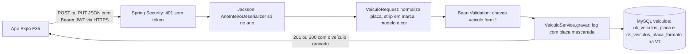
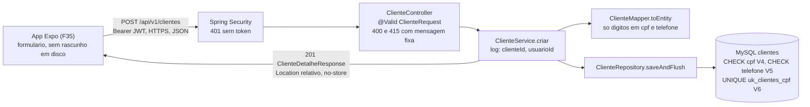
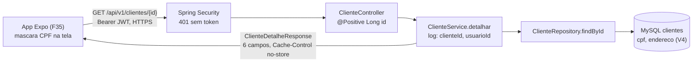

# Arquitetura — Mecânica São Jorge (op-002)

Visão de arquitetura da operação e índice de decisões (ADRs). Mantido pelo
CARTOGRAFO. Toda decisão difícil de reverter ou que afeta mais de um componente
vira um ADR em `adr/`, listado na tabela **Decisões** abaixo, atualizada no
mesmo commit.

## Estilo e fronteiras

- **Monorepo** ([[adr/ADR-008-monorepo-com-backend-spring-e-mobile-expo]]):
  `apps/api` (Spring Boot 4.1 / Java 21), `apps/mobile` (Expo), `docs/`.
- **Backend em camadas, pacotes por camada** ([[adr/ADR-001-organizar-pacotes-por-camada]]):
  `entity` → `repository`/`mapper` → `service` (regra de negócio) → `controller`;
  transversais em `config`, `security`, `exception`.
- **Nunca expor entidade na API**: entrada `*Request` (Bean Validation), saída
  `*Response`, mapeamento MapStruct ([[adr/ADR-007-nao-expor-entidade-na-api-dto-e-convencao-de-nomes]]).
- **Segurança**: Resource Server JWT HS256 stateless, a própria API emite/valida
  ([[adr/ADR-004-autenticacao-stateless-via-jwt-hs256]]); segredos fora de código
  e log ([[adr/ADR-009-configuracao-por-variavel-de-ambiente-e-segredos-fora-do-codigo]]).
- **Persistência**: MySQL via Flyway (migrations aditivas, sem DROP DATABASE),
  `ddl-auto: validate` ([[adr/ADR-003-versionar-schema-com-flyway-migrations-aditivas]]);
  enum como STRING ([[adr/ADR-006-persistir-enum-de-dominio-como-string]]);
  subtotais de item como coluna gerada ([[adr/ADR-005-subtotais-da-os-como-coluna-gerada-no-banco]]).

Diagramas C4 em `diagrams/` (contexto, contêineres, fluxo de login).
Mapa de navegação entre telas (wireframe F24, todas as telas do app, para
evitar fluxo órfão) em [`diagrams/navegacao-wireframe-f24.md`](diagrams/navegacao-wireframe-f24.md).

## Decisões

| ADR | Título | Status | Data |
|---|---|---|---|
| [ADR-001](adr/ADR-001-organizar-pacotes-por-camada.md) | Organizar o backend em pacotes por camada | Aceito | 2026-11-07 |
| [ADR-002](adr/ADR-002-documentar-api-com-springdoc-openapi.md) | Documentar a API com springdoc-openapi, não com Springfox | Aceito | 2026-11-07 |
| [ADR-003](adr/ADR-003-versionar-schema-com-flyway-migrations-aditivas.md) | Versionar o schema com Flyway e nunca reescrever migration aplicada | Aceito | 2026-11-07 |
| [ADR-004](adr/ADR-004-autenticacao-stateless-via-jwt-hs256.md) | Autenticação stateless via JWT HS256 com oauth2-resource-server | Aceito | 2026-11-07 |
| [ADR-005](adr/ADR-005-subtotais-da-os-como-coluna-gerada-no-banco.md) | Subtotais das junções da OS como coluna gerada no banco | Aceito | 2026-11-07 |
| [ADR-006](adr/ADR-006-persistir-enum-de-dominio-como-string.md) | Persistir enum de domínio como STRING | Aceito | 2026-11-07 |
| [ADR-007](adr/ADR-007-nao-expor-entidade-na-api-dto-e-convencao-de-nomes.md) | Não expor entidade na API: DTO + MapStruct e convenção de nomes | Aceito | 2026-11-07 |
| [ADR-008](adr/ADR-008-monorepo-com-backend-spring-e-mobile-expo.md) | Monorepo com backend Spring e mobile Expo | Aceito | 2026-11-07 |
| [ADR-009](adr/ADR-009-configuracao-por-variavel-de-ambiente-e-segredos-fora-do-codigo.md) | Configuração por variável de ambiente e segredos fora do código | Aceito | 2026-11-07 |
| [ADR-010](adr/ADR-010-testes-de-integracao-com-testcontainers.md) | Testes de integração com Testcontainers rodando as migrations do zero | Aceito | 2026-11-07 |
| [ADR-011](adr/ADR-011-handler-global-de-erro-e-mapeamento-de-status.md) | Handler global de erro: formato único e mapeamento de status HTTP | Aceito | 2026-11-07 |
| [ADR-012](adr/ADR-012-remover-template-generico-do-backend.md) | Remover o template genérico do backend em vez de adaptá-lo | Aceito | 2026-11-12 |
| [ADR-013](adr/ADR-013-adotar-migrations-flyway-como-fonte-unica-de-verdade-do-schema.md) | Adotar as migrations Flyway como fonte única de verdade do schema | Aceito | 2026-11-12 |
| [ADR-014](adr/ADR-014-adotar-referencia-figma-como-nova-identidade-visual.md) | Adotar o visual do Figma de referência como nova identidade visual do app (aceito na F41: referência FPdB8, cor ajustada para AA, classes de divergência e tabela token Figma × código) | Aceito | 2026-11-16 |
| [ADR-015](adr/ADR-015-separar-rota-tela-e-estilo-no-app-mobile.md) | Separar rota, tela e estilo no app mobile (`app/` só roteia, estilo em `*.styles.ts`) | Proposto | 2026-11-13 |
| [ADR-016](adr/ADR-016-fixar-jdk-21-no-build-com-enforcer-e-maven-wrapper.md) | Fixar o JDK 21 no build da API com maven-enforcer-plugin e Maven Wrapper | Proposto | 2026-11-14 |
| [ADR-017](adr/ADR-017-padronizar-listagem-com-busca-e-paginacao.md) | Padronizar a listagem com busca: termo literal, collation ai_ci fixada por migration e página própria | Proposto | 2026-11-14 |
| [ADR-018](adr/ADR-018-guardar-cpf-e-endereco-do-cliente-como-colunas-opcionais.md) | Guardar CPF e endereço do cliente como colunas opcionais, com endereço em campo único (V4 da F03b) | Proposto | 2026-11-17 |
| [ADR-019](adr/ADR-019-mapear-recurso-nao-encontrado-para-404-por-excecao-de-dominio.md) | Mapear recurso de domínio não encontrado para 404 com exceção dedicada no handler global | Proposto | 2026-11-17 |
| [ADR-020](adr/ADR-020-garantir-cpf-unico-por-indice-no-banco-com-409-no-service.md) | Garantir CPF único com índice no banco e traduzir a violação para 409 no service (F03c; momento de ligar depende de D2/P10) | Proposto | 2026-11-17 |
| [ADR-021](adr/ADR-021-compartilhar-dto-de-entrada-clienterequest-entre-criar-e-editar.md) | Compartilhar um único DTO de entrada `ClienteRequest` entre criar (F09) e editar (F10) | Proposto | 2026-11-17 |
| [ADR-022](adr/ADR-022-normalizar-placa-no-dto-e-garantir-unicidade-pelo-indice-uk-veiculos-placa-da-v7.md) | Normalizar a placa no DTO e garantir unicidade pelo índice `uk_veiculos_placa` da V7 com 409 no ponto único de gravação (F04) | Proposto | 2026-11-19 |
| [ADR-023](adr/ADR-023-reportar-erros-de-campo-com-campo-e-chave-i18n-so-na-validacao-de-veiculo.md) | Reportar erro de campo com campo e chave i18n, só no 400 de validação e no 409 de placa do veículo (F04) | Proposto | 2026-11-19 |
| [ADR-024](adr/ADR-024-vincular-veiculo-ao-cliente-pela-rota-de-criacao-com-dono-imutavel-e-put-total.md) | Vincular o veículo ao cliente pela rota de criação, com dono imutável e edição por PUT total (F04) | Proposto | 2026-11-19 |
| [ADR-025](adr/ADR-025-devolver-historico-de-os-sempre-presente-e-vazio-ate-a-sprint-04.md) | Devolver `historicoOs` sempre presente no detalhe do veículo e vazio até a Sprint 04 (F04) | Proposto | 2026-11-19 |
| [ADR-026](adr/ADR-026-garantir-email-unico-por-indice-na-v8-com-409-no-ponto-unico-de-gravacao.md) | Garantir email único com o índice `uk_clientes_email` na V8 e 409 no ponto único de gravação (F03d; depende da P16) | Proposto | 2026-11-18 |
| [ADR-027](adr/ADR-027-responder-409-a-deadlock-na-gravacao-sem-nova-tentativa.md) | Responder 409 a deadlock e espera de lock na gravação, sem nova tentativa (F03d, U6) | Proposto | 2026-11-18 |
| [ADR-028](adr/ADR-028-rejeitar-ano-nao-inteiro-com-desserializador-no-campo-e-chave-por-lista-fixa.md) | Rejeitar `ano` não inteiro com desserializador próprio no campo e reportar o campo por lista fixa no handler (F04, D3) | Proposto | 2026-11-19 |
| [ADR-029](adr/ADR-029-navegar-clientes-e-veiculos-em-stack-aninhado-na-aba-clientes.md) | Navegar Clientes e Veículos num Stack aninhado na aba Clientes, com rota que carrega só id (F35) | Proposto | 2026-11-19 |
| [ADR-030](adr/ADR-030-contratar-servico-e-hooks-de-clientes-e-veiculos-sobre-fetch-com-estado-discriminado.md) | Contratar serviço e hooks de Clientes e Veículos sobre `fetch`, com erro tipado e estado de tela discriminado (F35) | Proposto | 2026-11-19 |
| [ADR-031](adr/ADR-031-buscar-clientes-apos-pausa-de-400-ms-com-hook-proprio-e-cancelamento.md) | Buscar clientes depois de uma pausa de 400 ms, com hook próprio e cancelamento da busca anterior (F35) | Proposto | 2026-11-19 |
| [ADR-032](adr/ADR-032-reaproveitar-contrato-de-listagem-do-adr-017-com-paginacao-extraida-no-service.md) | Reaproveitar o contrato de listagem do ADR-017 em serviços e peças, com a paginação extraída para `service.Paginacao` (F05a, F17) | Proposto | 2026-11-23 |
| [ADR-033](adr/ADR-033-acrescentar-servicos-nome-por-migration-aditiva-v9-sem-tocar-nas-colunas-geradas.md) | Acrescentar `servicos.nome` por migration aditiva V9 com preenchimento provisório, sem tocar nas colunas geradas da OS (F05a) | Proposto | 2026-11-23 |
| [ADR-034](adr/ADR-034-listar-pecas-com-busca-em-nome-ou-codigo-sem-filtro-de-ativo-e-sem-custo.md) | Listar peças em `GET /api/v1/pecas` com busca em nome ou código, sem filtro de ativo e sem custo na resposta (F17) | Proposto | 2026-11-23 |
| [ADR-035](adr/ADR-035-calcular-estoque-baixo-no-service-a-cada-leitura-sem-persistir.md) | Calcular `estoqueBaixo` no service a cada leitura (`quantidadeEstoque <= estoqueMinimo`), sem persistir (F17) | Proposto | 2026-11-23 |
| [ADR-036](adr/ADR-036-acrescentar-pecas-nome-por-v10-e-fixar-collation-ai-ci-em-toda-a-tabela.md) | Acrescentar `pecas.nome` pela migration aditiva V10 e fixar a collation `utf8mb4_0900_ai_ci` em toda a tabela, incluindo `codigo` (F17) | Proposto | 2026-11-23 |

ADR-014 foi trazido de `docs/f39-wireframe-redesenho` (`18efb4e`) pela branch `docs/f41-adr014-referencia-aprovada`, aceito em 2026-11-16 na F41 e levado à `main` pela #16. O ADR-016 chega com a #14 (a F44 usa o número 016; o ADR-012 é a remoção do template, da F38). O ADR-015 entra pela branch `integracao/f40-i2-sobre-pr10`, com a estrutura reaplicada sobre o mobile da `main`.

**Lacuna de numeração fechada (2026-11-19, F04).** O código e o `docs/api/veiculos.md` da F04 já citavam o ADR-022 (placa), o ADR-023 (`erros[]`), o ADR-024 (vínculo e PUT total) e o ADR-025 (`historicoOs`), sem arquivo em nenhuma branch (conferido por `git log --all` em 2026-11-18 e 2026-11-19). A branch `docs/f04-cartografo-adrs` materializa os quatro com os números que o código cita, e a decisão D3 do PRD F04 rev 2 entra como ADR-028, o próximo número livre (a F03d usa 026 e 027). Todos estão `Proposto`: a implementação dos ajustes N1 a N4 da F04 só começa com o aceite formal da pessoa dona do produto.

Os ADR-029 a ADR-031 (F35) foram numerados depois de conferir os nomes de ADR no histórico de todos os ramos locais em 2026-11-19.

> Nota de materialização: a F00 referenciou ADR-004/006/010/011 em código mas
> não gravou os arquivos (ver `README.md`). Esta entrega da F02 materializa todo
> o conjunto, mantendo os números que o código já cita, e backfilla as decisões
> da F00 (008, 009, 010) para deixar a numeração íntegra e sem referência pendente.

## Modelo de dados (12 entidades)

Convenção ([[adr/ADR-007-nao-expor-entidade-na-api-dto-e-convencao-de-nomes]]):
tabela plural snake_case, PK `id` (`BIGINT UNSIGNED AUTO_INCREMENT`), FK
`<singular>_id`, entidade no singular em `entity`.

**Fonte de verdade**: o schema é o que as migrations Flyway criam
([[adr/ADR-013-adotar-migrations-flyway-como-fonte-unica-de-verdade-do-schema]]).
**Divergência registrada**: o script de referência (`docs/script.sql`, local e
fora do git desde `a1d2ddb`, originado do `BD/script.sql` do repo irmão) usa PascalCase e
PK `<tabela>_id` (ex.: `Clientes.cliente_id`). A casa segue o padrão já aplicado
pela F00 (`usuarios`, PK `id`, snake_case). O script é referência de **estrutura**
(colunas, FKs, geradas, enums), não de nomenclatura.

| Entidade | Tabela | Migration | Observações |
|---|---|---|---|
| Usuario | `usuarios` | V1 (F00) | PK `id`; `perfil` VARCHAR+CHECK (enum STRING); `created_at`/`updated_at` |
| Cliente | `clientes` | V2 (+ V3 na F03a; + V4 na F03b, aplicada no ramo `feat/f03b-clientes-detalhe`; + V5 e V6 na F03c, aplicadas no ramo `feat/f03c-clientes-criar`) | nome, telefone, email, created_at; `cpf` e `endereco` opcionais pela V4 ([ADR-018](adr/ADR-018-guardar-cpf-e-endereco-do-cliente-como-colunas-opcionais.md)); collation `utf8mb4_0900_ai_ci` fixada pela V3 ([ADR-017](adr/ADR-017-padronizar-listagem-com-busca-e-paginacao.md)); `CHECK` de telefone pela V5 da F03c; `UNIQUE` em `cpf` numa V6 ([ADR-020](adr/ADR-020-garantir-cpf-unico-por-indice-no-banco-com-409-no-service.md)), quando D2/P10 decidir o momento |
| Veiculo | `veiculos` | V2 | FK `cliente_id`; placa, modelo, marca, ano, cor, quilometragem |
| Servico | `servicos` | V2 (+ V9 na F05a, especificada no [ADR-033](adr/ADR-033-acrescentar-servicos-nome-por-migration-aditiva-v9-sem-tocar-nas-colunas-geradas.md), não escrita) | `nome` pela V9 (`VARCHAR(150) NOT NULL`, `CHECK` de preenchimento, collation `utf8mb4_0900_ai_ci`); valor_padrao_mao_obra, tempo_estimado_horas, ativo |
| Peca | `pecas` | V2 (+ V10 na F17, especificada no [ADR-036](adr/ADR-036-acrescentar-pecas-nome-por-v10-e-fixar-collation-ai-ci-em-toda-a-tabela.md), não escrita) | `nome` pela V10 (`VARCHAR(150) NOT NULL`, `CHECK` de preenchimento); codigo UNIQUE (insensível a caixa e acento depois da V10), custo, preco_venda, quantidade_estoque, estoque_minimo, ativo; collation `utf8mb4_0900_ai_ci` na tabela inteira pela V10. `estoqueBaixo` não é coluna: calculado no service ([ADR-035](adr/ADR-035-calcular-estoque-baixo-no-service-a-cada-leitura-sem-persistir.md)) |
| OrdemServico | `ordens_servico` | V2 | FK `cliente_id`, `veiculo_id`; `status` VARCHAR (enum); subtotais/desconto/valor_total **recalculados no service** (colunas comuns) |
| OrdemServicoServico | `ordens_servico_servicos` | V2 | FK `ordem_id`, `servico_id`; valor_cobrado, quantidade; **subtotal = coluna gerada** |
| OrdemServicoPeca | `ordens_servico_pecas` | V2 | FK `ordem_id`, `peca_id`; valor_unitario_cobrado, quantidade; **subtotal = coluna gerada** |
| MovimentacaoEstoque | `movimentacoes_estoque` | V2 | FK `peca_id`, `ordem_id?`; `tipo` VARCHAR (enum ENTRADA/SAIDA/AJUSTE), motivo |
| Parcela | `parcelas` | V2 | FK `ordem_id`; numero/total_parcelas, valor_previsto, data_vencimento. **Status calculado em runtime** (não é coluna) |
| Pagamento | `pagamentos` | V2 | FK `parcela_id`; valor, `forma_pagamento` VARCHAR (enum) |
| Financeiro | `financeiro` | V2 | `tipo` VARCHAR (enum ENTRADA/SAIDA); FK `ordem_id?`, `pagamento_id?` (origem do lançamento) |

Enums (todos `@Enumerated(EnumType.STRING)` + VARCHAR):
`Perfil` (ADMIN, FUNCIONARIO) · `StatusOS` (ABERTA, EM_ANALISE, ... — enum da
Sprint 04) · `FormaPagamento` (DINHEIRO, PIX, CARTAO, BOLETO) ·
`TipoMovimentacao` (ENTRADA, SAIDA, AJUSTE) · `TipoLancamento` (ENTRADA, SAIDA).

Colunas geradas ([[adr/ADR-005-subtotais-da-os-como-coluna-gerada-no-banco]]):
`ordens_servico_servicos.subtotal = GENERATED ALWAYS AS (valor_cobrado * quantidade) STORED`
e `ordens_servico_pecas.subtotal = GENERATED ALWAYS AS (valor_unitario_cobrado * quantidade) STORED`.
Mapear com `@Column(insertable=false, updatable=false)`.

## Reconciliação do schema com o script de referência

Regra ([[adr/ADR-013-adotar-migrations-flyway-como-fonte-unica-de-verdade-do-schema]]):
o schema do sistema é **o que as migrations criam**. `docs/script.sql` é
insumo histórico de requisito: fica local, fora do git desde `a1d2ddb`, e a
versão lida tem `sha256 d75746d0…afd235aa7`. Esta matriz congela o que o
script tem e a V1/V2 não têm. A V2 é **deliberadamente mínima**: cria as 11
tabelas só com o que a F02 precisa para `ddl-auto: validate`. Cada feature
dona fecha a sua linha **no mesmo PR** da migration aditiva (`V3+`,
[[adr/ADR-003-versionar-schema-com-flyway-migrations-aditivas]]). A entidade
JPA só mapeia a coluna depois que a migration que a cria entrar. Conferido
coluna a coluna por CARTOGRAFO em 2026-11-12, lendo os três arquivos SQL.

### Colunas do script ausentes nas migrations

| Tabela | Colunas no script que faltam em V1/V2 | Feature dona |
|---|---|---|
| `clientes` | nenhuma (só nomes divergem, ver abaixo) | n/a |
| `veiculos` | `data_cadastro` — **fechada na F04: não adotada** (nenhuma tela ou regra da F04 usa; coluna nova só quando a feature de histórico pedir). Linha `veiculos.placa` (UNIQUE + CHECK) fechada pela V7 | F04 |
| `servicos` | `nome VARCHAR(150) NOT NULL` (especificada na V9 da F05a pelo [ADR-033](adr/ADR-033-acrescentar-servicos-nome-por-migration-aditiva-v9-sem-tocar-nas-colunas-geradas.md); a linha fecha quando a V9 entrar), `descricao VARCHAR(255)` | F05a (`nome`) / F11 / F12 (`descricao`) |
| `pecas` | `nome VARCHAR(150) NOT NULL` (especificada na V10 da F17 pelo [ADR-036](adr/ADR-036-acrescentar-pecas-nome-por-v10-e-fixar-collation-ai-ci-em-toda-a-tabela.md); a linha fecha quando a V10 entrar), `categoria VARCHAR(80)`, `fabricante VARCHAR(100)`, `unidade VARCHAR(20) NOT NULL DEFAULT 'UN'` | F17 (`nome`) / F14 / F15 (`categoria`, `fabricante`, `unidade`, se o formulário pedir) |
| `ordens_servico` | `descricao_problema TEXT`, `diagnostico TEXT`, `data_abertura`, `data_previsao_entrega DATE`, `data_fechamento` | F18 / F19 / F20 |
| `ordens_servico_servicos` | nenhuma | n/a |
| `ordens_servico_pecas` | nenhuma | n/a |
| `movimentacoes_estoque` | `quantidade INT NOT NULL`, `data_movimento` | F16 |
| `parcelas` | nenhuma (`numero` corresponde a `numero_parcela`) | n/a |
| `pagamentos` | `data_pagamento` | F22 |
| `financeiro` | `valor DECIMAL(10,2) NOT NULL`, `descricao VARCHAR(200)`, `forma_pagamento VARCHAR(30)`, `data_movimento` | F22 / F23 / F31 / F32 |
| `usuarios` | nenhuma | n/a |

### Regras de FK, nulidade, default e índice

Estas regras são decididas pela feature dona, com justificativa no PR. Não são
copiadas do script às cegas: `CASCADE` apaga histórico.

| Onde | Script | Migrations hoje | Feature dona |
|---|---|---|---|
| `veiculos.cliente_id` | `ON DELETE CASCADE` | sem ação (bloqueia o delete) — **F04: `CASCADE` não adotado**, apagar cliente não apaga histórico; descarte de cliente anonimiza a placa (`ANON<id>`) | F04 |
| `veiculos.modelo`, `veiculos.marca` | `NULL` | `NOT NULL` (mais restrito) — **F04: mantido**, o DTO exige os dois | F04 |
| `veiculos.placa` | sem índice, sem formato | V7: `UNIQUE uk_veiculos_placa` + `CHECK ck_veiculos_placa_formato` (padrão antigo, Mercosul ou `ANON<1..6 dígitos>`, `REGEXP_LIKE` com `'c'`) | F04 |
| `pecas.codigo` | `NULL`, `UNIQUE` | `NOT NULL`, `UNIQUE` | F14 |
| `ordens_servico.status` | `VARCHAR(30) DEFAULT 'ABERTA'` | `VARCHAR(20)`, sem default | F18 / F20 |
| `ordens_servico_servicos.ordem_id`, `ordens_servico_pecas.ordem_id` | `ON DELETE CASCADE` | sem ação | F19 |
| `movimentacoes_estoque.ordem_id` | `ON DELETE SET NULL` | sem ação | F16 |
| `parcelas.ordem_id` | `ON DELETE CASCADE` | sem ação | F21 |
| `parcelas.numero`, `parcelas.total_parcelas` | `DEFAULT 1` | sem default | F21 |
| `pagamentos.parcela_id` | `ON DELETE CASCADE` | sem ação | F22 |
| `financeiro.ordem_id`, `financeiro.pagamento_id` | `ON DELETE SET NULL` | sem ação | F22 / F23 |
| Índices fora de FK: `idx_ordem_status`, `idx_parcela_vencimento`, `idx_financeiro_tipo`, `idx_financeiro_data` | presentes | ausentes | F06 / F07 / F31 |
| `clientes.nome`, `telefone`, `email` (collation) | sem `COLLATE` | sem `COLLATE`; no `mysql:8.4` padrão herdam `utf8mb4_0900_ai_ci` (verificado em 2026-11-14); num servidor com `--character-set-server=latin1` herdam `latin1_swedish_ci` (verificado em 2026-11-17) | F03a: a V3 fixa `utf8mb4_0900_ai_ci` nos dois casos (ADR-017, achado A7) |
| `clientes.telefone` (formato) | `VARCHAR(20)` sem `CHECK` | `VARCHAR(20)` sem `CHECK` | F03c: `V5__adicionar_check_telefone_em_clientes.sql` com `ADD CONSTRAINT ck_clientes_telefone_digitos CHECK (CHAR_LENGTH(telefone) BETWEEN 10 AND 11 AND telefone NOT REGEXP '[^0-9]')`, sem `NOT NULL` (mesmo padrão do `CHECK` de `cpf` do ADR-018; a obrigatoriedade fica no `ClienteRequest`, ADR-021). DDL provado em MySQL 8.4 sobre V1–V4 pelo CARTOGRAFO em 2026-11-17 (achado A8); prova por Flyway é do IT da F03c |
| `clientes.cpf`, `clientes.endereco` | ausentes (não estão no script, ver "Fora do script") | ausentes; a V4 da F08 cria `cpf VARCHAR(11) NULL` com `CHECK` de 11 dígitos e `endereco VARCHAR(255) NULL` ([ADR-018](adr/ADR-018-guardar-cpf-e-endereco-do-cliente-como-colunas-opcionais.md)) | F08 (F03b) cria. `UNIQUE` em `cpf`: índice `uk_clientes_cpf` em migration própria (hoje V6), conforme o [ADR-020](adr/ADR-020-garantir-cpf-unico-por-indice-no-banco-com-409-no-service.md); entra quando D2/P10 decidir o momento, junto com o código do 409 |
| `clientes.email` (unicidade) | sem índice | sem índice; nenhuma restrição sobre `email` da V2 à V7 (conferido no `information_schema` em 2026-11-18) | F03d (F10): `V8__adicionar_indice_unico_email_em_clientes.sql` com `ADD CONSTRAINT uk_clientes_email UNIQUE (email)`, vários `NULL` aceitos, contagem prévia sem `SELECT email` ([ADR-026](adr/ADR-026-garantir-email-unico-por-indice-na-v8-com-409-no-ponto-unico-de-gravacao.md), DDL provado em MySQL 8.4). Depende da P16 |
| `ordens_servico.data_abertura`, `pagamentos.data_pagamento` | `TIMESTAMP DEFAULT CURRENT_TIMESTAMP` | ausentes | F18 e F22: entram como `NOT NULL DEFAULT CURRENT_TIMESTAMP`, porque sustentam o prazo R1 da política de dados de cliente (achado A6). A `data_fechamento` da OS (F20) entra no cálculo quando existir |

Os 8 índices do script que ficam sobre colunas de FK são cobertos pelo índice
que o InnoDB cria sozinho para cada FK. Isso é o comportamento documentado do
MySQL, **não verificado** contra `information_schema` neste banco.

### Divergências aceitas (sem perda de dado)

* Nomes ([[adr/ADR-007-nao-expor-entidade-na-api-dto-e-convencao-de-nomes]]):
  PascalCase vira snake_case; PK `<tabela>_id` vira `id` `BIGINT UNSIGNED`;
  `data_cadastro` vira `created_at` (`clientes`, `usuarios`);
  `numero_parcela` vira `numero`.
* Enum STRING com `CHECK` a mais
  ([[adr/ADR-006-persistir-enum-de-dominio-como-string]]):
  `usuarios.perfil` (sem o default `'FUNCIONARIO'`),
  `movimentacoes_estoque.tipo`, `pagamentos.forma_pagamento` (`VARCHAR(20)`
  em vez de 30) e `financeiro.tipo`.
* Larguras maiores: `clientes.nome`/`email`, `usuarios.nome`/`email` e
  `movimentacoes_estoque.motivo` (255 em vez de 200). `usuarios.updated_at`
  existe só nas migrations.

### Fora do script

`clientes.cpf` e `clientes.endereco` **não estão no script**. Vêm da
US-DES-04 do wireframe F24. São coleta nova de dado pessoal e entram pela
**V4 da F08 (F03b)**, não da F09 como este documento dizia até 2026-11-17: a
F09 (F03c) depende da F08 no quadro, e a F08 é a primeira a ler as colunas.
Especificação normativa no [ADR-018](adr/ADR-018-guardar-cpf-e-endereco-do-cliente-como-colunas-opcionais.md):
`cpf VARCHAR(11) NULL` com `CHECK` de 11 dígitos ASCII e `endereco VARCHAR(255) NULL`
em campo único (DDL provado em MySQL 8.4 pelo CARTOGRAFO em 2026-11-17). A
F08 só lê; a primeira escrita é da F09, que também decide `UNIQUE` em `cpf`.
Condição: o VIGIA aprova as linhas de `cpf` e `endereco` da política (seção 2)
e do registro LGPD antes do merge da V4, e a pessoa aceita o ADR-018 (D-B).
**Estado da linha em 2026-11-17: V4 escrita e aplicada do zero em MySQL 8.4 pelo
`ClienteDetalheIT` (ESPRESSO), no ramo `feat/f03b-clientes-detalhe`.** Fecha de
vez quando a V4 entrar na `main`.

**Risco residual**: a matriz é documento, e nenhum teste a compara com o
banco. Se uma feature esquecer a coluna ou não fechar a linha, só a revisão de
PR (CARTOGRAFO/CORRENTE) pega. O `FlywayMigrationIT` garante só o conjunto
exato de tabelas.

## Contrato de API — Login (F02)

`POST /api/v1/auth/login` — público (fora de `authenticated()`).

Request (`LoginRequest`):
```json
{ "email": "usuario@oficina.com", "senha": "segredo" }
```
Validação (Bean Validation): `email` `@NotBlank @Email`; `senha` `@NotBlank`.
Ausência de campo → **400** com os campos listados ([[adr/ADR-011-handler-global-de-erro-e-mapeamento-de-status]]).

Resposta 200 (`LoginResponse`):
```json
{
  "token": "<jwt-hs256>",
  "tipo": "Bearer",
  "expiraEm": "2026-11-14T00:00:00Z",
  "usuario": { "id": 1, "nome": "Fulano", "email": "usuario@oficina.com", "perfil": "ADMIN" }
}
```
Nunca inclui `senha`/`senha_hash`.

JWT (HS256): `sub` = id do usuário; `perfil`; `iss` = `mecanica-sao-jorge-api`;
`iat`; `exp` = `iat + 7 dias` (`jwt.expiration-minutes=10080`, configurável).

Erros:
- **401** credencial inválida (email inexistente **ou** senha incorreta),
  mensagem genérica única ("Credenciais inválidas"), sem distinguir os casos.
- **401** rota protegida sem/with token inválido/expirado, via
  `AuthenticationEntryPoint`, no mesmo formato de corpo.
- Corpo de erro sempre: `{timestamp, status, erro, mensagem, path}`.

## Contrato de API — Clientes listar (F03a)

Contrato normativo no [ADR-017](adr/ADR-017-padronizar-listagem-com-busca-e-paginacao.md): `GET /api/v1/clientes` com `q` (até 100 caracteres contados no valor bruto, antes do `strip`), `page` (de 0 a 2.147.483.647) e `size` (1 a 100, padrão 20), ordem por `nome` e `id`, corpo `PaginaResponse<ClienteListResponse>` com `itens`, `pagina`, `tamanho`, `totalItens` e `totalPaginas`. Cada item traz só `id`, `nome`, `telefone` e `email`. O telefone só é consultado quando o termo é numérico (dígitos ASCII, `(`, `)`, `-`, `.`, `+` e espaço, com pelo menos um dígito; ADR-017, eixo 5). Página além do fim devolve 200 com `itens` vazio e total real, inclusive quando `page * size` passa de 2.147.483.647 (ADR-017, eixo 6). Erros 400, 401, 404, 405 e 500 seguem o formato do ADR-011. A sessão com o banco fica em `utf8mb4` pelo padrão do Connector/J, afirmada no teste de integração, e todo script manual roda com `mysql --default-character-set=utf8mb4` (ADR-017, eixo 4). A F35 consome exatamente esse formato, e mudança nele exige alinhar com a F35 (premissa P6).

Pontos de integração da F03a:

* `controller.ClienteController` chama `service.ClienteService`, que chama `repository.ClienteRepository` sobre a tabela `clientes`.
* `mapper.ClienteMapper` (MapStruct) converte `Cliente` em `ClienteListResponse`; `dto.PaginaResponse<T>` monta a página.
* `exception.GlobalExceptionHandler` ganha os handlers de 400 para parâmetro inválido (achado A1) e, na revisão 2 do ADR-017, os de 404 e 405 (RH-A3), sem log de erro inesperado nem eco da query string.
* `security.MascaraDadoPessoal`: utilitário único de máscara de telefone e CPF para log (seção 6.2 da política de dados). Classe `final` com métodos estáticos, sem bean, com teste unitário para entrada nula, curta e com formatação. Ver a divergência 8.

## Contrato de API — Serviços listar (F05a)

Contrato normativo no [ADR-032](adr/ADR-032-reaproveitar-contrato-de-listagem-do-adr-017-com-paginacao-extraida-no-service.md), que herda o do ADR-017 sem mudá-lo: `GET /api/v1/servicos` com `q` (até 100, busca por trecho só em `nome`), `page` (base 0), `size` (1 a 100, padrão 20; 400 acima) e `ativo` opcional (ausente lista todos; valor não booleano responde 400). Ordem por `nome` e `id`, corpo `PaginaResponse<ServicoListResponse>` com itens `id`, `nome`, `valorPadraoMaoObra`, `tempoEstimadoHoras` e `ativo`. A guarda de deslocamento do ADR-017 (O3) sai do `ClienteService` para `service.Paginacao`, usada por clientes, serviços e peças (F17). A coluna `nome` e a collation de `servicos` vêm da V9 ([ADR-033](adr/ADR-033-acrescentar-servicos-nome-por-migration-aditiva-v9-sem-tocar-nas-colunas-geradas.md)). Status: **proposto**; o ESPRESSO só começa depois do aceite dos dois ADRs.

## Contrato de API — Peças listar (F17)

Contrato normativo no [ADR-034](adr/ADR-034-listar-pecas-com-busca-em-nome-ou-codigo-sem-filtro-de-ativo-e-sem-custo.md), que herda o do ADR-017 e o do ADR-032 sem mudá-los: `GET /api/v1/pecas` com `q` (até 100, trecho em `nome` ou `codigo`, literal), `page` (base 0) e `size` (1 a 100, padrão 20; 400 acima). Sem parâmetro `ativo`. Ordem por `nome` e `id`, corpo `PaginaResponse<PecaListResponse>` com itens `id`, `nome`, `codigo`, `precoVenda`, `quantidadeEstoque`, `estoqueMinimo` e `estoqueBaixo`; nunca `custo` nem `ativo`. `estoqueBaixo = quantidadeEstoque <= estoqueMinimo`, calculado no service a cada leitura e nunca persistido ([ADR-035](adr/ADR-035-calcular-estoque-baixo-no-service-a-cada-leitura-sem-persistir.md)). A coluna `nome` e a collation de `pecas` (inclusive `codigo`) vêm da V10 ([ADR-036](adr/ADR-036-acrescentar-pecas-nome-por-v10-e-fixar-collation-ai-ci-em-toda-a-tabela.md)). Os critérios da F17 que citam `content`, `totalElements` e `totalPages` leem-se como `itens`, `totalItens` e `totalPaginas`. Status: **proposto**; o ESPRESSO só começa depois do aceite dos três ADRs e do merge da F05a (`service.Paginacao` e V9).

## Contrato de API — Clientes detalhe (F03b)

Decisões em [ADR-018](adr/ADR-018-guardar-cpf-e-endereco-do-cliente-como-colunas-opcionais.md) (colunas) e [ADR-019](adr/ADR-019-mapear-recurso-nao-encontrado-para-404-por-excecao-de-dominio.md) (404); PRD em `docs/product/F03b-clientes-detalhe.md`. Status: **proposto**, o ESPRESSO só começa depois do aceite dos dois ADRs.

`GET /api/v1/clientes/{id}` — autenticado (fora de `PUBLIC_PATHS`).

* `id`: `@PathVariable @Positive Long id`. Não numérico ou acima de `Long.MAX_VALUE` responde 400 por `MethodArgumentTypeMismatchException`; zero ou negativo responde 400 por `HandlerMethodValidationException`. Nos dois, `mensagem` é "Parametro invalido: id", sem o valor. Os handlers já existem; não há handler novo para o 400.
* Resposta 200, `dto.ClienteDetalheResponse` (record), exatamente 6 campos:

| Campo | Tipo | Nulo? | Regra |
|---|---|---|---|
| `id` | `Long` | não | chave técnica |
| `nome` | `String` | não | como gravado; cliente anonimizado sai "Cliente anonimizado" |
| `cpf` | `String` | sim | 11 dígitos, sem máscara (garantido pelo `CHECK` da V4). A máscara é da tela (D-C do PRD) |
| `telefone` | `String` | sim | só dígitos, como gravado; a formatação é da tela |
| `email` | `String` | sim | como gravado |
| `endereco` | `String` | sim | texto livre, campo único (ADR-018, D-B) |

* Campo nulo sai como `null`, presente no JSON. O projeto não configura `spring.jackson.default-property-inclusion` (lido em `application.yml` em 2026-11-17), então vale o padrão do Jackson, que inclui nulos. **Suposição** até o teste da US-CLI-DET-14 provar.
* Não saem `createdAt` nem `veiculos`. Veículos do cliente vêm de chamada própria da F04 (`GET /api/v1/clientes/{id}/veiculos`, rota já prevista em `arquitetura-backend.md`), decisão D-E do PRD, confirmada aqui: o detalhe não depende do módulo de veículos e não faz `JOIN`.
* `Cache-Control` com `no-store`: vem dos cabeçalhos padrão do Spring Security; o `SecurityConfig` não chama `headers()` (lido em 2026-11-17). O teste de controller afirma o cabeçalho (US-CLI-DET-02).

Exemplo (dados fictícios; CPF com dígito verificador inválido de propósito):

```json
{ "id": 7, "nome": "Ana Exemplo", "cpf": "12345678900", "telefone": "11912345678", "email": "ana@example.com", "endereco": "Rua Modelo, 100 - Jardim Exemplo" }
```

Erros, todos no formato do ADR-011:

| Status | Quando | Quem responde | `mensagem` |
|---|---|---|---|
| 400 | `id` não numérico, zero, negativo ou acima de `Long.MAX_VALUE` | handlers existentes | "Parametro invalido: id" |
| 401 | sem token, token malformado ou expirado | `RestAuthenticationEntryPoint`, antes do controller (o repositório não é consultado) | a do entry point |
| 404 | id numérico que não existe | `ClienteNaoEncontradoException` (ADR-019) | "Cliente nao encontrado" |
| 405 | `POST`, `PUT`, `PATCH` ou `DELETE` em `/api/v1/clientes/{id}` enquanto a F03d não existir | handler do ADR-017, com `Allow: GET` | "Metodo nao permitido" |
| 500 | falha inesperada | handler genérico; loga só a classe e o `path` | "Erro interno inesperado" |

Log (política, seções 6.1 e 6.3): uma linha INFO no service, depois de achar o cliente, exatamente `clientes.detalhar clienteId={} usuarioId={}` (`usuarioId` é o `sub` do JWT, como na F03a). Nunca nome, CPF (nem mascarado), telefone, e-mail, endereço, DTO ou entidade. O 404 não gera linha nesta proposta, igual ao 404 de rota (ADR-017). **O VIGIA decide** se a linha do 200 fica e se o 404 também deve gerar `clientes.detalhar.naoEncontrado clienteId={} usuarioId={}` para detectar varredura de ids. A máscara de `MascaraDadoPessoal` não é usada aqui, porque nenhum dos dois campos vai para o log.

Pontos de integração da F03b (todos em pacotes já existentes, ADR-001):

* `controller.ClienteController.detalhar(Long id, Jwt jwt)`: fino; chama o service e devolve `ResponseEntity.ok(...)`. OpenAPI com `@Operation` e `@ApiResponse` para 200 (`ClienteDetalheResponse`), 400, 401, 404 e 500 (`ErrorResponse`); `@Parameter` declara `id` inteiro positivo. O `@SecurityRequirement` da classe já cobre o Bearer.
* `service.ClienteService.detalhar(Long id, String usuarioId)`: `@Transactional(readOnly = true)`; `clienteRepository.findById(id)`, `orElseThrow(ClienteNaoEncontradoException::new)`, mapper e a linha de log.
* `repository.ClienteRepository`: sem método novo; `findById` vem do `JpaRepository` e é consulta parametrizada pela chave.
* `mapper.ClienteMapper.toDetalheResponse(Cliente)`: MapStruct. `toListResponse` não muda e continua sem `cpf` e `endereco`.
* `entity.Cliente`: ganha `cpf` e `endereco` depois da V4 (ADR-018, regra 5).
* `exception.RecursoNaoEncontradoException` (abstrata), `exception.ClienteNaoEncontradoException` e um handler 404 no `GlobalExceptionHandler` (ADR-019).
* App (F35 ou F08, conforme D-A): consome o contrato acima; a máscara do CPF na tela e o "Não informado" são da camada de apresentação. Mudança neste contrato exige alinhar com a F35 e com a F03d, que pré-preenche a edição com o CPF inteiro (G3 da F26).

## Contrato de API — Clientes criar (F03c)

Decisões em [ADR-021](adr/ADR-021-compartilhar-dto-de-entrada-clienterequest-entre-criar-e-editar.md) (DTO de entrada, validação e normalização) e [ADR-020](adr/ADR-020-garantir-cpf-unico-por-indice-no-banco-com-409-no-service.md) (unicidade do CPF). Política de dados: `docs/security/politica-dados-pessoais-cliente.md` (revisão 3 do VIGIA). Status: **proposto**. O ESPRESSO só começa depois do aceite dos dois ADRs. O ramo depende da V4, que ainda não está na `main` (vem de `feat/f03b-clientes-detalhe`).

`POST /api/v1/clientes`, autenticado (fora de `PUBLIC_PATHS`), `Content-Type: application/json`.

* Corpo `dto.ClienteRequest` (record), 5 campos. Validação e normalização normativas na tabela do ADR-021. Em resumo: `nome` obrigatório, até 120; `telefone` obrigatório, 10 ou 11 dígitos, com ou sem máscara; `cpf` **obrigatório** (implementado assim, conforme o critério 2 do card; a P9 segue aberta para a pessoa confirmar, verificado na F09 pelo QA: sem `cpf` a API responde 400 `cpf e obrigatorio`), 11 dígitos, com ou sem máscara; `email` opcional, até 120, formato de e-mail; `endereco` opcional, até 255. Campo em branco vira `null` antes da validação. O banco recebe só dígitos em `cpf` e `telefone`.
* Campo desconhecido no JSON (ex.: `id`, `createdAt`) é ignorado, porque o record não o tem e o mapper não o lê (ADR-021, regra 4, achado E4). O id é sempre do `AUTO_INCREMENT`.
* Resposta 201 com `dto.ClienteDetalheResponse` (os mesmos 6 campos do detalhe da F03b, valores já normalizados), cabeçalho `Location: /api/v1/clientes/{id}` **relativo** e `Cache-Control` com `no-store` (padrão do Spring Security, como na F03b). Relativo porque o URI absoluto seria montado a partir do `Host` da requisição, que o cliente controla.
* CPF repetido: **409** com `mensagem` fixa `CPF ja cadastrado`, por decisão do VIGIA em 2026-11-18 (ADR-020, ainda "proposto" até o aceite da pessoa). Implementado na F03c com a `V6` (`uk_clientes_cpf`). Se a pessoa recusar o ADR-020, volta o 201 provisório: remover a V6, o `catch` do `ClienteService.gravar` e o handler do 409.
* Não idempotente: dois `POST` iguais criam dois clientes (com CPF vazio ou enquanto o índice não existir). A proteção contra toque duplo é da F35 (`docs/product/F35-recebido-da-F03c-criar-cliente.md`).

Exemplo (dados fictícios; CPF com dígito verificador inválido de propósito):

```json
{ "nome": "  Ana Exemplo ", "cpf": "123.456.789-00", "telefone": "(11) 91234-5678", "email": "ana@example.com", "endereco": "" }
```

Resposta 201:

```json
{ "id": 7, "nome": "Ana Exemplo", "cpf": "12345678900", "telefone": "11912345678", "email": "ana@example.com", "endereco": null }
```

Erros, todos no formato do ADR-011:

| Status | Quando | Quem responde | `mensagem` |
|---|---|---|---|
| 400 | campo inválido no `ClienteRequest` | `handleValidation` existente | mensagens fixas do ADR-021, unidas por "; ", sem ordem garantida e sem o valor rejeitado (ex.: "telefone deve ter 10 ou 11 digitos") |
| 400 | corpo ausente, JSON malformado ou tipo errado num campo | **handler novo** de `HttpMessageNotReadableException`, sem log | "Corpo da requisicao invalido" (fixa: a mensagem do Jackson ecoa trecho do corpo) |
| 401 | sem token, token malformado ou expirado | `RestAuthenticationEntryPoint`, antes do controller | a do entry point |
| 409 | CPF já cadastrado (ativo desde a F03c, ADR-020; verificado contra a API real) | `CpfJaCadastradoException` (ADR-020), sem log | "CPF ja cadastrado" |
| 415 | `Content-Type` diferente de JSON | **handler novo** de `HttpMediaTypeNotSupportedException`, sem log | "Tipo de conteudo nao suportado" |
| 500 | falha inesperada, inclusive violação de `CHECK` que escapou da validação | handler genérico; loga só a classe e o `path` | "Erro interno inesperado" |

Sem os dois handlers novos, JSON malformado e `Content-Type` errado caem hoje no handler genérico e respondem 500 com log de erro (lido no `GlobalExceptionHandler` em 2026-11-17). Os dois seguem o ADR-011 (mapeamento de status), do mesmo jeito que o ADR-017 acrescentou 404 e 405, sem ADR novo.

Log (política, revisão 3): uma linha INFO no service, depois do `saveAndFlush`, exatamente `clientes.criar clienteId={} usuarioId={}` (`usuarioId` é o `sub` do JWT). Nunca nome, CPF (nem mascarado), telefone, e-mail, endereço, `ClienteRequest` ou entidade. O 400 e o 409 não geram linha. `ClienteRequest.toString()` devolve só o nome do tipo (ADR-021, regra 5).

Pontos de integração da F03c (todos em pacotes já existentes, ADR-001):

* `controller.ClienteController.criar(@Valid @RequestBody ClienteRequest, Jwt)`: fino; chama o service e devolve `ResponseEntity.created(URI.create("/api/v1/clientes/" + id)).body(...)`. OpenAPI com `@ApiResponse` para 201, 400, 401, 409, 415 e 500.
* `service.ClienteService.criar(ClienteRequest, String usuarioId)`: `@Transactional`; mapper, método privado de gravação com `saveAndFlush` (ADR-020, regra 3, compartilhado com a F10), mapper de saída e a linha de log.
* `mapper.ClienteMapper.toEntity(ClienteRequest)`: com `unmappedTargetPolicy = ERROR`, ignora `id` e `createdAt`; métodos `@Named` `somenteDigitos` e `aparado` (ADR-021, regras 3 e 4).
* `repository.ClienteRepository`: sem método novo (`saveAndFlush` vem do `JpaRepository`); sem `existsByCpf` nem `findByCpf` (ADR-020, regra 6).
* `exception.GlobalExceptionHandler`: handlers de 400 (corpo ilegível) e 415; o de 409 (`ConflitoException`) só com o ADR-020.
* Migrations `V5__adicionar_check_telefone_em_clientes.sql` e `V6__adicionar_indice_unico_cpf_em_clientes.sql` (matriz acima). O logger `org.hibernate.orm.jdbc.error` fica em `OFF` no `application.yml`, porque o Hibernate loga o `Duplicate entry '<cpf>'` do MySQL. Nada muda no diagrama C4 de contêineres: a F03c não cria contêiner, fila nem dependência externa.
* App (F35): consome o contrato acima. Os pontos de tela que a F03c deixa para a F35 estão em `docs/product/F35-recebido-da-F03c-criar-cliente.md` (tarefa 17).

## Contrato de API — Clientes editar (F03d)

Decisões: [ADR-021](adr/ADR-021-compartilhar-dto-de-entrada-clienterequest-entre-criar-e-editar.md) (DTO e semântica de substituição inteira), [ADR-019](adr/ADR-019-mapear-recurso-nao-encontrado-para-404-por-excecao-de-dominio.md) (404), [ADR-020](adr/ADR-020-garantir-cpf-unico-por-indice-no-banco-com-409-no-service.md) (CPF), [ADR-026](adr/ADR-026-garantir-email-unico-por-indice-na-v8-com-409-no-ponto-unico-de-gravacao.md) (email) e [ADR-027](adr/ADR-027-responder-409-a-deadlock-na-gravacao-sem-nova-tentativa.md) (deadlock). Política: `docs/security/politica-dados-pessoais-cliente.md`, revisão 6 (2.5, 6.7, seção 7 "API, edição" e 8.6). Status: **proposto**. O código de email espera a P16, e o resto do PUT não depende dela.

Referência de uso com requisições e respostas reais capturadas da API rodando: `docs/api/clientes.md`.

`PUT /api/v1/clientes/{id}`, autenticado (fora de `PUBLIC_PATHS`), `Content-Type: application/json`.

* `id`: `@PathVariable @Positive Long`, como no detalhe. É o único id que vale. `id`, `createdAt` ou qualquer outra propriedade do corpo é ignorada (o `ClienteRequest` não tem `id`).
* Corpo: o mesmo `dto.ClienteRequest` do POST, com as mesmas validações, sem DTO paralelo (ADR-021). Substituição inteira: opcional omitido ou em branco grava `NULL`.
* Resposta 200 com `dto.ClienteDetalheResponse` já com os valores gravados e `Cache-Control: no-store`.
* O contrato do POST não muda de formato. Com a P16 aceita, o POST passa a responder 409 `Email ja cadastrado` para email de outro cliente e grava o email com `A` a `Z` em minúsculas (ADR-026, "O que o cliente da API percebe no POST").

Erros, todos no formato do ADR-011 (`timestamp, status, erro, mensagem, path, erros[]`):

| Status | Quando | Quem responde | `mensagem` |
|---|---|---|---|
| 400 | campo inválido no `ClienteRequest`, `id` não positivo ou não numérico, corpo ilegível | handlers existentes | as do POST; sem o valor rejeitado |
| 401 | sem token, token malformado, expirado, de outra chave ou `alg: none` | `RestAuthenticationEntryPoint`, antes do controller | a do entry point |
| 404 | `id` sem cliente | `ClienteNaoEncontradoException` (ADR-019) | "Cliente nao encontrado" |
| 409 | CPF de outro cliente | `CpfJaCadastradoException` (ADR-020) | "CPF ja cadastrado" |
| 409 | email de outro cliente, sem diferença de caixa, acento ou espaço nas pontas | `EmailJaCadastradoException` (ADR-026) | "Email ja cadastrado" |
| 409 | deadlock ou espera de lock na corrida | handler de `PessimisticLockingFailureException` (ADR-027) | "Conflito de gravacao simultanea, tente novamente" |
| 415 | `Content-Type` diferente de JSON | handler existente | "Tipo de conteudo nao suportado" |

Nenhum 409 traz `erros[]` preenchido, o valor em conflito ou o id do outro cliente.

Pontos de integração da F03d (todos em pacotes já existentes, ADR-001):

* `controller.ClienteController.atualizar(@PathVariable @Positive Long id, @Valid @RequestBody ClienteRequest, Jwt)`: fino; `ResponseEntity.ok(clienteService.atualizar(id, request, jwt.getSubject()))`. OpenAPI com `@ApiResponse` para 200, 400, 401, 404, 409, 415 e 500. O exemplo de telefone troca para DDD que não existe (U9).
* `service.ClienteService.atualizar(Long id, ClienteRequest, String usuarioId)`: `@Transactional`. Faz `findById` (ausente: log `clientes.editar.naoEncontrado` e 404), copia os campos com `clienteMapper.atualizar(request, cliente)`, grava pelo mesmo `gravar` do ADR-020 e emite as linhas da 6.7. Nunca `new Cliente` nem `toEntity` com `setId` (U1).
* `mapper.ClienteMapper.atualizar(ClienteRequest, @MappingTarget Cliente)`: `unmappedTargetPolicy = ERROR`, ignora `id` e `createdAt`, e usa os mesmos `@Named` do `toEntity`, com `email` em `emailNormalizado` (ADR-026, regra 5).
* `exception.EmailJaCadastradoException` (ADR-026) e o handler de `PessimisticLockingFailureException` (ADR-027).
* Migration `V8__adicionar_indice_unico_email_em_clientes.sql` (matriz acima).
* Nada muda no diagrama C4 de contêineres: a F03d não cria contêiner, fila nem dependência externa.

## Contrato de API — Veículos (F04)

Decisões: [ADR-022](adr/ADR-022-normalizar-placa-no-dto-e-garantir-unicidade-pelo-indice-uk-veiculos-placa-da-v7.md) (placa), [ADR-023](adr/ADR-023-reportar-erros-de-campo-com-campo-e-chave-i18n-so-na-validacao-de-veiculo.md) (`erros[]` com chave), [ADR-024](adr/ADR-024-vincular-veiculo-ao-cliente-pela-rota-de-criacao-com-dono-imutavel-e-put-total.md) (vínculo e PUT total), [ADR-025](adr/ADR-025-devolver-historico-de-os-sempre-presente-e-vazio-ate-a-sprint-04.md) (`historicoOs`), [ADR-028](adr/ADR-028-rejeitar-ano-nao-inteiro-com-desserializador-no-campo-e-chave-por-lista-fixa.md) (`ano` estrito), mais ADR-019 (404) e ADR-027 (deadlock). Política: `docs/security/politica-dados-pessoais-cliente.md`, revisão 8 (seção 2.6). PRD: `docs/product/F04-veiculos.md` rev 2. Status: **proposto**. Referência de uso: `docs/api/veiculos.md`.

Schema conferido em 2026-11-19: `veiculos` vem da `V2__criar_schema_oficina.sql` e ganha `uk_veiculos_placa` e `ck_veiculos_placa_formato` na `V7__adicionar_indice_unico_e_check_de_placa_em_veiculos.sql`. A `V1__criar_tabela_usuarios.sql` não cria tabela de OS; `ordens_servico` vem da V2, sem coluna de data e sem código que grave nela.

| Rota (autenticada) | Corpo | Sucesso |
|---|---|---|
| `POST /api/v1/clientes/{clienteId}/veiculos` | `VeiculoRequest` (JSON) | 201, `VeiculoResponse`, `Location` relativa `/api/v1/veiculos/{id}` |
| `GET /api/v1/clientes/{clienteId}/veiculos` | nenhum | 200, lista de `VeiculoListResponse` (`id`, `placa`, `marca`, `modelo`) por `placa` e `id` |
| `GET /api/v1/veiculos/{id}` | nenhum | 200, `VeiculoDetalheResponse` com `clienteId`, `clienteNome` e `historicoOs: []` até a Sprint 04 |
| `PUT /api/v1/veiculos/{id}` | `VeiculoRequest` (JSON), substituição inteira | 200, `VeiculoResponse` |

`VeiculoRequest`: `placa` obrigatória, normalizada (sem hífen e espaço, `a`-`z` em maiúscula) e validada no padrão antigo ou Mercosul; `marca` e `modelo` obrigatórios, aparados, até 100; `ano` inteiro JSON obrigatório, de 1900 até o ano corrente + 1; `cor` opcional, aparada, até 40, e ausente ou em branco grava `NULL`. Não há campo de cliente nem de quilometragem; se vierem no corpo, são ignorados.

| Status | Quando | `mensagem` | `erros[]` |
|---|---|---|---|
| 400 | campo inválido no `VeiculoRequest` | chaves unidas por `; ` | um item por violação, com `campo` e `chave` `veiculo.form.*` (ADR-023) |
| 400 | `ano` não inteiro (`2015.9`, `2015.0`, `"2015"`, booleano, objeto, array, estouro) | `veiculo.form.ano.tipo` | um item, `campo` = `ano` (ADR-028) |
| 400 | corpo ilegível por outro motivo; id do caminho não positivo ou não numérico | texto fixo | vazio |
| 401 | sem token ou token inválido | a do entry point | vazio |
| 404 | cliente do caminho ou veículo inexistente | texto fixo (ADR-019) | vazio |
| 405, 415 | método ou `Content-Type` errados | texto fixo | vazio |
| 409 | placa de outro veículo | `veiculo.form.placa.duplicada` | um item, `campo` = `placa` (ADR-022) |
| 409 | deadlock ou espera de lock | texto fixo (ADR-027) | vazio |

Os erros de rota (400 de parâmetro, 404, 405 e 415) viram chave constante por tipo só se a F35 pedir, em ADR novo (ADR-023, regra 5). Nenhum erro devolve placa, valor rejeitado, id ou dono de outro veículo.

Pontos de integração (pacotes existentes, ADR-001): `controller.VeiculoController`, `service.VeiculoService` (`gravar` com tradução de `uk_veiculos_placa`), `repository.VeiculoRepository` (só `findByClienteIdOrderByPlacaAscIdAsc`, sem `existsByPlaca`), `mapper.VeiculoMapper` (`ReportingPolicy.ERROR`), `dto.VeiculoRequest`, `dto.VeiculoChaves`, `dto.AnoInteiroDeserializer` (novo, ADR-028), `exception.PlacaJaCadastradaException` e `exception.GlobalExceptionHandler` (mapa fixo do ADR-028). Nada muda no C4 de contêineres: sem contêiner, fila ou dependência externa nova.

## Threat model — veículos (STRIDE, F04)

Onde o dado pessoal entra, circula e sai. **Entra:** placa, marca, modelo, ano e cor pelo corpo do POST e do PUT, por HTTPS fora do ambiente local, digitados no balcão. A placa é dado pessoal do dono, e marca, modelo, ano e cor são dado pessoal por associação (política rev 8, base legal art. 7º, V; retenção pelo cliente dono, R1 ou R2; descarte com placa `ANON<id>`). **Circula:** só em memória, do `VeiculoRequest` (normalização e `strip` no construtor, `toString` fixo) para a entidade e para o `INSERT` ou `UPDATE` parametrizado. **Sai:** para o MySQL (`veiculos`) e de volta ao app no corpo do 201 ou do 200; o detalhe leva também `clienteNome`. Em log só vão `veiculoId`, `clienteId`, `usuarioId`, `total`, `placaAlterada` e a placa mascarada (`MascaraDadoPessoal.placa`). Nunca vão para log marca, modelo, ano, cor, nome do dono, corpo ou `getMessage()`. A placa nunca vai em URL.



| STRIDE | Ameaça | Controle | Risco residual |
|---|---|---|---|
| Spoofing | Chamar sem token ou com token inválido | Rotas fora de `PUBLIC_PATHS`; 401 antes do controller | Token vazado vale até expirar (ADR-004) e lê ou edita qualquer veículo |
| Tampering | Dono no corpo; id do corpo; quilometragem; placa fora do formato direto no banco; `ano` decimal ou texto | Dono e id só do caminho, mapper com `ReportingPolicy.ERROR` (ADR-024); `@Pattern` e `CHECK` com `'c'` (ADR-022); desserializador no `ano` (ADR-028) | Caractere de controle em marca, modelo e cor passa (Y3, backlog) |
| Tampering (corrida) | Dois cadastros simultâneos com a mesma placa; dois PUT do mesmo veículo | `uk_veiculos_placa` e 409 no `gravar` (ADR-022); deadlock vira 409 (ADR-027) | Última gravação vence entre PUT do mesmo veículo (sem `@Version`, V10) |
| Repudiation | Negar cadastro ou troca de placa | Linhas `veiculos.criar` e `veiculos.editar` com `usuarioId` e `placaAlterada` | Log não é trilha imutável; não guarda a placa anterior, por desenho |
| Information disclosure | Placa em log, no 409, na causa (1062 do MySQL), em URL, no `toString`; texto do Jackson refletido no 400 | Placa mascarada; 409 sem causa nem dono; rotas só com ids; `toString` fixos; handler do ADR-028 lê só o caminho e usa lista fixa | O 409 confirma que a placa existe na base (V7 da política, aceite nominal pendente); o 1062 da V7 no boot escreve a placa no log se houver duplicada (Y5, P17) |
| Denial of service | Corpo grande; inteiro gigante no `ano`; laço de cadastro | `@Size` nos textos; estouro do `ano` vira 400, nunca 500 (ADR-028); volume pequeno | Sem rate limiting (backlog, igual ao login) |
| Elevation of privilege | FUNCIONARIO editar placa de qualquer cliente | Não se aplica: perfis sem diferença nesta fase | A3 aceito |

## Threat model — edição de cliente (STRIDE, F03d)

Onde o dado pessoal entra, circula e sai: nome, CPF, telefone, email e endereço entram pelo corpo do `PUT`, por HTTPS fora do ambiente local. Circulam só em memória, do `ClienteRequest` para a entidade carregada. Saem para o MySQL, sobrescrevendo o valor anterior, que não fica guardado em lugar nenhum (política 2.5), e voltam ao app no corpo do 200. Nenhum vai para log: só `clienteId`, `usuarioId` e, no 409, `campo` (6.7). Base legal, finalidade e retenção: política, seções 2, 2.5 e 3.

| STRIDE | Ameaça | Controle | Risco residual |
|---|---|---|---|
| Spoofing | Editar sem token ou com token inválido | Rota fora de `PUBLIC_PATHS`; 401 antes do controller, sem tocar o banco | Token vazado ou de usuário desativado vale até expirar (ADR-004) e edita qualquer cliente (U5, P8) |
| Tampering | Id do corpo diferente do id do caminho; atribuição em massa (`createdAt`); PUT montado como entidade nova | Id só do caminho; record sem `id`; `findById` com `@MappingTarget` e `ReportingPolicy.ERROR` (U1) | `FAIL_ON_UNKNOWN_PROPERTIES` ligado no futuro muda a resposta para 400; o teste de ataque quebra e avisa |
| Tampering (corrida) | Duas edições simultâneas gravam o mesmo CPF ou email | Índices `uk_clientes_cpf` e `uk_clientes_email` (ADR-020, ADR-026); deadlock vira 409 (ADR-027) | Última gravação vence entre edições do mesmo cliente (sem `@Version`, fora do escopo) |
| Repudiation | Troca de contato sem rastro | Linha `clientes.editar clienteId usuarioId` depois do `saveAndFlush` | Sem valor anterior e sem lista de campos alterados, por desenho (R6 da política): a linha diz quem editou, não o que mudou |
| Information disclosure | CPF ou email no 409, no log ou na causa; 1062 com o valor | Exceções sem causa e com mensagem fixa; tradução pelo nome da restrição; loggers JDBC em `OFF`; corpo nunca logado | O 409 confirma que o valor já é de algum cliente (U8, P8) |
| Denial of service | Edições repetidas ou concorrentes | Volume pequeno; deadlock responde 409 e não 500 | Sem rate limiting (backlog, igual ao login) |
| Elevation of privilege | FUNCIONARIO editando CPF | Sem diferença de perfil por decisão do briefing | Revisar quando entrar permissão por perfil (U5) |


## Threat model — criação de cliente (STRIDE, F03c)

Onde o dado pessoal entra, circula e sai. **Entra:** é a primeira rota da API que grava dado pessoal de terceiro. Nome, telefone, CPF, e-mail e endereço chegam no corpo JSON por HTTPS, digitados no balcão pelo funcionário. O titular é o cliente da oficina, que não usa o app. **Circula:** só em memória. Passa pelo Jackson, pelo `ClienteRequest` (o `toString` não imprime campos), pelo Bean Validation (as mensagens não levam o valor), pelo mapper (normalização) e pela entidade `Cliente` (o builder também tem `toString` fixo, achado B1), e então vai para o `INSERT` parametrizado do Hibernate. **Sai:** grava no MySQL (`clientes`). Volta inteiro uma única vez, no corpo do 201, para o app que acabou de enviá-lo. Não sai em log (só `clienteId` e `usuarioId`), em mensagem de erro, no `Location` nem em exemplo do OpenAPI com dado real. Base legal, retenção e descarte: `docs/security/politica-dados-pessoais-cliente.md`, seção 2 (nome, telefone e e-mail: art. 7º, V; CPF: II, só com nota fiscal; endereço: II ou V). Retenção pelas regras R1 e R2 da seção 3 (proposta, P1). O aviso de privacidade no balcão (P4) continua pendente.



| Ameaça (STRIDE) | Vetor na criação | Mitigação | Risco residual |
|---|---|---|---|
| Spoofing | Criar sem token, com token malformado ou expirado | Rota fora de `PUBLIC_PATHS`; 401 pelo entry point antes do controller | Token vazado vale até 7 dias (ADR-004) e grava em nome do usuário; token de usuário desativado continua valendo até expirar (E6, ADR do CARTOGRAFO pendente) |
| Tampering | Injeção SQL pelos campos; mass assignment de `id`/`createdAt`; dígito não ASCII ou separador estranho no CPF ou telefone; CPF ou telefone fora do formato direto no banco | `INSERT` parametrizado; record sem `id` e mapper com `unmappedTargetPolicy = ERROR`; regex fechada `[ .-]` ou `[ ().-]` com `[0-9]` ASCII, normalização só depois da validação (E3), provada em jshell no ADR-021; `CHECK` da V4 e da V5 como última barreira | `@Email` do Hibernate Validator é permissivo (aceita domínio sem ponto); nome só com NBSP passa o `@NotBlank` (ADR-021, riscos) |
| Repudiation | Negar ter cadastrado o cliente | Linha `clientes.criar clienteId usuarioId` | Log não é trilha de auditoria imutável nem persistida (fora de escopo); a tabela não tem `created_by` |
| Information disclosure | Dado pessoal em log, `toString`, mensagem de validação, erro do MySQL (1062 e 3819 ecoam valor ou nome de constraint), `Location` absoluto, cache | Log só com ids; `toString` fixos; mensagens do ADR-021 sem valor; 500 sem `getMessage()`; 400 de corpo ilegível com mensagem fixa; 409 sem causa anexada (ADR-020); `Location` relativo; `no-store` | Com o 409 ligado, o 409 confirma que um CPF existe na base (enumeração por usuário autenticado; ADR-020, riscos); o 201 devolve CPF inteiro a quem acabou de digitá-lo |
| Denial of service | Corpo enorme; criação em laço | `@Size` em todos os campos de texto; regex linear (200 mil caracteres em cerca de 10 ms, jshell) | O corpo é lido inteiro antes do `@Size`; limite de tamanho do corpo e rate limiting ficam fora de escopo (backlog, igual ao login), **não verificado** o limite padrão do Jackson 3 |
| Integridade (duplicidade) | Toque duplo, rede lenta ou repetição criam o mesmo cliente duas vezes | Botão desabilitado e trava no hook (F35); índice `uk_clientes_cpf` (V6, ADR-020) barra CPF repetido com 409 | Toque duplo com o mesmo CPF vira 409 na segunda chamada; resposta perdida depois do `INSERT` ainda leva a novo envio e a 409, sem duplicata |
| Elevation of privilege | FUNCIONARIO criar cliente | Não se aplica: perfis sem diferença nesta fase | A3 aceito |

## Threat model — detalhe de cliente (STRIDE, F03b)

Onde o dado pessoal entra, circula e sai. **Entra:** nesta fatia nada pessoal entra pela API; só o `id` (chave técnica) pelo caminho. CPF e endereço só passam a ser gravados pela F09 (F03c). **Circula:** do MySQL para a entidade `Cliente` em memória, dentro de uma transação só de leitura, e dela para o `ClienteDetalheResponse`. **Sai:** só no corpo da resposta 200, por HTTPS, para o app, que não grava em disco e mascara o CPF na tela. Não sai em log, em mensagem de erro, na lista da F03a nem em exemplo do OpenAPI com dado real. É a única rota da API que devolve CPF inteiro. Base legal, retenção e descarte: `docs/security/politica-dados-pessoais-cliente.md` (CPF com base II, obrigação fiscal; endereço II ou V).



| Ameaça (STRIDE) | Vetor no detalhe | Mitigação | Risco residual |
|---|---|---|---|
| Spoofing | Chamar sem token, com token malformado ou expirado | Rota fora de `PUBLIC_PATHS`; 401 pelo entry point antes do controller, sem consultar o banco | Token vazado vale até 7 dias (ADR-004) e lê CPF inteiro |
| Tampering | `id` manipulado: texto, negativo, estouro, injeção | `Long` tipado e `@Positive`; `findById` parametrizado; 400 sem eco do valor | Nenhum relevante |
| Repudiation | Negar ter lido o CPF de alguém | Linha `clientes.detalhar clienteId usuarioId` (se o VIGIA mantiver) | Log não é trilha de auditoria imutável nem persistida (fora de escopo) |
| Information disclosure | CPF em log, em `toString`, em erro, em cache intermediário, em DTO largo | DTO com 6 campos; entidade sem `@ToString`; 404 com mensagem fixa (ADR-019); 500 sem `getMessage()`; `Cache-Control: no-store`; erro de `CHECK` do MySQL sem o valor (provado no ADR-018) | CPF inteiro chega a qualquer usuário autenticado (A3); captura de tela no aparelho está fora do controle da API |
| Information disclosure (enumeração) | Ids sequenciais: 200 contra 404 revela quais existem | Nenhuma específica | Não amplia exposição: a F03a já lista todos para qualquer token (A3) |
| Denial of service | Varredura de ids em laço | Consulta por chave primária, barata; volume pequeno | Sem rate limiting (backlog, igual ao login e à busca) |
| Elevation of privilege | FUNCIONARIO ler CPF | Não se aplica: perfis sem diferença nesta fase | A3 aceito; reavaliar o CPF inteiro no detalhe quando houver permissão por perfil (dúvida 3 do card) |

## Threat model — busca de clientes (STRIDE, F03a)

Onde o dado pessoal entra, circula e sai: o termo `q`, que pode ser nome, telefone ou email de um terceiro, entra pela query string por HTTPS. Ele circula só em memória no service e como parâmetro ligado no JPQL, e nunca vai para log nem para mensagem de erro. Nome, telefone e email dos clientes saem só no corpo da resposta 200, para o app, que não os grava em disco. Base legal, retenção e descarte: `docs/security/politica-dados-pessoais-cliente.md`.

| Ameaça (STRIDE) | Vetor na busca | Mitigação | Risco residual |
|---|---|---|---|
| Spoofing | Chamar sem token ou com token expirado | Rota fora de `PUBLIC_PATHS`; 401 pelo entry point | Token vazado vale até 7 dias (ADR-004) |
| Tampering | Injeção pelo termo; curinga para ampliar o resultado | JPQL com parâmetro ligado; escape com `!` e `ESCAPE` explícito; barra invertida literal, sem escape (ADR-017, achado A2 fechado com o VIGIA) | Cláusula `like` nova sem `ESCAPE` deixa curinga passar; coberto por `grep` e por um teste por cláusula |
| Repudiation | Negar extração da base | Linha de log `clientes.listar` com `usuarioId`, `total`, `page` e `size` | Sem auditoria persistida (fora de escopo) |
| Information disclosure | Termo em log, access log ou proxy; DTO largo; 500 com SQL; 404 ou 405 com detalhe | Log sem o termo; access log desligado ou só com `%U`; DTO com 4 campos; 500 com mensagem fixa; 404 e 405 com mensagem fixa e `path` sem query; sem token, toda rota responde 401 | Termo na query string fora da aplicação (A4) |
| Denial of service | `size` enorme; termo longo; varredura repetida; `page` gigante | `size` e `q` limitados a 100, com 400; volume pequeno (P2); `page` com deslocamento acima de 2.147.483.647 responde 200 só com a contagem (ADR-017, O3) | Sem rate limiting (backlog, igual ao login) |
| Elevation of privilege | FUNCIONARIO listar tudo | Não se aplica: perfis sem diferença nesta fase | A3, risco aceito: qualquer token percorre a base |

## Threat model — fluxo de login (STRIDE)

Onde o dado pessoal entra, circula e sai: `email`+`senha` entram pelo app via
HTTPS; `senha` é comparada em memória com `senha_hash` (BCrypt) e **nunca** é
gravada em claro nem logada; `senha_hash` repousa só no MySQL; o token sai para
o dispositivo e vive lá (logout local). Base legal/retenção na tabela LGPD do
PRD da F02.

| Ameaça (STRIDE) | Vetor no login | Mitigação nesta fatia | Risco residual |
|---|---|---|---|
| Spoofing | Enumeração de usuário; força bruta/credential stuffing | 401 genérico idêntico p/ email inexistente e senha errada; BCrypt | **Sem rate limiting/lockout** nesta fatia → força bruta possível. Backlog (VIGIA/ANCORA) |
| Tampering | Forjar/alterar JWT | HS256 validado por JwtDecoder (assinatura + exp); segredo ≥256 bits fora de código | Vazamento do segredo permite forjar token (mitigar: rotação = invalida todos) |
| Repudiation | Negar ação | Log de tentativa de login sem senha/segredo | Sem auditoria rica (fora de escopo) |
| Information disclosure | Vazar PII/segredo em log ou erro | Nunca logar senha/segredo/token; erro sem stack trace; DTO sem `senha_hash` | VIGIA valida mascaramento de log |
| Denial of service | Flood no /login | — | **Sem proteção** nesta fatia; backlog |
| Elevation of privilege | FUNCIONARIO agir como ADMIN | N/A — perfis sem diferença de permissão nesta fase (briefing) | Quando houver RBAC, revisitar (nova fatia) |

Transporte (HTTPS/TLS) é responsabilidade de infraestrutura (ANCORA); o threat
model assume terminação TLS antes da API. VIGIA valida este modelo na etapa
dele.

## Divergências do briefing / texto da fatia (registradas)

1. **"11 entidades" → 12**: o schema tem 12 tabelas; `Usuario` é necessária ao
   login. Ao final da F02, `entity` tem 12 classes ([[adr/ADR-007-nao-expor-entidade-na-api-dto-e-convencao-de-nomes]]).
2. **"Migration V1" → V2 aditiva**: a V1 (usuarios) já foi aplicada pela F00; o
   schema da oficina entra como V2 para não quebrar o checksum do Flyway
   ([[adr/ADR-003-versionar-schema-com-flyway-migrations-aditivas]]).
3. **jjwt → oauth2-resource-server**: troca de biblioteca de JWT, pois a jjwt da
   F00 nunca foi usada e a fatia pede JwtEncoder/JwtDecoder
   ([[adr/ADR-004-autenticacao-stateless-via-jwt-hs256]]).
4. **Validação 422 → 400**: handler global passa a devolver 400 para Bean
   Validation ([[adr/ADR-011-handler-global-de-erro-e-mapeamento-de-status]]).
5. **Telas de Login/Perfil não entram na F02**: o backend (fundação + endpoint
   de login) é da F02; as telas são da **F30** (depende de F02 + F25), conforme
   o grafo de dependências do panorama. Decisão alinhada ao PRD (BUSSOLA já
   descopou as telas) e ao PRUMO. Não é um ADR (decisão de produto/planejamento,
   não técnica difícil de reverter).
6. **Schema V2 mínimo/incremental vs schema de referência completo**: a V2 não
   reproduz todas as colunas de `docs/script.sql` de uma vez; cria o esqueleto e
   deixa cada feature adicionar suas colunas por migration aditiva (matriz na seção
   "Reconciliação do schema com o script de referência"; fonte de verdade no
   [[adr/ADR-013-adotar-migrations-flyway-como-fonte-unica-de-verdade-do-schema]]). Aplicação direta de [[adr/ADR-003-versionar-schema-com-flyway-migrations-aditivas]];
   não abre ADR novo, mas fica registrado por afetar todas as features de negócio.
7. **Guia da casa (hexagonal) vs pacotes por camada**: o guia de convenções
   descreve arquitetura hexagonal (`domain`/`application`/`adapters`) como
   referência; o briefing da OP-002 restringe a "pacotes por camada e não por
   feature". Seguimos o briefing e o padrão já aplicado no repo
   ([[adr/ADR-001-organizar-pacotes-por-camada]], Opção C compara e descarta o
   hexagonal pelo custo desproporcional a uma oficina de pequeno porte). Divergência
   consciente do guia, registrada conforme a própria regra da casa.
8. **Utilitário de máscara em `security`**: o ADR-001 descreve `security` como autenticação JWT. A máscara de dado pessoal em log (F03a) entra no mesmo pacote, como controle transversal de proteção de dado, em vez de abrir um pacote `util` fora da estrutura canônica. A classe é fácil de mover e não muda fronteira de módulo, por isso não abre ADR.
9. **`arquitetura-backend.md` desatualizado em dois pontos do módulo Clientes** (achado na F03b, 2026-11-17). O exemplo de erro mostra a mensagem `Cliente com id 12 não encontrado`, e o ADR-019 manda mensagem fixa, sem o id. A lista de rotas inclui `DELETE /api/v1/clientes/{id}`, e a política de dados descarta cliente por anonimização, nunca por exclusão. Os ADRs e a política prevalecem (CLAUDE.md). A correção do texto fica com o PERGAMINHO ou o CARTOGRAFO numa entrega de documentação; não bloqueia a F03b.

10. **Tarefa 2 da F04 pede `existsByPlaca` e `existsByPlacaAndIdNot`; o repositório não tem** (2026-11-19). A unicidade é garantida só pelo índice `uk_veiculos_placa` da V7, com tradução no `gravar` (ADR-022, opções B e C descartadas pela corrida). O `UPDATE` da própria linha com a mesma placa não viola o índice, então o PUT não precisa se excluir.
11. **Pacote `exception` importa `dto` para o 400 de tipo do `ano`** (2026-11-19). O mapa fixo `VeiculoRequest.class` para `ano` e `VeiculoChaves.ANO_TIPO` fica no `GlobalExceptionHandler` (ADR-028), porque a lista fixa no código é condição do VIGIA (Y1). O ADR-001 não proíbe essa dependência, mas até aqui o handler não conhecia DTO. Campo novo com regra de tipo exige editar o mapa e o ADR-028.
12. **Caracteres de controle em marca, modelo e cor** (achado Y3 da política rev 8, 2026-11-19). O `strip()` do ADR-024 apara só as pontas; caracteres de controle no meio passam. Vai para o backlog técnico (validação comum de texto livre para cliente e veículo), sem bloquear a F04.

## Sem Springfox

Não há Springfox neste repositório ([[adr/ADR-002-documentar-api-com-springdoc-openapi]]);
a documentação é springdoc desde a F00. A restrição do briefing ("Springfox
2.9.2 sai do pom") refere-se ao repositório de referência externo, não a
`op-002/apps/api`.
