# F45: auditoria de código (i18n, tokens, camadas), acessibilidade e contraste do app, Sprint 02 (ESQUADRO)

Branch `docs/f45-revisao-sprint-02-rodada-2` (base `00f3236`). Cobre os critérios 7
(acessibilidade, leitura estática), 8 e 9 (paridade com o Figma no simulador e contraste dos tokens) e
10 (parte de código) da revisão da Sprint 02 (Clientes e Veículos). Nenhum código de produto foi alterado
e nada foi commitado; os documentos de `docs/design/` e as capturas de `docs/design/f45-capturas/` são a entrega.

## 0. O que esta auditoria é e o que não é

- Duas fontes. (1) Leitura estática do código em `apps/mobile`, buscas (`grep`) e cálculo de contraste
  (seções 1 a 6). (2) Na rodada final, o app rodou no **simulador iOS** (iPhone 17, 402×874 pt, Expo Go)
  contra uma API local e um MySQL descartáveis com dados fictícios, e lido por MCP no Figma (seção 7).
  Isso deu 8 pares de captura. **Não houve leitor de tela (VoiceOver, TalkBack), teclado físico,
  aparelho Android nem tela de 360×740.** Onde escrevo "o leitor fala X", é o que o código manda falar,
  não o que foi ouvido. A seção 7 diz, por tela e por estado, o que foi visto no app e o que ficou só
  em código ou só no frame.
- O contraste é calculado sobre os **valores dos tokens** (hex de `src/theme/tokens.ts`), com a
  fórmula de luminância relativa da WCAG. Não é medição de pixels de captura.
- Escopo: as 7 telas (lista, detalhe e criar/editar de cliente; detalhe e criar/editar de veículo),
  seus componentes, hooks e serviços. Login, Perfil e Início ficaram fora, exceto onde um componente
  compartilhado aparece nas 7.
- Não repito os já corrigidos nesta F45 (N-05, N-06, LG-04, N-09, LG-03) nem os de
  `F45-conferencia-paridade-wcag-sprint-02.md` (N-01 a N-04, N-07, N-08); só os cito quando um achado
  novo depende deles.
- O limite de 5 correções pequenas já foi atingido. **Todo achado novo tem destino "feature de
  correção"**. A coluna "Pequeno?" diz só se o achado caberia na definição (até 2 arquivos de produto,
  cerca de 30 linhas, sem contrato, ADR, schema, dependência, cenário aprovado ou decisão de produto,
  com teste de regressão que falha antes e passa depois), para a BUSSOLA priorizar.
- Os comandos rodaram com o caminho absoluto de `apps/mobile`; aqui o prefixo aparece como
  `apps/mobile` para caber na página. A saída é a real, com uma exceção avisada na busca (a). Os três
  scripts de apoio (`chaves.py`, `pares.py`, `mortas.py`) ficaram na pasta temporária da sessão e não
  foram versionados; a fórmula e os hex estão neste documento, então dá para repetir.

## 1. Resumo

| Item | Contagem |
|---|---|
| Achados novos de código e acessibilidade | 10 (A-01 a A-10) |
| Divergências novas de paridade Figma × app (seção 7) | 4 (PA-01 e PA-04 Média; PA-02 e PA-03 Baixa), cada uma com especificação para a ORLA |
| Pares Figma × app capturados no simulador iOS | 8 de 7 telas (L1, L2, D1, V2, C1, E1, N1, M1) |
| Severidade Alta | 0 |
| Severidade Média | 4 (A-01, A-02, A-03, A-06) |
| Severidade Baixa | 6 (A-04, A-05, A-07, A-08, A-09, A-10) |
| Caberiam na definição de "pequeno" se houvesse folga no limite | 5 (A-01, A-02, A-04, A-08, A-10) e 1 em parte (A-07) |
| Dependem de contrato, ADR ou decisão | 2 (A-05, A-06) |
| Pares de contraste calculados (texto, ícone e borda) | 29 |
| Pares abaixo do alvo | 3, todos contornos decorativos (mesmo critério da F41, B5 e B6) |
| Texto de interface fixo fora de `t()` | 0 palavras; 3 junções com separador fixo (A-07) |
| Cor ou hex fora de `tokens.ts` | 0 |
| `fetch`, `axios`, `AsyncStorage`, `SecureStore` ou token em tela ou componente | 0 |

Os mais relevantes: A-01 (alvo de toque do "Limpar busca" de cerca de 34 por 20, abaixo até do mínimo
de 24 por 24 da WCAG 2.5.8), A-02 (os dois botões que sobraram sem anel de foco), A-03 (erro de
formulário em iOS depende do foco, sem anúncio explícito) e A-06 (o app compara o texto exato do 409
da API).

## 2. Critério 10: buscas no código

### (a) Texto fixo fora das chaves i18n (ignora `*.test.tsx`)

Atributos de texto com literal:

```
grep -rnE '(label|title|placeholder|message|accessibilityLabel|accessibilityHint|alt)="[^"]*[A-Za-z]' '--include=*.tsx' apps/mobile/src apps/mobile/app | grep -v '\.test\.tsx' | head -20
(sem saída)
```

Texto solto entre tags JSX:

```
grep -rnE '>[^<>{}=]*[A-Za-z]{3,}[^<>{}=]*</' '--include=*.tsx' apps/mobile/src apps/mobile/app | grep -v '\.test\.tsx' | head -20
(sem saída)
```

Junção de texto com separador escrito no código (pontuação, não palavra):

```
grep -rnE '\$\{[A-Za-z.]+\}(, |: | - | \| )\$\{' '--include=*.tsx' '--include=*.ts' apps/mobile/src | grep -v '\.test\.' | head -10
apps/mobile/src/components/ui/info-card/info-card.tsx:55:   accessibilityLabel={row.accessibilityLabel ?? `<rótulo>: <valor>`}
apps/mobile/src/components/ui/list-row/list-row.tsx:40:    accessibilityLabel={accessibilityLabel ?? `<título>, <subtítulo>`}
apps/mobile/src/components/ui/text-field/text-field.tsx:72:  const inputAccessibilityLabel = accessibilityLabel ?? (detail ? `<rótulo>, <detalhe>` : label);
```

Exceção à regra de colar a saída real: nas três linhas acima os marcadores de interpolação do template
(cifrão e chaves em volta do nome da variável) aparecem aqui como `<...>`, para o arquivo não depender de
escape. O arquivo, a linha e o separador são os da saída.

Resultado: nenhuma palavra de interface fora de `t(chave)`. Sobram 3 junções com `", "` e `": "`
escritas no código; servem ao pt-BR, mas ficam fora do dicionário (A-07).

### (b) Chaves fora de `area.componente.texto`

```
python3 -I <scratchpad>/chaves.py apps/mobile/src/i18n/strings.ts   (só o resumo; as linhas "N segmentos" estão omitidas)
total de chaves: 197
por numero de segmentos: [(2, 8), (3, 79), (4, 104), (5, 6)]
fora do padrao minusculas/camelCase: []
duplicadas: []
areas: [('cabecalho', 2), ('cliente', 7), ('clientes', 77), ('comum', 8), ('formulario', 1), ('inicio', 3), ('login', 13), ('menu', 8), ('perfil', 14), ('sessao', 5), ('veiculo', 6), ('veiculos', 53)]
folha que tambem e prefixo: ['clientes.detalhe.cpf']
```

A convenção da F25 (seção 9) é `area.componente.texto`. Na prática o dicionário usa de 2 a 5 segmentos
(3 segmentos: 79; 4: 104, o mais comum, no formato `area.componente.elemento.texto`).

| Desvio | Onde | Observação |
|---|---|---|
| Área no singular (`cliente`, `veiculo`) ao lado de `clientes` e `veiculos`: 13 chaves | `strings.ts:165-171` e `:220-225`; usadas em `use-client-form.ts:50`, `use-vehicle-form.ts:41`, `clients-service.ts:91,98` | São as chaves de erro do contrato da API (ADR-030, ADR-023). Renomear mexe no contrato. A-05 |
| Área solta `formulario.campo.invalido` (1 chave, 3 segmentos) | `strings.ts`, usada em `client-form-fields.tsx:39` | Texto genérico de reserva; mantém a convenção. Sem ação |
| 8 chaves de 2 segmentos (`login.titulo`, `perfil.titulo`...) | `strings.ts` | Fora das 7 telas; vêm da F25 e da F41. Só informativo |
| Folha que também é prefixo: `clientes.detalhe.cpf` e `clientes.detalhe.cpf.rotuloAcessivel` | `strings.ts` | Impede migrar o dicionário para objeto aninhado sem renomear. A-05 |

Não há chave duplicada nem fora de minúsculas/camelCase.

### (c) Cores e valores numéricos de estilo fora dos tokens

Hex e `rgb`/`rgba` fora de `tokens.ts`:

```
grep -rnE '#[0-9A-Fa-f]{3,8}\b|rgba?\(' '--include=*.ts' '--include=*.tsx' apps/mobile/src apps/mobile/app | grep -v '\.test\.' | grep -v 'theme/tokens.ts' | head -20
(sem saída)
```

Medidas numéricas literais em estilo:

```
grep -rnE '(fontSize|lineHeight|padding[A-Za-z]*|margin[A-Za-z]*|gap|width|height|minHeight|borderRadius|borderWidth|top|left|right|bottom): -?[0-9]' '--include=*.ts' '--include=*.tsx' apps/mobile/src apps/mobile/app | grep -v '\.test\.' | grep -v 'theme/tokens.ts' | head -20
(sem saída)
```

`fontWeight` ou peso numérico (a N-09 já corrigiu a ocorrência que havia):

```
grep -rnE "fontWeight|'[0-9]{3}'" '--include=*.ts' '--include=*.tsx' apps/mobile/src | grep -v '\.test\.' | grep -v 'theme/tokens.ts' | head -10
(sem saída)
```

Constantes numéricas soltas nos componentes e telas:

```
grep -rnE '(const [A-Za-z_]+ = -?[0-9.]+;|size=\{[0-9]+\}|: [0-9]+,$|\* [0-9]+\b)' '--include=*.ts' '--include=*.tsx' apps/mobile/src/components apps/mobile/src/screens | grep -v '\.test\.' | head -20
(20 linhas; 17 são "flex: 1," ou "flexShrink: 1,", que não são medida de design e omiti; as demais:)
apps/mobile/src/components/veiculos/vehicle-form-fields/vehicle-form-fields.tsx:124:        maxLength: 7,
apps/mobile/src/components/ui/alert-icon/alert-icon.styles.ts:6:export const RING_WIDTH = 1.5;
apps/mobile/src/components/ui/alert-icon/alert-icon.styles.ts:9:export const MARK_RATIO = 0.65;
```

Mais a linha `alert-icon.styles.ts:25:    lineHeight: iconSize.banner * MARK_RATIO + 2,` (o `+ 2` não casou o padrão; vi
lendo o arquivo).

Resultado: zero cor fora de `tokens.ts` e zero medida de estilo literal nas telas. Sobram 4 ocorrências
(A-08): `RING_WIDTH`, `MARK_RATIO` e o `+ 2` do ícone de alerta, e o `maxLength: 7` da placa escrito na tela.

### (d) Camadas: rede, armazenamento, token e serviço dentro de tela ou componente

```
grep -rnE "\b(fetch|axios|AsyncStorage|SecureStore|XMLHttpRequest)\b|Authorization|Bearer|useSession|\btoken\b|from '@/services" '--include=*.tsx' apps/mobile/src/screens apps/mobile/src/components apps/mobile/app | grep -v '\.test\.tsx' | head -20
apps/mobile/src/screens/session-restore/session-restore-screen.tsx:16: * SecureStore ao abrir o app. Desde a F41 o destino autenticado é `/inicio`
apps/mobile/src/components/veiculos/vehicle-history-section/vehicle-history-section.tsx:10:import type { HistoricoOsItem } from '@/services/vehicles-types';
apps/mobile/src/components/veiculos/vehicle-info-card/vehicle-info-card.tsx:6:import type { VeiculoDetalhe } from '@/services/vehicles-types';
apps/mobile/src/components/clientes/client-vehicles-section/client-vehicles-section.tsx:11:import type { VeiculoResumo } from '@/services/vehicles-types';
apps/mobile/src/components/clientes/client-info-card/client-info-card.tsx:9:import type { ClienteDetalhe } from '@/services/clients-types';
apps/mobile/src/components/clientes/vehicle-row/vehicle-row.tsx:6:import type { VeiculoResumo } from '@/services/vehicles-types';
apps/mobile/src/components/clientes/client-row/client-row.tsx:9:import type { ClienteResumo } from '@/services/clients-types';
```

Resultado: nenhuma ocorrência real. A primeira linha é comentário de uma tela fora das 7. As seis
seguintes são `import type` de tipos de resposta, que não puxam código de serviço para o componente.
As telas só falam com hooks (`use-client-list`, `use-client-detail`, `use-client-vehicles`,
`use-vehicle-detail`, `use-client-form`, `use-vehicle-form`); quem chama o serviço e leva o token é o
hook. Isolar os tipos numa pasta neutra seria decisão de arquitetura, não achado.

### (e) Datas, números e moedas formatados à mão

```
grep -rnE "toLocale|Intl\.|toFixed|\.padStart|new Date|Date\.now" '--include=*.ts' '--include=*.tsx' apps/mobile/src apps/mobile/app | grep -v '\.test\.' | head -20
apps/mobile/src/navigation/route-params.ts:51:  return { aviso, avisoId: String(Date.now()) };
apps/mobile/src/formatters/currency.ts:1:const BRL = new Intl.NumberFormat('pt-BR', { style: 'currency', currency: 'BRL' });
apps/mobile/src/formatters/get-initials.ts:16:  const names = allWords.filter((word) => !NAME_PARTICLES.has(word.toLocaleLowerCase('pt-BR')));
apps/mobile/src/formatters/get-initials.ts:27:  return `<iniciais>`.toLocaleUpperCase('pt-BR');
apps/mobile/src/hooks/use-vehicle-form.ts:202:    const locais = validarVeiculo(valores, new Date().getFullYear());
```

(Na linha de `get-initials.ts:27` o marcador de interpolação também foi trocado por `<iniciais>`.)

Quantidades entram no texto como parâmetro cru (`quantidade`):

```
grep -nE "quantidade|\(s\)" apps/mobile/src/i18n/strings.ts
88:  'clientes.lista.resultados.varios': '<quantidade> clientes encontrados',
113:  'clientes.detalhe.veiculos.titulo': 'Veículos (<quantidade>)',
157:  'clientes.formulario.erro.faixaPlural': 'Corrija os <quantidade> campos destacados para salvar.',
205:  'veiculos.formulario.erro.faixaPlural': 'Corrija os <quantidade> campos destacados para salvar.',
235:  'veiculos.detalhe.historico.titulo': 'Histórico de OS (<quantidade>)',
```

Resultado: moeda passa por `Intl.NumberFormat('pt-BR', BRL)` (`formatarMoeda`, usado em
`vehicle-history-section.tsx:20`). Nenhuma data é exibida nas 7 telas. `Date.now()` é identificador do
aviso e `getFullYear()` é validação do ano, não formatação. O ano do veículo sai como
`String(veiculo.ano)` (`vehicle-info-card.tsx:34`), certo: ano não leva separador de milhar. A lacuna é
o total da busca (`clientes.lista.resultados.varios`, `strings.ts:88`): 1200 clientes apareceria como
"1200 clientes encontrados", e não "1.200" (A-07). Singular e plural têm chaves separadas
(`resultados.um` e `.varios`, `faixaSingular` e `faixaPlural`); "Veículos (1)" e "Histórico de OS (0)"
usam o número entre parênteses e dispensam plural.

### (f) Código morto ou duplicado óbvio (2 exemplos)

Exemplo 1, duplicado: o mesmo `voltar()` (se pode voltar, volta; senão vai para `/clientes`) copiado
em 6 telas, mais duas variantes.

```
grep -rn "function voltar()" '--include=*.tsx' apps/mobile/src/screens | grep -v '\.test\.tsx'
apps/mobile/src/screens/client-create/client-create-screen.tsx:33:  function voltar(): void {
apps/mobile/src/screens/client-detail/client-detail-screen.tsx:46:  function voltar(): void {
apps/mobile/src/screens/client-edit/client-edit-screen.tsx:35:  function voltar(): void {
apps/mobile/src/screens/client-list/client-list-screen.tsx:63:  function voltar(): void {
apps/mobile/src/screens/profile/profile-screen.tsx:43:  function voltar(): void {
apps/mobile/src/screens/vehicle-create/vehicle-create-screen.tsx:30:  function voltar(): void {
apps/mobile/src/screens/vehicle-detail/vehicle-detail-screen.tsx:34:  function voltar(): void {
apps/mobile/src/screens/vehicle-edit/vehicle-edit-screen.tsx:31:  function voltar(): void {
```

Seis (criar, detalhe e editar de cliente e de veículo) caem em `/clientes`; a lista cai em `/inicio`; o
Perfil está fora do escopo. Além disso, `client-form-fields.tsx:80-94` e `vehicle-form-fields.tsx`
(trecho do efeito de foco, perto da linha 87) repetem o mesmo trio (mapa de `refs`, efeito que foca o
primeiro campo inválido a cada `recusas`, função `campo()`), e `client-form-view.tsx` e
`vehicle-form-view.tsx` só diferem em texto e campos. A-09.

Exemplo 2, morto: duas chaves que nenhum código usa (nem teste).

```
grep -rnE "editar\.rotulo['`]" '--include=*.ts' '--include=*.tsx' apps/mobile/src
apps/mobile/src/i18n/strings.ts:103:  'clientes.detalhe.editar.rotulo': 'Editar cliente',
apps/mobile/src/i18n/strings.ts:228:  'veiculos.detalhe.editar.rotulo': 'Editar veículo',
```

As telas usam `...editar.rotuloComNome` e `...editar.rotuloComPlaca`. O script de chaves sem referência
literal (`mortas.py`, que ignora testes e `strings.ts`) listou 32 de 197; 30 são falso positivo (montadas
por template, por exemplo `clientes.formulario.<campo>.rotulo` e `veiculo.form.<campo>.invalido`, ou
vindas da API em tempo de execução, como `veiculo.form.placa.duplicada`) e as 2 acima são mortas de
verdade. A-10.

### Tabela de achados do critério 10

Todos com destino "feature de correção" (limite de 5 correções pequenas atingido).

| ID | Onde (arquivo:linha) | Trecho | Sev. | Pequeno? | Destino (feature de correção) |
|---|---|---|---|---|---|
| A-05 | `strings.ts:165-171` e `:220-225`; `use-client-form.ts:50`; `use-vehicle-form.ts:41`; `clients-service.ts:91,98` | 13 chaves `cliente.form.*` e `veiculo.form.*` (área no singular, ao lado de `clientes.*` e `veiculos.*`); `clientes.detalhe.cpf` é folha e prefixo | Baixa | Não: são chaves do contrato da API (ADR-023, ADR-030) | "Alinhar as áreas das chaves de erro de campo (cliente para clientes, veiculo para veiculos) ou registrar a exceção no ADR-030", com API e app mudando juntos |
| A-06 | `clients-service.ts:80-81`, `:88`, `:95` | `const CONFLITO_CPF = 'CPF ja cadastrado'; const CONFLITO_EMAIL = 'Email ja cadastrado';`, comparados com a mensagem do 409 | Média | Não: depende de contrato (a API passar a devolver `erros[]`) | "API devolve `erros[]` no 409 de cliente e o app remove `traduzirConflito`". Hoje, se a API trocar a frase (acento, caixa), a pessoa vê o erro genérico em vez de "Já existe um cliente com este CPF." |
| A-07 | `strings.ts:88`; `info-card.tsx:55`; `list-row.tsx:40`; `text-field.tsx:72` | Total da busca sem `Intl.NumberFormat`; separadores `": "` e `", "` escritos no código | Baixa | Em parte: o total com `Intl` cabe (2 arquivos); os separadores são decisão de i18n | "Formatar quantidades com `Intl.NumberFormat('pt-BR')` e mover separadores do nome acessível para o dicionário" |
| A-08 | `alert-icon.styles.ts:6,9,25`; `vehicle-form-fields.tsx:124` | `RING_WIDTH = 1.5`, `MARK_RATIO = 0.65`, `+ 2`, `maxLength: 7` | Baixa | Sim (2 a 3 arquivos, poucas linhas; o `maxLength` pede uma constante de domínio) | "Tokens para o ícone de alerta e constante do limite da placa" |
| A-09 | 8 telas (lista acima); `client-form-fields.tsx:80-94` e `vehicle-form-fields.tsx` (perto da linha 87) | `voltar()` copiado; trio refs, foco e `campo()` copiado | Baixa | Não (mais de 2 arquivos) | "Hook `useVoltar(destino)` e hook de foco no primeiro campo inválido compartilhado pelos dois formulários" |
| A-10 | `strings.ts:103` e `:228` | `'clientes.detalhe.editar.rotulo'`, `'veiculos.detalhe.editar.rotulo'` sem uso | Baixa | Sim (1 arquivo, 2 linhas; o "teste" é a conferência de chaves sem uso, e o ideal é agrupar com A-05 ou A-07 no mesmo arquivo) | "Remover chaves sem uso do dicionário" |

## 3. Critério 7: acessibilidade por leitura estática (7 telas)

Legenda: **R** = papel (`accessibilityRole`), **N** = nome (`accessibilityLabel`), **E** = estado
(`accessibilityState`). "Anel" = anel de foco por teclado (`useFocusRing`; borda petro mais halo
branco, 12,12:1 sobre branco e 11,14:1 sobre Pampas). `minTouchTarget` = 48.

### 3.1 Controles compartilhados (valem para várias telas)

| Controle | Arquivo | R / N / E | Anel | Alvo de toque (calculado do código) |
|---|---|---|---|---|
| Botão de cabeçalho (voltar, editar, perfil) | `header-icon-button.tsx` | role button; nome vem da tela (`back.label`, `action.label`, `user.label`) | Sim (N-05 corrigida; branco sobre petro) | 36 visível, completa até 48 com `hitSlop` |
| Título do cabeçalho | `screen-header.tsx:51` | role header | n/a (não é controle) | n/a |
| `Button` (Salvar, Cancelar, Tentar de novo, Carregar mais, Novo veículo) | `button.tsx:53-62` | role button; nome = `accessibilityLabel ?? label`; E `disabled` e `busy` | Sim (`button.tsx:47`) | altura até 48 por `hitSlop` vertical (`button.styles.ts:22`); largura é a da linha |
| `ListRow` (cliente na lista, veículo no detalhe) | `list-row.tsx:34-40` | role button; nome padrão "título, subtítulo"; `ClientRow` e `VehicleRow` passam dica e nome próprios | Sim | `minHeight` = max(altura do desenho, 48) (`list-row.styles.ts:27`) |
| `TextField` | `text-field.tsx:68-108` | TextInput com nome = rótulo (mais ", erro" ou ", ajuda"); E `disabled` | Sim (borda Crail de 2 px; sem halo) | altura 46 mais `hitSlop` vertical (`text-field.styles.ts:16`) |
| Busca: campo | `search-field.tsx:40-63` | contêiner role search; TextInput com nome "Buscar clientes" | Sim (borda Crail de 2 px) | altura 46 (`size.field`), sem completar até 48 |
| Busca: "Limpar busca" | `search-field.tsx:65-71` | role button; nome "Limpar busca"; sem E | **Não** | **cerca de 34 por 20** (A-01, A-02) |
| Aviso de sucesso: "Fechar aviso" | `inline-notice.tsx:41-46` | role button; nome `comum.aviso.dispensar` | **Não** | 48 por 48 depois da N-06 (`inline-notice.styles.ts:5-13`) |
| Faixa de erro (`InlineAlert`) | `inline-alert.tsx:20-26` | role alert; `accessibilityLiveRegion="polite"`; nome = mensagem | n/a | n/a |
| Aviso de sucesso (`InlineNotice`) | `inline-notice.tsx:25-35` | role alert; live region; **mais** `announceForAccessibility(message)` ao aparecer | n/a | n/a |
| Estados (`StateView`: carregando, vazio, erro) | `state-view.tsx:55` | carregando chama `announceForAccessibility(loadingLabel)`; os botões são `Button` | Sim, via `Button` | idem `Button` |
| Selo de status (`StatusBadge`) | `status-badge.tsx:18-22` | não é controle; o texto do status é o conteúdo | n/a | n/a |

Cálculo do "Limpar busca" (A-01): `search-field.styles.ts:14-19` define `CLEAR_SLOP` com `top` e
`bottom` = (48 - 46) / 2 = 1 e `left` e `right` = `spacing.sm` = 8. O `Pressable` (`styles.clear`, sem
tamanho) mede só o ícone (`iconSize.search` = 18). Área tocável = (18 + 8 + 8) por (18 + 1 + 1) =
**34 por 20**. É a mesma família da N-06: o teste existente soma a altura do campo (46) em vez de medir
o botão, e por isso passa com o defeito. Cálculo do código, não medição em aparelho.

### 3.2 Por tela

**Tela 1: lista de clientes** (`client-list-screen.tsx`)

- Controles: botão de perfil no cabeçalho (R, N "Perfil"); busca (R search, N "Buscar clientes"); "Limpar busca" (R e N, **sem anel, 34 por 20**); cartões de cliente (R button, N "nome, contato", dica); "Carregar mais" (`Button`, R/N/E); botões dos estados vazio, sem resultado e erro (`Button`).
- Erro: falha ao carregar a lista vira `StateView` de erro com "Tentar de novo". Falha ao carregar mais vira `InlineAlert` (role alert, live region, **sem anúncio explícito em iOS**, A-03). O resultado da busca é anunciado por `useAnnounce` (`announceForAccessibility`: "N clientes encontrados", "Nenhum cliente encontrado"), nas duas plataformas (`client-list-screen.tsx:45`). O rodapé "Carregando mais" tem live region.
- Foco: anel em cabeçalho, cartões e botões; **falta** no "Limpar busca" (A-02). Ordem pelo código: cabeçalho, busca, limpar (quando há texto), cartões, "Carregar mais"; não testada em aparelho.
- Só por cor: nenhuma. O erro tem texto e ícone; a lista não usa selo.

**Tela 2: detalhe do cliente** (`client-detail-screen.tsx`)

- Controles: Voltar e Editar no cabeçalho (R e N; o de editar diz o nome, "Editar cliente <nome>"); aviso com "Fechar aviso" (R e N, **sem anel**, 48 por 48); linhas de dado (`InfoCard`, nome "rótulo: valor"; o CPF tem nome acessível próprio, `clientes.detalhe.cpf.rotuloAcessivel`, que não soletra os asteriscos); veículos (`ListRow`, R/N); "Novo veículo" (`Button`).
- Erro: aviso de sucesso anunciado ao aparecer (`inline-notice.tsx:25`). Falha ao atualizar vira `InlineAlert`. Carregando os veículos: anúncio e `progressbar` (`client-vehicles-section.tsx:38-41`). Erro de carga e "não encontrado": `StateView` e `NotFoundState`, com botão.
- Foco: anel nos botões e linhas; **falta** no "Fechar aviso" (A-02).
- Só por cor: nenhuma. O sucesso tem ícone de verificação e texto; o erro tem ícone e texto.

**Tela 3: cadastrar cliente** (`client-create-screen.tsx` com `client-form-view.tsx`)

- Controles: Voltar (R e N "Voltar"); 5 campos (nome do campo mais a dica de erro no nome; E disabled enquanto salva; preenchimento automático desligado pela LG-03); "Cadastrar" (`Button`, E busy); diálogo de descarte (`ConfirmDialog`, 2 botões).
- Erro: o erro de campo aparece como texto abaixo do campo (role alert, live region) **e** repetido no nome do campo; a faixa `InlineAlert` no topo diz "Corrija os N campos..." ou o erro de conexão ou de conflito. O foco vai ao primeiro campo inválido a cada recusa (`client-form-fields.tsx:85-94`), que em iOS é o que faz o erro ser lido; a faixa de conexão ou de conflito geral não move foco nem anuncia (A-03). A faixa fica **acima** dos campos, longe do botão Salvar (N-02).
- Foco: borda Crail de 2 px nos campos; foco e erro têm a **mesma** aparência, e o que distingue é o texto de erro.
- Só por cor: nenhuma. Obrigatório vai como "Nome completo *" e os opcionais com "(opcional)" no texto (N-04 trata o asterisco lido). Erro tem borda, texto e faixa com ícone.

**Tela 4: editar cliente** (`client-edit-screen.tsx` com `client-form-view.tsx`)

- Idêntica à 3, mais "Cancelar" (`Button` secondary, E disabled enquanto salva). Ao salvar, volta ao detalhe com o aviso de sucesso.

**Tela 5: detalhe do veículo** (`vehicle-detail-screen.tsx`)

- Controles: Voltar e Editar (nome "Editar veículo <placa>"); aviso e "Fechar aviso" (**sem anel**); `VehicleInfoCard` (`InfoCard`, linhas "rótulo: valor"); histórico com cartão de OS (`accessible`, um só nome "OS #id, status, valor", sem toque).
- Erro: igual ao 2. Aviso anunciado; falha ao atualizar em `InlineAlert`; erro de carga e não encontrado em `StateView` e `NotFoundState`.
- Foco: anel no cabeçalho e botões; **falta** no "Fechar aviso".
- Só por cor: nenhuma. No selo de status o texto é o conteúdo (borda no neutro, fundo nos demais) e o cartão também lê o status no nome.

**Tela 6: cadastrar veículo** (`vehicle-create-screen.tsx` com `vehicle-form-view.tsx`)

- Controles: Voltar; dono do veículo só leitura (`ReadOnlyField`, "Cliente: <nome>"); 5 campos (placa, marca, modelo, ano, cor); "Cadastrar"; diálogo de descarte.
- Erro, foco e só por cor: iguais à tela 3 (o mesmo trio de foco está em `vehicle-form-fields.tsx`, perto da linha 87). A placa duplicada chega como erro de campo da API (`veiculo.form.placa.duplicada`). Obrigatórios: "Placa *", "Marca *", "Modelo *"; opcionais com "(opcional)".

**Tela 7: editar veículo** (`vehicle-edit-screen.tsx` com `vehicle-form-view.tsx`)

- Igual à 6, mais "Cancelar"; o dono não muda e só é exibido.

### 3.3 Achados de acessibilidade (novos)

| ID | Onde (arquivo:linha) | O que acontece | WCAG | Sev. | Pequeno? | Destino (feature de correção) |
|---|---|---|---|---|---|---|
| A-01 | `search-field.styles.ts:14-19`; `search-field.tsx:65-71` | "Limpar busca" mede cerca de 34 por 20 (cálculo acima). A regra da casa é 48 (`minTouchTarget`); a WCAG 2.5.8 (AA) pede ao menos 24 por 24, com exceção por espaçamento que aqui provavelmente não vale, porque o campo de texto encosta no botão. O teste atual soma a altura do campo e passa com o defeito | 2.5.8 (AA); regra da casa | Média | Sim: 1 a 2 arquivos, cerca de 10 linhas; o teste de regressão deve medir o botão (como o da N-06) e falhar antes (altura calculada 20) | "Alvo de toque de 48 no 'Limpar busca' e teste que mede o botão, não o campo" |
| A-02 | `search-field.tsx:65`; `inline-notice.tsx:41` | Os dois únicos `Pressable` das 7 telas sem anel de foco. Dos 10 arquivos de `ui` com `Pressable`, `inline-notice.tsx` nem importa `useFocusRing`, e `search-field.tsx` o usa só para a borda do campo, não para o botão de limpar. Quem navega por teclado não vê onde está o foco nesses dois | 2.4.7 (AA) | Média | Sim: 2 arquivos (um por controle), cerca de 6 linhas cada; teste de regressão no padrão da N-05 | "Anel de foco no 'Limpar busca' e no 'Fechar aviso'" |
| A-03 | `inline-alert.tsx:22`; `text-field.tsx:114`; `client-form-fields.tsx:85-94`; `vehicle-form-fields.tsx` (perto da linha 87) | A faixa de erro e o erro de campo dependem de `accessibilityLiveRegion="polite"` e de `role alert`. Pela documentação do React Native, a região viva só vale no Android; em iOS o `role alert` não anuncia sozinho. Hoje o erro de **campo** é coberto em iOS porque o foco vai ao primeiro campo inválido e o nome do campo inclui o erro. A faixa de **conexão** (`erroConexao`) e a de **conflito geral** (`conflitoGeral`) não movem foco nem chamam `announceForAccessibility` (o `InlineNotice` e o `StateView` chamam). No Android, o erro de campo pode ser lido duas vezes (nome do campo e região viva). Nada disso foi verificado em aparelho | 4.1.3 (AA) | Média | Não verificado em aparelho. O conserto parece pequeno (chamar o anúncio no `InlineAlert`, como o `InlineNotice` faz), mas anunciar ou mover o foco para a faixa é decisão de design | "Anunciar a faixa de erro do formulário em iOS e Android sem leitura dupla", com teste em aparelho (VoiceOver e TalkBack) |
| A-04 | `button.tsx:56` e `:78` | Em carregamento o texto visível é `loadingLabel ?? label` ("Salvando..."), mas o nome acessível continua `accessibilityLabel ?? label` (o rótulo normal do botão); o leitor não fala "Salvando" (só o estado `busy`) e, para comando de voz, o texto visível não está contido no nome | 2.5.3 (AA) | Baixa | Sim: 1 arquivo, cerca de 3 linhas; teste de regressão: botão em `loading` expõe o texto de `loadingLabel` | "Nome acessível do botão acompanha o texto de carregamento" |

Itens já registrados e que ainda valem (não repetidos): N-01, N-03 e N-04 (ícone, nome acessível e
asterisco no `TextField`), N-02 (faixa de erro longe do botão Salvar) e N-08 (foco inicial do diálogo de
descarte). Observação nova, sem número: `outlineAccent` ("Carregar mais", `client-list.tsx:89`) reaproveita
a variante cujo contorno é Westar (1,23:1 sobre Pampas, `button.styles.ts:52`). A F41 (B5) aceitou isso
para "Sair da conta" porque o texto Crail a 4,97:1 identifica o botão. O argumento vale aqui, mas o
reuso é novo e a BUSSOLA pode querer registrá-lo.

## 4. Critério 9: contraste dos tokens (valores, não captura)

Fórmula: luminância relativa da WCAG 2.x, razão = (L1 + 0,05) / (L2 + 0,05). Alvos: 4,5:1 texto
normal; 3:1 texto grande, ícone e componente de interface. Hex dos tokens (`tokens.ts:16-42`): petro
`#1E3A3F`, Pampas `#F7F5F2`, branco `#FFFFFF`, Flint `#6E6A66`, Stone `#8C8780`, Westar `#E2DEDA`,
Crail `#B5453D`, El Salva `#923631`, Pot Pourri `#F6E7E5`, Rose Fog `#E2B5B0`, Spectra `#33575D`,
Moss `#3E6E4A`, Deep Teal `#2C5258`, skeleton `#F1F5F9`, círculo de estado `#EDE9E4`.

Rodei `docs/design/F41-contraste.py` (`python3 -I docs/design/F41-contraste.py | head -60`). Ele termina
com `OK: todos os pares obrigatórios atingem o alvo` e cobre Login, Perfil, tab bar e estados. Ele **não
cobre** vários pares que as 7 telas usam (cartão, selo de status, aviso de sucesso, erro sobre fundo
claro), então calculei os pares abaixo com os hex dos tokens (script `pares.py`, mesma fórmula) e
cruzei com o F41 onde coincidem: as razões batem (4,93; 5,36; 12,12; 4,97; 5,41; 6,26; 7,89; 3,56; 3,28).

| Par | Onde aparece | Token (texto sobre fundo) | Razão | Alvo | AA |
|---|---|---|---|---|---|
| P01 | Título e nome sobre o fundo da tela | `text.primary` sobre `surface.background` | 11,14:1 | 4,5 | Sim |
| P02 | Rótulo de campo, mensagem de estado, texto de apoio | `text.secondary` (Flint) sobre Pampas | 4,93:1 | 4,5 | Sim (folga pequena) |
| P03 | Contato na linha, rótulo do cartão, texto do vazio | Flint sobre branco | 5,36:1 | 4,5 | Sim |
| P04 | Nome na linha, valor do cartão, valor digitado | `text.primary` sobre branco | 12,12:1 | 4,5 | Sim |
| P05 | Placeholder do campo e da busca | `text.placeholder` (Flint) sobre branco | 5,36:1 | 4,5 | Sim |
| P06 | Mensagem de erro do campo; botão "Carregar mais" | `text.error` (Crail) sobre Pampas | 4,97:1 | 4,5 | Sim (folga pequena) |
| P07 | Erro dentro de cartão ou diálogo | Crail sobre branco | 5,41:1 | 4,5 | Sim |
| P08 | Erro em campo travado (skeleton) | Crail sobre `#F1F5F9` | 4,94:1 | 4,5 | Sim |
| P09 | Texto da faixa de erro | `text.errorOnBanner` (El Salva) sobre Pot Pourri | 6,26:1 | 4,5 | Sim |
| P10 | Rótulo de "Cadastrar", "Salvar", "Tentar de novo" | branco sobre Crail | 5,41:1 | 4,5 | Sim |
| P11 | Título do cabeçalho | branco sobre petro | 12,12:1 | 4,5 | Sim |
| P12 | Aviso de sucesso e selo ENTREGUE | branco sobre Moss | 5,94:1 | 4,5 | Sim |
| P13 | Selo EM ANDAMENTO | branco sobre Deep Teal | 8,55:1 | 4,5 | Sim |
| P14 | Selo neutro (demais status) | petro sobre branco | 12,12:1 | 4,5 | Sim |
| P15 | Iniciais do avatar e ícone do veículo | branco sobre Spectra | 7,89:1 | 4,5 | Sim |
| P16 | Texto de apoio sobre fundo skeleton | Flint sobre `#F1F5F9` | 4,89:1 | 4,5 | Sim (folga pequena) |
| C01 | Contorno do campo e da busca em repouso | Stone contra branco | 3,56:1 | 3 | Sim |
| C02 | Mesmo contorno contra o fundo da tela | Stone contra Pampas | 3,28:1 | 3 | Sim |
| C03 | Borda de foco e de erro (2 px) | Crail contra branco | 5,41:1 | 3 | Sim |
| C04 | Mesma borda contra o fundo da tela | Crail contra Pampas | 4,97:1 | 3 | Sim |
| C05 | Borda do selo neutro | Stone contra Pampas | 3,28:1 | 3 | Sim |
| C09 | Ícone de lupa, de limpar e seta da linha (chevron) | Flint sobre branco | 5,36:1 | 3 | Sim |
| C11 | Anel de foco (halo) de botões e linhas | petro contra branco | 12,12:1 | 3 | Sim |
| C12 | Anel de foco contra o fundo da tela | petro contra Pampas | 11,14:1 | 3 | Sim |
| C13 | Anel de foco do cabeçalho | branco contra petro | 12,12:1 | 3 | Sim |
| C14 | Ícone de estado vazio e de erro | Spectra contra `#EDE9E4` | 6,53:1 | 3 | Sim |
| C06 | Contorno de "Carregar mais" e "Sair da conta" (`outlineAccent`) | Westar contra Pampas | 1,23:1 | 3 | **Não; decorativo aceito (F41, B5)**: o texto Crail (P06, 4,97:1) identifica o botão |
| C07 | Contorno de cartão e de linha | Westar contra Pampas | 1,23:1 | 3 | **Não; decorativo (F41, B6)**: o conteúdo é texto |
| C08 | Contorno da faixa de erro | Rose Fog contra Pot Pourri | 1,52:1 | 3 | **Não; decorativo**: o ícone El Salva (6,26:1) e o texto carregam o erro |

Resultado: 29 pares; nenhum par de **texto** ou de **ícone** das 7 telas fica abaixo do alvo. Os três
pares abaixo de 3:1 são contornos que não são a única pista do controle (texto e ícone o identificam),
no mesmo critério que a F41 usou; C08 e o reuso de C06 em "Carregar mais" são extensões do critério da
F41 e valem registro pela BUSSOLA. Folgas pequenas (menos de 0,5 sobre o alvo): P02 (4,93), P06 (4,97) e
P16 (4,89); qualquer escurecimento do fundo Pampas ou do Flint os leva para baixo de 4,5, então vale
conferir antes de mexer nesses tokens. Itens desabilitados (botão "Cancelar" enquanto salva, campo
travado) ficam isentos (WCAG 1.4.3 e 1.4.11), como na F41 (D1 a D3).

Não medido: estado pressionado (`styles.pressed`) e o botão `disabled` (esmaecido); texto com escala de
fonte do sistema (200 %); reflow em 360 px com fonte grande. Ficam com a captura da ORLA e o teste em
aparelho.

## 5. Destinos para a BUSSOLA

| Prioridade sugerida | ID | Feature de correção (1 linha) |
|---|---|---|
| 1 | A-01 | Alvo de toque de 48 no "Limpar busca" e teste que mede o botão |
| 1 | A-02 | Anel de foco no "Limpar busca" e no "Fechar aviso" |
| 2 | A-03 | Anunciar a faixa de erro do formulário em iOS e Android sem leitura dupla (validar em aparelho) |
| 2 | A-06 | API devolve `erros[]` no 409 de cliente e o app remove a comparação por texto |
| 3 | A-04 | Nome acessível do botão acompanha o texto de carregamento |
| 3 | A-05 | Alinhar a área das chaves de erro de campo, ou registrar a exceção no ADR-030 |
| 4 | A-07, A-08, A-09, A-10 | Formatar quantidades com `Intl`; tokens do ícone de alerta; hooks `useVoltar` e de foco; remover chaves sem uso |

Achados da seção 7 (paridade Figma × app), também sem folga no limite de 5 correções:

| Prioridade sugerida | ID | Feature de correção (1 linha) |
|---|---|---|
| 2 | PA-01 | Título de seção (`SectionTitle`) em Flint com espaçamento de letra 0,9, como o Figma |
| 2 | PA-04 | Decidir rodapé ancorado ou em fluxo nos botões de E1, M1 e N1; depois ajustar o app ou o Figma |
| 3 | PA-02, PA-03 | Ícone de editar do cabeçalho e texto centralizado no cartão "Nenhuma OS neste veículo" |

## 6. O que não foi verificado

- Leitor de tela (VoiceOver e TalkBack), navegação por teclado físico e ordem real de foco: nada disso rodou.
  O simulador desta rodada só aceitou abrir rota e capturar tela (sem `idb`, sem `adb`): não consegui
  tocar, digitar nem navegar por gestos.
- Estados carregando e erro no app, diálogo de descarte, erro de campo, "salvando" e sucesso: tentei
  provocar, mas o deep link não navega para rota já montada e, com a API parada, o app não passou pela
  tela esperada. As capturas enganosas foram apagadas. Esses estados ficam só em frame do Figma e em código
  (tabela de cobertura da seção 7).
- Tamanho real dos alvos de toque em aparelho: os 34 por 20 e os 48 por 48 vêm de conta sobre `hitSlop` e tokens.
- Comportamento de `accessibilityLiveRegion` e de `role alert` em iOS: é o que a documentação do React Native diz, não o que ouvi.
- Tela de 360×740: as capturas são do iPhone 17 (402×874 pt). O frame do Figma tem 360×740 de conteúdo
  (362×742 com borda). Larguras diferentes mudam quebra de linha e posição; a comparação vale para
  estrutura, textos, hierarquia e tokens, não para a medida em pixel.
- Pixels de captura, escala de fonte do sistema e modo escuro (ORLA). O contraste segue calculado sobre tokens.
- Aparelho Android e o Expo Go em si (a barra de status do iOS aparece nas capturas do app e não existe no frame).

## 7. Paridade Figma × app, simulador iOS (7 telas da F26)

Esta seção cobre a instrução de conferir pelo MCP do Figma a paridade das 7 telas com o app. Arquivo do
Figma: `FPdB8RymAnN81pbKfizdzE`, seção F26 `106:2097`, sessão `315e213e-428c-43cc-ac71-9022e1ca7134`. O arquivo
é o do briefing: li, não editei.

### 7.1 Como foi feito (e o que o ambiente não deixou fazer)

- **Figma (verificado):** `get_metadata` (medidas e posições dos nós de D1, V2 e E1), `get_screenshot` (frames)
  e `get_variable_defs` (título de seção e cabeçalho). `get_design_context` não respondeu (a instrução dele
  ficou inacessível), então não li código de referência do Figma; as medidas vêm do metadata.
- **App (verificado):** simulador iPhone 17 (402×874 pt, relógio fixo em 09:41), Expo Go, Metro, API local
  (`apps/api`, jar compilado) e MySQL 8.4 descartável em contêiner, só com dados fictícios
  (`@exemplo.invalid`, telefones `(11) 90000-000x`). Captura com `xcrun simctl io screenshot`.
- **Limite:** sem `idb` nem `adb` eu só abro rota e capturo. Não consegui tocar, digitar nem provocar
  carregando e erro (o deep link não navega para rota já montada). Por isso 8 telas/estados foram vistos no
  app e os demais só no frame (7.3).
- Para entrar no app usei uma rota temporária de login (`apps/mobile/app/zz-capture-login.tsx`). Ela não é
  entrega, não está versionada e foi apagada ao final.

### 7.2 Captura lado a lado (Figma à esquerda, app à direita)

Largura diferente de propósito: o frame é 360×740; o app é 402×874 pt com barra de status e área segura do
iOS. Compare estrutura, texto, hierarquia e cor; não compare pixel. (A composição das duas imagens numa só
não foi possível: faltou biblioteca de imagem e não instalei dependência só para isso; por isso o lado a
lado é por tabela.)

| Par | Figma F26 | App (iPhone 17) |
|---|---|---|
| L1 lista preenchida | 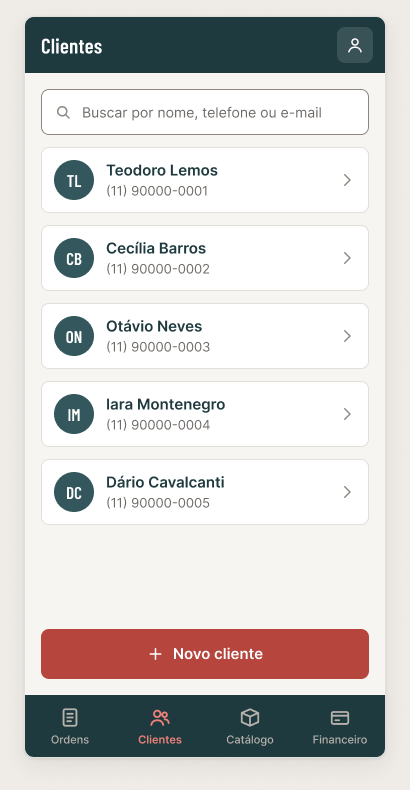 | 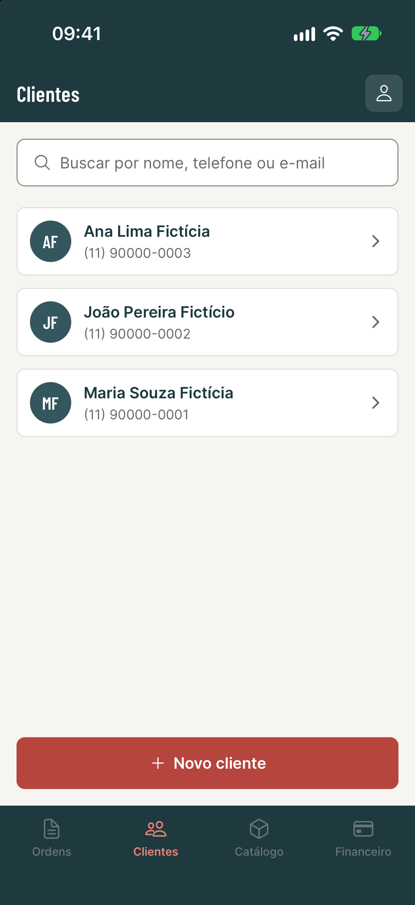 |
| L2 lista vazia | 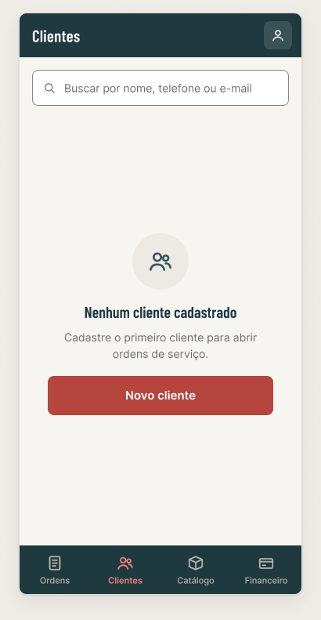 | 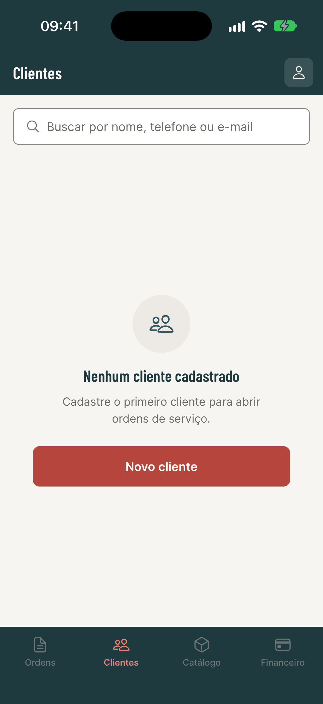 |
| D1 detalhe do cliente | 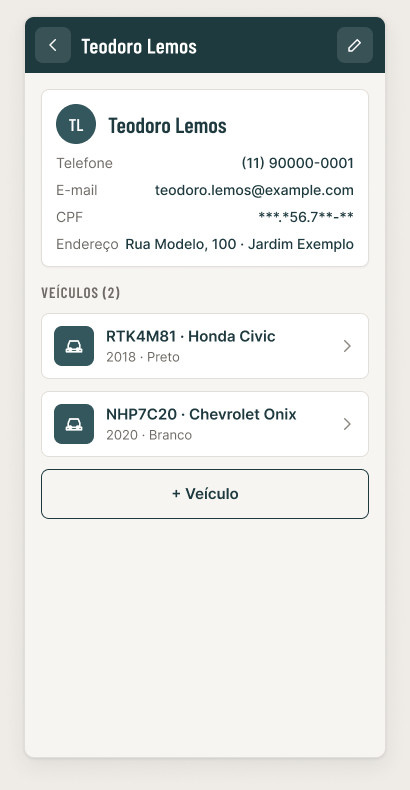 | 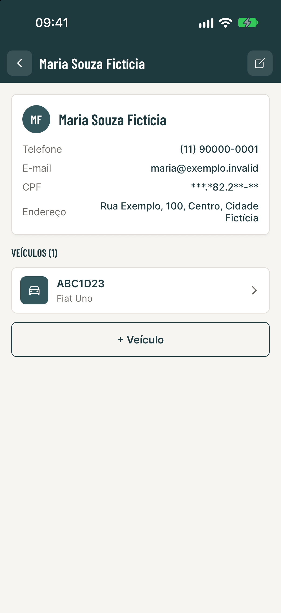 |
| V2 veículo, histórico vazio | 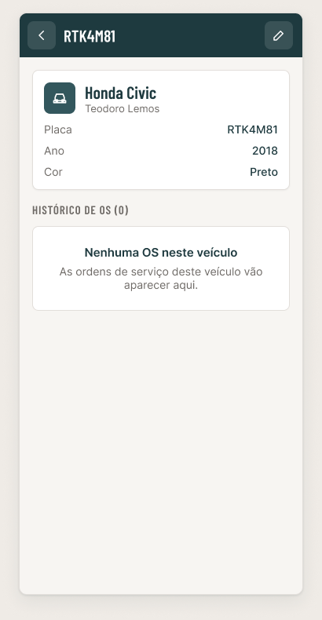 | 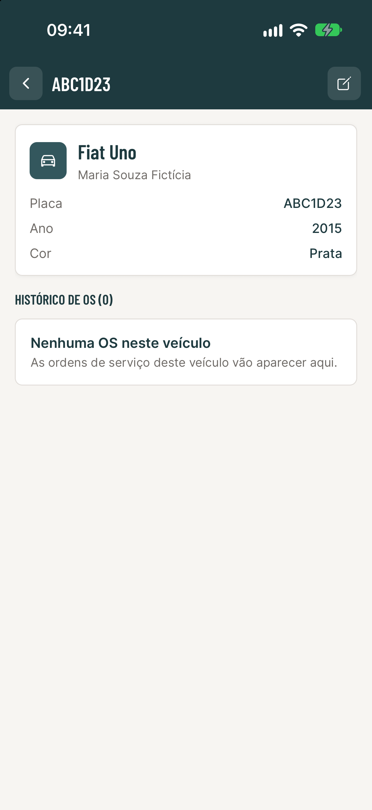 |
| C1 criar cliente | 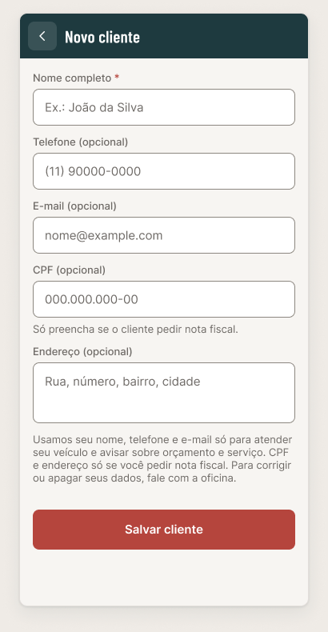 | 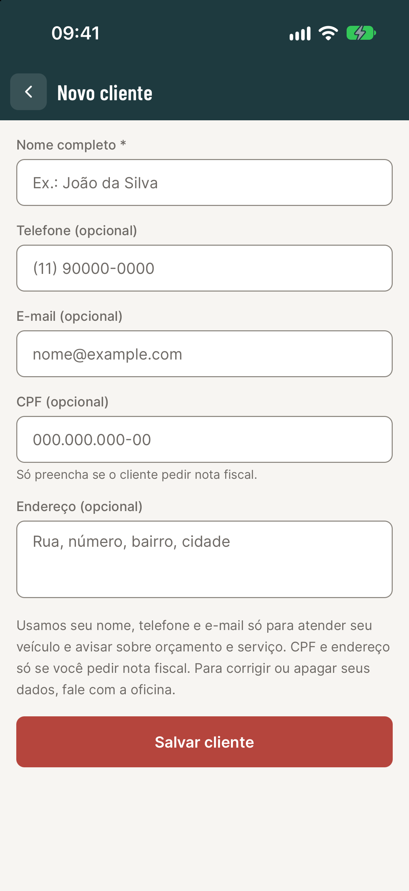 |
| E1 editar cliente | 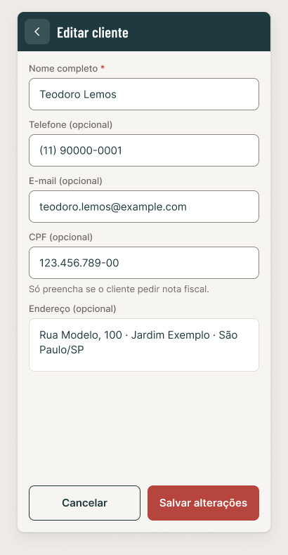 | 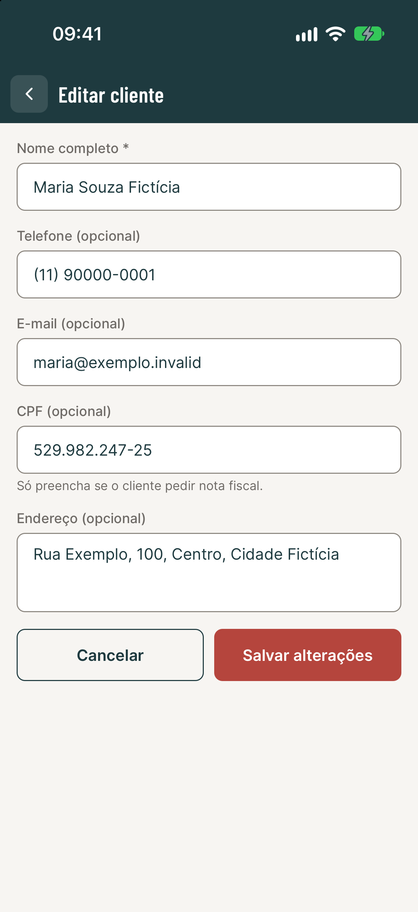 |
| N1 criar veículo | 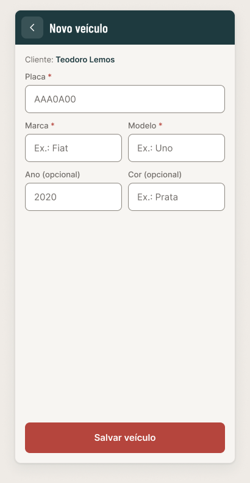 | 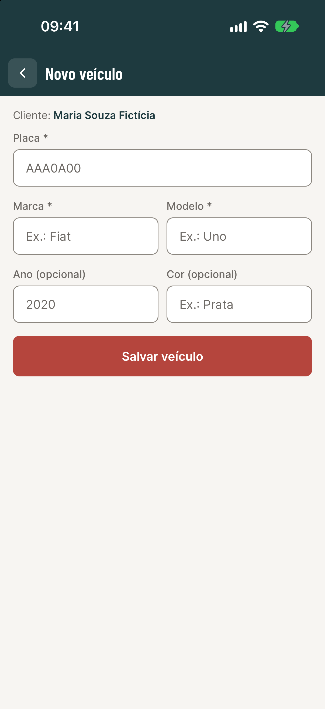 |
| M1 editar veículo | 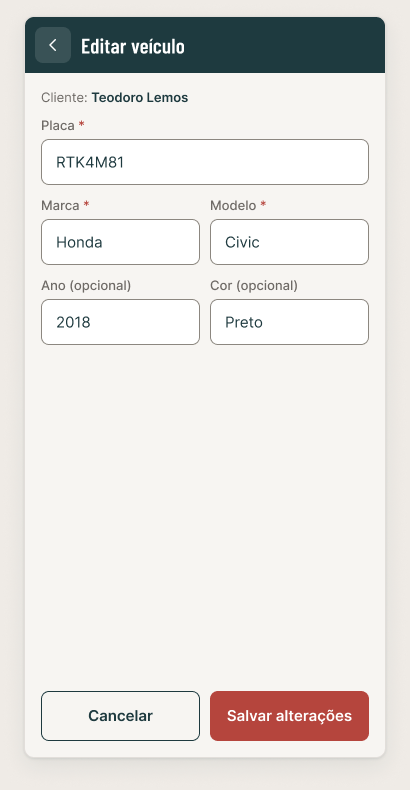 | 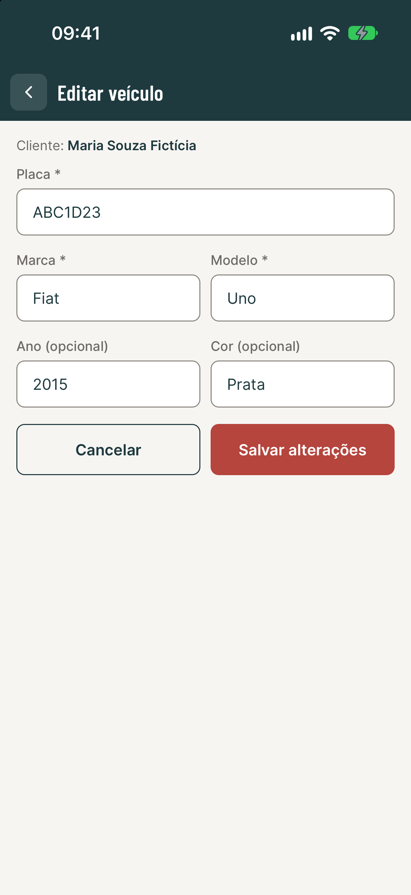 |

Extra: `f45-capturas/figma-ao-vivo-L1-com-camada-de-foco-106-2098.png` é o L1 lido ao vivo no Figma com a
camada de especificação de foco ligada (ver 7.6). Ela é do Figma, não do app.

Os textos do app nas capturas (por exemplo "Maria Souza Fictícia") diferem dos do Figma ("Teodoro Lemos")
porque os dados são semeados por mim; só a estrutura e os rótulos fixos contam.

### 7.3 Cobertura: 7 telas × estados

"App" = visto no simulador, com captura. "Frame" = existe frame na F26 e eu o li; **não** foi provocado no
app. "Sem frame" = a F26 não desenha o estado (lacuna de design).

| Tela | Preenchido | Vazio | Carregando / salvando | Erro | Sucesso |
|---|---|---|---|---|---|
| Lista de clientes | App (L1) | App (L2); busca sem resultado: frame L3 | Frame (L4) | Frame (L5) | Frame (L6) |
| Detalhe do cliente | App (D1) | Não capturado (cliente sem veículos) | Frame (D2) | Frame (D3) | Frame (D4, D5) |
| Criar cliente | **Sem frame** (criar já preenchido) | App (C1) | Frame (C2) | Frames (C3 a C7) | Sem frame próprio lido |
| Editar cliente | App (E1) | **Sem frame** (editar com campo apagado) | Frame (E2) | Frame (E3) | Sem frame próprio lido |
| Detalhe do veículo | Frame (V1); no app não há OS para listar | App (V2, histórico vazio) | Frame (V3) | Frame (V4) | Frame (V5) |
| Criar veículo | **Sem frame** (criar já preenchido) | App (N1) | Frame (N2) | Frames (N3 a N5) | Sem frame próprio lido |
| Editar veículo | App (M1) | **Sem frame** | Frame (M2) | Frame (M3) | Sem frame próprio lido |
| Descartar alterações | n/a | n/a | n/a | n/a | Frames X1 a X4, não provocados no app |

Lacunas de design (para a BUSSOLA e para mim desenhar depois da aprovação): **preenchido em criar**
(C, N), **vazio em editar** (E, M), e o que a F35 chamou de P-12 e P-13. Não desenhei nada aqui: o Figma do
briefing é só leitura para mim nesta rodada.

Critério 11 (histórico de OS vazio): coberto pela captura V2. O histórico **com** OS só fecha quando a F06
entregar OS; até lá o V1 é só frame.

### 7.4 O que bate (verificado nas capturas e no metadata)

- Textos fixos, ordem e hierarquia de L1, L2, C1, E1, N1, M1, D1 e V2 (título do cabeçalho, rótulos,
  "(opcional)", texto de apoio do CPF "Só preencha se o cliente pedir nota fiscal.").
- Cabeçalho petro `#1E3A3F` com título branco e botão de voltar de 36×36 dentro de alvo de 44×44.
- Fundo Pampas `#F7F5F2`, campos brancos com borda Stone, botão primário em Crail `#B5453D`, botão
  secundário com contorno petro.
- Campos de 46 pt de altura, 12 pt entre blocos e 16 pt de margem lateral no Figma. Na captura do app o
  ritmo parece o mesmo; não medi em pixel (ver 7.1).

### 7.5 Divergências novas, com a especificação para a ORLA

Todas viram feature de correção (limite de 5 correções pequenas esgotado).

#### PA-01 Título de seção sem a cor e sem o espaçamento do Figma (Média)

- **Onde:** D1 ("Veículos (n)"), V2 ("Histórico de OS (n)") e todo `SectionTitle`.
- **Figma** (`get_variable_defs`): Barlow Condensed SemiBold 15, caixa alta, `letter spacing/0_9`
  (0,9), cor Flint `#6E6A66`. Nó do V2: `109:3065` (328×18).
- **App** (leitura do código): `section-title.styles.ts` usa `color.text.primary` (petro) e não aplica
  `letterSpacing`; `tokens.ts:179` define `typography.sectionTitle.letterSpacing: 0.5`.
- **Especificação:**
  1. `apps/mobile/src/theme/tokens.ts:179`: `letterSpacing: 0.9` (era 0.5).
  2. `apps/mobile/src/components/ui/section-title/section-title.styles.ts`: `color: color.text.secondary`
     e `letterSpacing: typography.sectionTitle.letterSpacing`.
  3. Contraste do Flint sobre Pampas: 4,93:1 (par P02, passa AA 4,5; folga pequena, não escurecer o fundo).
  4. Antes de mexer no token, `grep -rn "SectionTitle\|sectionTitle" apps/mobile/src apps/mobile/app` e
     conferir as telas de fora das 7 (Início, Perfil), que eu **não** comparei com o Figma. Se o desenho
     delas usar outra cor, criar variante em vez de mudar o padrão.
  5. Teste de regressão: o estilo do título tem cor `color.text.secondary` e `letterSpacing` 0,9
     (deve falhar antes e passar depois).

#### PA-02 Ícone de editar do cabeçalho do detalhe do veículo (Baixa)

- **Figma:** instância `109:3037` (18×18, dentro do alvo 36×36 em x 312) com lápis simples.
- **App:** `create-outline` (lápis com contorno e sublinhado, Ionicons).
- **Especificação:** trocar por `pencil` (Ionicons), tamanho 18, cor do texto do cabeçalho (branco; par C13,
  12,12:1). **Não confirmei** o glifo exato do Figma (o metadata só dá o nome "Component 1"); a ORLA
  compara com a captura V2 e, se o glifo for outro, a decisão volta para mim. Alvo de toque continua 44×44
  (`112:2739`). Mantém o `accessibilityLabel` por `t(...)`; não muda texto nem chave.

#### PA-03 Cartão "Nenhuma OS neste veículo" alinhado à esquerda (Baixa)

- **Figma:** cartão `109:3100` (328×108, x 16, y 215). Título `109:3101` (x 21, y 25, 286×18) e apoio
  `109:3102` (x 21, y 49, 286×34). Na captura, os dois textos aparecem centralizados.
- **App:** textos alinhados à esquerda (captura V2).
- **Especificação:** `textAlign: 'center'` nos dois textos. Medidas do Figma: 25 acima e abaixo, 6 entre
  título e apoio, 21 nas laterais (borda de 1 incluída). Chaves i18n existentes; não criar chave nova.
  Só estilo, sem mudança de comportamento.

#### PA-04 Botões de ação ancorados no rodapé no Figma, em fluxo no app (Média, decisão)

- **Figma E1** (`get_metadata`): corpo 360×684. Entre o Endereço (termina em y 456) e os botões existe o
  nó `106:2329` (328×138, sem texto, y 468), que empurra o grupo `106:2330` (328×50, y 618) para o fim do
  corpo: 16 pt de margem inferior (618 + 50 = 668 de 684). Dois botões de 159×50 com 10 de intervalo
  (`Cancelar` e `Botão / Salvar alterações` `106:2333`). M1 e N1 seguem o mesmo padrão (lidos na rodada
  anterior, não reabertos agora). C1 **não**: está em fluxo.
- **App** (captura E1): os botões vêm logo depois do Endereço e sobra espaço em branco embaixo. N1 e M1
  idem.
- **Opção A: ancorar (seguir o Figma).** `ScrollView` com `contentContainerStyle={{ flexGrow: 1 }}`, grupo de
  botões com `marginTop: 'auto'`, `paddingBottom: 16` mais o inset inferior da área segura,
  `KeyboardAvoidingView` (`behavior: 'padding'` no iOS) e `keyboardShouldPersistTaps="handled"`. Critério:
  com o teclado aberto, o campo em foco e os botões não podem ficar cobertos (WCAG 2.4.11). Testar com
  fonte do sistema a 200%.
- **Opção B: manter em fluxo e eu ajusto o Figma** (E1, M1, N1) depois de aprovada a F26.
- **Recomendação (não verificada em aparelho):** B. Botão ancorado com teclado aberto e fonte grande é o
  caso em que rodapé fixo cobre campo, e o C1 do Figma já está em fluxo, então B alinha as quatro telas de
  formulário. Quem decide é o PO/comandante.

#### Confirmações, agora com captura (sem especificação nova)

| ID | Tela | O que a captura mostra | Onde está a especificação |
|---|---|---|---|
| N-04 | E1, C1, N1, M1 | Asterisco de "Nome completo *" cinza no app; vermelho `#B5453D` no Figma (E1 `106:2309`) | `F45-conferencia-paridade-wcag-sprint-02.md`, N-04 (junto com N-03) |
| P-03 | D1 | Cartão de veículo sem ano e cor, porque `VeiculoResumo` só traz `id, placa, marca, modelo` | `F35-paridade-figma-app.md`, P-03 (depende da API) |
| P-08 | L1 | Ícone "+" presente no botão "Novo cliente" da lista preenchida (corrigido) | `F35-paridade-figma-app.md`, P-08 |
| P-14 | E1 | Borda do Endereço em Stone, intencional (3,56:1; o Figma usa Westar, 1,34:1) | `F35-paridade-figma-app.md`, P-14 |
| LG-07 | C1, E1 | Rótulos "Telefone (opcional)" e "CPF (opcional)", mas a API ainda devolve 400 "cpf e obrigatorio" para corpo sem CPF | `docs/product/F45-evidencia-api-espresso.md`, LG-07 e F-API-4 |

### 7.6 Foco e ordem de foco: o que o Figma especifica (leitura; não testado no app)

O Figma tem uma camada "Foco por controle (sobreposição de especificação; ocultar para paridade)" em cada
frame. No V2 (`120:1449`): 1 Voltar, 2 Editar, anel branco de 2 pt nos botões do cabeçalho (alvo 44×44). No E1
(`120:1706`): 1 Voltar, 2 Nome, 3 Telefone, 4 E-mail, 5 CPF, 6 Endereço, 7 Cancelar, 8 Salvar alterações;
campo com borda Crail de 2 pt (token `color.border.focusField`); botões com respiro branco de 2 pt e anel
petro de 2 pt por fora (anel de 163×54 sobre botão de 159×50). Isso coincide com os tokens
`color.border.focusField` e `focus.ring` (`tokens.ts:90,105`) e com os pares C03, C11 e C13 da seção 4.
**Falta** (critério 7): rodar o anel de foco no app com teclado externo e confirmar a ordem acima com
VoiceOver e TalkBack.

### 7.7 Pedido de decisão ao PO

1. **N-02: posição da faixa de erro do formulário.** O Figma (`106:2435`, y 540) a põe acima do botão
   Salvar; o app a põe no topo do formulário (`client-form-fields.tsx:115`, `vehicle-form-fields.tsx:111`).
   Opção 1: mover para acima do Salvar (quem tocou Salvar vê o aviso junto do botão). Opção 2: manter no
   topo e eu ajusto o Figma (é o primeiro item lido por quem navega por gestos). Falta conferir em aparelho
   se, com o teclado aberto, o topo sai da tela; sem isso não recomendo uma das duas.
2. **N-07: rastreabilidade do Figma.** Cinco frames (D6 `135:937`, D7 `135:1022`, D8 `135:1107`, V6 `135:1144`,
   L8 `135:1182`) e as anotações `136:888` a `136:897` estão na página `20:2131` ("01 — Wireframes", y 8900),
   mas a F35 diz que estão na seção F26 `106:2097`. Os cinco frames e as anotações foram criados pela
   ESQUADRO na F35 (`docs/design/figma.md`). Opção A: mover para a seção F26 (exige escrita no Figma, que esta
   rodada não fez). Opção B: manter onde estão e deixar só a correção de registro que já está em
   `docs/design/figma.md` (N-07). Recomendo B até a F26 ser aprovada; mover antes da aprovação mexe em
   frames que ainda podem mudar.
3. **PA-04** (rodapé ancorado ou em fluxo), seção 7.5.
4. **F26 aguardando aprovação:** o desenho segue sem aprovação registrada do PO. P-02, P-06 e P-07 da F35
   continuam abertos por isso. Nenhuma divergência acima é bug até a aprovação.
- A maioria dos `*.styles.ts` das telas e de `ui` não foi lida linha a linha. Os pares de contraste vêm dos
  tokens usados (conferidos por busca de `color` nos `*.styles.ts` de `ui`), não de cada folha de estilo.
- Telas fora das 7 (Login, Perfil, Início, tab bar) não foram auditadas aqui.
